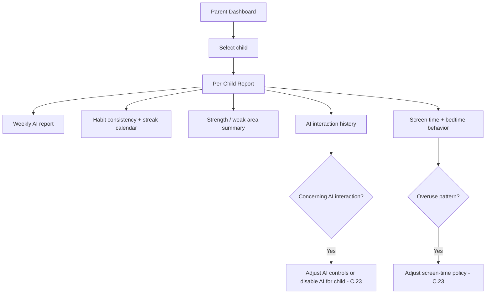
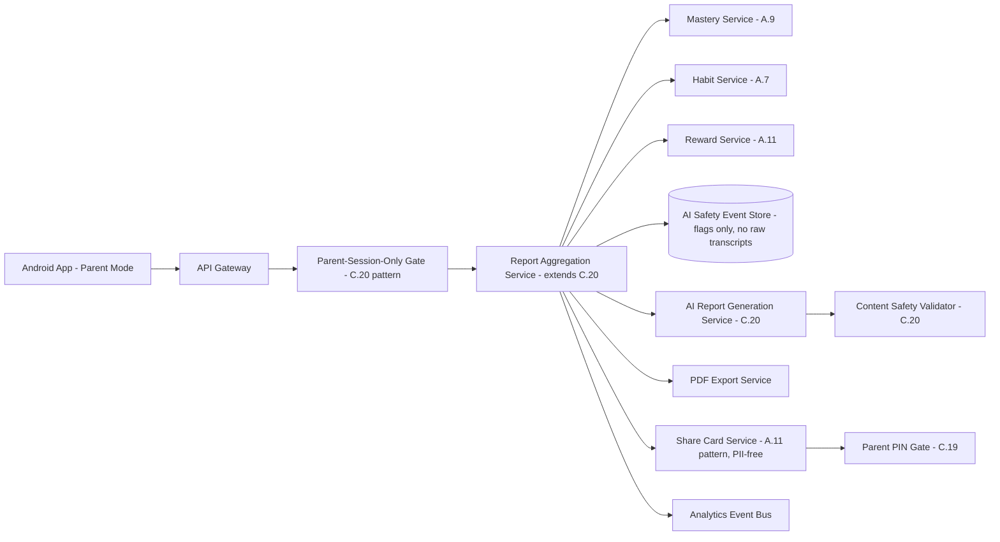
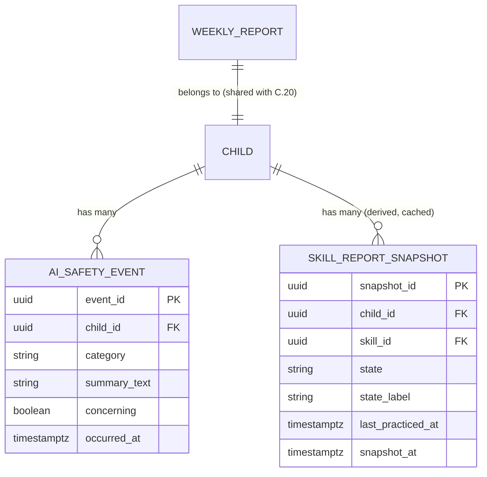

# Feature C.22 — Per-Child Reports

**App:** NoorHeroes — Islamic Learning App for Children
**Feature Owner:** Product / Parent Trust / Data & AI
**Status:** Implementation-ready
**Version:** 1.0
**Depends on:** C.19 (Parent PIN/Biometric Gate — entry + share-action gating), C.20 (Parent Dashboard — entry point, weekly report preview, shared content-safety validator), A.7/A.9/A.11 (habit/mastery/reward data sources), A.5 §1.7 FR-10 (zero-retention recitation pipeline — AI interaction history must never expose raw voice data)
**Feeds into:** C.23 Parental Controls (AI Controls exit point from a concerning AI interaction), C.24 Subscription & Billing (AI Insight Report premium gating)

> **Scope note:** C.20 specified the Parent Dashboard's **preview** of the weekly report. This document specifies the **full, deep Per-Child Report** — the dedicated screen reached by drilling into that preview: the weekly trend chart, habit calendar, skill mastery grid, AI Interaction History (redacted, never raw transcripts), the four report types and their generation/delivery contract (Weekly, Monthly Family, AI Insight, Safety), PDF export, parent-gated WhatsApp sharing, and the explicit delayed-analytics/no-activity states. This is the canonical specification for everything "report" on the platform; C.20 only previews it, and C.23's AI Controls is the action destination when this report surfaces a concerning AI interaction.

---

## Table of Contents

1. [Product Requirements](#1-product-requirements)
2. [UX/UI Requirements](#2-uxui-requirements)
3. [Backend Requirements](#3-backend-requirements)
4. [Database Design](#4-database-design)
5. [Backend AI Code-Generation Prompt](#5-backend-ai-code-generation-prompt)
6. [Android Requirements](#6-android-requirements)
7. [Android AI Code-Generation Prompt](#7-android-ai-code-generation-prompt)
8. [Admin Requirements](#8-admin-requirements)
9. [Admin AI Code-Generation Prompt](#9-admin-ai-code-generation-prompt)
10. [DevOps Requirements](#10-devops-requirements)
11. [Analytics Requirements](#11-analytics-requirements)
12. [Security Requirements](#12-security-requirements)
13. [QA Requirements](#13-qa-requirements)
14. [Marketing Requirements](#14-marketing-requirements)
15. [Release & Rollback Plan](#15-release--rollback-plan)

---

## 1. Product Requirements

### 1.1 Problem Statement

Parents need a deep, trustworthy progress view for each child — learning, habits, stories, Quran, strengths/weak areas, and a redacted AI interaction history — that always labels data freshness explicitly, never shows raw AI chat transcripts, never reduces a child's identity to anything beyond a nickname/initial when shared, and that turns a concerning AI interaction directly into an actionable control adjustment rather than just an alarming, unresolvable observation (source: NoorHeroes Blueprint screen catalog "Per-Child Reports — Purpose: Deep progress view for one child: learning, habits, stories, Quran, strengths/weak areas, AI history"; Parent Area screen table: "Reports... never include raw AI chat transcripts, only flags"; "Parent Monitoring Flow" diagram: "Concerning AI interaction? → Yes → Adjust AI controls or disable AI for child").

### 1.2 Business Goals

- Deliver the platform's highest-conversion trust module — the AI Weekly Report — as a genuinely useful, calm, jargon-free product parents pay for.
- Give parents a closed loop from observation (a report) to action (adjusting AI/screen-time controls), reinforcing the platform's "Trust-Led Monetization" strategy.
- Maintain absolute discipline around AI interaction history: redacted by design, never raw transcripts, supporting parent oversight without ever becoming a backdoor surveillance/chat-log feature.
- Support organic, zero-CAC growth via parent-gated WhatsApp achievement/progress sharing (a P0 growth channel) without ever leaking PII.

### 1.3 User Goals

- **Parent:** See exactly how my child is doing — what they've learned, their habit consistency, their strengths and weak areas, and what AI interactions occurred — drill into specifics, export or share a report, and know immediately what to do if something concerns me.

### 1.4 Success Metrics

| Metric | Target |
|---|---|
| Per-Child Report full-view rate (from Dashboard preview) | ≥ 45% |
| AI Interaction History review rate (among parents with AI enabled for a child) | ≥ 20% monthly |
| PDF export usage rate | ≥ 10% |
| WhatsApp share usage rate (organic growth signal) | ≥ 8% |
| Concerning-AI-interaction → control-adjustment conversion rate | ≥ 50% |
| Delayed-analytics/no-activity correct-state-shown rate | 100% (never a blank/broken chart) |
| Crash-free Report sessions | ≥ 99.6% |

### 1.5 Stakeholders

Product Manager, Parent Trust/UX Lead, Data & AI Lead (report generation, AI safety redaction), Backend Architect, Android Architect, Legal/Compliance (AI interaction retention/redaction rules), Data Analyst, Security Engineer, QA Lead, Customer Support Lead, feature owners of C.20 (shared Content Safety Validator), C.23 (AI Controls action destination), C.24 (AI Insight Report premium gating).

### 1.6 User Stories

1. As a parent, I want a deep progress view for one child covering learning, habits, stories, Quran, and strengths/weak areas.
2. As a parent, I want to see a weekly trend chart and a habit consistency calendar.
3. As a parent, I want to see which skills my child has mastered and which need work, and drill into any one of them.
4. As a parent, I want to review my child's AI interaction history — what they asked, what was blocked, without seeing raw chat transcripts that feel like surveillance.
5. As a parent, when I see a concerning AI interaction, I want a direct path to adjust AI controls or disable AI for that child.
6. As a parent, I want to filter this report by date range, export it as a PDF, or share an achievement via WhatsApp without exposing my child's identity.
7. As a parent, when analytics are delayed or my child has no activity yet, I want to be told that clearly, not shown a broken-looking empty chart.
8. As a parent, I want my Safety Report on demand — AI usage history, blocked requests, content flags, and profile-setting changes — for full transparency.

### 1.7 Functional Requirements

**FR-1** Per-Child Report components: weekly trend chart, habit calendar, skill mastery grid, AI interaction log link, share-report button (source: screen catalog "Components").
**FR-2** Per-Child Report actions: filter by date range, drill into a skill, export PDF, share via WhatsApp (parent-gated) (source: screen catalog "Actions").
**FR-3** Entry points: Parent Dashboard, Child Management; exit points: AI Interaction History, Screen Time & Bedtime Settings (source: screen catalog "Entry/Exit Points").
**FR-4** **Delayed-analytics and no-activity states are shown explicitly rather than as an empty chart** (source: screen catalog "Navigation Rules").
**FR-5** **Reports never include raw AI chat transcripts, only flags** (source: Parent Area screen table — a hard, zero-exception rule governing the AI Interaction History and Safety Report specifically).
**FR-6** Four report types and their cadence (canonical, source §6.7 "Detailed Workflow"): **Weekly child report** (stories completed, Quran progress, duas learned, habit streaks, quiz scores, recommended next step) — weekly; **Monthly family report** (cross-child progress summary, family streaks, content favorites, learning consistency) — monthly; **AI insight report** (strengths, weak areas, suggested next stories/duas/Quran practice, healthy-usage notes) — premium, weekly; **Safety report** (AI usage history, blocked requests, content flags, profile-setting changes) — on demand.
**FR-7** **Dashboard/report content always labels data freshness; uses trend language and recommendations, never judgmental grades** (source §6.7 Validation Rules — restated here as this screen's own content-tone contract, shared with C.20).
**FR-8** **AI-generated parent insights must never diagnose developmental, behavioral, or religious conditions; must never compare siblings; must never present uncertain conclusions as settled facts** (source §6.7 Business Rules — enforced via the same Content Safety Validator write-time gate established in C.20 §3/§5, reused here, not reimplemented).
**FR-9** Parent Monitoring Flow (canonical, source "Parent Monitoring Flow" diagram): Parent Dashboard → Select child → Per-Child Report → parent sees: Weekly AI report, Habit consistency + streak calendar, Strength/weak-area summary, AI interaction history, Screen time + bedtime behavior → if a concerning AI interaction is found, parent adjusts AI controls or disables AI for that child (routes to C.23); if an overuse pattern is found, parent adjusts the screen-time policy (routes to C.23).
**FR-10** **Achievement sharing is parent-gated and PII-free**: the share flow generates a card showing nickname/initial, badge, and no PII — generated only after Parent PIN verification (source: "Reward/Achievement Flow" diagram, cross-ref A.11 FR-12 — restated and applied here as the canonical share-card contract for any report-originated sharing, not just badge-specific sharing).
**FR-11** **Export PDF** produces a parent-facing document containing the same content-governed (no raw transcript, no diagnosis, no sibling comparison) report data as the in-app view — the PDF is not a separate, less-governed data export path.
**FR-12** **Skill mastery grid drill-down** routes into the underlying skill's detail (consistent with A.9's shared Mastery Engine's skill-state model — Locked/Ready/Learning/Practicing/Mastered/Needs Refresh — presented here in parent-friendly, non-raw-score language, consistent with A.9 FR-3's no-raw-score child-facing rule extended here as a parent-facing-but-still-non-raw-score convention, since A.9's broader "no confusing raw model score" principle applies to parent reports too per FR-7's "never judgmental grades" framing).
**FR-13** AI Interaction History entries are derived exclusively from **safety-event and flag records**, never from raw prompt/response logs — this is an architectural data-sourcing constraint, not merely a display-layer redaction (consistent with A.5's zero-retention principle extended here to the broader AI-interaction-logging surface: if the raw data was never retained in re-displayable form in the first place, FR-5's "never raw transcripts" rule is enforced structurally, not just by a UI choice not to render a field that does exist).
**FR-14** Date-range filtering applies consistently across every component on the screen (trend chart, habit calendar, skill grid, AI interaction log) — a single date-range control governs the whole report view, not per-component independent filters.

### 1.8 Non-Functional Requirements

- **Content Safety:** The same mandatory write-time Content Safety Validator gate established in C.20 governs every report type generated here — no parallel, less-governed generation path.
- **Data Sourcing Integrity:** AI Interaction History's underlying data store must structurally never contain raw, re-displayable prompt/response transcripts — enforced at the data-architecture level (FR-13), not the display layer.
- **Performance:** Report load (cached) p95 < 700ms; PDF export generation p95 < 3s.
- **Tone:** Calm, trend-oriented, never judgmental — consistent with C.20's established content-governance standard.

### 1.9 Acceptance Criteria

- Given a parent opens the full Per-Child Report, when it renders, then it shows the weekly trend chart, habit calendar, skill mastery grid, AI interaction log link, and share-report button for the selected child.
- Given a parent filters by a specific date range, when applied, then every component on the screen reflects that same range consistently.
- Given a parent drills into a specific skill, when the detail opens, then it shows parent-friendly state language (e.g., "Practicing," "Mastered") rather than a raw numeric mastery score.
- Given a parent opens the AI Interaction History, when reviewed, then it shows only flags/safety-event summaries — never a raw chat transcript of what the child typed or what the AI responded.
- Given a parent finds a concerning AI interaction, when they act on it, then they are routed directly to AI Controls (C.23) with a clear path to adjust or disable AI for that specific child.
- Given a parent exports a report as PDF or shares via WhatsApp, when the action completes, then the content is identical in governance (no raw transcripts, no diagnosis, no sibling comparison, no PII beyond nickname/initial for shares) to the in-app view.
- Given report generation is delayed or a child has zero activity in the selected range, when the report renders, then it shows the explicit delayed/no-activity state, never a blank or broken chart.

### 1.10 Edge Cases

1. A parent selects a date range that spans a period before the child's account even existed → the report correctly shows "no activity" only for the portion of the range after account creation, never an error for the impossible pre-existence portion, and clearly communicates the child's actual account-start boundary if relevant to the parent's understanding.
2. A parent shares an achievement via WhatsApp, but the underlying badge is later revoked due to a data-quality correction (cross-ref A.11 Edge Case 3's "badges are sticky once earned" rule) → the already-shared card remains valid/unaffected (it was generated and sent at a point in time, a static artifact, not a live-updating reference); future report views simply reflect current state without retroactively invalidating a prior share.
3. A parent requests a Safety Report "on demand" for a child with zero blocked requests or content flags ever recorded → the report generates successfully showing a clean/reassuring "no safety events recorded" state, never an error or an empty-looking broken section.
4. AI Insight Report access is requested for a child whose family's premium entitlement expires mid-generation (a race between the async report job and a billing-state change) → the report generation job re-checks entitlement at completion time, not just at request time, and the delivered report respects the entitlement state actually in effect when it's served to the parent.
5. A parent drills into a skill mastery grid item for a skill belonging to a domain the child hasn't engaged with at all yet → shows a clear "not started" state for that skill rather than an empty/confusing detail view, consistent with A.9's `Locked`/`Ready` state language.
6. Two co-guardians view the same child's report on different devices simultaneously and one exports a PDF while the other adjusts the date filter → these are independent, read-mostly view actions with no shared-state conflict requiring coordination (distinct from C.21's mutating-action concurrency concerns).
7. A parent's PDF export or WhatsApp share is requested for a report that itself failed content-safety validation (the underlying weekly/AI-insight report row has `content_safety_passed = false`) → the export/share action operates only against the last *passing* report, exactly mirroring C.20's read-API fallback behavior, never exporting/sharing content that was never eligible to be shown in-app in the first place.
8. A child's AI permission is disabled by the parent partway through a reporting period → the AI Interaction History for that period correctly shows activity only up to the point AI was disabled, with no further entries after that point, and the report doesn't imply ongoing AI activity that didn't actually occur.
9. A parent requests an export/share action while offline → blocked with a clear "needs internet" message, since both actions require a fresh, server-validated report payload, never operating on a potentially-stale local cache for an action with external-sharing consequences.

### 1.11 Error Handling

| Scenario | System Behavior |
|---|---|
| Report generation delayed | Last successfully generated report shown with explicit "as of" framing (consistent with C.20's established pattern) |
| Zero activity in the selected range/report type | Explicit "no activity yet" / "no safety events recorded" state, never a blank/broken chart |
| AI Insight Report entitlement lapses mid-generation | Delivered report respects entitlement state at serve time, not request time (Edge Case 4) |
| Export/share requested against a content-safety-failed report | Operates against the last passing report instead, mirroring C.20's fallback |
| Export/share requested offline | Blocked with a clear "needs internet" message |

### 1.12 Empty States
- Zero activity in the selected date range → "Once [Child] starts learning, you'll see their progress here" framing, consistent with the platform's general empty-state philosophy.
- Zero AI interactions/safety events ever → a clean, reassuring "no safety events recorded" state, not an alarming or confusing absence.

### 1.13 Loading States
- Per-Child Report: skeleton shimmer per component, independently resolving (consistent with C.20's per-component independence pattern).
- PDF export: a clear "Generating your report..." progress indicator given the few-second generation time.

### 1.14 Offline States
- The in-app report view renders from cache when offline (read-only, consistent with C.20); export/share actions are blocked offline per Edge Case 9.

### 1.15 Permission States
- No new runtime permissions; WhatsApp sharing uses the standard OS share sheet, which itself may surface its own permission/app-selection UI outside this app's control.

### 1.16 User Flow (Narrative)

Parent drills into a child from the NoorHeroes Dashboard's weekly report preview or via Child Management → full Per-Child Report opens with the weekly trend chart, habit calendar, skill mastery grid, AI interaction log link, and share button → parent filters by date range, which updates every component consistently → parent drills into a specific skill or opens the AI Interaction History → if a concerning AI interaction is found, parent taps through to AI Controls (C.23) to adjust or disable AI for that child → parent may export the report as PDF or share an achievement via WhatsApp, both passing through governance/gating as needed.

### 1.17 Detailed Flow Diagram (Mermaid)

**Parent Monitoring Flow (canonical, source diagram):**



### 1.18 Screen Inventory (Complete — Zero Missing)

| # | Screen | Type | Entry Points | Exit Points |
|---|---|---|---|---|
| 1 | Per-Child Report (full view) | Primary | Parent Dashboard, Child Management | AI Interaction History, Screen Time & Bedtime Settings (C.23), Skill Detail |
| 2 | Date Range Filter (component) | Component | Per-Child Report | Filtered report view |
| 3 | Weekly Trend Chart | Component | Per-Child Report | N/A (display) |
| 4 | Habit Calendar | Component | Per-Child Report | Habit detail (cross-ref A.7) |
| 5 | Skill Mastery Grid | Component | Per-Child Report | Skill Detail Drill-down |
| 6 | Skill Detail Drill-down | Screen | Skill Mastery Grid | Back to Per-Child Report |
| 7 | AI Interaction Log Link (component) | Component | Per-Child Report | AI Interaction History |
| 8 | AI Interaction History (full screen) | Screen | Per-Child Report "AI interaction log" link | Concerning-interaction → AI Controls (C.23) |
| 9 | AI Controls Action Prompt (component, within AI Interaction History) | Component | A flagged/concerning entry | AI Controls (C.23) |
| 10 | Safety Report (on-demand, full screen) | Screen | Per-Child Report / Parent Dashboard | Back to Per-Child Report |
| 11 | Monthly Family Report (cross-child, aggregate-only) | Screen | Parent Dashboard / Per-Child Report cross-link | Back |
| 12 | AI Insight Report (premium) | Screen | Per-Child Report | Locked/Upsell state if non-premium (C.24) |
| 13 | Share Report — Parent Gate | Modal | "Share via WhatsApp" action | OS Share Sheet (success) / cancel |
| 14 | Achievement Share Card Preview (PII-free) | Screen | Parent Gate success | OS Share Sheet |
| 15 | PDF Export — Generating State | Screen variant | "Export PDF" action | PDF ready (OS share/save sheet) |
| 16 | Delayed-Analytics State (component variant) | Component variant | Report generation delayed | N/A |
| 17 | No-Activity Empty State (component variant) | Component variant | Zero activity in range | N/A |
| 18 | Clean/No-Safety-Events State (Safety Report variant) | Screen variant | Safety Report, zero events | N/A |
| 19 | Offline Export/Share Blocked State | Screen variant | Export/Share attempted offline | N/A |

### 1.19 Events (Complete Analytics Event List)

`per_child_report_viewed`, `report_date_range_filtered`, `skill_mastery_grid_viewed`, `skill_detail_drilldown_viewed`, `ai_interaction_history_viewed`, `ai_interaction_concerning_flag_acted_on`, `safety_report_requested`, `monthly_family_report_viewed`, `ai_insight_report_viewed`, `ai_insight_locked_state_shown`, `report_pdf_export_initiated`, `report_pdf_export_completed`, `report_share_gate_opened`, `report_share_completed`, `report_delayed_state_shown`, `report_no_activity_state_shown`, `report_export_share_blocked_offline`.

---

## 2. UX/UI Requirements

> Global Design System tokens defined in **Feature A.1 §2.1**; Parent-Mode formal visual register and calm trend-oriented visual language established in **Feature C.20 §2.1**; PII-free achievement-card pattern established in **Feature A.11 §2.1/§3.4**.

### 2.1 Report-Specific Design System Extensions

- **Skill Mastery Grid Visual Language:** Reuses A.9's six-state visual tokens (Locked/Ready/Learning/Practicing/Mastered/Needs Refresh), recontextualized for a parent audience — same color/iconography system as the child-facing Skill Tree (A.5) for consistency, but labeled with brief parent-oriented descriptions rather than child-facing micro-copy.
- **AI Interaction History Visual Language:** A calm, list-based log of flag/event summaries (e.g., "Topic redirected to approved content," "Topic blocked: [category]") — never styled to resemble a chat-transcript UI, deliberately avoiding any visual implication that raw conversational content exists to scroll through.
- **Habit Calendar:** A simple month-grid calendar with day-cells colored by check-in status, consistent with the platform's general non-alarming, non-shaming visual treatment of habit data established in A.7.

### 2.2 Screen-Level Design Requirements (Key Screens)

#### Screen: Per-Child Report (Full View)

- **Purpose:** A comprehensive, calm, trustworthy deep-dive into one child's learning and safety picture.
- **Components:** Date-range filter control (top), Weekly Trend Chart, Habit Calendar, Skill Mastery Grid, AI Interaction Log entry card, Export PDF and Share buttons.
- **States:** Default, Loading (per-component skeleton), Delayed-analytics (per affected component), No-activity (per affected component), Offline (cached, export/share disabled).
- **Accessibility:** Charts have text-equivalent summaries; skill grid items individually labeled with their parent-friendly state.
- **Responsive Rules:** Single-column stacked on mobile; tablet may show Trend Chart + Habit Calendar side-by-side, Skill Grid below.

#### Screen: AI Interaction History

- **Purpose:** Transparent, non-surveillance-feeling oversight of AI interactions.
- **Components:** Chronological list of flag/event entries (date, category, brief description, resolution status), a clear "Adjust AI Controls" action for any concerning entry.
- **States:** Default, Empty ("No AI interactions recorded" — a neutral, not alarming, framing if AI is disabled or genuinely unused), Loading.
- **Accessibility:** Each entry's category/description fully screen-reader-readable.

### 2.3 Tab Structure

Per-Child Report is reached from the Parent Dashboard or Child Management, not a standalone tab.

| Click Target | Destination | API Called | Analytics Event | Permission Check | Error Handling |
|---|---|---|---|---|---|
| Dashboard weekly-report-card / Child Management report link | Per-Child Report | `GET /v1/parent/reports/{child_id}` | `per_child_report_viewed` | Family-ownership + parent-session-only gate (C.20 pattern) | Cached/delayed fallback |
| Date range filter | Filtered report view | `GET /v1/parent/reports/{child_id}?from=&to=` | `report_date_range_filtered` | Same as above | Same as above |
| Skill Mastery Grid item | Skill Detail | `GET /v1/parent/reports/{child_id}/skills/{skill_id}` | `skill_detail_drilldown_viewed` | Same as above | "Not started" state if applicable |
| AI Interaction Log link | AI Interaction History | `GET /v1/parent/reports/{child_id}/ai-history` | `ai_interaction_history_viewed` | Same as above | Empty/clean state |
| Concerning flag "Adjust AI Controls" | AI Controls (C.23) | N/A (navigation) | `ai_interaction_concerning_flag_acted_on` | Standard C.23 checks | Standard C.23 handling |
| Export PDF | PDF Generating → Share/Save sheet | `POST /v1/parent/reports/{child_id}/export` | `report_pdf_export_completed` | Online required | Offline-blocked message |
| Share via WhatsApp | Parent Gate → Card Preview → OS Share Sheet | `POST /v1/parent/reports/{child_id}/share-card` | `report_share_completed` | Parent PIN/biometric (C.19) | Offline-blocked message |

### 2.4 Wireframe Description (Composite)

A single, vertically-scrolling, card-based deep-dive screen, visually and structurally consistent with C.20's Dashboard pattern but denser/more detailed, reflecting its role as the "drill in further" destination rather than the at-a-glance landing surface.

### 2.5 Screen Image Generation Prompts

**Screen: Per-Child Report**
- *Prompt 1 (English):* "Mobile app per-child deep progress report screen UI mockup for a family learning app, formal parent-mode visual register. Warm off-white background. Top shows a date-range filter pill control. Below, a card with a calm line-trend graph labeled 'This Month'. Below that, a small calendar-grid card showing habit check-in dots across a month. Below that, a card labeled 'Skill Progress' showing a grid of small rounded skill tiles each with a subtle progress-ring icon and a short label like 'Practicing' or 'Mastered'. Below that, a card labeled 'AI Activity' with a small shield icon and a short reassuring summary line. At the bottom, two buttons: 'Export PDF' and 'Share'. Clean, trustworthy, calm aesthetic, soft shadows, rounded corners, warm teal and gold accents used sparingly, no realistic human faces."
- *Prompt 2 (Arabic RTL):* "نفس شاشة تقرير التقدم العميق للطفل لتطبيق تعليم عائلي، بطابع بصري رسمي لوضع الوالدين، بتخطيط من اليمين إلى اليسار بالكامل. خلفية بيج فاتح دافئ. يعرض الأعلى عنصر تحكم بشكل رقاقة لتصفية نطاق التاريخ. أسفل ذلك بطاقة برسم بياني خطي هادئ بعنوان 'هذا الشهر'. أسفل ذلك بطاقة صغيرة بشبكة تقويم تعرض نقاط تسجيل العادات عبر الشهر. أسفل ذلك بطاقة بعنوان 'تقدم المهارات' تعرض شبكة من بلاطات مهارات صغيرة مستديرة، كل منها بأيقونة حلقة تقدم خفيفة وتسمية قصيرة مثل 'قيد التدريب' أو 'مكتسبة'. أسفل ذلك بطاقة بعنوان 'نشاط الذكاء الاصطناعي' مع أيقونة درع صغيرة وسطر ملخص قصير ومطمئن. في الأسفل زرّان: 'تصدير PDF' و'مشاركة'. طابع نظيف وموثوق وهادئ، ظلال خفيفة، زوايا دائرية، لمسات فيروزية وذهبية دافئة مستخدمة بقلة، بدون وجوه بشرية واقعية."

**Screen: AI Interaction History**
- *Prompt 1 (English):* "Mobile app AI interaction history screen UI mockup, calm and transparent, deliberately NOT styled like a chat app. Warm off-white background. A vertical list of rounded card rows, each showing a small shield or checkmark icon, a date, a short category label like 'Topic redirected' or 'Question approved', and a brief one-line description -- no chat bubbles, no back-and-forth conversational styling anywhere. One row has a small 'Adjust AI Controls' text link beneath it. Calm, reassuring, transparent aesthetic, soft shadows, rounded corners, no realistic human faces."
- *Prompt 2 (Arabic RTL):* "نفس شاشة سجل تفاعلات الذكاء الاصطناعي، بطابع هادئ وشفاف، مصممة عمدًا بحيث لا تشبه تطبيق محادثة، بتخطيط من اليمين إلى اليسار. خلفية بيج فاتح دافئ. قائمة عمودية من صفوف بطاقات مستديرة، كل منها يعرض أيقونة درع أو علامة صح صغيرة، تاريخًا، تسمية فئة قصيرة مثل 'تم إعادة توجيه الموضوع' أو 'تمت الموافقة على السؤال'، ووصفًا قصيرًا من سطر واحد — بدون فقاعات محادثة، بدون أي تنسيق محادثة متبادلة في أي مكان. صف واحد به رابط نصي صغير 'تعديل ضوابط الذكاء الاصطناعي' أسفله. طابع هادئ ومطمئن وشفاف، ظلال خفيفة، زوايا دائرية، بدون وجوه بشرية واقعية."

---

## 3. Backend Requirements

### 3.1 System Design Overview

Per-Child Reports is served by an extended **Dashboard/Report Aggregation Service** (the same service introduced in C.20, extended here with the full-depth report endpoints), reusing the **AI Report Generation Service** and its mandatory **Content Safety Validator** gate, and a structurally-redacted **AI Safety Event Store** that sources the AI Interaction History from flags/events only — never raw prompt/response logs.

### 3.2 Architecture Diagram (Mermaid)



### 3.3 Service Breakdown

| Service | Responsibility |
|---|---|
| Report Aggregation Service (extended from C.20) | Full-depth per-child report composition, date-range filtering, skill drill-down |
| AI Safety Event Store | Structurally redacted store of AI flags/safety events only — no raw transcript field exists in its schema |
| AI Report Generation Service (reused, C.20) | Async weekly/monthly/AI-insight/safety report production |
| Content Safety Validator (reused, C.20) | Mandatory write-time gate on every report type |
| PDF Export Service | Renders the same content-governed report data as a PDF document |
| Share Card Service (reused pattern, A.11) | Generates PII-free achievement/progress cards, gated by Parent PIN |

### 3.4 API List

#### `GET /v1/parent/reports/{child_id}?from=&to=`
- **Auth:** Bearer (**Parent session only** — same structural middleware rejection as C.20)
- **Response 200:** `{ "trend_chart": {...}, "habit_calendar": {...}, "skill_mastery_summary": [...], "ai_interaction_summary": {...}, "report_as_of": "..." }`
- **Validation:** Standard family-ownership check; date range applied consistently across every component server-side (FR-14), not left to client-side filtering of a larger payload.

#### `GET /v1/parent/reports/{child_id}/skills/{skill_id}`
- **Response 200:** Parent-friendly skill detail — `{ "skill_id": "...", "state": "practicing", "state_label": "Getting more confident", "last_practiced_at": "..." }` — **no raw numeric mastery score field exists in this response schema**, consistent with A.9's structural no-raw-score guarantee extended to parent-facing surfaces (FR-12).

#### `GET /v1/children/{id}/ai-history?from=&to=`
- **Response 200:** `{ "entries": [ { "date": "...", "category": "topic_blocked|question_redirected|question_approved", "summary": "...", "concerning": false } ] }` — **sourced exclusively from the AI Safety Event Store, which has no raw prompt/response field in its schema at all** (FR-13).

#### `GET /v1/parent/reports/{child_id}/safety-report` (on-demand)
- **Response 200:** `{ "ai_usage_summary": {...}, "blocked_requests": [...], "content_flags": [...], "profile_setting_changes": [...] }`.

#### `GET /v1/parent/reports/{family_id}/monthly-family` (aggregate-only, cross-ref C.20 §4.2's no-per-child-array schema pattern)
- **Response 200:** Cross-child aggregate summary, structurally no per-child comparison array.

#### `GET /v1/parent/reports/{child_id}/ai-insight` (premium-gated, reused from C.20 §3.4)

#### `POST /v1/parent/reports/{child_id}/export`
- **Auth:** Bearer (parent session)
- **Response 200:** `{ "pdf_url": "...", "expires_at": "..." }` — a signed, short-TTL download URL; PDF content generated from the same governed report data, never a separate export-specific data path.

#### `POST /v1/parent/reports/{child_id}/share-card`
- **Auth:** Bearer (parent session), **requires fresh Parent PIN/biometric verification** (C.19 step-up, reused from A.11 FR-12's pattern)
- **Response 200:** `{ "card_image_url": "...", "expires_at": "..." }` — card contains nickname/initial + badge/achievement only, **no child ID, DOB, or location**, consistent with A.11's established content-safety check on card generation.

### 3.5 Cross-Cutting API Concerns

- **Structural AI-transcript absence:** The AI Safety Event Store's schema has no field capable of holding a raw prompt/response transcript — this is a data-architecture guarantee, not a display-layer redaction that a future change could accidentally expose.
- **Consistent date-range application:** Server-side, single source of truth across every report component.
- **PII-free sharing:** Reused, not reimplemented, from A.11's established share-card content-safety pattern.
- **Mandatory content-safety gate:** Every report type, including this document's deeper drill-downs, inherits C.20's write-time validator — no parallel generation path bypasses it.

---

## 4. Database Design

### 4.1 ER Diagram (Mermaid)



> Note: `weekly_report`, `monthly_family_report`, `ai_insight_report`, `safety_report` are the same canonical tables defined in C.20 §4.1 — reused, not duplicated, here. `AI_SAFETY_EVENT` is the new table introduced by this document, specifically designed with **no column capable of holding raw prompt/response text** — only categorical/summary fields.

### 4.2 Tables, Relationships, Constraints

| Table | Key Constraints | Indexes |
|---|---|---|
| `ai_safety_event` | FK `child_id`; CHECK `category IN ('topic_blocked','question_redirected','question_approved', ...)`; **no `raw_prompt`/`raw_response`/`transcript` column exists in this table's schema, by design** | Index `(child_id, occurred_at DESC)`, Index `(child_id, concerning)` |
| `skill_report_snapshot` | FK `child_id`, `skill_id`; **no raw numeric score column**, only `state`/`state_label` | Index `(child_id, skill_id, snapshot_at DESC)` |

### 4.3 Audit Fields
`ai_safety_event.occurred_at` is the historical record itself (append-only). `skill_report_snapshot.snapshot_at` supports point-in-time report rendering consistency.

### 4.4 Soft Delete Rules
N/A — these are append-only historical/derived records, consistent with the platform's general approach to audit-adjacent data.

### 4.5 Retention Rules
`ai_safety_event` retained per the platform's compliance-relevant retention policy (it is, after all, the Safety Report's primary data source) — but specifically because it was *designed never to contain raw transcripts in the first place*, its retention carries none of the heightened sensitivity a raw-conversation-log retention policy would require.

---

## 5. Backend AI Code-Generation Prompt

```
You are extending the Report Aggregation Service (built for Feature C.20)
for "NoorHeroes" to support the full-depth Per-Child Report: skill drill-down,
AI Interaction History, Safety Report, PDF export, and PII-free sharing.
Reuse C.20's Content Safety Validator and Parent-Session-Only Gate
middleware -- do not reimplement either.

Stack: FastAPI (Python 3.12), PostgreSQL (SQLAlchemy 2.0), Redis, a PDF
rendering library, Kafka consumer for AI safety event ingestion.

Hard requirements:
1. Design the ai_safety_event table with NO column capable of holding a
   raw prompt or response string -- only category (enum), summary_text
   (a short, pre-templated categorical description, NOT free-form
   user-generated text), concerning (boolean), occurred_at. Write a
   SCHEMA INTROSPECTION test asserting this table has no column matching
   /prompt|response|transcript|raw_text/i -- this is the structural
   guarantee underlying FR-5's "never raw transcripts" rule, enforced at
   the data-architecture level, not just by choosing not to query/display
   such a field if it existed.
2. Implement GET /v1/parent/reports/{child_id}/skills/{skill_id} to
   return ONLY state and a pre-mapped state_label (e.g., practicing ->
   "Getting more confident") -- write a schema test asserting no numeric
   score/confidence field exists anywhere in this response model,
   mirroring A.9's existing structural no-raw-score test pattern applied
   here to the parent-facing surface.
3. Implement GET /v1/parent/reports/{child_id}?from=&to= to apply the
   date range as a SERVER-SIDE filter consistently across every
   sub-component of the response (trend_chart, habit_calendar,
   skill_mastery_summary, ai_interaction_summary) -- write a test
   asserting all components in a single response reflect the SAME
   from/to bounds, never one component silently ignoring the filter and
   returning all-time data.
4. Implement POST /v1/parent/reports/{child_id}/export to render a PDF
   using the EXACT SAME aggregated, content-safety-validated data as the
   in-app GET endpoint -- write a test asserting the PDF generation
   pipeline calls the same underlying aggregation function/service as the
   JSON API, never a separate, parallel data-fetching path that could
   drift out of sync or bypass the content-safety gate.
5. Implement POST /v1/parent/reports/{child_id}/share-card to REQUIRE a
   fresh Parent PIN/biometric verification token (reusing C.19's step-up
   mechanism) before generating any card, and to produce a card
   containing ONLY nickname/initial + badge/achievement data -- write a
   test scanning the generated card's underlying data payload for any
   field matching /child_id|dob|location|address/i and asserting none
   are present, mirroring A.11's existing share-card content-safety test.
6. Implement export/share-card requests against a report whose
   content_safety_passed=false to AUTOMATICALLY fall back to the most
   recent content_safety_passed=true report instead -- write a test
   confirming this fallback behavior, consistent with C.20's read-API
   fallback pattern, applied here to the export/share write actions too.

Deliver: FastAPI router additions, SQLAlchemy models (ai_safety_event,
skill_report_snapshot), Alembic migrations, Pydantic schemas, and a
pytest suite covering all 6 items, with items 1 (structural no-raw-
transcript schema) and 5 (PII-free share card) treated as the two
highest-priority guarantees in this entire service.
```

---

## 6. Android Requirements

### 6.1 Technical Requirements
Kotlin, Jetpack Compose, MVVM, Clean Architecture, module `:feature:reports`, depends on `:core:auth` (C.19/C.20's gates), `:core:design-system`, `:core:network`, `:core:offline-cache`.

### 6.2 Screen Mapping
`PerChildReportScreen`, `SkillDetailScreen`, `AiInteractionHistoryScreen`, `SafetyReportScreen`, `ShareReportFlow` (Parent Gate → Card Preview → OS Share Sheet), `PdfExportFlow`.

### 6.3 Navigation Flow
Reached from C.20's Dashboard or C.21's Child Management; a concerning AI Interaction History entry deep-links into `:feature:parental-controls` (C.23) with the relevant `child_id` pre-selected.

### 6.4 State Management
`PerChildReportViewModel` applies a single date-range selection across all component sub-states, consistent with the backend's server-side-consistent filtering (FR-14) — the client never independently filters one component's already-fetched data to a different range than another's.

### 6.5 API Mapping
`ReportRepository.getReport(childId, from, to)` → `GET /v1/parent/reports/{child_id}`; `getSkillDetail()` → skill endpoint; `getAiHistory()` → AI history endpoint; `exportPdf()` → export endpoint; `ShareReportFlow` calls `ParentGateLauncher.requireParentAuth(AchievementShare)` (C.19) before `getShareCard()`.

### 6.6 Analytics Mapping
`PerChildReportAnalytics` fires events per §1.19.

### 6.7 Offline Support
In-app report view renders from cache (read-only); export/share actions are blocked offline with a clear message, consistent with their server-validated, externally-consequential nature.

### 6.8 Deep Linking
`noorheroes://parent/reports/{child_id}`, `noorheroes://parent/reports/{child_id}/ai-history`.

### 6.9 Push Notifications
Landing target for "Your weekly report is ready" notifications (owned by C.25), always passing through the Parent Gate per B.17's universal deep-link revalidation rule.

### 6.10 Testing Strategy
- Unit: consistent date-range application across all sub-state slices; skill-detail DTO reflection test confirming no raw score field.
- UI tests: AI Interaction History never renders anything resembling a chat-bubble/transcript UI (a structural visual-pattern test); Share Card Preview screen scanned for absence of PII fields.
- Integration: full report-view → skill-drilldown → back flow; full concerning-AI-flag → AI Controls deep-link flow; full PDF-export and WhatsApp-share flows including the Parent Gate step for sharing.

---

## 7. Android AI Code-Generation Prompt

```
Build the `:feature:reports` Android module for NoorHeroes using Kotlin,
Jetpack Compose, MVVM, Clean Architecture.

Hard requirements:
1. PerChildReportViewModel applies a SINGLE selected date range across
   ALL component sub-states (trend chart, habit calendar, skill grid,
   AI history) by passing it to a single repository call returning all
   components together -- write a test confirming no component's data
   is independently re-filtered client-side to a DIFFERENT range than
   what was requested from the server.
2. Implement SkillDetailScreen and its DTO with NO numeric score/
   confidence field declared anywhere -- write a reflection-based test
   mirroring A.9's pattern, applied to this module's DTOs.
3. Implement AiInteractionHistoryScreen using ONLY a flat list-row
   component design (icon + date + category label + one-line summary)
   -- write a UI test asserting NO chat-bubble, message-thread, or
   back-and-forth conversational layout pattern exists anywhere in this
   screen's composable tree (e.g., assert no two consecutive rows are
   rendered with alternating left/right alignment resembling a
   conversation, which would visually imply a transcript exists).
4. Implement ShareReportFlow requiring
   ParentGateLauncher.requireParentAuth(TriggerContext.AchievementShare)
   to succeed BEFORE calling the share-card API -- write a test
   confirming the API call is never reachable without this gate passing
   first in the same flow instance.
5. Implement the Share Card Preview screen and scan its bound data model
   for the absence of any child_id/dob/location field -- write a
   reflection-based test confirming the ShareCardUiState data class has
   no such field declared, structurally preventing it from ever being
   rendered even by accident.
6. Implement PdfExportFlow and ShareReportFlow to both check connectivity
   FIRST and show a clear "needs internet" blocked state if offline,
   rather than attempting and failing the API call -- write a test
   simulating airplane mode and asserting the blocked state renders
   immediately without an attempted network call.

Use Hilt, Retrofit+OkHttp, Room for cached report-view data. Follow
Global Design System tokens from `:core:design-system`, reusing A.9's
skill-state visual tokens and A.11's PII-free share-card pattern.
```

---

## 8. Admin Requirements

- **AI Safety Event Taxonomy Manager:** Admin CRUD for the `category` enum and its associated pre-templated `summary_text` patterns used by the AI Safety Event Store — since `summary_text` is generated from a controlled template (never free-form user text, per §5 item 1), this admin surface governs that template library, with the same kind of content-governance review as other parent-facing copy.
- **Report Content-Safety Audit Log (Read-only):** Shared with C.20's existing page, extended in scope to cover this document's deeper report types.

CRUD permissions: AI Safety Event Taxonomy Manager = full CRUD behind `content_editor`/`trust_safety` role; Report Content-Safety Audit Log = Read-only behind `trust_safety`/`ai_ops` (shared with C.20).

---

## 9. Admin AI Code-Generation Prompt

```
Extend the NoorHeroes Admin Portal's existing Notification/Content modules
(React + TypeScript) with one new page.

1. AI Safety Event Taxonomy Manager -- CRUD for ai_safety_event category
   definitions and their pre-templated summary_text patterns (e.g.,
   category="topic_blocked" -> template "A question about {topic} was
   redirected to approved content"). Each template field is validated to
   contain ONLY placeholder-style variables from an allowed list (no
   free-form text injection point that could accidentally become a
   vector for displaying raw user input) -- enforce this validation
   server-side at save time. Restricted to content_editor/trust_safety
   roles. Every change writes an audit_log row.

Enforce RBAC via the existing Admin Portal role context.
```

---

## 10. DevOps Requirements

- **Infrastructure:** Report Aggregation Service extension shares C.20's infrastructure tier; PDF Export Service is a moderate-load, on-demand rendering service.
- **CI/CD:** The structural no-raw-transcript schema test and the PII-free share-card test (§5 items 1 and 5) are mandatory, non-bypassable CI gates.
- **Monitoring/Logging/Alerting:** Alert (P0) if any production-sampling audit ever detects a free-form text field reachable from the AI Interaction History response. Alert on PDF export failure-rate spikes. Alert on share-card generation requests failing the PII-absence check (should be structurally impossible, monitored as a defense-in-depth canary).
- **Disaster Recovery:** `ai_safety_event` at standard-to-high tier given its Safety Report sourcing role.
- **Rollback Strategy:** Any deploy touching the AI Safety Event Store's ingestion pipeline (consuming events from the Child-Safe AI Layer) requires a staging verification that no raw transcript data is ever written, before promotion.
- **Backup Strategy:** Standard tier for `ai_safety_event`/`skill_report_snapshot`.
- **Environment Setup:** Staging supports fixture AI safety events across every category, and fixture children with zero events, for reliable QA of both the populated and clean/reassuring empty states.

---

## 11. Analytics Requirements

### 11.1 Event Taxonomy
Full list in §1.19.

### 11.2 Funnel Analysis
`per_child_report_viewed` → `ai_interaction_history_viewed` → `ai_interaction_concerning_flag_acted_on` → (C.23 control adjustment) — measures the closed-loop "observe → act" funnel that's central to this feature's trust value proposition.

### 11.3 Dashboard Metrics
Report-type view-rate distribution (Weekly vs. Monthly vs. AI Insight vs. Safety), skill-drilldown engagement rate, AI-concerning-flag rate and resolution rate, PDF-export and WhatsApp-share usage rates (the latter doubling as a growth-channel health metric per the platform's P0 organic-growth strategy).

### 11.4 Cohort & Retention
Cohort by first-AI-Interaction-History-view; correlate sustained Safety Report engagement with overall subscription retention (testing whether AI transparency specifically, not just general progress reporting, drives trust-based retention).

### 11.5 Learning Metrics
Indirect — this screen displays, but doesn't generate, the underlying learning metrics (A.7/A.9/A.11).

---

## 12. Security Requirements

### 12.1 Threat Analysis
- **Raw AI transcript exposure (this feature's single defining risk):** mitigated structurally — the AI Safety Event Store's schema has no field capable of holding such data in the first place, the strongest possible mitigation.
- **PII leakage via shared achievement cards:** mitigated by the reused, hardened A.11 share-card content-safety pattern, with a dedicated field-absence test.
- **AI Insight Report entitlement race (premium access lapsing mid-generation):** mitigated by entitlement re-checking at serve time, not request time.
- **Export/share operating on content-safety-failed report data:** mitigated by the automatic fallback-to-last-passing-report behavior, consistent with C.20's pattern.

### 12.2 OWASP Checklist (Applied)
Security Misconfiguration: the structural absence of a raw-transcript-capable column is a misconfiguration-defense pattern — there's no field to ever accidentally expose. Sensitive Data Exposure: this entire feature's design is oriented around preventing this exact risk class for AI interaction data specifically.

### 12.3 API Security
Standard family-ownership and parent-session-only gating, reused from C.20; step-up auth required specifically for the share-card action, reused from C.19/A.11.

### 12.4 Mobile Security
No new sensitive data handling beyond what's already governed by the underlying domain services.

### 12.5 Admin Security
The AI Safety Event Taxonomy Manager's template-validation rule (placeholder-only, no free-form injection point) is itself a security control preventing this admin surface from becoming an indirect vector for exposing raw user input.

### 12.6 Data Encryption & PII Protection
The structural no-raw-transcript design is this feature's primary data-protection mechanism; share-card PII-absence is its second.

### 12.7 Child Safety Requirements
The redacted, flags-only AI Interaction History (never feeling like surveillance, never exposing raw conversational content) and the closed observe-to-act loop into AI Controls are this feature's defining child-and-family trust commitments.

### 12.8 Compliance Requirements
`ai_safety_event` retention supports the platform's AI-safety-audit compliance posture, with the structural no-transcript design meaningfully reducing the data-protection risk profile of that retention compared to a raw-log retention policy.

### 12.9 Security Checklist (Pre-Launch)
- [ ] Structural no-raw-transcript schema verified via introspection test on `ai_safety_event`
- [ ] PII-free share card verified via field-absence test
- [ ] No-raw-score skill-detail response verified
- [ ] Consistent server-side date-range filtering verified across all report components
- [ ] PDF export verified to use the identical aggregation path as the JSON API (no parallel data-fetch)
- [ ] Export/share-against-failed-report fallback verified

---

## 13. QA Requirements

### 13.1 Test Plan Summary
Coverage spans: structural write-time-redaction (signature test), PII-free sharing (signature test), consistent date-range filtering, content-safety fallback for export/share, and all 9 edge cases from §1.10.

### 13.2 Test Cases — Happy Path
1. Parent views a full Per-Child Report, filters by a custom date range, and every component reflects that range.
2. Parent drills into a skill, sees parent-friendly state language, no raw score.
3. Parent reviews AI Interaction History, finds a concerning flag, taps through to AI Controls, and adjusts AI permissions for that child.
4. Parent exports a PDF and separately shares an achievement via WhatsApp after passing the Parent Gate.

### 13.3 Edge Cases
All 9 items from §1.10.

### 13.4 Negative Cases
- Inspect the `ai_safety_event` schema for any raw-transcript-capable column → none exists.
- Inspect a generated share card's data payload for child_id/DOB/location → none present.
- Attempt export/share while offline → blocked with a clear message, no network call attempted.
- Request export/share against a content-safety-failed report → falls back to the last passing report.

### 13.5 Regression Cases
Full Per-Child Reports suite re-run on every release touching the Report Aggregation Service extension, the AI Safety Event Store, PDF Export Service, or Share Card Service.

### 13.6 Automation Cases
End-to-end: full report-view-to-skill-drilldown flow; AI-Interaction-History-to-AI-Controls deep-link flow; PDF export and WhatsApp share flows including the Parent Gate; structural schema-introspection automated tests (CI-blocking).

---

## 14. Marketing Requirements

- **Launch Plan:** Position the redacted, transparent AI Interaction History and the closed observe-to-act loop as a flagship trust differentiator, alongside C.20's broader Dashboard narrative.
- **Push Notifications:** "Your weekly report is ready" notification type, owned by C.25, deep-links here.
- **Release Notes:** New report sections or skill-drilldown capabilities get standard release-note entries.
- **App/Play Store Description:** "See exactly what your child learned this week — and exactly what AI did and didn't do, without raw chat logs" as a genuine, testable claim; "Share achievements with family on WhatsApp, with zero personal info ever included" supporting the platform's organic growth strategy.
- **ASO Keywords:** "kids app parent report," "Islamic learning progress tracker," "AI safety report kids app."

---

## 15. Release & Rollback Plan

### 15.1 Release Plan
Phased rollout 10% → 50% → 100% over 3–5 days, with the structural no-raw-transcript schema test and the PII-free share-card test required to pass at every stage, given the trust-criticality of both guarantees.

### 15.2 Rollback Plan
Rollback triggers (all P0): any confirmed raw AI transcript exposure via any report surface, any confirmed PII leakage via a shared achievement card, any confirmed inconsistent date-range filtering producing misleading report data, any confirmed export/share operating on content-safety-failed data. Mechanism: standard deployment rollback; given the structural nature of the core guarantees, a regression would likely indicate a deeper data-architecture issue warranting investigation beyond this feature alone.

### 15.3 Success Metrics for Go/No-Go
Matches §1.4 targets. Go/no-go requires sign-off from Product, Parent Trust/UX Lead, Security, and Trust & Safety jointly — the structural no-raw-transcript and PII-free-sharing guarantees specifically require confirmation that their respective schema-introspection and field-absence tests are green before this feature's deeper report surfaces go live in production.
