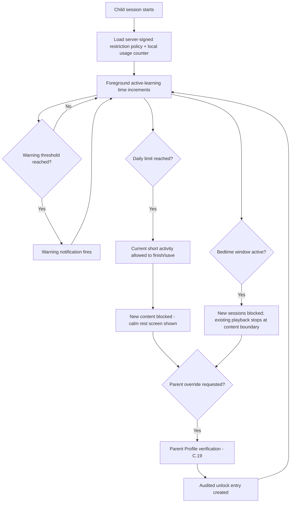
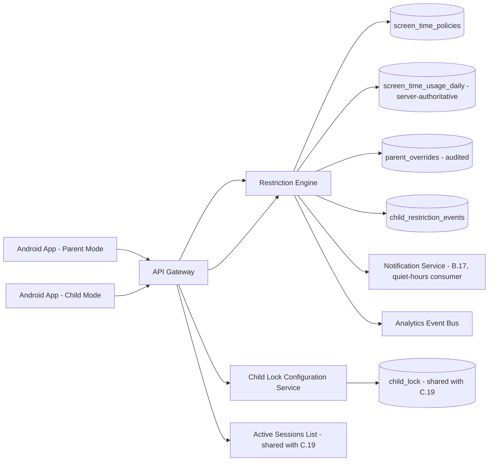

# Feature C.23 — Parental Controls (Screen Time, Bedtime, AI Permissions, Content Age Level)

**App:** NoorHeroes — Islamic Learning App for Children
**Feature Owner:** Product / Child Wellbeing / Trust & Safety
**Status:** Implementation-ready
**Version:** 1.0
**Depends on:** C.19 (Parent PIN/Biometric Gate — step-up on every control change), C.20 (Parent Dashboard — screen-time summary preview), A.4 (Bedtime Player — bedtime window consumption), A.5 (Quran/Arabic — AI/microphone permission consumption), C.21 (Child Locks & Sessions cross-reference)
**Feeds into:** A.7 Habit Tracker (streak grace interplay with restriction events), B.17 Notifications (quiet-hours enforcement), A.5 (AI pronunciation gating), C.22 Per-Child Reports (restriction-event history)

> **Scope note:** This document is the canonical specification for the **Restriction Engine** and its four parent-facing control surfaces under "Controls" in the Parent Area: Screen Time, Quiet Hours/Bedtime, AI Permissions, and Content Age Level. It also specifies **Child Locks & Sessions** (per-child lock type configuration and the active-device list with revocation) as it is actually configured from this area, complementing C.19's specification of the *verification* mechanics for whatever lock is configured here. Every other feature that *consumes* these policies (A.4's bedtime window, A.5's AI/microphone gating, A.7's streak grace, B.17's quiet-hours enforcement) references this document as the single source of truth for the policy itself, rather than each implementing its own configuration surface.

---

## Table of Contents

1. [Product Requirements](#1-product-requirements)
2. [UX/UI Requirements](#2-uxui-requirements)
3. [Backend Requirements](#3-backend-requirements)
4. [Database Design](#4-database-design)
5. [Backend AI Code-Generation Prompt](#5-backend-ai-code-generation-prompt)
6. [Android Requirements](#6-android-requirements)
7. [Android AI Code-Generation Prompt](#7-android-ai-code-generation-prompt)
8. [Admin Requirements](#8-admin-requirements)
9. [Admin AI Code-Generation Prompt](#9-admin-ai-code-generation-prompt)
10. [DevOps Requirements](#10-devops-requirements)
11. [Analytics Requirements](#11-analytics-requirements)
12. [Security Requirements](#12-security-requirements)
13. [QA Requirements](#13-qa-requirements)
14. [Marketing Requirements](#14-marketing-requirements)
15. [Release & Rollback Plan](#15-release--rollback-plan)

---

## 1. Product Requirements

### 1.1 Problem Statement

Parents need genuinely trustworthy, server-authoritative control over how long, when, and how their children use the app — daily screen-time limits, bedtime/quiet-hours windows, AI and voice-interaction permissions, and content age-level overrides — with the system finishing a child's current short activity gracefully at the limit rather than yanking it away mid-task, never allowing device-clock manipulation to reset usage counters, and never letting any per-child lock configuration leak data between siblings (source: Consolidated Blueprint §6.13 "Restriction Engine" Detailed Workflow: "At the limit: the current short activity/question is allowed to finish or save, then new content is blocked and a calm rest screen is shown... Bedtime: new sessions are blocked during the bedtime window; existing playback stops at an appropriate boundary... Device clock manipulation does not reset usage counters").

### 1.2 Business Goals

- Make Screen-Time Intelligence a genuine, defensible differentiator from generic entertainment apps — "Healthy usage score, bedtime behavior, overuse alerts, session caps, and quiet hours" as a named premium-value module.
- Maintain server-side authority over every restriction so that local-device tampering (clock changes, app reinstalls) can never extend usage beyond what a parent actually configured.
- Give parents fine-grained AI/voice control per child (disable AI entirely, restrict voice interaction, "curated only" mode) consistent with the platform's Child-Safe AI Layer commitments.
- Support a calm, never-punitive restriction UX that protects the platform's broader anti-shaming ethical commitments even at the moment a limit is enforced.

### 1.3 User Goals

- **Parent:** Set a daily time limit, a bedtime window, and decide whether AI/voice features are enabled per child, trusting that these settings are actually enforced — even if my child tries to manipulate the device clock or use a different device.
- **Child:** When my time is up, finish what I'm doing and see a calm, kind message — never an abrupt cutoff or a scary warning.

### 1.4 Success Metrics

| Metric | Target |
|---|---|
| Screen-time policy configuration completion rate (parents who set at least one limit) | ≥ 60% |
| Restriction-event-to-calm-rest-screen latency (graceful finish, not abrupt cutoff) | 100% compliance (hard guarantee) |
| Device-clock-manipulation bypass attempts blocked | 100% (hard guarantee) |
| Parent override usage rate (screen-time/bedtime) | Tracked, informs calibration of default limits |
| AI Permissions configuration rate | Tracked |
| Child Locks & Sessions device-revocation usage rate | Tracked |
| Crash-free Controls sessions | ≥ 99.6% |

### 1.5 Stakeholders

Product Manager, Child Wellbeing Advisor, Backend Architect (Restriction Engine), Android Architect, Security Engineer, Data Analyst, QA Lead, feature owners of A.4/A.5/A.7/B.17 (policy consumers), C.19 (gate reuse), C.21 (Child Locks cross-reference).

### 1.6 User Stories

1. As a parent, I want to set a daily screen-time limit for each child.
2. As a parent, I want to configure a bedtime window during which new sessions can't start.
3. As a parent, I want to control whether AI features and voice/microphone interaction are enabled for each child, including a "curated only" mode.
4. As a parent, I want to override a child's age-based content level if I think it should be different.
5. As a parent, I want to see and revoke any device my child is currently using.
6. As a child, when my time runs out, I want to finish my current activity and see a kind message, not have the app suddenly stop.
7. As a parent, I want confidence that changing my device's clock, or my child's, can't extend their allowed time.
8. As a parent, I want to grant a little extra time occasionally, with that override clearly tracked.

### 1.7 Functional Requirements

**FR-1** Controls area sections (canonical, source NoorHeroes Blueprint Master Navigation Map): Screen Time, Quiet Hours / Bedtime, AI Permissions, Content Age Level — all reached under Parent Area → Controls.
**FR-2** Restriction Engine Detailed Workflow (canonical, source §6.13, items 1–6): (1) child session starts; app loads the server-signed restriction policy plus the local usage counter; (2) foreground active-learning time increments; background/paused time does not; (3) a warning notification fires at the configured threshold (e.g., 10 minutes remaining); (4) at the limit, the current short activity/question is allowed to finish or save, then new content is blocked and a calm rest screen is shown (e.g., "Mashallah! Great learning today. Time to rest."); (5) bedtime: new sessions are blocked during the bedtime window; existing playback stops at an appropriate boundary (never mid-word in an active Quran lesson); (6) parent override requires Parent Profile verification and creates an audited unlock entry.
**FR-3** **Server is authoritative; local cache is honored only within a signed grace period. Device clock manipulation does not reset usage counters. Multi-device usage is reconciled server-side, not tracked independently per device** (source §6.13 Validation Rules — three hard, zero-exception rules).
**FR-4** **Offline mode enforces the last signed restriction policy rather than allowing unlimited use when disconnected** (source §6.13 Error Handling).
**FR-5** Existing playback stops at an appropriate boundary at bedtime — **never mid-word in an active Quran lesson** (source §6.13 item 5 — a specific, hard content-respect rule distinct from the general "finish the short activity" rule at the screen-time limit, since bedtime cutoffs apply even mid-activity in a way screen-time limits don't, but must still respect natural content boundaries).
**FR-6** AI Permissions per child: disable AI entirely, restrict voice interaction specifically, set language limits, and choose "curated only" mode (source NoorHeroes Blueprint "Parent AI Controls" card: "Parents can disable AI per child, restrict voice interaction, review history, set language limits, and choose 'curated only' mode").
**FR-7** **AI should increase trust, not risk** — every AI Permissions control exists to give parents a strictly more restrictive posture than the platform default, never to unlock capability beyond what the platform's own AI-safety pipeline allows regardless of parent preference (source: AI Rule card — restated as a ceiling principle: parent controls can only narrow AI capability, never expand it past platform-wide safety bounds).
**FR-8** Content Age Level allows a parent to override the system-derived age-band content eligibility for a specific child (e.g., a precocious reader, or conversely a parent wanting more conservative content than the raw DOB-derived band would suggest) — this override interacts with, but never bypasses, the platform's hard age-band-exclusion guarantees elsewhere (cross-ref B.13 Search's hard age-band filter, A.5's domain content eligibility) — it adjusts the *eligible band itself*, which downstream systems then respect exactly as they would the DOB-derived default.
**FR-9** Child Locks & Sessions: configure per-child app lock (PIN/pattern/biometric toggle) and view/revoke the active device list (source: NoorHeroes Blueprint Parent Area screen table, "Child Locks & Sessions — Configure per-child app lock; PIN/pattern/biometric toggle, active device list; Set lock, Revoke device... Revoking a device force-logs-out that session").
**FR-10** **A locked profile opens its own verification screen. Each child can independently use no lock, pattern, PIN, or device biometric. Only salted hashes/OS biometric assertions are stored; raw patterns and PINs are never logged** (source NoorHeroes Blueprint — the configuration-side restatement of C.19's verification-side guarantee; this document owns the *setting* of these values, C.19 owns their *verification*).
**FR-11** Parent override (screen-time extension or bedtime bypass) **requires Parent Profile verification and creates an audited unlock entry** (source §6.13 item 6) — every override is fully traceable, never an invisible or untracked grant.
**FR-12** Every mutating action under Controls requires step-up authentication via C.19's gate — consistent with C.21's identical requirement, this area introduces no separate or weaker authorization mechanism.
**FR-13** Healthy-usage scoring (a derived, parent-facing metric summarizing bedtime behavior, overuse alerts, and session-cap adherence) is computed from the same server-authoritative usage data this engine maintains — it is a read/insight layer on top of Screen Time data, not a separate tracking system (cross-ref C.20/C.22's "healthy-usage and screen-time status" report content, which reads from this engine's data).

### 1.8 Non-Functional Requirements

- **Server Authority:** Every restriction decision is server-computed and server-signed; the client enforces a locally-cached policy only within a bounded grace period when offline, never as an independently-authoritative source.
- **Tamper Resistance:** Device-clock manipulation, app reinstalls, or multi-device usage must never extend a child's actual allowed time beyond what the server's authoritative daily counter reflects.
- **Graceful Enforcement:** Limit-reached and bedtime-reached transitions must never abruptly terminate an in-progress short activity or cut off content mid-word/mid-sentence — this is treated as a hard UX requirement, not a nice-to-have.
- **Auditability:** Every parent override is logged with who granted it, when, and how much additional time/access was given.

### 1.9 Acceptance Criteria

- Given a child's screen-time policy has a daily limit, when the limit is reached mid-activity, then the current short activity/question is allowed to finish or save before any block applies, followed by a calm rest screen.
- Given a child's device clock is manually changed forward or backward, when the app evaluates usage, then the server-authoritative counter is unaffected by this manipulation.
- Given a child uses two different devices on the same day, when usage is evaluated, then total time is reconciled server-side as a single combined daily total, not tracked independently per device.
- Given the bedtime window begins while a child is mid-lesson in an active Quran recitation, when the cutoff applies, then playback stops at an appropriate content boundary, never mid-word.
- Given a parent grants a screen-time override, when granted, then it requires fresh Parent Profile verification and creates an audited `parent_overrides` entry recording who granted it and how much time.
- Given a parent disables AI entirely for a child, when that child uses any AI-touching feature (e.g., A.5's pronunciation coaching), then it falls back to its listen-only/non-AI path, consistent with that feature's own server-side enforcement of this exact setting.
- Given a parent sets a Content Age Level override, when content eligibility is evaluated anywhere in the app, then it respects the overridden band exactly as it would the DOB-derived default, never bypassing any other hard content-safety rule.
- Given a parent revokes a device from Child Locks & Sessions, when revoked, then that device's active session is force-logged-out.

### 1.10 Edge Cases

1. A child is mid-quiz when the daily screen-time limit is reached → the current question is allowed to complete and the score saved, then the rest screen appears — consistent with the platform's general "never lose in-progress reward-eligible progress due to a restriction" principle.
2. A child's bedtime window begins while they are mid-episode of a Story (not specifically a Quran lesson, but a similar "don't cut off mid-content" concern applies) → playback pauses at the nearest natural content boundary (e.g., end of the current scene/segment) rather than literally mid-sentence, generalizing FR-5's Quran-specific example to all content types with a similar respect-for-content-boundaries principle.
3. A parent grants a screen-time override while the child's session is already in the "calm rest screen" blocked state → the override should unblock that same session immediately (the child doesn't need to fully exit and re-enter), consistent with a smooth, non-punitive parent-assist experience.
4. A child is offline when their locally-cached signed policy's grace period expires (e.g., several days of being offline well past the policy's signed validity window) → the app fails closed, applying the most conservative reasonable restriction (e.g., treating it as if the daily limit were already reached) rather than failing open to unlimited use, consistent with FR-4's "never unlimited when disconnected" rule.
5. A parent changes a child's screen-time limit mid-session (e.g., lowering it from another device while the child is actively using the app) → consistent with the platform's general "changes apply at next session" pattern (already established for screen-time/bedtime elsewhere), the active session is not abruptly interrupted by this specific kind of change, though a bedtime-window change taking effect mid-session is a distinct, generally hard-enforced cutoff per FR-2 item 5 regardless of when it was configured (bedtime windows are evaluated against current time continuously, not "locked in" at session start the way a daily-limit value might be).
6. A parent disables AI for a child while that child is mid-recitation-attempt in A.5's pronunciation flow → consistent with A.5's own established edge case (§1.10 Edge Case 2), the in-progress UI gracefully exits to listen-only mode on the next app-state check, never leaving a dangling broken control.
7. Two co-guardians on different devices simultaneously adjust the same child's screen-time limit to different values → standard last-write-wins semantics apply (consistent with the platform's general low-stakes-preference-conflict handling, distinct from the optimistic-concurrency protection applied to higher-stakes actions like child deletion in C.21) — this is a low-risk-enough setting that a simple last-write-wins is acceptable, though the resulting value is always clearly visible to both parents on next view.
8. A Content Age Level override would place a child's eligible band *below* their actual DOB-derived band (a parent choosing more conservative content) → this is fully supported and respected identically to an above-DOB-band override; the system has no asymmetric restriction on which direction a parent can adjust.
9. A device is revoked from Child Locks & Sessions while that device is mid-API-call (e.g., submitting a habit check-in at the exact moment of revocation) → the in-flight request is allowed to complete if it was already authenticated before the revocation took effect (avoiding data loss for an action the child had already legitimately initiated), but any subsequent request from that device fails authentication immediately after.
10. A parent attempts to set a daily screen-time limit of 0 minutes (effectively fully blocking a child) → this is accepted as a valid, if unusual, configuration (a parent's prerogative), resulting in the child immediately seeing the calm rest screen on any session attempt, with no special-casing or warning beyond standard confirmation of the setting being saved.

### 1.11 Error Handling

| Scenario | System Behavior |
|---|---|
| Device clock manipulated | Server-authoritative counter unaffected; usage evaluated against signed server time |
| Offline beyond signed grace period | Fails closed to the most conservative restriction state (Edge Case 4) |
| Bedtime cutoff mid-content | Stops at the nearest natural content boundary, never mid-word/mid-sentence (FR-5/Edge Case 2) |
| Parent override requested while child is blocked | Unblocks the existing session immediately, no re-entry required (Edge Case 3) |
| AI disabled mid-recitation-attempt | In-progress UI gracefully exits to listen-only on next app-state check (Edge Case 6) |
| Device revoked mid-in-flight-request | Already-authenticated in-flight request completes; subsequent requests fail immediately |

### 1.12 Empty States
- A child with no screen-time policy configured yet → defaults to no daily limit (unrestricted) with a clear "no limit set" indicator on the Controls screen, never an ambiguous blank field.

### 1.13 Loading States
- Controls screens: skeleton form shimmer while current settings load.

### 1.14 Offline States
- Controls screens themselves require connectivity to save changes (server-authoritative); viewing current settings may render from cache with a staleness indicator.

### 1.15 Permission States
- No new runtime permissions; microphone-related AI Permissions settings here govern *server-side* feature availability, distinct from the OS-level microphone permission itself (both must be true for recording features to appear, per A.5's established pattern).

### 1.16 User Flow (Narrative)

Parent navigates Parent Area → Controls → selects Screen Time, Quiet Hours/Bedtime, AI Permissions, or Content Age Level for a specific child → makes changes, each requiring step-up authentication → saves → the Restriction Engine immediately reflects the new policy for future sessions (with bedtime windows evaluated continuously regardless of when configured) → separately, the parent may visit Child Locks & Sessions to configure that child's app-lock type or revoke an unfamiliar/old device from the active list.

### 1.17 Detailed Flow Diagram (Mermaid)

**Restriction Engine Flow (canonical, source §6.13):**



### 1.18 Screen Inventory (Complete — Zero Missing)

| # | Screen | Type | Entry Points | Exit Points |
|---|---|---|---|---|
| 1 | Controls Landing (Screen Time / Quiet Hours / AI Permissions / Content Age Level entry list) | Primary | Parent Dashboard module shortcut grid | Each sub-control screen |
| 2 | Screen Time Settings (per child) | Screen | Controls Landing | Saves, returns to Controls Landing |
| 3 | Quiet Hours / Bedtime Settings (per child) | Screen | Controls Landing | Saves, returns to Controls Landing |
| 4 | AI Permissions Settings (per child) | Screen | Controls Landing | Saves, returns to Controls Landing |
| 5 | Content Age Level Settings (per child) | Screen | Controls Landing | Saves, returns to Controls Landing |
| 6 | Child Locks & Sessions (per child) | Screen | Child Management List, Controls Landing | Set Lock sub-screen, Device Revocation |
| 7 | Set Lock Type (Pattern/PIN/Biometric/None) | Screen | Child Locks & Sessions | Child Locks & Sessions (saved) |
| 8 | Active Device List | Component (within Child Locks & Sessions) | Child Locks & Sessions | Device Revocation Confirmation |
| 9 | Device Revocation Confirmation | Modal | Active Device List "Revoke" | Active Device List (device removed) |
| 10 | Warning Notification State (in-app, near screen-time limit) | Component | Active child session approaching limit | Continues session |
| 11 | Calm Rest Screen (limit reached) | Screen | Daily limit reached | Parent Override Gate |
| 12 | Bedtime Block Screen (new session attempt during bedtime) | Screen | Session-start attempt during bedtime window | Parent Override Gate |
| 13 | Mid-Content Bedtime Cutoff (graceful pause at content boundary) | Screen variant | Bedtime window begins mid-session | Parent Override Gate, or session ends |
| 14 | Parent Override Gate | Screen (shared with C.19) | Calm Rest Screen, Bedtime Block Screen | Override granted (audited) → session resumes |
| 15 | Override Audit Confirmation (brief, shown to parent) | Component | Override granted | Returns to whichever screen initiated the override flow |
| 16 | AI Permissions — "Curated Only" Mode Explainer | Component (within AI Permissions Settings) | AI Permissions Settings | N/A |
| 17 | Content Age Level — Override Confirmation | Modal | Content Age Level Settings, save action | Content Age Level Settings (saved) |

### 1.19 Events (Complete Analytics Event List)

`controls_landing_viewed`, `screen_time_policy_configured`, `bedtime_policy_configured`, `ai_permissions_configured` (with `setting: ai_disabled|voice_restricted|curated_only|language_limit`), `content_age_level_overridden`, `child_lock_type_set`, `device_revoked`, `restriction_warning_notification_fired`, `restriction_limit_reached`, `restriction_calm_rest_screen_shown`, `restriction_bedtime_block_shown`, `restriction_bedtime_midcontent_cutoff_shown`, `restriction_override_requested`, `restriction_override_granted` (with `minutes_granted`, `granted_by`), `restriction_offline_grace_expired_failclosed`, `healthy_usage_score_viewed`.

---

## 2. UX/UI Requirements

> Global Design System tokens defined in **Feature A.1 §2.1**; Parent-Mode formal visual register established in **Feature C.19 §2.1**; anti-shaming, non-punitive tone established platform-wide in **Feature A.7 §2.1**.

### 2.1 Controls-Specific Design System Extensions

- **Calm Rest Screen Visual Language:** Warm, celebratory-but-calm imagery (consistent with A.7's anti-shaming visual philosophy) — e.g., a softly glowing moon/star scene with the "Mashallah! Great learning today. Time to rest." message — never a stark "time's up" countdown-zero or lockout-style red treatment.
- **Settings Form Visual Language:** Clean, simple toggle/slider/time-picker controls in the Parent-Mode formal register, with each setting's real-world effect described in plain language directly beneath the control (e.g., under a bedtime time-picker: "New sessions won't start during this window").
- **Device List Visual Language:** A simple list of device entries (name, last-active timestamp, a "Revoke" action) — consistent with general settings-list patterns, no special visual treatment needed beyond clarity.

### 2.2 Screen-Level Design Requirements (Key Screens)

#### Screen: Calm Rest Screen

- **Purpose:** Communicate the daily limit has been reached without any shaming or alarm.
- **Components:** Warm illustration, "Mashallah! Great learning today. Time to rest." message (or equivalent localized phrasing), a subtle "Ask a grown-up for more time" link routing to the Parent Override Gate.
- **States:** Default, Override-requested (brief loading), Override-granted (session resumes).

#### Screen: Screen Time Settings

- **Purpose:** Let a parent configure a clear, understandable daily limit.
- **Components:** Daily limit time-picker/slider, warning-threshold configuration (e.g., "warn at X minutes remaining"), a clear current-usage-today indicator for context.
- **States:** Default, Saving, Saved-confirmation, No-limit-set (explicit empty state).

### 2.3 Tab Structure

Controls is reached from the Parent Dashboard's module shortcut grid. Click mapping:

| Click Target | Destination | API Called | Analytics Event | Permission Check | Error Handling |
|---|---|---|---|---|---|
| Screen Time entry | Screen Time Settings | `GET/PATCH /v1/children/{id}/screen-time-policy` | `screen_time_policy_configured` | Step-up (C.19) | Standard handling |
| Quiet Hours/Bedtime entry | Bedtime Settings | `GET/PATCH /v1/children/{id}/restrictions` (bedtime fields) | `bedtime_policy_configured` | Step-up | Standard handling |
| AI Permissions entry | AI Permissions Settings | `PATCH /v1/family/children/{id}/settings` (AI fields) | `ai_permissions_configured` | Step-up | Standard handling |
| Content Age Level entry | Content Age Level Settings | `PATCH /v1/family/children/{id}/settings` (age-level field) | `content_age_level_overridden` | Step-up | Standard handling |
| Child Locks & Sessions entry | Child Locks & Sessions | `GET/PATCH /v1/children/{id}/lock`, `GET /v1/sessions` | `child_lock_type_set` | Step-up | Standard handling |
| "Revoke" on a device | Revocation Confirmation → applied | `DELETE /v1/sessions/{id}` | `device_revoked` | Step-up | Standard handling |

### 2.4 Wireframe Description (Composite)

A simple settings-list landing screen leading into focused, single-purpose sub-screens — consistent with the platform's general "one clear focus per screen" philosophy, appropriate given each control here is a distinct, independently-meaningful decision a parent makes.

### 2.5 Screen Image Generation Prompts

**Screen: Calm Rest Screen**
- *Prompt 1 (English):* "Mobile app screen-time-limit-reached screen UI mockup for a children's app, warm and celebratory but calm, NOT alarmist. Soft night-sky gradient background with gentle stars and a glowing crescent moon. Centered friendly text reading 'Mashallah! Great learning today. Time to rest.' in warm gold lettering. Below, a small soft illustration of a cozy reading nook or a sleepy lantern character. A small, subtle text link near the bottom reading 'Ask a grown-up for more time'. No countdown timer, no red coloring, no lock icon, calm and warm mood throughout, rounded soft shapes, no realistic human faces."
- *Prompt 2 (Arabic RTL):* "نفس شاشة الوصول إلى حد وقت الشاشة لتطبيق أطفال، بطابع دافئ واحتفالي لكن هادئ وغير مثير للقلق، بتخطيط من اليمين إلى اليسار. خلفية متدرجة هادئة تشبه سماء الليل مع نجوم لطيفة وهلال متوهج. نص ودود في المنتصف يقول 'ما شاء الله! تعلم رائع اليوم. حان وقت الراحة.' بخط ذهبي دافئ. أسفل ذلك رسمة صغيرة وناعمة لزاوية قراءة مريحة أو شخصية فانوس نعسانة. رابط نصي صغير وخفي قرب الأسفل يقول 'اطلب وقتًا إضافيًا من أحد الوالدين'. بدون عداد تنازلي، بدون لون أحمر، بدون أيقونة قفل، طابع هادئ ودافئ في كل مكان، أشكال ناعمة مستديرة، بدون وجوه بشرية واقعية."

**Screen: Screen Time Settings**
- *Prompt 1 (English):* "Mobile app screen-time settings screen UI mockup, formal parent-mode visual register. Warm off-white background. A card showing a large rounded time-picker/slider control for 'Daily Limit' currently showing '45 minutes', with a small subtext below reading 'Today: 20 of 45 minutes used'. Below that, a smaller row for 'Warn me at' with a dropdown showing '10 minutes remaining'. Clean, simple, clear typography, soft shadows, rounded corners, warm teal and gold accents used sparingly, no realistic human faces."
- *Prompt 2 (Arabic RTL):* "نفس شاشة إعدادات وقت الشاشة، بطابع بصري رسمي لوضع الوالدين، بتخطيط من اليمين إلى اليسار. خلفية بيج فاتح دافئ. بطاقة تعرض عنصر تحكم منزلق/منتقي وقت كبير ومستدير لـ 'الحد اليومي' يعرض حاليًا '45 دقيقة'، مع نص فرعي صغير أسفله يقول 'اليوم: تم استخدام 20 من 45 دقيقة'. أسفل ذلك صف أصغر لـ 'تحذيري عند' بقائمة منسدلة تعرض 'باقي 10 دقائق'. خط نظيف وبسيط وواضح، ظلال خفيفة، زوايا دائرية، لمسات فيروزية وذهبية دافئة مستخدمة بقلة، بدون وجوه بشرية واقعية."

---

## 3. Backend Requirements

### 3.1 System Design Overview

Parental Controls is served by the **Restriction Engine** (the canonical, server-authoritative policy/usage/enforcement service referenced throughout A.4/A.5/A.7/B.17/C.19/C.21/C.22), exposing both the parent-facing configuration APIs and the child-facing policy/heartbeat APIs that drive real-time enforcement, plus the **Child Lock Configuration Service** (the setting-side companion to C.19's verification-side Child Lock Service).

### 3.2 Architecture Diagram (Mermaid)



### 3.3 Service Breakdown

| Service | Responsibility |
|---|---|
| Restriction Engine | Policy storage, server-authoritative usage tracking, heartbeat processing, limit/bedtime enforcement, override auditing |
| Child Lock Configuration Service | Per-child lock-type setting (companion to C.19's verification-side Child Lock Service, same underlying table) |
| Active Sessions List (shared, C.19) | Lists/revokes active device sessions |
| Notification Service (consumer, B.17) | Reads bedtime/quiet-hours config from this engine to suppress notifications during those windows |

### 3.4 API List

#### `GET/PATCH /v1/children/{id}/restrictions`
- **Auth:** Bearer (parent) + step-up for PATCH
- **Response/Request:** `{ "daily_limit_minutes": 45, "warning_threshold_minutes": 10, "bedtime_start": "20:00", "bedtime_end": "07:00" }`
- **Validation:** `bedtime_start`/`bedtime_end` support midnight-crossing windows (consistent with A.4's established logic) — evaluated correctly regardless of which is numerically earlier.

#### `GET/PATCH /v1/children/{id}/screen-time-policy`
- Alias/sub-resource of the above for the daily-limit-specific fields, consistent with the platform's existing API naming.

#### `POST /v1/children/{id}/usage-heartbeats`
- **Auth:** Bearer (child-mode)
- **Request:** `{ "foreground_seconds_since_last_heartbeat": 30, "client_timestamp": "..." }`
- **Response 200:** `{ "minutes_used_today": 22, "minutes_remaining": 23, "limit_reached": false, "warning_threshold_crossed": false }`
- **Validation:** Server computes elapsed time using **server time**, never trusting `client_timestamp` for the actual increment calculation (it may be logged for diagnostic purposes only) — this is the core mechanism defeating device-clock manipulation (FR-3).
- **Business Logic:** Increments `screen_time_usage_daily.minutes_used` server-side per heartbeat; reconciles across devices by always reading/writing the same per-`child_id`-per-`local_date` row regardless of which device's heartbeat triggered it.

#### `POST /v1/restriction-overrides`
- **Auth:** Bearer (parent) + step-up (fresh Parent Gate pass required)
- **Request:** `{ "child_id": "...", "type": "screen_time|bedtime", "minutes_granted": 15 }`
- **Response 200:** `{ "override_id": "...", "granted_by": "...", "granted_at": "..." }`
- **Business Logic:** Writes an audited `parent_overrides` row; for an active blocked session, this should be reflected on the child's next heartbeat/policy-check without requiring app restart (a near-real-time unblock, consistent with Edge Case 3).

#### `PATCH /v1/family/children/{id}/settings` (AI/content fields, extending A.1's general child-settings contract)
- **Request (AI fields):** `{ "ai_enabled": true, "voice_interaction_enabled": false, "curated_only_mode": false, "language_limit": null }`
- **Request (content fields):** `{ "content_age_level_override": "6 to 9" }`
- **Validation:** `ai_enabled`/`voice_interaction_enabled` settings can only **narrow** capability relative to the platform default for that child's actual age band — there is no value combination that could grant a child access to an AI capability the platform doesn't already permit for their age band by default (FR-7's ceiling principle, enforced server-side).

#### `GET /v1/sessions` / `DELETE /v1/sessions/{id}` (reused from A.1/C.19's session list contract)
- Lists/revokes active device sessions for the family, including child-mode sessions, surfaced here under Child Locks & Sessions.

#### `GET/PATCH /v1/children/{id}/lock` (the configuration-side companion to C.19's verification endpoints)
- **Request (PATCH):** `{ "lock_type": "pattern", "value": "..." }` (raw value hashed server-side immediately, never stored or logged in plaintext, consistent with C.19's storage rule)
- **Response 200:** `{ "lock_type": "pattern", "configured": true }`

### 3.5 Cross-Cutting API Concerns

- **Server-time-only usage accounting:** The single most important integrity guarantee in this entire service — every elapsed-time calculation uses server-received timing, never client-reported timestamps, for the actual counter increment.
- **Cross-device reconciliation:** A single authoritative `screen_time_usage_daily` row per child per day, written to by heartbeats from any device.
- **AI-permission ceiling enforcement:** Parent settings can only restrict, never expand, AI capability beyond the platform-wide safety default.
- **Override auditing:** Every override is a permanent, attributed record.

---

## 4. Database Design

### 4.1 ER Diagram (Mermaid)

> Tables sourced directly from the Consolidated Blueprint §9.6 schema reference.

```mermaid
erDiagram
    CHILD ||--|| SCREEN_TIME_POLICY : "has one"
    CHILD ||--o{ SCREEN_TIME_USAGE_DAILY : "has many"
    CHILD ||--o{ PARENT_OVERRIDE : "has many"
    CHILD ||--o{ CHILD_RESTRICTION_EVENT : "has many"
    CHILD ||--o| CHILD_LOCK : "may have one"

    SCREEN_TIME_POLICY {
        uuid child_id PK_FK
        int daily_limit_minutes
        int warning_threshold_minutes
        time bedtime_start
        time bedtime_end
        timestamptz updated_at
    }
    SCREEN_TIME_USAGE_DAILY {
        uuid child_id FK
        date local_date
        int minutes_used
    }
    PARENT_OVERRIDE {
        uuid override_id PK
        uuid child_id FK
        string type
        int minutes_granted
        string granted_by FK
        timestamptz created_at
    }
    CHILD_RESTRICTION_EVENT {
        uuid event_id PK
        uuid child_id FK
        string event_type
        timestamptz occurred_at
    }
    CHILD_LOCK {
        uuid child_id PK_FK
        string lock_type
        string value_hash
        timestamptz updated_at
    }
```

### 4.2 Tables, Relationships, Constraints

| Table | Key Constraints | Indexes |
|---|---|---|
| `screen_time_policies` | PK = FK `child_id` | — |
| `screen_time_usage_daily` | FK `child_id`; UNIQUE(`child_id`, `local_date`) — the single authoritative per-day counter row | Index `(child_id, local_date DESC)` |
| `parent_overrides` | FK `child_id`, `granted_by`; append-only (a permanent audit record, never edited) | Index `(child_id, created_at DESC)` |
| `child_restriction_events` | FK `child_id`; CHECK `event_type IN ('limit_hit','bedtime_block')`; append-only | Index `(child_id, occurred_at DESC)` |
| `child_lock` | PK = FK `child_id` (shared table with C.19) | — |

### 4.3 Audit Fields
`parent_overrides`/`child_restriction_events` are append-only historical facts by design — the audit trail itself. `screen_time_policies.updated_at` tracks configuration changes.

### 4.4 Soft Delete Rules
N/A — policy/lock tables are current-state configuration, updated in place; usage/override/event tables are append-only with no deletion lifecycle.

### 4.5 Retention Rules
`screen_time_usage_daily` retained for historical trend display (feeds C.22's habit/usage trend charts); `parent_overrides`/`child_restriction_events` retained per the platform's standard audit-retention policy.

---

## 5. Backend AI Code-Generation Prompt

```
You are building the Restriction Engine and Child Lock Configuration
Service for "NoorHeroes." The single most important guarantee in this
entire service: USAGE ACCOUNTING IS SERVER-TIME-ONLY, never trusting any
client-reported timestamp for the actual counter increment, making
device-clock manipulation structurally ineffective.

Stack: FastAPI (Python 3.12), PostgreSQL (SQLAlchemy 2.0), Redis.

Hard requirements:
1. Implement POST /v1/children/{id}/usage-heartbeats to compute elapsed
   foreground time using the SERVER's own received-timestamp delta
   between consecutive heartbeats for that child_id (not the client-
   supplied client_timestamp field, which exists only for diagnostic
   logging) -- write a test simulating a client that reports a
   manipulated/rolled-back client_timestamp and confirming the server's
   computed minutes_used_today is based entirely on server-side timing,
   unaffected by the manipulated value.
2. Implement screen_time_usage_daily with UNIQUE(child_id, local_date)
   as the single authoritative counter row -- write a test simulating
   heartbeats arriving from TWO DIFFERENT simulated device sessions for
   the same child on the same day and confirming both increment the SAME
   row, producing a correctly reconciled combined total (not two
   independent per-device counters).
3. Implement the limit-reached and bedtime-window enforcement logic to
   return a response shape allowing the CLIENT to gracefully finish a
   short in-progress activity (the server does not forcibly terminate
   anything mid-call; it simply reports limit_reached=true on the
   heartbeat following the activity's own natural completion) -- write a
   test confirming the heartbeat response includes enough information
   (e.g., minutes_remaining=0, limit_reached=true) for the client to
   make this graceful-finish decision, never an abrupt server-side kill
   signal.
4. Implement bedtime-window evaluation supporting midnight-crossing
   windows (reusing the exact logic pattern from A.4's bedtime
   configuration) -- write a test for a window like 20:00-07:00
   evaluated correctly at 23:30 and 05:00 as "within bedtime" and at
   14:00 as "not within bedtime."
5. Implement POST /v1/restriction-overrides requiring a FRESH Parent
   Gate verification (reuse C.19's step-up check) and writing an
   append-only parent_overrides row -- write a test confirming an
   override cannot be granted without a fresh gate pass, and that the
   resulting row is never editable/deletable after creation (no
   UPDATE/DELETE grant on this table, mirroring the platform's
   established append-only-ledger pattern from A.11).
6. Implement the AI-permission ceiling enforcement: PATCH
   /v1/family/children/{id}/settings must validate that no combination
   of ai_enabled/voice_interaction_enabled/curated_only_mode values
   could result in a child receiving MORE AI capability than the
   platform-wide default for their age band -- since all these settings
   are inherently restriction-only toggles (never an "enable beyond
   default" lever), write a test confirming there is no settings
   combination that increases capability past the age-band default,
   only ever maintains or reduces it.
7. Implement offline-grace-period fail-closed behavior: define a signed
   policy token with an expiry; once expired (client has been offline
   beyond the grace window), subsequent local enforcement on the client
   must default to a maximally-conservative state (treat as limit-
   reached) -- write a test for the server-side token-signing/expiry
   logic backing this client behavior, confirming an expired token is
   correctly flagged as such on next server contact.

Deliver: FastAPI routers, SQLAlchemy models, Alembic migrations
(including the append-only permission lockout on parent_overrides),
Pydantic schemas, and a pytest suite covering all 7 items, with items 1
(server-time-only accounting) and 2 (cross-device reconciliation)
treated as the two highest-priority guarantees in this entire service.
```

---

## 6. Android Requirements

### 6.1 Technical Requirements
Kotlin, Jetpack Compose, MVVM, Clean Architecture, module `:feature:parental-controls`, depends on `:core:auth` (C.19's step-up gate, session list), `:core:design-system`, `:core:network`.

### 6.2 Screen Mapping
`ControlsLandingScreen`, `ScreenTimeSettingsScreen`, `BedtimeSettingsScreen`, `AiPermissionsSettingsScreen`, `ContentAgeLevelSettingsScreen`, `ChildLocksAndSessionsScreen` Composables.

### 6.3 Navigation Flow
Reached from C.20's module shortcut grid; every save action routes through `:core:auth`'s `ParentGateLauncher.requireParentAuth(Settings)` (or a more specific trigger context per setting type) before the PATCH call fires.

### 6.4 State Management
A shared `UsageHeartbeatManager` (in `:core:network` or a dedicated `:core:restriction-engine` module, consumed by the Child Mode app shell, not this Parent-facing module directly) sends periodic heartbeats and surfaces `limit_reached`/`bedtime_active` state to the active child session's UI shell, which renders the Calm Rest Screen or Bedtime Block Screen accordingly — this Parent-facing `:feature:parental-controls` module owns only the configuration screens, not the child-side enforcement UI itself (which lives in the Child Mode app shell, consuming this engine's APIs).

### 6.5 API Mapping
`ControlsRepository.getRestrictions()/updateRestrictions()/updateAiPermissions()/updateContentAgeLevel()` map to their respective endpoints; `ChildLockConfigRepository.setLock()` maps to `PATCH /v1/children/{id}/lock`.

### 6.6 Analytics Mapping
`ControlsAnalytics` fires events per §1.19.

### 6.7 Offline Support
Controls configuration screens require connectivity to save (server-authoritative); the child-side enforcement consumer (`UsageHeartbeatManager`) implements the offline-grace-period fail-closed behavior per §5 item 7's signed-token design.

### 6.8 Deep Linking
`noorheroes://parent/controls/screen-time`, `.../bedtime`, `.../ai-permissions`, `.../content-age-level`, `.../child-locks`.

### 6.9 Push Notifications
N/A directly as a source; this feature's bedtime/quiet-hours configuration is consumed by B.17's Notification Service.

### 6.10 Testing Strategy
- Unit: `UsageHeartbeatManager's` server-time-trust logic (a test confirming the client never derives `minutes_used_today` from local clock arithmetic, only from the server's response).
- UI tests: Calm Rest Screen and Bedtime Block Screen render the correct non-alarming copy and never a countdown/red-styled treatment; AI Permissions settings never expose a toggle that could expand capability beyond default (a UI-level mirror of the backend's ceiling-only design).
- Integration: full screen-time-limit-reached → graceful-finish → calm-rest-screen → parent-override → session-resumes flow; full midnight-crossing bedtime-window evaluation test.

---

## 7. Android AI Code-Generation Prompt

```
Build the `:feature:parental-controls` Android module for NoorHeroes using
Kotlin, Jetpack Compose, MVVM, Clean Architecture, plus a shared
`:core:restriction-engine` module (consumed by the Child Mode app shell)
implementing the heartbeat/enforcement client logic.

Hard requirements:
1. Implement UsageHeartbeatManager (in `:core:restriction-engine`) to
   send periodic heartbeats (e.g., every 30-60s of foreground active
   time) and derive minutes_used_today/minutes_remaining/limit_reached
   EXCLUSIVELY from the server's heartbeat response -- write a test
   confirming this manager never performs its own local-clock-based
   arithmetic to compute these values; it only ever displays what the
   server most recently reported, falling back to the LAST SERVER-
   REPORTED value (not a locally-extrapolated guess) if heartbeats are
   temporarily failing.
2. Implement the offline fail-closed behavior: if no successful
   heartbeat response has been received within the signed policy
   token's grace window, UsageHeartbeatManager transitions to a
   conservative "treat as limit reached" local state -- write a test
   simulating an expired grace window and confirming this fail-closed
   transition occurs.
3. Implement CalmRestScreen and BedtimeBlockScreen composables using
   ONLY warm, non-alarming visual tokens (no red color tokens, no
   countdown-timer composables) -- write a UI test scanning these
   screens' color usage and asserting no red/alarm-toned color token
   from the design system is used anywhere on them.
4. Implement AiPermissionsSettingsScreen with toggles that are
   STRUCTURALLY restriction-only -- model the UI state such that there
   is no possible toggle combination representable in this screen's
   ViewModel that the corresponding API request could interpret as
   "grant capability beyond default" (i.e., the absence of a restrictive
   toggle simply means "use platform default," never an explicit
   "grant extra" value) -- write a test enumerating all possible toggle
   states and confirming none of them serialize to a request body field
   value outside the documented restriction-only enum/boolean space.
5. Implement ChildLocksAndSessionsScreen's device revocation action to
   call DELETE /v1/sessions/{id} through `:core:auth`'s shared session
   repository (reusing C.19's existing session-list/revocation
   infrastructure) rather than implementing a parallel session-management
   client here.
6. Implement bedtime time-picker validation supporting midnight-crossing
   windows (e.g., 20:00 start, 07:00 end is valid and means overnight,
   not "negative duration") -- write a test confirming this input is
   accepted and correctly serialized.

Use Hilt, Retrofit+OkHttp. Follow Global Design System tokens from
`:core:design-system`, using the calm/non-alarming token set established
for this spec's UX section.
```

---

## 8. Admin Requirements

- **Restriction Engine Configuration Defaults:** Admin-tunable platform-wide default screen-time/bedtime suggestions (presented to parents as starting suggestions, never enforced defaults that override an unconfigured policy's "no limit" state) and the AI-permission-default-by-age-band table that defines the ceiling parent settings can only restrict, never exceed.
- **Restriction Engine Health Monitor (Read-only):** Aggregate visibility into heartbeat-processing latency, override-grant frequency, and limit/bedtime-block event volume — an operational and product-calibration signal.
- **Override Audit Log (Read-only):** Visibility into every `parent_overrides` record for support/dispute investigation, consistent with the platform's general append-only-audit-table read-access pattern.

CRUD permissions: Restriction Engine Configuration Defaults = Update-only behind `product_admin` role; Health Monitor = Read-only behind `product_admin`/`content_editor`; Override Audit Log = Read-only behind `support`/`trust_safety`.

---

## 9. Admin AI Code-Generation Prompt

```
Build an internal admin module (React + TypeScript, existing NoorHeroes
Admin Portal shell) for the Restriction Engine's platform-wide
configuration and monitoring.

Pages:
1. Restriction Engine Configuration Defaults -- a settings form for
   suggested (not enforced) default screen-time/bedtime values shown to
   parents as starting suggestions during initial configuration, and the
   AI-permission-default-by-age-band table defining the ceiling that
   parent settings can only restrict, never exceed. Changing the
   age-band ceiling table requires ai_ops sign-off given its platform-
   wide safety implications, mirroring the rigor applied to A.5's
   pronunciation-confidence-threshold configuration.
2. Restriction Engine Health Monitor -- read-only dashboard (recharts)
   showing heartbeat-processing latency, override-grant frequency by
   type (screen_time/bedtime), and limit/bedtime-block event volume
   over time, sourced from a read-only aggregated endpoint.
3. Override Audit Log -- a read-only, paginated table of
   parent_overrides records (masked child identifier, type,
   minutes_granted, granted_by, timestamp), restricted to support/
   trust_safety roles, supporting dispute investigation.

Enforce RBAC via the existing Admin Portal role context. Configuration
Default changes write an immutable audit_log row; the two monitor/log
pages are read-only.
```

---

## 10. DevOps Requirements

- **Infrastructure:** The Restriction Engine's heartbeat endpoint is the platform's highest-frequency child-mode API call by volume (fired every 30-60s during active use across the entire user base) — scaled and optimized accordingly, likely with Redis-backed fast-path counter increments synced to PostgreSQL periodically rather than a synchronous DB write per heartbeat.
- **CI/CD:** The server-time-only accounting test and the cross-device reconciliation test (§5 items 1 and 2) are mandatory, non-bypassable CI gates.
- **Monitoring/Logging/Alerting:** Alert on heartbeat-processing latency/error-rate spikes (given this endpoint's volume, even a small regression has outsized impact). Alert on any detected discrepancy between a child's actual elapsed foreground time (from independent client-side instrumentation, if available) and the server's recorded usage, beyond a reasonable tolerance — a canary for the server-time-only guarantee. Alert on override-grant-rate spikes (a calibration signal, not necessarily a problem, but worth visibility).
- **Disaster Recovery:** `screen_time_usage_daily` at standard tier (regenerable-ish from heartbeat event logs if ever needed, though primarily an operational counter); `parent_overrides`/`child_restriction_events` at the platform's standard audit tier.
- **Rollback Strategy:** Any deploy touching the heartbeat-processing or bedtime-window-evaluation logic requires a staging verification against fixture multi-device, clock-skewed, and midnight-crossing scenarios before promotion.
- **Backup Strategy:** Standard tier across the board for this service's tables.
- **Environment Setup:** Staging supports a "time-travel" testing utility (consistent with A.7's established pattern) plus the ability to simulate multiple concurrent device heartbeats for the same child for reliable QA of cross-device reconciliation.

---

## 11. Analytics Requirements

### 11.1 Event Taxonomy
Full list in §1.19.

### 11.2 Funnel Analysis
`restriction_warning_notification_fired` → `restriction_limit_reached` → `restriction_calm_rest_screen_shown` → (`restriction_override_requested` → `_granted` OR session simply ends) — measures how often children/parents seek an override versus accepting the limit, informing default-limit calibration.

### 11.3 Dashboard Metrics
Screen-time policy configuration rate and typical limit values (calibration signal), override-grant frequency and typical minutes granted, bedtime-block frequency, AI-permissions configuration distribution (how many parents disable AI entirely vs. restrict voice only vs. use curated-only mode — informs which control granularity actually matters to parents).

### 11.4 Cohort & Retention
Cohort by screen-time-policy-configuration status; correlate configured-vs-unconfigured families with retention and with healthy-usage-score trends (testing whether active parental engagement with Controls correlates with healthier, more sustainable usage patterns).

### 11.5 Learning Metrics
Indirect — Controls itself doesn't generate learning metrics, but interacts with A.7's habit/streak grace logic and A.5's AI-gating, both of which have their own learning-metric implications already covered in those features' own specs.

---

## 12. Security Requirements

### 12.1 Threat Analysis
- **Device-clock manipulation to extend usage (this feature's defining risk):** mitigated by server-time-only accounting, the strongest possible defense against this specific attack.
- **Multi-device usage stacking (using a second device to "reset" a daily limit):** mitigated by the single authoritative per-child-per-day counter row, reconciled across all devices.
- **AI-permission-ceiling bypass (a parent or client attempting to grant more AI capability than the platform default permits):** mitigated by the restriction-only design of every AI-permission setting, with no representable "expand beyond default" value anywhere in the schema or UI.
- **Unaudited parent overrides:** mitigated by the append-only `parent_overrides` table with no UPDATE/DELETE grant.

### 12.2 OWASP Checklist (Applied)
Security Misconfiguration: server-time-only accounting and the restriction-only AI-permission schema are both misconfiguration-defense patterns — the dangerous capability (client-controlled time, capability-expanding settings) simply doesn't exist as a representable state.

### 12.3 API Security
Step-up authentication (C.19) on every mutating Controls endpoint; fresh gate verification specifically required for overrides, consistent with the platform's "irreversible-or-high-stakes actions always require fresh verification" pattern.

### 12.4 Mobile Security
No new sensitive data handling; lock values are hashed server-side immediately upon receipt, never stored or logged in plaintext at any point in transit or at rest, consistent with C.19's established rule.

### 12.5 Admin Security
AI-permission-default-by-age-band table changes require `ai_ops` sign-off given their platform-wide safety-ceiling implications.

### 12.6 Data Encryption & PII Protection
No new PII surface beyond standard child-data handling already governed by platform-wide patterns.

### 12.7 Child Safety Requirements
The graceful-finish-never-abrupt-cutoff guarantee and the calm, non-shaming rest-screen/bedtime-block UX are this feature's defining child-wellbeing commitments, directly extending the platform's anti-shaming ethical principle to the moment of restriction enforcement itself — arguably the single moment in the entire app most at risk of feeling punitive if mishandled.

### 12.8 Compliance Requirements
No additional regulatory surface beyond the platform baseline; the AI-permission ceiling design supports the platform's broader Child-Safe AI Layer compliance posture.

### 12.9 Security Checklist (Pre-Launch)
- [ ] Server-time-only usage accounting verified via simulated client-clock-manipulation test
- [ ] Cross-device reconciliation verified (concurrent heartbeats from two devices correctly combine into one counter)
- [ ] AI-permission ceiling enforcement verified (no settings combination expands capability beyond age-band default)
- [ ] Append-only `parent_overrides` table permission lockout verified
- [ ] Midnight-crossing bedtime-window evaluation verified
- [ ] Offline fail-closed behavior verified beyond the signed grace window

---

## 13. QA Requirements

### 13.1 Test Plan Summary
Coverage spans: server-time-only accounting (signature test), cross-device reconciliation, graceful limit/bedtime enforcement, AI-permission ceiling, override auditing, and all 10 edge cases from §1.10.

### 13.2 Test Cases — Happy Path
1. Parent sets a 45-minute daily limit; child uses 45 minutes, finishes their current quiz question, and sees the Calm Rest Screen.
2. Parent configures a 20:00-07:00 bedtime window; a session attempt at 22:00 is blocked with the Bedtime Block Screen; an attempt at 14:00 succeeds normally.
3. Parent disables AI for a child; that child's Surah Learning screen shows no record button, only listen-only mode.

### 13.3 Edge Cases
All 10 items from §1.10.

### 13.4 Negative Cases
- Manipulate a test device's clock forward by several hours mid-session → server-reported usage is unaffected.
- Send heartbeats from two simulated devices for the same child on the same day → combined into one correct daily total.
- Attempt to construct an AI-permissions PATCH request granting capability beyond the age-band default → rejected/clamped server-side.
- Attempt to grant a restriction override without a fresh Parent Gate pass → rejected.
- Attempt a direct database UPDATE on a `parent_overrides` row → rejected at the permission layer.

### 13.5 Regression Cases
Full Parental Controls suite re-run on every release touching the Restriction Engine, Child Lock Configuration Service, or any policy-consuming feature (A.4/A.5/A.7/B.17).

### 13.6 Automation Cases
End-to-end: full limit-reached-to-graceful-finish-to-rest-screen-to-override flow; midnight-crossing bedtime automated test; cross-device-reconciliation automated test (CI-blocking); AI-permission-ceiling automated test (CI-blocking).

---

## 14. Marketing Requirements

- **Launch Plan:** Position "Screen-Time Intelligence" — healthy usage scoring, tamper-resistant limits, graceful (never abrupt) enforcement — as a named premium-value module distinguishing NoorHeroes from generic entertainment apps.
- **Push Notifications:** Warning-threshold and limit-reached notifications (owned by B.17) consume this engine's policy data.
- **Release Notes:** New Controls capabilities (e.g., a future per-content-type time budget) get standard release-note entries.
- **App/Play Store Description:** "Real screen-time limits that can't be tricked by changing the clock, and a calm, kind message when time's up — never an abrupt cutoff" as a genuine, testable claim.
- **ASO Keywords:** "kids app screen time control," "parental controls Islamic app," "kids app bedtime lock."

---

## 15. Release & Rollback Plan

### 15.1 Release Plan
Phased rollout 10% → 50% → 100% over 4–5 days, with the server-time-only-accounting and cross-device-reconciliation test suites required to pass at each stage, given this service's high-frequency, tamper-resistance-critical role.

### 15.2 Rollback Plan
Rollback triggers (all P0): any confirmed device-clock-manipulation bypass, any confirmed cross-device usage double-counting or under-counting, any confirmed abrupt mid-activity cutoff (violating the graceful-finish guarantee), any confirmed AI-permission-ceiling bypass, any confirmed unaudited override. Mechanism: standard deployment rollback.

### 15.3 Success Metrics for Go/No-Go
Matches §1.4 targets. Go/no-go requires sign-off from Product, Child Wellbeing Advisor, and Security jointly — the graceful-enforcement and tamper-resistance guarantees both require explicit confirmation that their respective test suites are green, consistent with the rigor applied to this app's other defining trust commitments.
