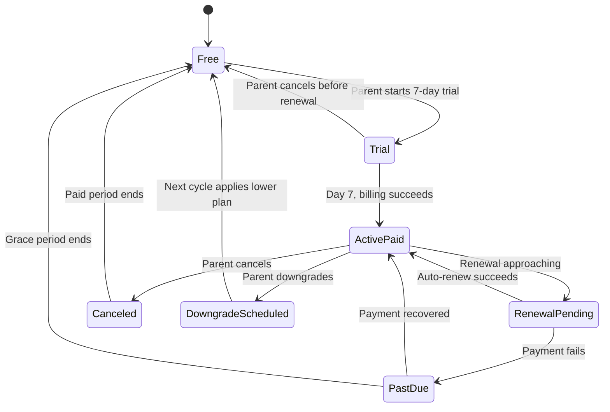
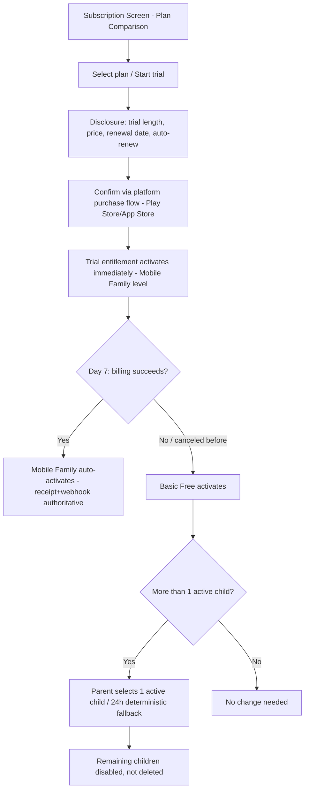
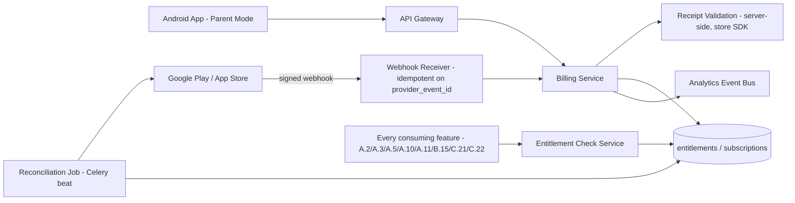
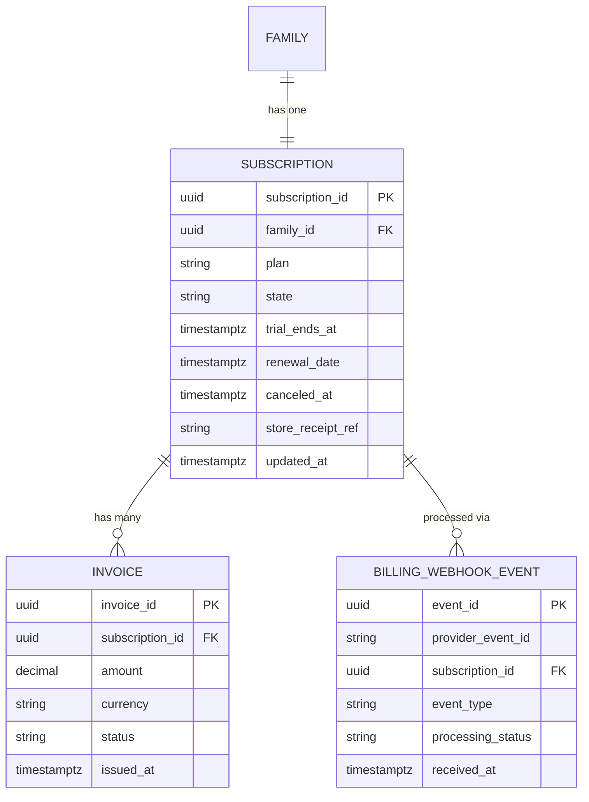

# Feature C.24 — Subscription & Billing

**App:** NoorHeroes — Islamic Learning App for Children
**Feature Owner:** Product / Growth & Monetization / Platform
**Status:** Implementation-ready
**Version:** 1.0
**Depends on:** C.19 (Parent PIN/Biometric Gate), C.20 (Parent Dashboard — entry point, plan capacity badge), C.21 (Multi-Child Management — plan-capacity interplay, trial-cancellation child selector)
**Feeds into:** C.21 (child-count enforcement), A.2/A.3/A.5/A.6/A.10/A.11 (entitlement checks throughout the child app), C.22 (AI Insight Report premium gating), B.15 (offline download-count entitlement)

> **Scope note:** This document is the canonical specification for the entire subscription/entitlement lifecycle — plan comparison, the 7-day trial, store-receipt-and-webhook billing source of truth, the full state machine (Free → Trial → ActivePaid → RenewalPending/PastDue → Canceled/DowngradeScheduled), invoice history, restore-purchase, and the platform-wide entitlement-check contract every other feature calls into. It also owns the trial-cancellation/downgrade child-selection flow's *triggering* logic (the actual selector UI and disable mechanics are C.21's). Every feature elsewhere in this suite that references "entitlement," "plan capacity," or "premium gating" treats this document as the single source of truth.

---

## Table of Contents

1. [Product Requirements](#1-product-requirements)
2. [UX/UI Requirements](#2-uxui-requirements)
3. [Backend Requirements](#3-backend-requirements)
4. [Database Design](#4-database-design)
5. [Backend AI Code-Generation Prompt](#5-backend-ai-code-generation-prompt)
6. [Android Requirements](#6-android-requirements)
7. [Android AI Code-Generation Prompt](#7-android-ai-code-generation-prompt)
8. [Admin Requirements](#8-admin-requirements)
9. [Admin AI Code-Generation Prompt](#9-admin-ai-code-generation-prompt)
10. [DevOps Requirements](#10-devops-requirements)
11. [Analytics Requirements](#11-analytics-requirements)
12. [Security Requirements](#12-security-requirements)
13. [QA Requirements](#13-qa-requirements)
14. [Marketing Requirements](#14-marketing-requirements)
15. [Release & Rollback Plan](#15-release--rollback-plan)

---

## 1. Product Requirements

### 1.1 Problem Statement

Parents need a clear, fair, surprise-free subscription experience — a genuine 7-day trial with explicit pricing/renewal disclosure before any purchase confirmation, scaling per number of children, with billing decided authoritatively by the store's own receipt and signed webhook rather than client-reported state, and with downgrades that disable rather than delete data, while core Islamic content (duas, basic stories, Quran basics, habit tracking) always remains free per the platform's risk register (source: Consolidated Blueprint §6.9: "As a parent, I want a clear, fair trial that doesn't surprise-charge me, and a plan that scales with my number of children"; "Objective: Convert engaged free families into paying subscribers while keeping core Islamic content... free").

### 1.2 Business Goals

- Convert engaged free families into paying subscribers with a trial-to-paid conversion rate ≥ 25% (Phase 3 exit criterion) and annual-plan share ≥ 40% of paid.
- Maintain billing correctness as a platform-foundational guarantee — store receipt + signed webhook is the source of truth, never client-reported entitlement state, with a reconciliation job covering webhook-delivery gaps.
- Never paywall content the community expects to be free — core duas, stories, Quran basics, and habit tracking remain free per the risk register, a hard product/trust commitment as much as a business one.
- Ensure downgrades and cancellations never destroy data — disabling, never deleting, excess child profiles.

### 1.3 User Goals

- **Parent:** Understand exactly what I'm signing up for and when I'll be charged before confirming, trust that my billing is handled correctly even if something glitches, scale my plan to my number of children, and never lose any child's data just because I downgraded.

### 1.4 Success Metrics

| Metric | Target |
|---|---|
| Trial-to-paid conversion rate | ≥ 25% (Phase 3 exit criterion) |
| Annual plan share of paid subscriptions | ≥ 40% (Phase 3 exit criterion) |
| Entitlement-drift incidents (client-vs-store-truth mismatch beyond grace window) | 0 (hard, zero-tolerance) |
| Billing-related support contact rate | ≤ 3% of active subscriptions |
| Webhook reconciliation job success rate | 100% |
| Restore-purchase success rate | ≥ 98% |
| Crash-free Subscription screens | ≥ 99.6% |

### 1.5 Stakeholders

Product Manager, Growth/Monetization Lead, Backend Architect (Billing Service), Android Architect, Legal/Compliance (store-policy adherence), Data Analyst, Security Engineer, QA Lead, Customer Support Lead, feature owners of C.21 (plan-capacity interplay) and every premium-gated feature.

### 1.6 User Stories

1. As a parent, I want to see a clear comparison of plans before choosing one.
2. As a parent, I want to start a 7-day trial and know exactly what I'll be charged and when, before confirming.
3. As a parent, I want my trial to auto-convert to a paid plan only if I don't cancel, with no surprises.
4. As a parent, I want to cancel anytime and keep my paid access until the period ends.
5. As a parent, I want to upgrade immediately and keep all my children's profiles intact.
6. As a parent, if I downgrade or my trial ends, I want to choose which child stays active rather than losing anyone's data.
7. As a parent, I want to see my invoice history and manage billing through the platform's own purchase flow, never a custom payment form.
8. As a parent, I want my child to never see any billing or subscription messaging, ever.
9. As a parent, if a payment fails, I want a clear reminder and a grace period, not an abrupt loss of access.

### 1.7 Functional Requirements

**FR-1** Plan Comparison (canonical, source §6.9 "Plan Comparison" table): Free Family Starter ($0, 1 active child, basic stories/duas/habits/basic reports, premium content locked, no AI weekly reports, limited offline); Mobile Family ($3/mo or $30/yr, 16.7% savings, 4 children, expanded content, 10 offline downloads, monthly family report, limited AI insights); Premium Family ($5.99/mo or $59/yr, 17.9% savings, 8 children, full story/Quran library, premium animated stories, full offline mode, weekly AI parent reports, advanced dashboard, extra child slots addable later).
**FR-2** Subscription Lifecycle state machine (canonical, source §6.9): `Free → Trial (7-day) → ActivePaid → RenewalPending → ActivePaid (auto-renew success) | PastDue (payment fails) → ActivePaid (recovered) | Free (grace ends); ActivePaid → Canceled → Free (paid period ends); ActivePaid → DowngradeScheduled → Free (next cycle)`.
**FR-3** **Trial Rules** (canonical, source §6.9/§"Yearly Subscription Logic"): (1) parent sees trial length, post-trial price, renewal date, and auto-renew disclosure before confirming; (2) parent confirms through the platform purchase flow (Google Play / App Store) — **never a custom payment form**; (3) trial entitlements (Mobile Family level) activate immediately; (4) on day 7, Mobile Family auto-activates if billing succeeds; **store receipt + signed webhook are the billing source of truth, not client-reported state**.
**FR-4** **Cancellation/Downgrade Rules** (canonical, source §6.9 table): Cancel subscription → paid access remains until the period ends, then reverts to Free limits; Trial cancellation with multiple children → parent selects 1 child to remain active on Free, others become **disabled, not deleted** (progress retained, restored when plan capacity returns), deterministic fallback (most-recently-active child) applies if no selection within 24 hours; Payment failure → parent receives email/push reminder, **child mode never shows billing messaging**; Renewal reminder → annual plans notify 7 days and 24 hours before renewal; Free plan second-child attempt → upgrade prompt shown in **parent mode only**, existing child's data unaffected.
**FR-5** **Entitlement checks apply at:** catalog/home feed, search, content detail, playback start, download manifest, AI features, and child-profile activation/creation (source §6.9 Validation Rules — the canonical, complete list of entitlement checkpoints every consuming feature must implement).
**FR-6** **Store webhook delayed → use last verified entitlement plus a grace window, then reconcile via a dedicated reconciliation job (not silent trust of the webhook alone, since webhook delivery is not guaranteed-once)** (source §6.9 Error Handling).
**FR-7** **The web portal cannot initiate app-store purchases outside provider policy; it may display the active entitlement and direct the parent to the mobile app appropriately. Store-purchase actions route through platform billing APIs only** (source §5 Web business rules / NoorHeroes Blueprint Parent Area screen table — restated as the hard rule governing the web portal's strictly limited billing surface).
**FR-8** **Purchases, AI controls, external links, deletion/export, and profile edits require parent PIN. Child mode never exposes billing or account-management controls** (source NoorHeroes Blueprint — restated as the hard rule this feature's child-mode-invisibility guarantee enforces, consistent with A.2's platform-wide no-billing-content-to-child rule).
**FR-9** **Yearly Billing Flow** (canonical, source §"Billing Flow" card): Trial converts automatically to Mobile Family unless the parent cancels before the trial ends; Auto-renew renews unless the parent cancels before the renewal date; Cancel means access continues until the paid period ends, then returns to Free limits; Upgrade unlocks immediately and keeps all child profiles intact; Trial cancellation/downgrade activates Basic Free with only one child remaining active and additional profiles disabled without data deletion.
**FR-10** **Downgrade never deletes child data; excess profiles become read-only archives, never silently deleted** (source NoorHeroes Blueprint Subscription & Billing screen, "Navigation Rules" — restated; cross-ref C.21's archived-profile read-only display pattern).
**FR-11** Subscription screen components (canonical, source screen catalog): plan card, entitlement list, invoice history, "Manage on Play Store" deep link, cancel flow. Actions: start trial, upgrade, downgrade, cancel renewal, view invoice, retry failed payment. Entry points: Parent Dashboard, paywall upsell, Settings. Exit points: Google Play billing sheet (external), Parent Dashboard.
**FR-12** Billing endpoints (canonical, source API table): `GET /api/v1/billing/plans` (public, cached); `POST /api/v1/billing/subscribe` (Bearer JWT, validates receipt server-side before activation); `POST /api/v1/billing/webhooks/play` (webhook signature, idempotent on `provider_event_id`, feeds reconciliation); `POST /api/v1/billing/reconcile` (internal/Celery, scheduled job reconciling entitlement state vs. provider truth, not user-facing).
**FR-13** Paywall upsell UI is shown **only in the parent area** when a profile limit is reached or premium content is browsed in a parent-approved discovery context — never inside child mode (cross-ref A.2's hard rule, C.20's explicit permission for parent-surface billing messaging).
**FR-14** Premium content items remain **visible with a lock icon** in parent-approved discovery contexts — never hidden entirely. **Locking never deletes progress. Free plan always supports basic Islamic education** (source NoorHeroes Blueprint — restated, cross-ref A.3/A.10's established "locked, not hidden" content pattern).

### 1.8 Non-Functional Requirements

- **Billing Source-of-Truth Integrity:** Store receipt + signed webhook are authoritative; client-reported purchase state is never trusted for activation — this is the platform's highest-priority monetization-integrity guarantee.
- **Reconciliation Reliability:** The scheduled reconciliation job must run reliably and catch any entitlement drift within a bounded window, given webhook delivery is not guaranteed-once.
- **Child-Mode Invisibility:** Billing/subscription content is structurally absent from every child-mode-reachable code path — a platform-wide guarantee this feature's API design must not violate.
- **Store-Policy Compliance:** All purchase flows route through Google Play/App Store billing APIs exclusively — no custom payment form exists anywhere in the app.

### 1.9 Acceptance Criteria

- Given a parent starts a 7-day trial, when they confirm, then they have already seen trial length, post-trial price, renewal date, and auto-renew disclosure, and confirmation happens through the platform purchase flow, never a custom form.
- Given a trial reaches day 7 and billing succeeds, when checked, then Mobile Family entitlement activates automatically, driven by the store receipt and signed webhook, not any client-reported state.
- Given a parent cancels a trial with 3 active children, when the trial ends, then Basic Free activates with exactly 1 child remaining active (per the parent's selection, or the deterministic most-recently-active fallback after 24 hours with no selection) and the rest disabled with data fully retained.
- Given a payment fails on renewal, when this occurs, then the parent receives an email/push reminder and enters a grace period — child mode shows no billing messaging at any point in this process.
- Given a webhook is delayed, when the app checks entitlement, then it uses the last verified entitlement plus a grace window, with the reconciliation job catching any eventual discrepancy.
- Given a parent attempts to purchase via the web portal, when they try, then no purchase flow exists there — only entitlement display and a redirect to the mobile app.
- Given a free-tier parent attempts to add a second child, when blocked, then the upgrade prompt appears only in parent mode, with the existing child's data entirely unaffected.
- Given a parent downgrades from Premium Family (8 children) to Free, when the transition completes, then the parent has chosen (or the deterministic fallback has selected) 1 active child, with the remaining 7 disabled, not deleted.

### 1.10 Edge Cases

1. A parent starts a 7-day trial, then immediately cancels within the first hour → the trial entitlement remains active (Mobile Family level) for the remainder of the 7 days, since canceling a trial means "don't auto-convert," not "revoke immediately" — consistent with the platform's general "access continues until the period ends" cancellation philosophy applied even to trials.
2. The Play Store webhook for a successful day-7 trial conversion is delayed by several hours → the app continues to honor the last-verified (trial) entitlement through the signed grace window; if the webhook arrives within that window, entitlement updates correctly; if it doesn't arrive before the grace window expires, the reconciliation job queries the store directly to resolve the actual state rather than leaving it ambiguous indefinitely.
3. A parent on Premium Family (8 children, 6 active) downgrades to Mobile Family (4 children) → the system must select which 2 of the 6 active children become disabled; consistent with the trial-cancellation pattern, the parent is prompted to choose, with the deterministic most-recently-active fallback applying if no selection is made within 24 hours, generalized here from "select 1 of many" to "select N of many to keep" as needed for the specific plan-capacity delta.
4. A parent's payment fails, enters the grace period (`PastDue`), and recovers payment on the very last day of the grace window → the account returns to `ActivePaid` and no children are disabled, since the grace period's entire purpose is to avoid disrupting access while payment issues are resolved.
5. A parent restores a purchase on a new device (e.g., after reinstalling the app or switching devices) → the restore-purchase flow re-validates the existing store receipt server-side and re-establishes the correct entitlement state without requiring a new purchase, consistent with standard app-store restore-purchase expectations.
6. A parent attempts to browse premium content while on the Free plan → the content is shown with a lock icon in the relevant parent-approved discovery context (never hidden entirely), and tapping it routes to the Subscription upsell — this premium content is never silently absent from a catalog/browse view.
7. A family's annual plan is approaching its renewal date, and the 7-day reminder notification would fire during the child's configured bedtime window → since this is a parent-facing notification type, not a child-facing one, it is unaffected by the child's own bedtime/quiet-hours configuration (cross-ref C.23's scope being specifically per-child; parent notification timing is governed by the Parent Area's own notification preferences, C.25).
8. A parent's family has children added via different historical plan tiers (e.g., 4 children added while on Premium Family, then downgraded) → the system's enforcement of "how many children may be *active* at once" is always evaluated against the *current* plan, regardless of historical tier at the time each child was originally added — there is no grandfathering of past capacity.
9. Two webhook events for the same underlying billing event arrive (e.g., a retried delivery from the store) → idempotent processing on `provider_event_id` ensures the second delivery is a safe no-op, never double-processing a renewal or cancellation event.
10. A parent attempts to upgrade mid-trial (before day 7) directly to Premium Family rather than waiting for the standard Mobile Family auto-conversion → this is supported as a direct upgrade path; the trial's scheduled day-7 conversion logic is superseded by the explicit upgrade, which takes effect immediately per FR-9's "Upgrade unlocks immediately" rule.

### 1.11 Error Handling

| Scenario | System Behavior |
|---|---|
| Store webhook delayed | Last verified entitlement honored within a signed grace window; reconciliation job resolves any lingering ambiguity (FR-6) |
| Duplicate webhook delivery | Idempotent on `provider_event_id`, safe no-op on replay (Edge Case 9) |
| Payment failure on renewal | Email/push reminder, grace period (`PastDue`), no child-mode billing messaging at any point |
| Restore-purchase request | Server-side receipt re-validation, entitlement re-established without a new purchase |
| Plan-capacity-reducing downgrade with more active children than the new plan allows | Parent prompted to select which children remain active; deterministic 24-hour fallback if no selection |

### 1.12 Empty States
- Zero invoice history yet (new subscriber, first billing cycle not yet processed) → friendly "Your first invoice will appear here after your trial converts" framing.

### 1.13 Loading States
- Plan Comparison/Subscription screen: skeleton plan-card shimmer while entitlement/plan data loads.

### 1.14 Offline States
- Subscription screen renders last-cached entitlement/plan state when offline; purchase/upgrade/cancel actions require connectivity and clearly indicate this if attempted offline, given their store-billing-API dependency.

### 1.15 Permission States
- No new runtime permissions; all purchase actions route through the OS-level Play Store/App Store billing sheet, which has its own standard permission/account context outside this app's control.

### 1.16 User Flow (Narrative)

Parent reaches Subscription from the Parent Dashboard, a paywall upsell, or Settings → views the Plan Comparison → starts a trial or upgrades directly, confirming through the platform purchase flow with full disclosure shown beforehand → entitlement activates based on store receipt/webhook → parent may later view invoice history, manage billing via "Manage on Play Store," cancel (access continues until period end), or downgrade (triggering the child-selection flow if capacity is reduced) → if a payment fails, the parent receives reminders and a grace period before any access reduction, and the child never sees any of this.

### 1.17 Detailed Flow Diagram (Mermaid)

**Subscription Lifecycle State Machine (canonical, source §6.9):**



**Trial/Purchase Flow:**



### 1.18 Screen Inventory (Complete — Zero Missing)

| # | Screen | Type | Entry Points | Exit Points |
|---|---|---|---|---|
| 1 | Subscription & Billing (landing) | Primary | Parent Dashboard module shortcut, paywall upsell, Settings | Plan Comparison, Invoice History, Cancel Flow, Google Play billing sheet (external) |
| 2 | Plan Comparison | Screen | Subscription landing | Trial Disclosure / Direct Upgrade Disclosure |
| 3 | Trial Disclosure Screen (length, price, renewal date, auto-renew) | Screen | Plan Comparison "Start Trial" | Platform Purchase Flow (external) |
| 4 | Direct Upgrade Disclosure Screen | Screen | Plan Comparison "Upgrade" | Platform Purchase Flow (external) |
| 5 | Platform Purchase Flow (Google Play / App Store billing sheet) | System (external) | Trial/Upgrade Disclosure confirm | Returns to Subscription landing |
| 6 | Entitlement List (component, current plan's included features) | Component | Subscription landing | N/A |
| 7 | Invoice History | Screen | Subscription landing | Invoice Detail |
| 8 | Invoice Detail | Screen | Invoice History | Back |
| 9 | "Manage on Play Store" Deep Link | Component | Subscription landing | External Play Store subscription management |
| 10 | Cancel Flow — Confirmation | Screen | Subscription landing "Cancel" | Subscription landing (status updated to Canceled, access continues) |
| 11 | Retry Failed Payment | Screen | PastDue state notification/banner | Platform Purchase Flow (external) |
| 12 | Trial-Cancellation/Downgrade Child Selector (shared trigger, owned by C.21) | Screen (cross-ref C.21) | Trial cancellation / downgrade transition | Child Management List (C.21) |
| 13 | Deterministic-Fallback Notice (24h, cross-ref C.21) | Screen variant | No explicit selection within 24h | Child Management List |
| 14 | Free-Plan Second-Child Upgrade Prompt (parent-mode only) | Modal | Add Child attempt beyond Free-plan capacity | Subscription landing |
| 15 | Premium Content Lock Icon + Upsell Tap-Through (parent-approved discovery context) | Component | Parent-mode content browsing | Subscription landing |
| 16 | Renewal Reminder Banner (7-day / 24-hour, parent-facing) | Component | Parent Dashboard / Notifications | Subscription landing |
| 17 | Web Portal — Entitlement Display Only (cross-ref Parent Web Account Portal) | Screen (web) | Web Portal navigation | Redirect to Mobile App |
| 18 | Restore Purchase Action | Component | Subscription landing | Re-established entitlement, or "nothing to restore" state |

### 1.19 Events (Complete Analytics Event List)

`subscription_screen_viewed`, `plan_comparison_viewed`, `trial_started`, `trial_disclosure_viewed`, `trial_auto_converted`, `trial_canceled`, `upgrade_initiated`, `upgrade_completed`, `downgrade_initiated`, `downgrade_completed`, `cancellation_initiated`, `cancellation_completed`, `payment_failed`, `payment_recovered`, `grace_period_entered`, `grace_period_expired`, `webhook_received` (internal), `webhook_processing_idempotent_skip` (internal), `reconciliation_job_drift_corrected` (internal/integrity signal), `invoice_viewed`, `manage_on_play_store_tapped`, `restore_purchase_initiated`, `restore_purchase_completed`, `renewal_reminder_shown`, `premium_lock_icon_tapped`, `free_plan_second_child_upsell_shown`, `entitlement_check_performed` (internal, high-volume, sampled).

---

## 2. UX/UI Requirements

> Global Design System tokens defined in **Feature A.1 §2.1**; Parent-Mode formal visual register established in **Feature C.19 §2.1**; the platform-wide rule that billing/upsell content is explicitly permitted here (a parent-only surface) per **Feature C.20's** documented exception.

### 2.1 Subscription-Specific Design System Extensions

- **Plan Card Visual Language:** Three clearly-differentiated plan cards (Free/Mobile Family/Premium Family) with the current plan visually highlighted, pricing shown both monthly and annual (with the savings percentage called out), and included-features lists using simple checkmark rows.
- **Disclosure Screen Visual Language:** Calm, clear, unhurried typography for trial/upgrade disclosures — every material term (price, date, auto-renew) visually prominent, never buried in fine print, consistent with the platform's "no surprise-charging" trust commitment.
- **Lock Icon Treatment:** Consistent with A.3/A.10's existing "locked, not hidden" premium-content visual pattern — a small, friendly lock badge on an otherwise fully-visible content card, tapping through to the upsell rather than a dead end.

### 2.2 Screen-Level Design Requirements (Key Screens)

#### Screen: Plan Comparison

- **Purpose:** Let a parent clearly compare and choose a plan.
- **Components:** Three plan cards (Free/Mobile Family/Premium Family) with monthly/annual toggle, feature checklists, child-capacity callout, current-plan indicator.
- **States:** Default, Loading (skeleton), Annual-toggle-active (recalculates displayed pricing/savings).
- **Accessibility:** Pricing and savings percentages fully screen-reader-readable, not relying on visual-only badge styling.
- **Responsive Rules:** Stacked cards on mobile; side-by-side 3-column on tablet.

#### Screen: Trial Disclosure

- **Purpose:** Ensure complete, unambiguous understanding before the platform purchase flow opens.
- **Components:** Trial length, post-trial price, renewal date, auto-renew disclosure statement, "Continue to Purchase" action (which hands off to the OS billing sheet).
- **States:** Default, Proceeding-to-purchase (brief transition state before the external sheet opens).

### 2.3 Tab Structure

Reached from the Parent Dashboard, a paywall upsell, or Settings — not a standalone tab. Click mapping:

| Click Target | Destination | API Called | Analytics Event | Permission Check | Error Handling |
|---|---|---|---|---|---|
| "Start Trial" (Plan Comparison) | Trial Disclosure | None until confirm | `trial_disclosure_viewed` | None | N/A |
| "Continue to Purchase" (Disclosure) | Platform Purchase Flow (external) | `POST /api/v1/billing/subscribe` (on return with receipt) | `trial_started` | None | Receipt validation failure handling |
| "Manage on Play Store" | External Play Store | N/A | `manage_on_play_store_tapped` | None | N/A |
| "Cancel" (Subscription landing) | Cancel Confirmation | Platform cancel flow (external) + local status sync | `cancellation_initiated` → `_completed` | Step-up not required (a reversible-until-period-end action) | Standard handling |
| Premium content lock icon | Subscription landing (upsell context) | N/A | `premium_lock_icon_tapped` | None | N/A |

### 2.4 Wireframe Description (Composite)

A standard commerce-pattern screen sequence — Plan Comparison → Disclosure → external billing sheet handoff — consistent with platform-store-billing UX conventions parents already recognize from other subscription apps, deliberately not reinventing this familiar pattern.

### 2.5 Screen Image Generation Prompts

**Screen: Plan Comparison**
- *Prompt 1 (English):* "Mobile app subscription plan comparison screen UI mockup, formal parent-mode visual register. Warm off-white background. A small toggle switch at top for 'Monthly / Yearly'. Below, three vertically-stacked rounded plan cards: 'Free Family Starter' ($0, simple feature checklist), 'Mobile Family' ($3/mo, highlighted with a subtle gold border indicating popularity, feature checklist, '4 children' badge), and 'Premium Family' ($5.99/mo, feature checklist, '8 children' badge). Each card has a rounded button at the bottom ('Start Free', 'Start Trial', 'Upgrade'). Clean, trustworthy, clear pricing typography, soft shadows, rounded corners, warm teal and gold accents, no realistic human faces."
- *Prompt 2 (Arabic RTL):* "نفس شاشة مقارنة خطط الاشتراك، بطابع بصري رسمي لوضع الوالدين، بتخطيط من اليمين إلى اليسار بالكامل. خلفية بيج فاتح دافئ. مفتاح تبديل بسيط في الأعلى لـ 'شهري / سنوي'. أسفل ذلك ثلاث بطاقات خطط مستديرة مرصوصة عموديًا: 'الباقة المجانية للعائلة' (0$، قائمة تحقق ميزات بسيطة)، 'باقة الموبايل العائلية' (3$/شهريًا، مميزة بحد ذهبي خفيف يشير إلى الشعبية، قائمة تحقق ميزات، شارة '4 أطفال')، و'الباقة المميزة للعائلة' (5.99$/شهريًا، قائمة تحقق ميزات، شارة '8 أطفال'). كل بطاقة بزر مستدير في الأسفل ('ابدأ مجانًا'، 'ابدأ التجربة'، 'ترقية'). خط تسعير نظيف وموثوق وواضح، ظلال خفيفة، زوايا دائرية، لمسات فيروزية وذهبية دافئة مستخدمة بقلة، بدون وجوه بشرية واقعية."

**Screen: Trial Disclosure**
- *Prompt 1 (English):* "Mobile app trial disclosure confirmation screen UI mockup, calm and transparent tone. Warm off-white background. A centered card showing four clear rows of information: 'Trial length: 7 days', 'Price after trial: $3.00/month', 'First renewal date: [date]', 'Auto-renews unless canceled'. Below, a single prominent rounded button reading 'Continue to Purchase'. A small muted 'Cancel' text link beneath. Clean, honest, no-surprises visual tone, generous spacing, soft shadows, rounded corners, warm teal and gold accents used sparingly, no realistic human faces."
- *Prompt 2 (Arabic RTL):* "نفس شاشة تأكيد الإفصاح عن التجربة، بطابع هادئ وشفاف، بتخطيط من اليمين إلى اليسار. خلفية بيج فاتح دافئ. بطاقة مركزية تعرض أربعة صفوف واضحة من المعلومات: 'مدة التجربة: 7 أيام'، 'السعر بعد التجربة: 3.00$/شهريًا'، 'تاريخ التجديد الأول: [التاريخ]'، 'يتجدد تلقائيًا إلا في حال الإلغاء'. أسفل ذلك زر مستدير بارز واحد يقول 'الاستمرار للشراء'. رابط نصي خافت صغير بعنوان 'إلغاء' أسفل ذلك. طابع بصري نظيف وصادق وبدون مفاجآت، تباعد كبير، ظلال خفيفة، زوايا دائرية، لمسات فيروزية وذهبية دافئة مستخدمة بقلة، بدون وجوه بشرية واقعية."

---

## 3. Backend Requirements

### 3.1 System Design Overview

Subscription & Billing is served by a **Billing Service** that validates store receipts server-side, processes signed store webhooks idempotently, runs a scheduled **Reconciliation Job** against provider truth, and exposes the platform-wide **Entitlement Check** contract consumed at every checkpoint listed in FR-5.

### 3.2 Architecture Diagram (Mermaid)



### 3.3 Service Breakdown

| Service | Responsibility |
|---|---|
| Billing Service | Receipt validation, subscription state-machine transitions, invoice composition |
| Webhook Receiver | Idempotent ingestion of Play/App Store signed webhooks |
| Reconciliation Job | Scheduled provider-truth reconciliation, catching webhook-delivery gaps |
| Entitlement Check Service | The shared, platform-wide entitlement query every consuming feature calls |

### 3.4 API List

#### `GET /api/v1/billing/plans`
- **Auth:** Public
- **Response 200:** Active plans + entitlements, cached in Redis (source: canonical endpoint table).

#### `POST /api/v1/billing/subscribe`
- **Auth:** Bearer JWT
- **Request:** `{ "plan": "mobile_family", "store_receipt": "...", "is_trial": true }`
- **Response 200:** `{ "subscription_id": "...", "state": "trial", "trial_ends_at": "..." }`
- **Validation:** Validates the receipt server-side via the store's own verification API **before** activation — never trusts a client-asserted "purchase succeeded" claim (source: canonical endpoint table, "Notes: Validates receipt server-side before activation").

#### `POST /api/v1/billing/webhooks/play`
- **Auth:** Webhook signature verification
- **Validation:** **Idempotent on `provider_event_id`** — a replayed delivery of the same event is a safe no-op (source: canonical endpoint table).
- **Business Logic:** Drives subscription state-machine transitions (Trial→ActivePaid, ActivePaid→PastDue, etc.) per the canonical state machine (FR-2).

#### `POST /api/v1/billing/reconcile`
- **Auth:** Internal/Celery only — not user-facing
- **Business Logic:** A scheduled job querying the store's own subscription-status API for every active/trial subscription and correcting any drift between the local `entitlements` table and provider truth (source: canonical endpoint table).

#### `GET /v1/parent/subscription`
- **Response 200:** `{ "plan": "...", "state": "...", "renewal_date": "...", "child_capacity": 4, "active_child_count": 3, "invoices": [...] }`

#### `POST /v1/parent/subscription/cancel`
- **Response 200:** `{ "canceled": true, "access_until": "..." }`

#### `GET /v1/entitlements/check?feature=&child_id=` (internal, called by every consuming feature)
- **Response 200:** `{ "entitled": true, "reason": "..." }`
- **Validation:** This is the single shared checkpoint consumed at catalog/home feed, search, content detail, playback start, download manifest, AI features, and child-profile activation/creation (FR-5) — every consuming feature calls this contract rather than independently re-deriving entitlement logic.

### 3.5 Cross-Cutting API Concerns

- **Receipt/webhook authority:** No endpoint anywhere in this service activates or extends entitlement based on client-reported purchase state alone — every activation traces back to a server-validated receipt or a signed webhook.
- **Idempotency:** Webhook processing is idempotent on `provider_event_id`, a hard requirement given non-guaranteed-once delivery.
- **Child-mode invisibility:** No endpoint in this service is reachable from a child-mode session token (consistent with C.20's structural Parent-Session-Only Gate pattern, applied here).

---

## 4. Database Design

### 4.1 ER Diagram (Mermaid)



### 4.2 Tables, Relationships, Constraints

| Table | Key Constraints | Indexes |
|---|---|---|
| `subscription` | PK = FK `family_id` (one subscription record per family); CHECK `state IN ('free','trial','active_paid','renewal_pending','past_due','canceled','downgrade_scheduled')` matching the canonical state machine exactly | — |
| `invoice` | FK `subscription_id`; append-only (a historical billing record, never edited) | Index `(subscription_id, issued_at DESC)` |
| `billing_webhook_event` | **UNIQUE(`provider_event_id`)** — the idempotency backbone | Index `(subscription_id, received_at DESC)` |

### 4.3 Audit Fields
`subscription.updated_at` tracks state transitions; `invoice`/`billing_webhook_event` are append-only historical records.

### 4.4 Soft Delete Rules
N/A — subscription is a current-state record updated in place; invoices/webhook events are append-only with no deletion lifecycle.

### 4.5 Retention Rules
`invoice` retained per standard financial-recordkeeping retention requirements; `billing_webhook_event` retained for a rolling audit window sufficient for billing-dispute investigation.

---

## 5. Backend AI Code-Generation Prompt

```
You are building the Billing Service, Webhook Receiver, Reconciliation
Job, and Entitlement Check Service for "NoorHeroes." The single most
important guarantee in this entire service: STORE RECEIPT + SIGNED
WEBHOOK ARE THE BILLING SOURCE OF TRUTH, never client-reported purchase
state, for any entitlement activation.

Stack: FastAPI (Python 3.12), PostgreSQL (SQLAlchemy 2.0), Redis, Celery
for the reconciliation job, Google Play Billing / App Store Server API
integration for receipt validation and provider-truth queries.

Hard requirements:
1. Implement POST /api/v1/billing/subscribe to validate the submitted
   store_receipt against the store's OWN verification API server-side
   BEFORE writing any subscription state change -- write a test
   confirming a request with a syntactically-valid-looking but
   store-unverifiable receipt is rejected, with NO entitlement activated.
2. Implement POST /api/v1/billing/webhooks/play with UNIQUE(provider_event_id)
   enforced at the database layer -- on a constraint violation (replayed
   delivery), return success without reprocessing the underlying state
   transition. Write a test firing the same webhook payload twice and
   asserting the subscription's state transitions exactly ONCE, not
   twice (e.g., a renewal webhook replayed must not double-extend the
   renewal date or fire duplicate downstream notifications).
3. Implement the subscription state machine as a pure function validating
   only the EXACT transitions in the canonical diagram (Free->Trial,
   Trial->ActivePaid, Trial->Free, ActivePaid->RenewalPending,
   RenewalPending->ActivePaid, RenewalPending->PastDue, PastDue->ActivePaid,
   PastDue->Free, ActivePaid->Canceled, Canceled->Free,
   ActivePaid->DowngradeScheduled, DowngradeScheduled->Free) -- write
   exhaustive tests for every legal transition and confirm illegal
   transitions are unreachable via the public API.
4. Implement the Reconciliation Job (Celery beat task) to query the
   store's provider-truth API for every subscription currently in
   'trial' or a paid state, compare against the local subscription.state,
   and correct any drift -- write a test simulating a local state that
   has drifted from a mocked provider-truth response and confirming the
   job corrects it, logging the correction as an auditable event.
5. Implement GET /v1/entitlements/check as the SOLE entitlement-decision
   endpoint -- write a test confirming this endpoint correctly resolves
   entitlement for each of the 7 checkpoint contexts listed in FR-5
   (catalog, search, content_detail, playback, download_manifest,
   ai_features, child_profile_activation), and write an architectural
   test (or documented convention) confirming no other service in the
   platform independently re-derives entitlement logic rather than
   calling this shared endpoint.
6. Implement plan-capacity-driven child disabling: when a
   subscription transitions to a state with a lower child_capacity than
   the family's current active_child_count, trigger the same disable
   mechanism already built in C.21 (call C.21's existing disable
   endpoint/service internally, do NOT reimplement child-disabling logic
   here) for the parent-selected (or 24-hour-deterministic-fallback)
   children -- write a test confirming this service delegates to C.21's
   existing mechanism rather than duplicating it.
7. Implement structural child-mode-token rejection on every route in this
   service, mirroring C.20's exact middleware pattern -- write a test
   adding a new dummy route and confirming it's still protected.

Deliver: FastAPI routers, the webhook receiver, the Celery reconciliation
task, SQLAlchemy models, Alembic migrations, Pydantic schemas, and a
pytest suite covering all 7 items, with items 1 (receipt-validated
activation) and 2 (idempotent webhook processing) treated as the two
highest-priority guarantees in this entire service.
```

---

## 6. Android Requirements

### 6.1 Technical Requirements
Kotlin, Jetpack Compose, MVVM, Clean Architecture, module `:feature:subscription`, depends on `:core:auth`, `:core:design-system`, `:core:network`, Google Play Billing Library.

### 6.2 Screen Mapping
`SubscriptionLandingScreen`, `PlanComparisonScreen`, `TrialDisclosureScreen`, `InvoiceHistoryScreen` Composables; purchase confirmation hands off to the Play Billing Library's own UI, not a custom Compose screen.

### 6.3 Navigation Flow
Reached from C.20's module shortcut grid, paywall upsells throughout the parent-approved discovery contexts, or Settings; "Continue to Purchase" launches the Play Billing flow via the official SDK, never a custom payment form.

### 6.4 State Management
`SubscriptionViewModel` derives current entitlement state from the server (`GET /v1/parent/subscription`), never independently computing or caching a "purchased" state from the Play Billing SDK's local response alone — the SDK's purchase result is submitted to the backend for server-side validation, and the backend's response is what actually updates the UI's entitlement state.

### 6.5 API Mapping
`SubscriptionRepository.getPlans()/subscribe()/cancel()/getInvoices()` map to their respective endpoints; `EntitlementRepository.check(feature, childId)` is the shared client-side wrapper around `GET /v1/entitlements/check`, consumed by every other feature module (A.2/A.3/A.5/A.10/A.11/B.15) rather than each implementing its own entitlement-check call.

### 6.6 Analytics Mapping
`SubscriptionAnalytics` fires events per §1.19.

### 6.7 Offline Support
Subscription screen renders last-cached entitlement state offline; purchase/cancel actions require connectivity.

### 6.8 Deep Linking
`noorheroes://parent/subscription`.

### 6.9 Push Notifications
Renewal-reminder and payment-failure notifications (owned by C.25) deep-link here.

### 6.10 Testing Strategy
- Unit: `EntitlementRepository's` shared-contract usage (a structural test confirming feature modules consume this shared repository rather than independently calling the entitlement endpoint with divergent logic).
- UI tests: Free-plan second-child upsell never appears in any child-mode-reachable screen (a blocklist scan mirroring A.2's billing-content-absence test pattern, applied here at the source).
- Integration: full trial-start → disclosure → Play Billing handoff → server-validated-activation flow; full downgrade → child-selector → disable flow (delegating to C.21).

---

## 7. Android AI Code-Generation Prompt

```
Build the `:feature:subscription` Android module for NoorHeroes using
Kotlin, Jetpack Compose, MVVM, Clean Architecture, integrating the
Google Play Billing Library for all purchase flows.

Hard requirements:
1. Implement SubscriptionViewModel to treat the Play Billing Library's
   local purchase result as a SIGNAL TO SUBMIT TO THE BACKEND, never as
   the entitlement state itself -- after a successful Play Billing
   purchase flow, immediately call
   SubscriptionRepository.subscribe(receipt) and update UI state ONLY
   from that backend response. Write a test confirming the UI never
   shows an "active" entitlement state purely from the Play Billing
   SDK's local callback before the backend confirms it.
2. Implement a SHARED EntitlementRepository (in `:core:network` or a
   dedicated `:core:entitlement` module) as the SOLE client-side
   entitlement-check mechanism, consumed by every other feature module.
   Write a structural test (or enforced lint rule) confirming no other
   feature module makes its own independent entitlement-related network
   call outside this shared repository.
3. Implement a content-safety-style UI test (mirroring A.2's billing-
   content-absence pattern) that renders Home, Stories, Learn, Rewards,
   and Profile screens under a child-mode session fixture and asserts
   NONE of them contain any composable from `:feature:subscription` or
   any text matching billing-related terms -- this is the Android-side
   enforcement of FR-8's child-mode invisibility guarantee, verified at
   the point of consumption, not just at this module's own boundary.
4. Implement TrialDisclosureScreen to display trial length, post-trial
   price, renewal date, and auto-renew disclosure ALL BEFORE the
   "Continue to Purchase" button is enabled -- write a UI test confirming
   this button is disabled/absent until all four pieces of information
   have been rendered (not just present in the view model, but actually
   composed on screen).
5. Implement the downgrade flow to delegate to C.21's existing child-
   management repository for the actual disable mechanics -- write a
   test confirming this module calls C.21's ChildManagementRepository
   rather than implementing its own parallel disable logic.

Use Hilt, Retrofit+OkHttp, the Play Billing Library. Follow Global Design
System tokens from `:core:design-system`.
```

---

## 8. Admin Requirements

Per the existing Admin Portal's "Commerce" navigation group (source: §5.5 Admin Portal Navigation — "Plans, entitlements, subscriptions, receipts, refunds, revenue analytics"):

- **Plan Catalog Manager:** CRUD for plan definitions (pricing, child capacity, included features) — changes here drive `GET /api/v1/billing/plans's` cached response.
- **Subscription/Entitlement Lookup:** Search by family/parent identifier or subscription ID; view current state, history, and reconciliation-correction log for support investigation.
- **Receipt/Refund Management:** View receipts, process refunds per store policy (refunds themselves are typically initiated through the store, but this tool tracks/reflects them).
- **Revenue Analytics (Read-only):** Trial-to-paid conversion rate, annual-plan share, churn/cancellation trends — the platform's primary monetization health dashboard.
- **Reconciliation Job Monitor (Read-only):** Visibility into the scheduled job's run history and any drift corrections it has made — an integrity-health signal mirroring the pattern established for other reconciliation jobs across the platform (B.15/A.11).

CRUD permissions: Plan Catalog Manager = full CRUD behind `product_admin`/`commerce_admin` role; Subscription/Entitlement Lookup = Read-only + limited correction actions behind `support`/`commerce_admin`; Receipt/Refund Management = behind `commerce_admin`; Revenue Analytics = Read-only behind `product_admin`/`commerce_admin`; Reconciliation Job Monitor = Read-only behind `product_admin`/`trust_safety`.

---

## 9. Admin AI Code-Generation Prompt

```
Build the NoorHeroes Admin Portal's Commerce module (React + TypeScript) for
managing plans, entitlements, and subscription support.

Pages:
1. Plan Catalog Manager -- CRUD for plan definitions (plan code, display
   name, monthly/annual pricing, child_capacity, included_features list).
   Changes invalidate the Redis cache backing the public
   GET /api/v1/billing/plans endpoint. Restricted to product_admin/
   commerce_admin role.
2. Subscription/Entitlement Lookup -- search by masked parent/family
   identifier or subscription_id, showing current state, full state-
   transition history, and any reconciliation-job corrections applied to
   this specific subscription, for support investigation. Restricted to
   support/commerce_admin role.
3. Receipt/Refund Management -- a view of receipts and any refund records
   associated with a subscription, restricted to commerce_admin role.
4. Revenue Analytics -- read-only dashboard (recharts) showing trial-to-
   paid conversion rate, annual-vs-monthly plan share, and churn/
   cancellation trend over time, sourced from a read-only aggregated
   endpoint.
5. Reconciliation Job Monitor -- read-only table of reconciliation job
   runs and any drift corrections made (masked family identifier,
   before/after state, timestamp), restricted to product_admin/
   trust_safety roles.

Enforce RBAC via the existing Admin Portal role context. Every mutating
action (plan changes, refund processing) writes an immutable audit_log
row.
```

---

## 10. DevOps Requirements

- **Infrastructure:** Billing Service integrates with Google Play Billing / App Store Server APIs; the Webhook Receiver must be highly available given its role as a billing-correctness-critical ingestion point; the Reconciliation Job runs as a reliable Celery beat scheduled task.
- **CI/CD:** The receipt-validated-activation test and the idempotent-webhook-processing test (§5 items 1 and 2) are mandatory, non-bypassable CI gates.
- **Monitoring/Logging/Alerting:** Alert (P0) on any entitlement activation that occurred without a corresponding validated receipt or webhook record. Alert on Reconciliation Job failure or skipped runs. Alert on webhook-processing error-rate spikes (could indicate a store-API or signature-verification issue). Alert on drift-correction volume spiking unexpectedly (a signal worth investigating even though the correction itself is safely handled).
- **Disaster Recovery:** `subscription`/`invoice` at the platform's highest financial-recordkeeping durability tier; `billing_webhook_event` at a tier sufficient for billing-dispute audit windows.
- **Rollback Strategy:** Any deploy touching the subscription state machine or webhook-processing logic requires a staging replay against historical fixture webhook sequences (including deliberately duplicated/out-of-order deliveries) confirming identical outcomes to the pre-deploy version.
- **Backup Strategy:** Highest tier for `subscription`/`invoice`; standard-to-high for `billing_webhook_event`.
- **Environment Setup:** Staging integrates with the store's sandbox billing environment (Play Billing test tracks / App Store sandbox) for realistic end-to-end purchase-flow testing without real charges.

---

## 11. Analytics Requirements

### 11.1 Event Taxonomy
Full list in §1.19.

### 11.2 Funnel Analysis
`plan_comparison_viewed` → `trial_disclosure_viewed` → `trial_started` → `trial_auto_converted` (the platform's primary monetization funnel, directly tracking the Phase 3 exit criterion of ≥25% trial-to-paid conversion).

### 11.3 Dashboard Metrics
Trial-to-paid conversion rate, annual-vs-monthly plan share, cancellation/downgrade rate and reasons (where captured), payment-failure and grace-period-recovery rate, reconciliation-job drift-correction frequency (a billing-integrity health signal).

### 11.4 Cohort & Retention
Cohort by trial-start date; correlate trial-engagement depth (cross-ref other features' own engagement metrics during the trial window) with eventual conversion, informing which in-trial experiences most predict paid retention.

### 11.5 Revenue Metrics
This is the platform's primary revenue-metrics-generating feature: MRR/ARR, trial-to-paid conversion, annual-plan mix, churn rate, average revenue per family — all sourced from this service's subscription/invoice data.

---

## 12. Security Requirements

### 12.1 Threat Analysis
- **Client-side entitlement spoofing (this feature's defining risk):** mitigated by exclusive reliance on server-validated receipts and signed webhooks for every activation decision, never client-reported state.
- **Duplicate webhook processing causing entitlement drift:** mitigated by idempotency on `provider_event_id`.
- **Web-portal purchase-flow circumvention of store policy:** mitigated by the web portal having no purchase-initiation capability at all, only entitlement display.
- **Billing content reaching child mode:** mitigated by structural child-mode-token rejection mirroring C.20's pattern, plus the Android-side content-safety-style UI test verified at every consuming screen.

### 12.2 OWASP Checklist (Applied)
Broken Access Control: structural child-mode-token rejection. Security Misconfiguration: server-side-only receipt validation and idempotent webhook processing are both misconfiguration-defense patterns preventing the dangerous "trust the client" state from ever being representable.

### 12.3 API Security
Server-side receipt validation and idempotent webhook processing are this service's two most important integrity properties.

### 12.4 Mobile Security
Purchase flows route exclusively through the official Play Billing Library — no custom payment form or alternative purchase path exists anywhere in the app.

### 12.5 Admin Security
Plan Catalog and Receipt/Refund management actions are restricted to commerce-specific admin roles, fully audited.

### 12.6 Data Encryption & PII Protection
No new PII surface beyond standard billing-adjacent metadata (plan, state, invoice amounts) already appropriate for financial recordkeeping; no payment card data is ever handled directly by NoorHeroes' own systems (delegated entirely to the platform billing APIs).

### 12.7 Child Safety Requirements
The structural child-mode invisibility of all billing/subscription content is this feature's defining child-safety/trust commitment, directly reinforcing A.2's platform-wide rule at its actual source.

### 12.8 Compliance Requirements
Invoice/financial-record retention follows standard financial-recordkeeping compliance requirements; store-policy adherence (no purchases outside platform billing APIs) is itself a hard app-store-compliance requirement, not merely a UX preference.

### 12.9 Security Checklist (Pre-Launch)
- [ ] Receipt-validated activation verified (no entitlement granted on an unverifiable receipt)
- [ ] Idempotent webhook processing verified (replayed delivery never double-processes)
- [ ] Subscription state-machine illegal-transition-impossibility verified
- [ ] Structural child-mode-token rejection verified across every route in this service
- [ ] Android-side billing-content-absence verified across every child-mode-reachable screen
- [ ] Web portal confirmed to have zero purchase-initiation capability

---

## 13. QA Requirements

### 13.1 Test Plan Summary
Coverage spans: receipt-validated activation (signature test), idempotent webhook processing (signature test), state-machine correctness, plan-capacity-driven disabling delegation to C.21, and all 10 edge cases from §1.10.

### 13.2 Test Cases — Happy Path
1. Parent starts a 7-day trial, sees full disclosure, confirms via Play Billing, and the trial entitlement activates immediately.
2. Day 7 arrives, billing succeeds via store receipt/webhook, and Mobile Family activates automatically.
3. Parent downgrades from Premium Family to Free with multiple active children, selects 1 to remain active, and the rest are disabled with data intact.

### 13.3 Edge Cases
All 10 items from §1.10.

### 13.4 Negative Cases
- Submit a subscribe request with a fabricated/unverifiable receipt → rejected, no entitlement granted.
- Replay the same webhook payload twice → state transitions exactly once.
- Attempt any billing endpoint with a child-mode session token → rejected.
- Attempt to find a purchase-initiation path on the web portal → none exists.

### 13.5 Regression Cases
Full Subscription & Billing suite re-run on every release touching the Billing Service, Webhook Receiver, Reconciliation Job, or Entitlement Check Service.

### 13.6 Automation Cases
End-to-end: full trial-to-paid-conversion flow against the store sandbox; idempotent-webhook-replay automated test (CI-blocking); state-machine exhaustive-transition automated test; plan-capacity-downgrade-to-C.21-delegation automated test.

---

## 14. Marketing Requirements

- **Launch Plan:** Position the trial's complete pre-purchase disclosure and the platform-billing-only purchase flow as part of the broader "no surprises, no manipulative engagement tactics" trust narrative.
- **Push Notifications:** Renewal reminders (7-day/24-hour) and payment-failure reminders owned by C.25.
- **Release Notes:** New plan tiers or pricing changes get standard release-note entries, subject to store-policy notice requirements.
- **App/Play Store Description:** "A clear 7-day trial with no surprise charges, billed only through Google Play/App Store — never a custom payment form" as a genuine, store-policy-compliant claim.
- **ASO Keywords:** "Islamic kids app family plan," "kids learning app subscription," "family Islamic education app pricing."

---

## 15. Release & Rollback Plan

### 15.1 Release Plan
Phased rollout 10% → 50% → 100% over 5–7 days against the store's sandbox/test-track environment first, then production, with the receipt-validation and idempotent-webhook test suites required to pass at every stage, given this feature's direct revenue and trust impact.

### 15.2 Rollback Plan
Rollback triggers (all P0): any confirmed entitlement granted without a validated receipt/webhook, any confirmed duplicate-webhook-processing entitlement drift, any confirmed billing content reaching child mode, any confirmed web-portal purchase-initiation capability. Mechanism: standard deployment rollback; given the revenue-criticality, a billing incident triggers immediate cross-team response including Finance/Legal alongside Engineering.

### 15.3 Success Metrics for Go/No-Go
Matches §1.4 targets, explicitly including the Phase 3 exit criteria (trial-to-paid conversion ≥25%, annual-plan share ≥40% of paid). Go/no-go requires sign-off from Product, Growth/Monetization, Security, Legal/Compliance, and Finance jointly — the receipt/webhook-authority guarantee specifically requires confirmation that the signature suite is green and that a sandbox end-to-end purchase test has been manually verified before this feature processes real payments in production.
