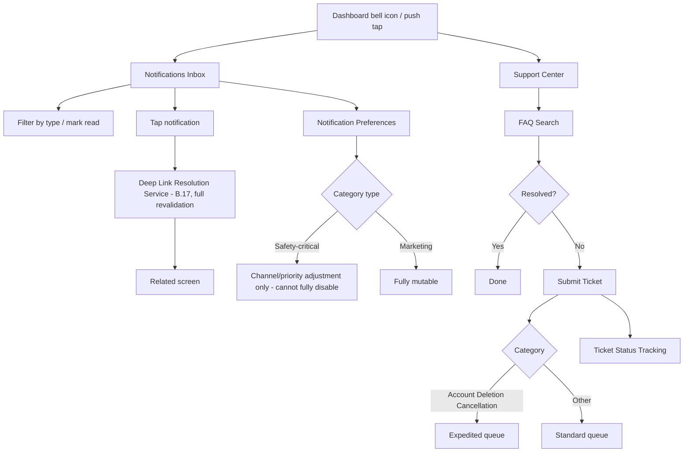
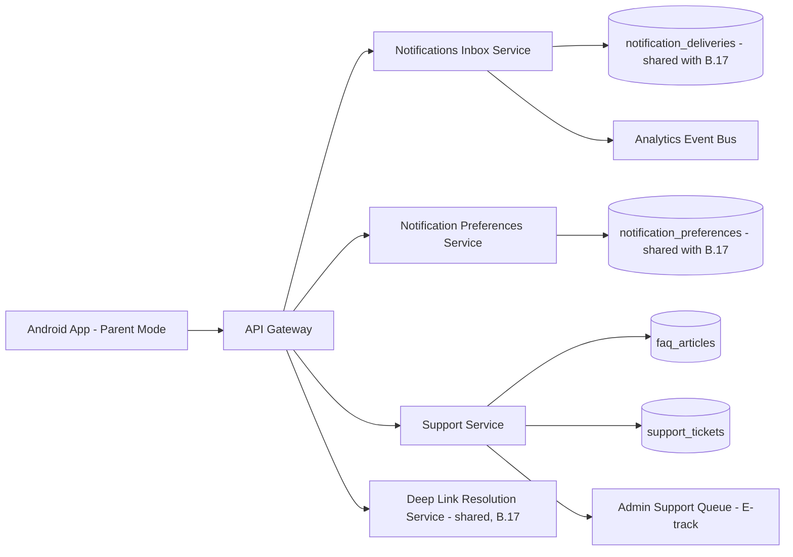
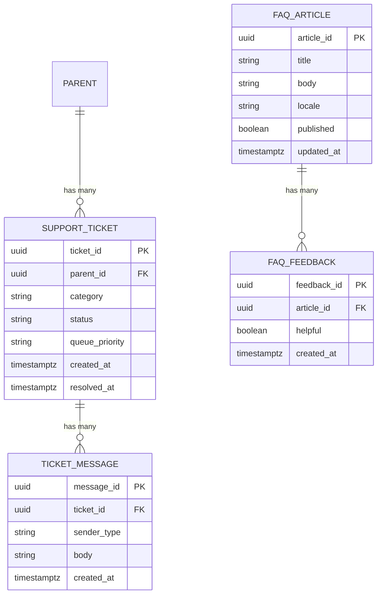

# Feature C.25 — Notifications (Parent) & Support

**App:** NoorHeroes — Islamic Learning App for Children
**Feature Owner:** Product / Customer Support / Trust & Safety
**Status:** Implementation-ready
**Version:** 1.0
**Depends on:** C.19 (Parent PIN/Biometric Gate — export/deletion step-up), C.20 (Parent Dashboard — entry point), B.17 (Notifications infrastructure — shared delivery/binding architecture), C.21/C.24 (deletion grace-period and billing-failure source events)
**Feeds into:** C.21 (Parent Account Deletion cancellation routes here to Support), C.24 (billing-failure/renewal-reminder delivery), every Parent Area screen (deep-link landing target for parent-facing pushes)

> **Scope note:** B.17 specified the **child-facing** notification trigger catalog and the shared device-binding/delivery architecture (FCM registration, profile binding, the Policy Engine, Deep Link Resolution Service). This document specifies the **parent-facing** half of that same shared architecture — the Notifications (Parent) inbox, notification-category preferences and quiet hours, and the **Support Center** (FAQ search, contact-support form, ticket history) — plus the one hard rule unique to this surface: safety-critical notification categories (deletion grace period, billing failure) can never be fully disabled, only de-prioritized in delivery channel, while marketing categories can be freely muted.

---

## Table of Contents

1. [Product Requirements](#1-product-requirements)
2. [UX/UI Requirements](#2-uxui-requirements)
3. [Backend Requirements](#3-backend-requirements)
4. [Database Design](#4-database-design)
5. [Backend AI Code-Generation Prompt](#5-backend-ai-code-generation-prompt)
6. [Android Requirements](#6-android-requirements)
7. [Android AI Code-Generation Prompt](#7-android-ai-code-generation-prompt)
8. [Admin Requirements](#8-admin-requirements)
9. [Admin AI Code-Generation Prompt](#9-admin-ai-code-generation-prompt)
10. [DevOps Requirements](#10-devops-requirements)
11. [Analytics Requirements](#11-analytics-requirements)
12. [Security Requirements](#12-security-requirements)
13. [QA Requirements](#13-qa-requirements)
14. [Marketing Requirements](#14-marketing-requirements)
15. [Release & Rollback Plan](#15-release--rollback-plan)

---

## 1. Product Requirements

### 1.1 Problem Statement

Parents need a clear inbox of system/safety/marketing alerts, granular control over which notification categories they receive and when, and an easy way to reach self-serve (FAQ) or human (ticket) support — with an absolute guarantee that safety-critical alerts (an account-deletion grace-period countdown, a billing failure that could lapse access) can never be silently muted, while marketing notifications remain fully optional (source: NoorHeroes Blueprint Parent Area screen table: "Notifications (Parent) | Inbox of system/safety/marketing alerts | List, read/unread state, filters | Mark read, Open related screen | Dashboard bell icon, push tap | Related deep-linked screen | Safety alerts cannot be muted; marketing ones can").

### 1.2 Business Goals

- Ensure parents never miss a safety-critical alert (deletion grace period, billing failure) that could materially affect their family's access or data, while respecting their right to opt out of purely promotional content.
- Reduce support burden via genuinely useful self-serve FAQ search, reserving human ticket support for issues that actually need it.
- Maintain the shared notification-delivery architecture's integrity (exclusive device-profile binding, server-side quiet-hours enforcement) at the parent-facing half of the system, consistent with B.17's child-facing specification.
- Provide a clear, async-aware ticket-status experience so parents always know where their support request stands.

### 1.3 User Goals

- **Parent:** See all my notifications in one inbox, control which categories I get and when (except the ones that genuinely matter for safety/billing), search for an answer myself first, and submit a ticket with visibility into its status if I need real help.

### 1.4 Success Metrics

| Metric | Target |
|---|---|
| Notification inbox view rate (weekly) | ≥ 40% |
| Safety-critical-category delivery success rate (deletion grace, billing failure) | 100% (hard, zero-tolerance) |
| FAQ self-serve resolution rate (ticket not submitted after a relevant FAQ view) | ≥ 50% |
| Support ticket first-response time | ≤ 24 hours |
| Support ticket resolution satisfaction rate | ≥ 85% |
| Crash-free Notifications/Support sessions | ≥ 99.6% |

### 1.5 Stakeholders

Product Manager, Customer Support Lead, Trust & Safety, Backend Architect (shared Notification Service from B.17), Android Architect, Data Analyst, QA Lead, feature owners of C.21 (deletion-cancellation routing) and C.24 (billing-failure source events).

### 1.6 User Stories

1. As a parent, I want one inbox showing all my system, safety, and marketing notifications.
2. As a parent, I want to mark notifications as read and filter by type.
3. As a parent, I want to control which notification categories I receive and set quiet hours for non-critical ones.
4. As a parent, I want assurance that safety-critical alerts (deletion countdown, billing failure) always reach me, even if I've muted everything else.
5. As a parent, I want to search a FAQ before submitting a support ticket.
6. As a parent, I want to submit a support ticket and see its status without guessing.
7. As a parent, when I have a pending account-deletion request, I want a clear way to contact Support to cancel it from right here.

### 1.7 Functional Requirements

**FR-1** Notifications (Parent) components: inbox list, read/unread state, filters by type (source: screen catalog).
**FR-2** Notifications (Parent) actions: mark read, open the related deep-linked screen (source: screen catalog).
**FR-3** **Safety alerts cannot be muted; marketing ones can** (source: screen catalog "Navigation Rules" — a hard, zero-exception rule on the category-preference model itself, not just a UI convention).
**FR-4** **Safety-critical notifications (deletion grace period, billing failure) cannot be fully disabled, only de-prioritized in delivery channel** (source: NoorHeroes Blueprint — restated as the precise mechanism: a parent may downgrade *how* a safety-critical notification reaches them — e.g., push de-prioritized in favor of email-only — but never opt out of receiving it through *some* channel entirely).
**FR-5** Support Center components: FAQ search, contact-support form, ticket status (source: screen catalog "Privacy & Support — Components: Consent toggles, AI history, export request, support chat"; NoorHeroes Blueprint "Notifications (Parent) & Support — Components: Notification type toggles, quiet hours, FAQ search, contact-support form, ticket status").
**FR-6** Support Center actions: toggle notification categories, set quiet hours, submit support ticket, view ticket history (source: screen catalog "Actions").
**FR-7** **Data-export requests are async; status shown here and in the web portal** (source: screen catalog — restated as the canonical async-job UX pattern this feature's "Privacy & Support" surface must implement for export/deletion-adjacent requests).
**FR-8** **Parent Account Deletion cancellation during the 7-day grace period routes through Support, never self-service** (cross-ref C.21 FR-8 step 7) — the Support Center's contact-form/ticket flow is the actual mechanism through which a parent initiates this specific cancellation request; this document's ticket-submission flow must support a distinctly-tagged "Account Deletion Cancellation" category that routes to the appropriate priority queue.
**FR-9** Support tickets support a defined category taxonomy (e.g., billing, technical issue, content concern, safety concern, account-deletion-cancellation, general) — each category may route to a different internal queue/SLA, with safety-concern and account-deletion-cancellation categories receiving expedited priority.
**FR-10** The FAQ search is content-governed (admin-authored, scholar-reviewed where Islamic-content-adjacent) — never an AI-freeform-generated answer presented as official guidance, consistent with the platform's general content-governance discipline applied here to support content specifically.
**FR-11** A parent's notification-category preferences and quiet-hours configuration here are the **parent-facing counterpart** of B.17's shared Policy Engine — this feature writes to the same `notification_preferences` table B.17's Policy Engine reads from, with `child_id` null for parent-scoped preference rows (cross-ref B.17 §4.1's shared schema).
**FR-12** Every notification in the inbox deep-links to its related screen using the same Deep Link Resolution Service specified in B.17 (full revalidation on open) — this feature does not implement a separate, weaker deep-link path for parent-facing notifications.

### 1.8 Non-Functional Requirements

- **Safety-Critical Delivery Guarantee:** Deletion-grace-period and billing-failure notifications must always reach the parent through at least one enabled channel — this is enforced at the preference-model layer (these categories simply have no "fully off" state representable in the schema), not merely a UI restriction.
- **Self-Serve Effectiveness:** FAQ content must be genuinely useful and kept current — measured via the self-serve resolution rate metric, with admin tooling supporting content-gap identification from search-then-ticket patterns.
- **Ticket Transparency:** Ticket status must always be visible and current to the parent, with no ambiguous "submitted" state that never updates.
- **Shared Architecture Reuse:** This feature's notification-delivery mechanics reuse B.17's exact shared infrastructure (binding, Policy Engine, Deep Link Resolution) — no parallel, divergent implementation for the parent-facing half.

### 1.9 Acceptance Criteria

- Given a parent opens the Notifications inbox, when it renders, then they see all system/safety/marketing notifications with read/unread state and filters.
- Given a parent attempts to disable a safety-critical category (deletion grace period or billing failure), when they look for a "turn off completely" option, then none exists — only channel/delivery-priority adjustment is offered.
- Given a parent mutes all marketing notifications, when a purely promotional notification would otherwise fire, then it is correctly suppressed, while a safety-critical notification in the same period still delivers through at least one channel.
- Given a parent has a pending Account Deletion request, when they open Support, then a clearly-visible path to submit an "Account Deletion Cancellation" ticket is available, routing to an expedited support queue.
- Given a parent searches the FAQ, when results are shown, then all content is admin-authored and content-governed — never an AI-freeform-generated answer.
- Given a parent submits a support ticket, when they later check ticket status, then it accurately reflects the current state (open/in-progress/resolved) without requiring them to guess or re-contact support to find out.
- Given a parent taps a notification in the inbox, when it opens, then it deep-links through the same full-revalidation Deep Link Resolution Service used for child-facing notifications (B.17), never a separate weaker path.

### 1.10 Edge Cases

1. A parent mutes every notification category they can (everything except the un-mutable safety-critical ones) → the inbox still functions normally for viewing any notifications that do arrive (the safety-critical ones, plus any the parent didn't fully mute), never breaking or hiding the inbox itself based on preference state.
2. A parent submits a ticket, then submits a second, related ticket on the same topic before the first is resolved → both tickets exist independently in their ticket history (no automatic merging), though a support agent may manually link/merge them on the admin side if appropriate — the parent always sees an accurate reflection of what they actually submitted.
3. A parent's Account Deletion grace period expires (cascade completes) while they have an open, unresolved "Account Deletion Cancellation" ticket → consistent with C.21's cascade-worker boundary logic, if the ticket/cancellation wasn't actioned by Support before the deadline, the cascade proceeds as scheduled; the ticket should then be updated to reflect this outcome rather than remaining ambiguously "open" forever.
4. A parent searches the FAQ for a topic with no matching content → a clear "no results, here's how to contact Support" fallback is shown, never a dead-end blank search result.
5. A parent's billing-failure notification is configured to de-prioritized delivery (e.g., email-only, push de-prioritized) → it still must actually arrive via that remaining enabled channel; "de-prioritized" never means "sometimes doesn't arrive at all" — it's a channel/ordering preference, not a delivery-reliability reduction.
6. A parent views the Notifications inbox while offline → renders from cache with a staleness indicator; marking-as-read actions taken offline queue and sync on reconnect, consistent with the platform's general offline-action pattern.
7. A parent's ticket category is "safety concern" but the actual content, on review, turns out to be a routine billing question → support agents can recategorize a ticket on the admin side without the parent needing to resubmit; the parent's ticket-status view reflects the corrected category and any resulting SLA change transparently.
8. Two co-guardians on different devices both submit feedback/tickets about the same underlying issue independently → each ticket is tracked separately (consistent with Edge Case 2's no-auto-merge default), with support agents responsible for recognizing and coordinating related tickets manually if warranted.

### 1.11 Error Handling

| Scenario | System Behavior |
|---|---|
| FAQ search returns zero results | Clear "no results, contact Support" fallback (Edge Case 4) |
| Ticket submission fails (network) | Local draft preserved, retried, never silently lost |
| Notifications inbox fetch failure | Cached last-known list shown with a staleness indicator |
| Mark-as-read action fails (network) | Optimistic local update, queued for retry, never blocks further interaction |
| Safety-critical notification delivery channel itself fails (e.g., push token invalid) | Falls back to the next enabled channel (e.g., email) rather than silently failing to deliver at all |

### 1.12 Empty States
- Zero notifications yet (new account) → friendly "Nothing here yet" empty state.
- Zero ticket history yet → friendly "You haven't contacted Support yet — search our FAQ or reach out anytime" framing.

### 1.13 Loading States
- Notifications inbox / Support Center: skeleton list shimmer.

### 1.14 Offline States
- Notifications inbox renders from cache; FAQ search and ticket submission require connectivity, indicated clearly if attempted offline.

### 1.15 Permission States
- No new runtime permissions; relies on the existing OS notification-permission state already governed by the platform's general notification infrastructure (B.17).

### 1.16 User Flow (Narrative)

Parent taps the Dashboard bell icon or a push notification → Notifications inbox opens, showing all categories with read/unread state and filters → parent marks items read or taps through to a related screen via full deep-link revalidation → separately, parent navigates to Support → searches the FAQ first → if unresolved, submits a ticket (optionally tagged with a specific category like "Account Deletion Cancellation") → tracks ticket status over time until resolution → throughout, the parent may visit notification-preference settings to adjust which categories/channels/quiet-hours apply, with safety-critical categories always remaining at least minimally deliverable.

### 1.17 Detailed Flow Diagram (Mermaid)



### 1.18 Screen Inventory (Complete — Zero Missing)

| # | Screen | Type | Entry Points | Exit Points |
|---|---|---|---|---|
| 1 | Notifications (Parent) Inbox | Primary | Parent Dashboard bell icon, push notification tap | Related deep-linked screen, Notification Preferences |
| 2 | Notification Type Filter (component) | Component | Notifications Inbox | Filtered inbox |
| 3 | Notification Detail / Mark-Read Interaction (inline) | Component | Notifications Inbox | Related deep-linked screen |
| 4 | Notification Preferences — Category Toggles | Screen | Notifications Inbox, Settings | Saves, returns |
| 5 | Notification Preferences — Quiet Hours | Screen | Notification Preferences | Saves, returns |
| 6 | Safety-Critical Category — Channel/Priority Adjustment (not a full disable) | Screen variant | Notification Preferences, safety-critical category | Saves, returns |
| 7 | Support Center (landing) | Primary | Parent Dashboard, Settings, Privacy & Support | FAQ Search, Contact Support Form, Ticket History |
| 8 | FAQ Search | Screen | Support Center | FAQ Article Detail, "Contact Support" fallback |
| 9 | FAQ Article Detail | Screen | FAQ Search results | Back, "Was this helpful?" → Contact Support if not |
| 10 | FAQ Zero-Results Fallback | Screen variant | FAQ Search, no matches | Contact Support Form |
| 11 | Contact Support Form | Screen | Support Center, FAQ fallback | Ticket Submitted Confirmation |
| 12 | Ticket Category Selector (within Contact Support Form) | Component | Contact Support Form | N/A |
| 13 | Ticket Submitted Confirmation | Screen | Contact Support Form submit | Ticket History |
| 14 | Ticket History List | Screen | Support Center | Ticket Detail |
| 15 | Ticket Detail / Status View | Screen | Ticket History | Back, add a follow-up message |
| 16 | Account Deletion Cancellation — Expedited Ticket Entry Point | Component | Deletion-Pending Countdown Banner (cross-ref C.21), Support Center | Contact Support Form (pre-tagged category) |
| 17 | Privacy & Support — Data Export Status (async) | Screen | Settings → Privacy & Support | Web Portal (cross-reference for status) |

### 1.19 Events (Complete Analytics Event List)

`notifications_inbox_viewed`, `notification_marked_read`, `notification_filtered_by_type`, `notification_deep_link_opened`, `notification_preferences_viewed`, `notification_category_toggled`, `notification_quiet_hours_set`, `safety_critical_category_disable_attempt_blocked` (internal/UX signal), `support_center_viewed`, `faq_search_performed`, `faq_article_viewed`, `faq_zero_results_shown`, `faq_marked_unhelpful`, `support_ticket_submitted` (with `category`), `support_ticket_status_viewed`, `support_ticket_follow_up_added`, `account_deletion_cancellation_ticket_submitted`, `data_export_status_viewed`.

---

## 2. UX/UI Requirements

> Global Design System tokens defined in **Feature A.1 §2.1**; Parent-Mode formal visual register established in **Feature C.19 §2.1**.

### 2.1 Notifications/Support-Specific Design System Extensions

- **Inbox List Visual Language:** Standard read/unread visual distinction (bold vs. regular weight, a small dot indicator), category-type icon badges (system/safety/marketing), consistent with general inbox UX conventions parents already recognize.
- **Safety-Critical Category Visual Treatment:** In Notification Preferences, safety-critical categories are visually distinguished (e.g., a small "Required" or "Safety" tag) with the toggle replaced by a channel-selector control rather than a simple on/off switch — making the "you can adjust delivery, but not fully disable" distinction visually obvious, not just a disabled-looking toggle that might read as a bug.
- **FAQ/Support Visual Language:** Clean, simple search-and-list pattern consistent with standard help-center conventions; ticket status uses a simple stage-indicator (Submitted → In Progress → Resolved) rather than ambiguous free-text status only.

### 2.2 Screen-Level Design Requirements (Key Screens)

#### Screen: Notification Preferences

- **Purpose:** Let a parent control notification categories and timing, with safety-critical categories clearly distinguished.
- **Components:** Category list (System/Safety/Marketing groupings), per-category toggle (marketing) or channel-selector (safety-critical), quiet-hours time-range picker (applies to non-safety-critical categories).
- **States:** Default, Saving, Saved-confirmation.
- **Accessibility:** The distinction between a true on/off toggle and a channel-selector-only control is conveyed via both visual styling and accessible label text ("Safety alerts: always on, choose delivery method"), never ambiguous to a screen-reader user.

#### Screen: Support Center

- **Purpose:** A calm, effective self-serve-first help hub.
- **Components:** FAQ search bar, popular-topics quick links, "Contact Support" entry, "My Tickets" entry.
- **States:** Default, Search-active, Search-zero-results.

### 2.3 Tab Structure

Reached from the Parent Dashboard's bell icon (Notifications) or module shortcut grid (Support), and from Settings. Click mapping:

| Click Target | Destination | API Called | Analytics Event | Permission Check | Error Handling |
|---|---|---|---|---|---|
| Bell icon | Notifications Inbox | `GET /v1/parent/notifications` | `notifications_inbox_viewed` | None | Cached fallback |
| Notification item | Deep Link Resolution → related screen | `GET /v1/notifications/resolve` (shared with B.17) | `notification_deep_link_opened` | Full revalidation (B.17) | Standard B.17 fallback states |
| Notification Preferences entry | Preferences screen | `GET/PATCH /v1/parent/notification-preferences` | `notification_category_toggled` | None | Standard handling |
| Support Center entry | Support Center | N/A | `support_center_viewed` | None | N/A |
| FAQ search | FAQ results | `GET /v1/support/faq?q=` | `faq_search_performed` | None | Zero-results fallback |
| "Contact Support" / Submit ticket | Ticket Submitted Confirmation | `POST /v1/support/tickets` | `support_ticket_submitted` | None | Retry on failure |
| Ticket History item | Ticket Detail | `GET /v1/support/tickets/{id}` | `support_ticket_status_viewed` | Own-family-scoped | Standard handling |

### 2.4 Wireframe Description (Composite)

Notifications Inbox follows a standard list/inbox pattern; Support Center follows a standard help-center landing pattern (search-first, with clear secondary paths to contact/ticket-history) — both deliberately conventional, since parents benefit from these surfaces matching widely-recognized patterns rather than introducing novel interaction models.

### 2.5 Screen Image Generation Prompts

**Screen: Notifications (Parent) Inbox**
- *Prompt 1 (English):* "Mobile app parent notifications inbox screen UI mockup, formal parent-mode visual register. Warm off-white background. A row of small filter chips at top ('All / System / Safety / Marketing'). Below, a vertical list of rounded notification rows, some in bold text with a small unread dot (unread), some in regular weight (read), each with a small category icon badge (a shield for safety, a bell for system, a tag for marketing) and a timestamp. Clean, organized, trustworthy aesthetic, soft shadows, rounded corners, warm teal and gold accents used sparingly, no realistic human faces."
- *Prompt 2 (Arabic RTL):* "نفس شاشة صندوق إشعارات الوالدين، بطابع بصري رسمي لوضع الوالدين، بتخطيط من اليمين إلى اليسار بالكامل. خلفية بيج فاتح دافئ. صف من رقاقات تصفية صغيرة في الأعلى ('الكل / النظام / السلامة / التسويق'). أسفل ذلك قائمة عمودية من صفوف إشعارات مستديرة، بعضها بخط عريض مع نقطة صغيرة لغير المقروء، وبعضها بخط عادي (مقروء)، كل منها بشارة أيقونة فئة صغيرة (درع للسلامة، جرس للنظام، علامة للتسويق) وطابع زمني. طابع نظيف ومنظم وموثوق، ظلال خفيفة، زوايا دائرية، لمسات فيروزية وذهبية دافئة مستخدمة بقلة، بدون وجوه بشرية واقعية."

**Screen: Notification Preferences (Safety-Critical Category)**
- *Prompt 1 (English):* "Mobile app notification preferences screen UI mockup, formal parent-mode visual register. Warm off-white background. A list of setting rows grouped under headers 'Safety & Account' and 'Marketing'. Under 'Safety & Account', a row labeled 'Billing & Account Alerts' with a small 'Always On' tag and a channel-selector dropdown showing 'Push + Email' instead of a simple toggle switch. Under 'Marketing', a row labeled 'New Content Updates' with a standard toggle switch, currently on. Clean, clear, trustworthy typography distinguishing the two control types visually, soft shadows, rounded corners, warm teal and gold accents, no realistic human faces."
- *Prompt 2 (Arabic RTL):* "نفس شاشة تفضيلات الإشعارات، بطابع بصري رسمي لوضع الوالدين، بتخطيط من اليمين إلى اليسار بالكامل. خلفية بيج فاتح دافئ. قائمة من صفوف الإعدادات مجمعة تحت عناوين 'السلامة والحساب' و'التسويق'. تحت 'السلامة والحساب' صف بعنوان 'تنبيهات الفوترة والحساب' مع شارة صغيرة 'مفعّل دائمًا' وقائمة منسدلة لاختيار القناة تعرض 'إشعار + بريد إلكتروني' بدلاً من مفتاح تبديل بسيط. تحت 'التسويق' صف بعنوان 'تحديثات المحتوى الجديد' مع مفتاح تبديل عادي، مفعّل حاليًا. خط نظيف وواضح وموثوق يميز بين نوعي التحكم بصريًا، ظلال خفيفة، زوايا دائرية، لمسات فيروزية وذهبية دافئة، بدون وجوه بشرية واقعية."

---

## 3. Backend Requirements

### 3.1 System Design Overview

The parent-facing half of Notifications reuses B.17's exact **Notification Intent Service, Policy Engine, Device Profile Binding Service,** and **Deep Link Resolution Service** — this document adds only the **Notifications Inbox read model** (a parent-queryable list of their own historical notifications) and the **Support Service** (FAQ content, ticket lifecycle).

### 3.2 Architecture Diagram (Mermaid)



### 3.3 Service Breakdown

| Service | Responsibility |
|---|---|
| Notifications Inbox Service | Parent-queryable read model over `notification_deliveries` |
| Notification Preferences Service | Reads/writes `notification_preferences`, enforcing the safety-critical-cannot-fully-disable schema constraint |
| Support Service | FAQ content serving, ticket lifecycle (create/read/update/follow-up) |
| Deep Link Resolution Service (reused, B.17) | Full revalidation on notification-tap, identical contract for parent-facing notifications |

### 3.4 API List

#### `GET /v1/parent/notifications?type=&read_status=`
- **Auth:** Bearer (Parent session only — child-mode token rejected per the structural pattern established in C.20)
- **Response 200:** `{ "notifications": [ { "id": "...", "type": "safety|system|marketing", "title": "...", "read": false, "deep_link": "...", "occurred_at": "..." } ] }`

#### `POST /v1/parent/notifications/{id}/mark-read`
- **Response 200:** `{ "read": true }`

#### `GET/PATCH /v1/parent/notification-preferences`
- **Request (PATCH):** `{ "category": "billing_alerts", "enabled": true, "channels": ["push","email"], "quiet_hours": null }`
- **Validation:** For categories flagged `safety_critical=true` in the category registry, `enabled: false` is **rejected** (`422 SAFETY_CRITICAL_CANNOT_DISABLE`) — only `channels` may be adjusted, and `channels` must always contain at least one enabled delivery method (rejecting an attempt to set it to an empty array for a safety-critical category).

#### `GET /v1/support/faq?q=`
- **Auth:** Public or Bearer (works for any parent, even pre-subscription)
- **Response 200:** `{ "articles": [ { "id": "...", "title": "...", "summary": "..." } ] }`
- **Validation:** Served exclusively from admin-authored, content-governed `faq_articles` — never an AI-freeform-generated answer (FR-10).

#### `GET /v1/support/faq/{id}`
- **Response 200:** Full article content + a "Was this helpful?" feedback capture.

#### `POST /v1/support/tickets`
- **Auth:** Bearer (Parent session)
- **Request:** `{ "category": "account_deletion_cancellation|billing|technical|content_concern|safety_concern|general", "message": "...", "related_family_deletion_request_id": null }`
- **Response 200:** `{ "ticket_id": "...", "status": "submitted", "queue_priority": "expedited|standard" }`
- **Business Logic:** `account_deletion_cancellation` and `safety_concern` categories are routed to an expedited internal queue/SLA; for `account_deletion_cancellation` specifically, this ticket is the parent-facing trigger that a Support agent acts on via C.21's admin-only cancellation endpoint — this service itself never directly cancels the deletion, only routes the request to a human.

#### `GET /v1/support/tickets` / `GET /v1/support/tickets/{id}`
- **Response 200:** Ticket history/detail with current `status` (submitted/in_progress/resolved) and any agent responses.

### 3.5 Cross-Cutting API Concerns

- **Safety-critical schema enforcement:** The `enabled: false` rejection for safety-critical categories is enforced at the validation layer using a category registry's `safety_critical` flag, not a hardcoded category-name check — extensible to future safety-critical categories without a code change.
- **Shared deep-link reuse:** No parallel deep-link resolution path exists for parent notifications; the exact B.17 contract is reused.
- **Ticket-to-admin-action separation:** The Support Service creates and tracks tickets; it never itself performs the underlying privileged action (e.g., deletion cancellation) — that remains exclusively a human-Support-agent action via the admin-only endpoint already specified in C.21, preserving that feature's deliberate self-service-cancellation-is-structurally-absent guarantee.

---

## 4. Database Design

### 4.1 ER Diagram (Mermaid)



> Note: `notification_preferences` and `notification_deliveries` are the same shared tables already introduced in B.17 §4.1 — this document reuses them directly.

### 4.2 Tables, Relationships, Constraints

| Table | Key Constraints | Indexes |
|---|---|---|
| `support_ticket` | FK `parent_id`; CHECK `status IN ('submitted','in_progress','resolved')`; CHECK `category IN ('account_deletion_cancellation','billing','technical','content_concern','safety_concern','general')` | Index `(parent_id, created_at DESC)`, Index `(category, status)` |
| `ticket_message` | FK `ticket_id`; CHECK `sender_type IN ('parent','support_agent')`; append-only | Index `(ticket_id, created_at)` |
| `faq_article` | CHECK `published` gates visibility in the public search endpoint | Index `(locale, published)` |
| `faq_feedback` | FK `article_id`; append-only | Index `(article_id, created_at DESC)` |

### 4.3 Audit Fields
`support_ticket.created_at`/`resolved_at`; `ticket_message`/`faq_feedback` are append-only historical records.

### 4.4 Soft Delete Rules
N/A for tickets/messages (append-only, permanent record); `faq_article.published = false` used to retire content without deleting the historical record of what was once published.

### 4.5 Retention Rules
`support_ticket`/`ticket_message` retained per the platform's standard support-history retention policy; `faq_feedback` aggregated for content-quality signals, retained per standard analytics retention.

---

## 5. Backend AI Code-Generation Prompt

```
You are building the Notifications Inbox Service, Notification Preferences
Service, and Support Service for "NoorHeroes." Reuse B.17's EXISTING
notification_deliveries, notification_preferences, and Deep Link
Resolution Service contracts -- do not duplicate or fork them.

Stack: FastAPI (Python 3.12), PostgreSQL (SQLAlchemy 2.0), Redis.

Hard requirements:
1. Implement a category registry (a small reference table or enum-with-
   metadata) where each notification category carries a safety_critical
   boolean flag. Implement PATCH /v1/parent/notification-preferences to
   REJECT (422 SAFETY_CRITICAL_CANNOT_DISABLE) any request setting
   enabled=false for a category where safety_critical=true -- write a
   test confirming this rejection for the deletion_grace_period and
   billing_failure categories specifically, and confirming a NON-safety-
   critical category (e.g., new_content_updates) CAN be set to
   enabled=false without issue.
2. For safety-critical categories, also reject a channels array that
   would be EMPTY (e.g., {"channels": []}) -- a safety-critical category
   must always have at least one enabled delivery channel. Write a test
   for this exact rejection.
3. Implement GET /v1/support/faq to serve EXCLUSIVELY from
   faq_article rows where published=true -- write a test confirming an
   unpublished/draft article is never returned by this endpoint, and a
   structural test confirming this endpoint's implementation has no
   code path that calls any AI-generation service to synthesize an
   answer -- it is a pure database query against pre-authored content.
4. Implement POST /v1/support/tickets to route account_deletion_cancellation
   and safety_concern categories to queue_priority='expedited', all
   others to 'standard' -- write a test for both routing outcomes.
5. Implement the explicit separation between ticket creation and
   privileged-action execution: POST /v1/support/tickets with
   category='account_deletion_cancellation' must ONLY create a ticket
   record -- it must NEVER itself call C.21's
   POST /v1/admin/parent-deletion/{family_id}/cancel endpoint or any
   equivalent cancellation logic. Write a test confirming ticket creation
   for this category has zero side effects on the family's
   deletion_pending status; the actual cancellation remains exclusively
   reachable via a human support agent's separate, audited admin action.
6. Implement GET /v1/parent/notifications and POST .../mark-read with
   the same structural Parent-Session-Only Gate middleware pattern from
   C.20 -- write a test confirming a child-mode token is rejected on
   these routes, including against a newly-added test-only route.

Deliver: FastAPI routers, SQLAlchemy models, Alembic migrations
(extending B.17's existing notification_preferences/notification_deliveries
tables, not duplicating them), Pydantic schemas, and a pytest suite
covering all 6 items, with items 1 (safety-critical-cannot-disable) and 5
(ticket-creation-never-self-executes-the-privileged-action) treated as
the two highest-priority guarantees in this entire service.
```

---

## 6. Android Requirements

### 6.1 Technical Requirements
Kotlin, Jetpack Compose, MVVM, Clean Architecture, module `:feature:parent-notifications-support`, depends on `:core:notifications` (B.17's shared module), `:core:auth`, `:core:design-system`, `:core:network`.

### 6.2 Screen Mapping
`NotificationsInboxScreen`, `NotificationPreferencesScreen`, `SupportCenterScreen`, `FaqSearchScreen`, `ContactSupportFormScreen`, `TicketHistoryScreen`, `TicketDetailScreen` Composables.

### 6.3 Navigation Flow
Reached from C.20's Dashboard bell icon and module shortcut grid, and from Settings; notification taps route through `:core:notifications's` existing `DeepLinkResolutionHandler` (B.17 §6.3), never a separate parent-specific deep-link path.

### 6.4 State Management
`NotificationPreferencesViewModel` renders safety-critical categories with a distinct UI component (a channel-selector, never a simple toggle) derived from the server's `safety_critical` flag on each category — the client never hardcodes which categories are safety-critical; it reflects whatever the server's category registry reports, so a future new safety-critical category requires no client app update to be correctly rendered as non-fully-disableable.

### 6.5 API Mapping
`NotificationsRepository.getInbox()/markRead()` and `SupportRepository.searchFaq()/submitTicket()/getTickets()` map to their respective endpoints.

### 6.6 Analytics Mapping
`ParentNotificationsAnalytics`/`SupportAnalytics` fire events per §1.19.

### 6.7 Offline Support
Inbox renders from cache offline; mark-as-read queues and syncs on reconnect; FAQ search and ticket submission require connectivity.

### 6.8 Deep Linking
`noorheroes://parent/notifications`, `noorheroes://parent/support`, `noorheroes://parent/support/tickets/{id}`.

### 6.9 Push Notifications
This feature is itself a landing target for parent-facing pushes (owned by the shared B.17 architecture); it does not define new push trigger types beyond what C.21/C.24 already specify as source events.

### 6.10 Testing Strategy
- Unit: `NotificationPreferencesViewModel's` server-driven (not hardcoded) safety-critical-category rendering logic.
- UI tests: a safety-critical category's preference row never renders a simple binary toggle (only a channel-selector); FAQ zero-results state shows the Contact Support fallback, never a dead end.
- Integration: full notification-tap → deep-link-resolve → correct-destination flow (reusing B.17's existing test infrastructure); full FAQ-search-to-ticket-submission-to-status-tracking flow; full Account-Deletion-Cancellation ticket submission flow confirming it only creates a ticket, never directly altering deletion status client-side either.

---

## 7. Android AI Code-Generation Prompt

```
Build the `:feature:parent-notifications-support` Android module for
NoorHeroes using Kotlin, Jetpack Compose, MVVM, Clean Architecture, reusing
`:core:notifications's` existing DeepLinkResolutionHandler (B.17) rather
than implementing a parallel deep-link path for parent notifications.

Hard requirements:
1. Implement NotificationPreferencesScreen to render each category's
   control type (toggle vs. channel-selector) based ENTIRELY on a
   safety_critical boolean field in the server's response for that
   category -- write a UI test using two fixture categories (one
   safety_critical=true, one false) and asserting the correct distinct
   control type renders for each, with NO hardcoded category-name
   checks anywhere in this screen's source (a structural/lint-style
   test if feasible, otherwise a thorough behavioral test covering this
   exact distinction).
2. Implement the channel-selector control (for safety-critical
   categories) to disallow submitting an empty channel selection --
   write a UI test confirming the "Save" action is disabled or rejected
   client-side if zero channels are selected, mirroring the backend's
   own validation as a fast local UX check (while the backend remains
   authoritative).
3. Implement FaqSearchScreen's zero-results state to prominently surface
   a "Contact Support" call-to-action -- write a UI test for this exact
   transition.
4. Implement ContactSupportFormScreen's category selector to include
   "Account Deletion Cancellation" as an explicit, clearly-labeled
   option, with helper text explaining this routes to an expedited
   human-reviewed queue -- write a test confirming selecting this
   category and submitting calls SupportRepository.submitTicket() with
   the correct category value, and that this repository method has NO
   code path touching any deletion-status-mutation endpoint (a
   structural test confirming this module's API surface for this action
   is limited to ticket creation only).
5. Implement TicketDetailScreen to display the ticket's current status
   (submitted/in_progress/resolved) prominently, with a clear visual
   stage-indicator rather than relying solely on free-text status
   description.

Use Hilt, Retrofit+OkHttp, Room for inbox/ticket caching. Follow Global
Design System tokens from `:core:design-system`, using the safety-
critical-category visual distinction tokens described in this spec's UX
section.
```

---

## 8. Admin Requirements

Per the existing Admin Portal's "Notification Management" module (already referenced in A.12's admin context for a different purpose; this is its primary home):

- **Notification Template Library:** CRUD for push/in-app templates (per child-facing and parent-facing class), with the **hard billing/analytics-term blocklist validation** (§5 item 6) enforced at save time for any child-facing template — no override exists for any admin role.
- **Campaign Scheduler:** Create/schedule admin-authored campaigns (e.g., seasonal-event pushes) with **preview, test audience, schedule, cancel, and kill switch** support (FR-7) — every campaign, even a one-off admin-authored one, routes through the same Policy Engine as automated triggers, never a separate, weaker delivery path.
- **Segment Builder:** Build audiences by age band, locale, plan, engagement state (cross-ref the platform's general segment-data source from Analytics) — never directly exposing raw child identities to the campaign-authoring admin.
- **Delivery/Engagement Report (Read-only):** Sent/delivered/opened rates per category, fatigue-backoff trigger frequency, and binding-related delivery-block rates (a health signal for the exclusive-binding architecture's correct operation).
- **Device Binding Health Monitor (Read-only):** Visibility into binding-switch latency, any detected (and automatically prevented) misdelivery-risk events from the send-time re-check (§5 item 3) — a positive integrity signal, similar in spirit to B.15's duplicate-prevention monitor.

CRUD permissions: Template Library = full CRUD behind `content_editor` role, hard blocklist gate non-bypassable for any role; Campaign Scheduler = full CRUD (Create campaign/Read performance/Update pre-send only/Cancel a scheduled send) behind `notification_manager`/`content_editor` role; Segment Builder = part of Campaign Scheduler's tooling, same role; Delivery/Engagement Report = Read-only behind `product_admin`/`content_editor`; Device Binding Health Monitor = Read-only behind `product_admin`/`trust_safety`.

---

## 9. Admin AI Code-Generation Prompt

```
Build/extend the NoorHeroes Admin Portal's Notification Management module
(React + TypeScript) for managing child-facing and parent-facing
notification templates and campaigns.

Pages:
1. Notification Template Library -- CRUD editor for templates, tagged by
   target class (child-facing vs parent-facing) and type (reminder,
   streak-risk, bedtime, new-content, reward, seasonal, etc.). On save,
   for any template tagged child-facing, run it through a BLOCKLIST
   VALIDATOR (terms: "subscribe", "price", "billing", "renew", "trial",
   and analytics-sounding terms like "engagement score", "retention") --
   block the save with the matched term highlighted, for EVERY admin
   role, with NO override option anywhere in this UI, mirroring the
   pattern from A.5's coaching-feedback-template blocklist.
2. Campaign Scheduler -- create/schedule admin-authored campaigns with a
   live PREVIEW (rendering the template with sample data), a TEST
   AUDIENCE send option (limited to a small, explicitly-marked-as-test
   segment), scheduling controls, and a CANCEL action for any
   not-yet-sent scheduled campaign, plus a global KILL SWITCH that
   immediately halts all in-flight sends for a given campaign. Every
   campaign created here is submitted to the SAME backend Policy Engine
   pipeline as automated triggers -- this admin tool has no separate,
   bypassing delivery path.
3. Segment Builder -- a filter-builder UI for age band, locale, plan
   tier, and engagement-state criteria, sourced from existing Analytics
   segment data -- this tool never displays or exports raw individual
   child identities, only aggregate segment size estimates.
4. Delivery/Engagement Report -- read-only dashboard (recharts) showing
   sent/delivered/opened rates per category over time, fatigue-backoff
   trigger frequency, restricted to product_admin/content_editor roles.
5. Device Binding Health Monitor -- read-only dashboard showing binding-
   switch latency and a count of "misdelivery-risk events correctly
   prevented" (framed positively, mirroring B.15's duplicate-prevention
   monitor pattern), restricted to product_admin/trust_safety roles.

Enforce RBAC via the existing Admin Portal role context. Every mutating
action (template edits, campaign create/schedule/cancel) writes an
immutable audit_log row.
```

---

## 10. DevOps Requirements

- **Infrastructure:** Notification Intent Service and Policy Engine scaled for the platform's full notification volume (scheduled triggers like daily reminders create large simultaneous batches at common threshold hours); Device Profile Binding Service is a low-latency, high-consistency-requirement service given its exclusive-binding guarantee.
- **CI/CD:** The atomic-exclusive-binding test and the send-time policy/binding re-check test (§5 items 1 and 3) are **mandatory, non-bypassable** CI gates on any PR touching the Device Profile Binding Service or the Policy Engine.
- **Monitoring/Logging/Alerting:** Alert (P0) on any production-sampling-detected cross-profile misdelivery incident. Alert on quiet-hours/bedtime-window violation detected in production sampling (P0, zero-tolerance per FR-10). Alert on FCM delivery failure rate spikes (infrastructure health). Alert on fatigue-backoff trigger rate trending unusually high or low (a calibration signal for the backoff thresholds).
- **Disaster Recovery:** `device_profile_bindings` and `push_tokens` at a tier ensuring quick recovery, given their direct role in preventing misdelivery; `notification_deliveries` standard analytics-retention tier.
- **Rollback Strategy:** Any deploy touching the Policy Engine's send-time-re-evaluation logic or the binding-switch transaction requires a staging replay confirming no regression in the exclusive-binding guarantee or the quiet-hours enforcement guarantee before promotion.
- **Backup Strategy:** Standard tier for delivery/intent tables; binding/token tables prioritize fast-recovery/consistency over deep historical backup given their current-state nature.
- **Environment Setup:** Staging supports simulating rapid profile-switch sequences and concurrent notification-intent processing to reliably test the send-time re-check guarantees without depending on rare real-world timing races.

---

## 11. Analytics Requirements

### 11.1 Event Taxonomy
Full list in §1.19. `notification_suppressed` tagged by `suppression_reason` gives clear visibility into why notifications aren't reaching children — distinguishing healthy suppression (quiet hours, stale condition) from potential calibration issues (frequency cap too aggressive).

### 11.2 Funnel Analysis
`notification_intent_created` → `notification_sent` (after suppression checks) → `notification_delivered` → `notification_opened` → `notification_deep_link_resolved` → (destination feature's own engagement). This is the complete trigger-to-engagement funnel, comparable across notification classes (daily reminder vs. streak-risk vs. bedtime story vs. new content vs. reward) to inform calibration.

### 11.3 Dashboard Metrics
Per-category open rate and conversion-to-action rate (e.g., streak-risk → check-in completion, matching A.7's own funnel), suppression-reason breakdown, fatigue-backoff trigger frequency, binding-switch volume/latency.

### 11.4 Cohort & Retention
Cohort by notification-opt-in configuration; correlate reminder/streak-risk engagement with overall retention (testing whether well-calibrated reminders are a genuine retention lever vs. simply a vanity engagement metric).

### 11.5 Learning Metrics
Indirect — notifications drive engagement with each destination feature's own learning metrics (A.4/A.5/A.7's completion/mastery rates), with this feature's contribution measured via the funnel above.

---

## 12. Security Requirements

### 12.1 Threat Analysis
- **Cross-profile misdelivery (the feature's single highest-stakes risk):** mitigated by the atomic exclusive-binding architecture plus send-time binding re-validation, tested exhaustively.
- **Quiet-hours/bedtime bypass:** mitigated by server-side-only policy enforcement, never trusting any client-side mute setting as authoritative.
- **Deep-link-based gate bypass:** mitigated by full server-side revalidation on every notification open, never trusting the raw notification payload's destination claim.
- **Billing/sensitive-content leakage into child-facing copy:** mitigated by the hard, non-bypassable template blocklist validator.
- **Stale notification intents acting on outdated conditions:** mitigated by send-time (not intent-creation-time) re-evaluation across every relevant check.

### 12.2 OWASP Checklist (Applied)
Broken Access Control: deep-link resolution re-validates session/child/content/gate on every open, the correct defense against trusting an unauthenticated client-supplied destination claim. Security Misconfiguration: the exclusive single-active-binding schema design and the hard content-safety blocklist are both misconfiguration-defense patterns enforced at the data/logic layer.

### 12.3 API Security
Standard auth patterns; the binding-switch transaction is this service's most security-critical operation given its exclusivity guarantee.

### 12.4 Mobile Security
Notification logic reuses NoorHeroes' privacy-hardened architecture.

### 12.5 Admin Security
Campaign creation routes through the same Policy Engine as automated triggers — no admin-exclusive bypass path exists, limiting the admin surface's own risk profile.

### 12.6 Data Encryption & PII Protection
No new PII surface beyond device/token metadata already governed by standard handling; notification copy itself is content, not personal data, though child-facing copy is held to the platform's content-safety governance regardless.

### 12.7 Child Safety Requirements
The exclusive-binding misdelivery prevention, the server-enforced quiet-hours/bedtime guarantee, and the no-billing/no-sensitive-analytics child-copy rule are this feature's three core child-wellbeing/trust commitments.

### 12.8 Compliance Requirements
No additional regulatory surface beyond the platform baseline; notification-data handling continues to meaningfully exceed typical regulatory minimums.

### 12.9 Security Checklist (Pre-Launch)
- [ ] Atomic exclusive-binding guarantee verified (no installation ever has zero or multiple simultaneously active bindings)
- [ ] Send-time policy/binding re-evaluation verified (a stale intent never delivers against an outdated condition or to the wrong currently-active profile)
- [ ] Server-side quiet-hours/bedtime enforcement verified independent of any client-side mute setting
- [ ] Deep-link full revalidation-on-open verified (raw payload destination never directly trusted)
- [ ] Child-facing template blocklist verified to reject all known-bad test phrases for every admin role

---

## 13. QA Requirements

### 13.1 Test Plan Summary
Coverage spans: exclusive-binding integrity (signature test), send-time policy re-evaluation (signature integrity test), deep-link full revalidation, content-safety template governance, and all 11 edge cases from §1.10.

### 13.2 Test Cases — Happy Path
1. Child doesn't meet their daily goal by the threshold hour → daily-reminder notification fires, respecting quiet hours, and tapping it lands correctly on the relevant learning screen.
2. Child's streak is at risk in the evening → streak-risk notification fires, tapping it lands on Habit Builder, and a timely check-in resolves the risk.
3. Parent switches the active device profile from Child A to Child B → Child A's binding deactivates and Child B's activates atomically, with subsequent notifications correctly targeted.

### 13.3 Edge Cases
All 11 items from §1.10.

### 13.4 Negative Cases
- Switch the active binding away from Child A between intent creation and send → notification is not misdelivered to whichever profile is now active.
- Change a child's quiet-hours configuration after an intent is created but before send → the updated configuration is respected, not the stale one.
- Attempt to save a child-facing template containing a blocked billing term → rejected for every role.
- Tap a notification deep link while offline → clear reconnect prompt, no crash.
- Open a notification originally intended for Child A while Child B's session is active → correctly re-routes through Who Is Learning, never resolves into Child A's content under Child B's session.

### 13.5 Regression Cases
Full Notifications suite re-run on every release touching the Notification Intent Service, Policy Engine, Device Profile Binding Service, Template Renderer, or Deep Link Resolution Service.

### 13.6 Automation Cases
End-to-end: full trigger-to-delivery-to-open-to-correct-destination flow per notification class; atomic-binding-switch automated test (CI-blocking); send-time-re-evaluation automated test for both stale-condition and stale-binding scenarios; child-facing-template content-safety automated scan.

---

## 14. Marketing Requirements

- **Launch Plan:** Position the exclusive device-binding guarantee and server-enforced quiet hours as part of the platform's broader trust narrative (no notification mix-ups, no late-night pings).
- **Push Notifications:** This feature *is* the push notification system for child-facing triggers.
- **Release Notes:** New notification trigger types or seasonal-campaign capabilities get standard release-note entries.
- **App/Play Store Description:** "Notifications that always go to the right profile, respect bedtime, and never mention billing to your child" as a genuine, testable claim.
- **ASO Keywords:** Indirect support for general trust/safety-related discoverability.

---

## 15. Release & Rollback Plan

### 15.1 Release Plan
Phased rollout 10% → 50% → 100% over 3–5 days, with the exclusive-binding and send-time-re-evaluation test suites required to pass at each stage, given the cross-cutting nature of the binding architecture (shared with the Parent Area's own notification surface).

### 15.2 Rollback Plan
Rollback triggers (all P0, zero tolerance): any confirmed cross-profile misdelivery incident, any confirmed quiet-hours/bedtime-window violation, any confirmed billing/sensitive-analytics content reaching a child via notification copy, any confirmed deep-link gate bypass. Mechanism: standard deployment rollback; given the shared binding infrastructure, an incident here is coordinated with the Parent Area's notification team as well.

### 15.3 Success Metrics for Go/No-Go
Matches §1.4 targets. Go/no-go requires sign-off from Product, Security, and Child Wellbeing jointly confirming the exclusive-binding, send-time-re-evaluation, server-side quiet-hours, and content-safety test suites are all green — consistent with the rigor applied to this app's other defining zero-tolerance trust commitments.
