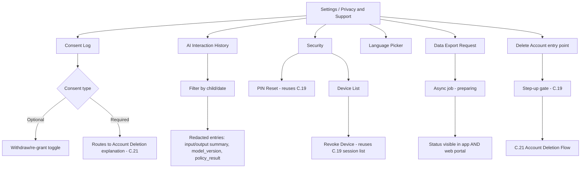
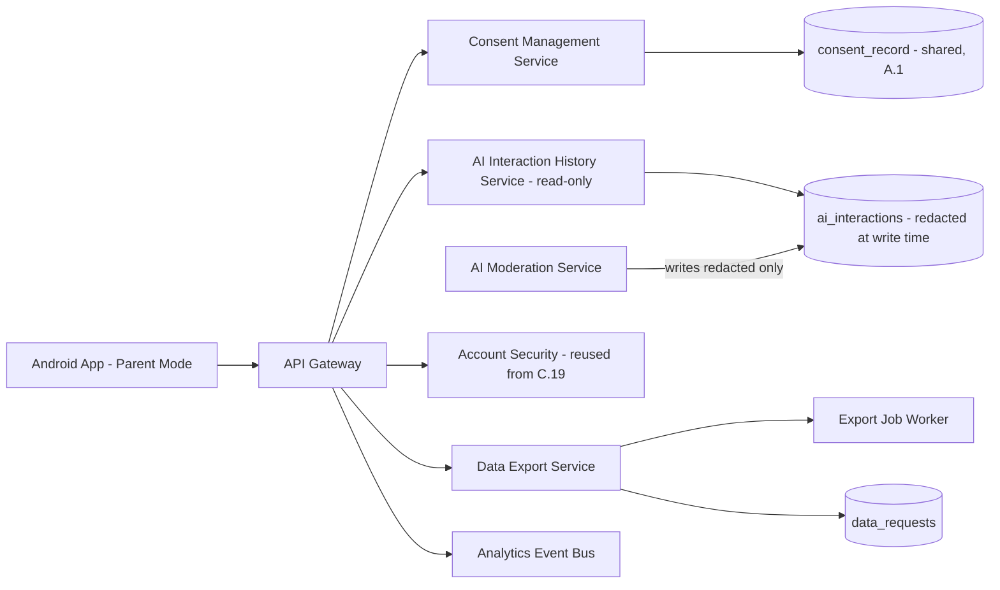
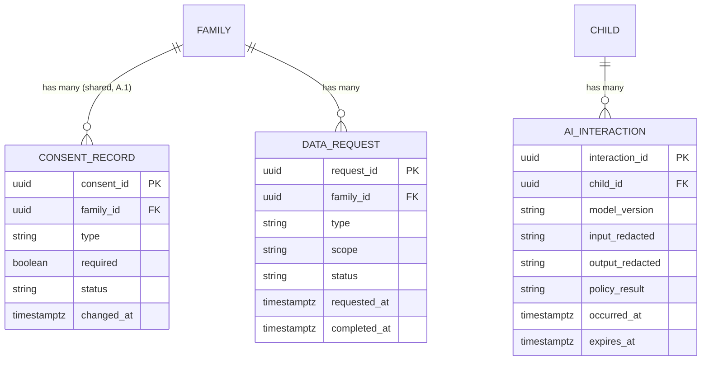

# Feature C.26 — Privacy, Consent, Account Security & Data Rights (Settings)

**App:** NoorHeroes — Islamic Learning App for Children
**Feature Owner:** Product / Trust & Safety / Legal-Compliance
**Status:** Implementation-ready
**Version:** 1.0
**Depends on:** C.19 (Parent PIN/Biometric Gate — step-up on every sensitive action), C.21 (Multi-Child Management — Account Deletion entry point), A.1 (Auth & Onboarding — original consent capture), C.23 (Parental Controls — AI Permissions configuration, cross-referenced not duplicated)
**Feeds into:** C.21 (Delete Account trigger), C.20 (Parent Dashboard entry point), NoorHeroes Web Account Portal (data-export status cross-reference)

> **Scope note:** This document is the canonical specification for the **Settings → Security / Consent / AI History / Language / Data Rights** surface — the "Privacy & Support" and "Settings" screens from the platform's navigation map, minus what's already owned elsewhere: AI Permissions *configuration* (toggles/curated-only mode) belongs to C.23; the Account Deletion *flow itself* (warning, 7-day grace, cascade) belongs to C.21; Notification preferences and the Support ticket system belong to C.25. What remains, and what this document owns in full, is: Account Security (PIN reset trigger, device list and revocation as a settings-surface concern), the Consent Log (review/withdraw individual consents captured at onboarding), the full redacted **AI Interaction History** (distinct from C.22's flags-only Safety Report — this is the richer, still-redacted-at-write-time log), the Language picker, and the Data Export request flow (async, with cross-portal status visibility).

---

## Table of Contents

1. [Product Requirements](#1-product-requirements)
2. [UX/UI Requirements](#2-uxui-requirements)
3. [Backend Requirements](#3-backend-requirements)
4. [Database Design](#4-database-design)
5. [Backend AI Code-Generation Prompt](#5-backend-ai-code-generation-prompt)
6. [Android Requirements](#6-android-requirements)
7. [Android AI Code-Generation Prompt](#7-android-ai-code-generation-prompt)
8. [Admin Requirements](#8-admin-requirements)
9. [Admin AI Code-Generation Prompt](#9-admin-ai-code-generation-prompt)
10. [DevOps Requirements](#10-devops-requirements)
11. [Analytics Requirements](#11-analytics-requirements)
12. [Security Requirements](#12-security-requirements)
13. [QA Requirements](#13-qa-requirements)
14. [Marketing Requirements](#14-marketing-requirements)
15. [Release & Rollback Plan](#15-release--rollback-plan)

---

## 1. Product Requirements

### 1.1 Problem Statement

Parents need genuine, granular visibility into and control over their family's privacy posture — reviewing or withdrawing any consent they gave at onboarding, seeing a real (if redacted) record of what their child's AI interactions actually involved, exporting their family's data, resetting account security, and managing devices — all gated by step-up authentication for anything sensitive, with the AI interaction record redacted **at write time, not just at read time**, and data-export requests handled as genuinely async with consistent status visibility across both the mobile app and the web portal (source: Consolidated Blueprint §9.5 schema notes: "`ai_interactions`: id, child_id, model_version, input_redacted, output_redacted, policy_result, expires_at | Redacted at write time, not just at read time"; NoorHeroes Blueprint Parent Settings screen: "Components: Security (PIN/biometric reset), devices list, consent log, AI controls per child, language picker, export/delete account... Navigation Rules: Export and deletion require step-up authentication").

### 1.2 Business Goals

- Operationalize the platform's consent-and-privacy commitments concretely, not just as legal boilerplate — every consent captured at onboarding (A.1) must be genuinely reviewable and revocable here.
- Provide real AI-safety transparency at a depth beyond C.22's flags-only Safety Report, while maintaining the platform's zero-tolerance "redacted at write time" guarantee — there is no raw, unredacted version of this data anywhere in the system to accidentally leak.
- Support data-portability/export rights as a genuinely functional, async, cross-surface-visible feature, not a dead-end request button.
- Keep Account Security (PIN reset, device management) consistent and reused from C.19/C.23's existing mechanisms rather than introducing a third parallel implementation.

### 1.3 User Goals

- **Parent:** See and control exactly what I consented to, get real visibility into my child's AI interactions (in a safe, redacted form), export my family's data if I want a copy, reset my PIN or manage devices, and pick my preferred language — all from one trustworthy settings area.

### 1.4 Success Metrics

| Metric | Target |
|---|---|
| Consent Log view rate (among active parents) | ≥ 15% (a trust-reinforcing, not necessarily high-frequency, feature) |
| Consent withdrawal completion rate (once initiated) | ≥ 95% |
| AI Interaction History view rate | Tracked, informs whether this transparency feature is actually used |
| Data Export request completion rate | ≥ 90% within the committed SLA |
| PIN reset completion rate | ≥ 95% |
| Device revocation usage rate | Tracked |
| Crash-free Settings sessions | ≥ 99.6% |

### 1.5 Stakeholders

Product Manager, Trust & Safety, Legal/Compliance, Backend Architect, Android Architect, Data Analyst, Security Engineer, QA Lead, Customer Support Lead, feature owners of C.19 (PIN/device reuse), C.21 (deletion entry point), C.23 (AI Permissions cross-reference).

### 1.6 User Stories

1. As a parent, I want to see every consent I gave during onboarding and withdraw any optional one at any time.
2. As a parent, I want to see a redacted record of my child's AI interactions, including anything that was blocked.
3. As a parent, I want to request an export of my family's data and know when it's ready.
4. As a parent, I want to reset my PIN and manage which devices have access to my account.
5. As a parent, I want to choose my preferred app language from one clear setting.
6. As a parent, I want every sensitive action here (export, deletion-adjacent actions, consent withdrawal) to require my PIN again.

### 1.7 Functional Requirements

**FR-1** Settings/Privacy & Support components (canonical, source NoorHeroes Blueprint Parent Settings screen): Security (PIN/biometric reset), devices list, consent log, AI controls per child (cross-ref/link only, configuration owned by C.23), language picker, export/delete account.
**FR-2** Settings actions: reset PIN, revoke device, review/withdraw consent, request export, request account deletion (cross-ref C.21 for the deletion flow itself — this screen's role is the entry point/link).
**FR-3** **Export and deletion require step-up authentication; deletion shows the 7-day grace period explicitly** (source: screen catalog "Navigation Rules" — restated; the deletion *experience* itself is C.21's, this screen only requires the same step-up before linking into it).
**FR-4** **Logout requires confirmation if any unsynced offline downloads exist** (source: screen catalog "Settings — Navigation Rules") — a data-loss-prevention courtesy check specific to the logout action on this screen.
**FR-5** **Data-export requests are async; status shown here and in the web portal** (source: screen catalog "Privacy & Support — Navigation Rules") — the same `data_requests` record is queryable from both surfaces.
**FR-6** AI Interaction History entries are **redacted at write time, not just at read time** — `ai_interactions.input_redacted`/`output_redacted` are the only fields that ever exist for this data; there is no corresponding unredacted column anywhere in the schema for a later read-time filter to fail and leak (source §9.5 schema notes — a hard, structural guarantee, generalizing C.22's flags-only Safety Report into the fuller, still-safe, history view this screen offers).
**FR-7** Each AI Interaction History entry carries `model_version` and `policy_result` (e.g., allowed/blocked/redirected) alongside the redacted input/output summaries and an `expires_at` retention boundary — giving parents genuine context (what kind of interaction, what the system decided) without ever exposing a raw, re-identifiable transcript.
**FR-8** Consent Log entries are individually reviewable and, for optional consents (personalization, voice/AI, marketing — cross-ref A.1 FR-5's required-vs-optional distinction), individually withdrawable; **required consents (Terms, Privacy Policy, child-data-processing) cannot be withdrawn without triggering the broader account-deletion path**, since withdrawing a required consent is functionally equivalent to revoking the basis for the account's existence (cross-ref A.1's consent model, restated here as this screen's withdrawal-eligibility rule).
**FR-9** Withdrawing the AI/voice consent specifically here has the identical effect as toggling AI off via C.23's AI Permissions screen — this screen and C.23 read/write the **same** underlying settings field, never two independently-tracked values that could drift out of sync.
**FR-10** The language picker sets the app's display language; this is the same setting B.16's child-Profile language toggle exposes per-child — at the parent level, this screen sets the **default/family-level** language preference, distinct from (but consistent in mechanism with) a child's own individual override, if any.
**FR-11** PIN reset and device revocation on this screen reuse C.19's exact `ParentGateLauncher`/session-list mechanisms — this screen introduces no parallel PIN-storage or session-management implementation of its own.
**FR-12** Data export produces a structured, parent-readable export of the family's own data (consent history, child profiles' progress summaries, AI interaction history, billing history) — **never** including another family's data, and excluding raw biometric data (which never existed in exportable form to begin with, per A.1/C.19's zero-biometric-storage guarantee).

### 1.8 Non-Functional Requirements

- **Write-Time Redaction:** AI Interaction History redaction must happen at the moment of ingestion, not as a query-time filter — a structural guarantee, not a defense-in-depth layer alone.
- **Step-Up Consistency:** Every sensitive action on this screen (export request, consent withdrawal, PIN reset, account-deletion entry) requires fresh step-up via the same C.19 mechanism used everywhere else in the app.
- **Cross-Surface Consistency:** Data-export request status must be identical whether viewed from the mobile app or the NoorHeroes Web Account Portal — a single source of truth, never two diverging status views.
- **Settings Single-Source-of-Truth:** AI/voice consent here and C.23's AI Permissions toggle must never represent two independently-stored values.

### 1.9 Acceptance Criteria

- Given a parent opens the Consent Log, when it renders, then every consent captured at onboarding is individually listed with its current status and, for optional consents, a withdraw action.
- Given a parent withdraws the AI/voice consent here, when checked from C.23's AI Permissions screen, then it reflects the identical updated state — they are the same setting.
- Given a parent attempts to withdraw a required consent (Terms/Privacy/child-data-processing), when they try, then they are routed toward the account-deletion path rather than a simple toggle-off, since this isn't independently revocable.
- Given a parent opens AI Interaction History, when it renders, then every entry shows only redacted input/output summaries, model version, and policy result — never a raw, re-identifiable transcript, and this is true even immediately after a fresh interaction (no write-time gap where unredacted data briefly exists).
- Given a parent requests a data export, when they check status later from either the mobile app or the web portal, then both show the identical current state.
- Given a parent attempts to log out with unsynced offline downloads present, when they try, then a confirmation prompt appears first.
- Given a parent initiates PIN reset or device revocation, when completed, then it uses the exact same underlying mechanism as C.19's gate and active-session list, never a separate implementation.

### 1.10 Edge Cases

1. A parent withdraws the marketing consent, then later wants to re-grant it (e.g., decides they do want promotional emails after all) → re-granting an optional consent is supported as a straightforward toggle-back-on action, creating a new consent-ledger entry (consistent with A.1's append-only, versioned consent-recording pattern) rather than attempting to "undelete" the prior withdrawal record.
2. A parent requests a data export, then immediately requests a second one before the first completes → the second request either queues behind the first or is recognized as a duplicate-in-progress request (returning the existing request's status rather than spawning a redundant parallel export job) — implementation may choose either approach, but the parent must never see two simultaneously-conflicting "your export is ready" notifications for what should be one logical export.
3. An AI interaction occurs for a child whose family later requests full account deletion, and the 7-day grace period elapses → the AI Interaction History records for that family are subject to the same cascade-deletion/legal-retention rules as all other family data (cross-ref C.21's cascade worker), not independently retained beyond what's legally required.
4. A parent's AI Interaction History query spans a period with zero AI interactions (e.g., AI was disabled for that child the whole time) → shows an explicit "No AI interactions in this period" state, consistent with C.22's established empty-state pattern for the same conceptual absence.
5. A parent revokes a device that is, at that exact moment, in the middle of an active data-export-status poll from that same device → the in-flight read request may complete (read-only, low-risk), but any subsequent request from that revoked device fails authentication immediately after, consistent with C.23's established device-revocation timing pattern.
6. A parent changes the family-level language preference while a specific child has their own individually-overridden display language (per B.16) → the child's own override is unaffected; this screen's language picker only affects the family/parent-level default and any child without their own override.
7. A data export request is made for a family with a very large amount of historical data (long-tenured, many children) → the export job may take longer; the async status model already accommodates this via its "preparing" state, with no different handling needed beyond what the async design already provides.
8. A parent attempts to view AI Interaction History for a child whose AI has always been disabled (never enabled) → shows a friendly empty state distinct from "no interactions this period" — something like "AI has been off for this child the entire time," reinforcing that the absence is by configuration, not a missing-data issue worth flagging as suspicious.

### 1.11 Error Handling

| Scenario | System Behavior |
|---|---|
| Data export request fails to start (backend issue) | Clear retry option, never a silent failure |
| Duplicate export request while one is in-progress | Recognized and deduplicated, or queued; never two conflicting "ready" states |
| Consent withdrawal attempted on a required consent | Routed to the account-deletion explanation rather than a toggle action |
| PIN reset / device revocation failure | Standard C.19 error handling reused, no separate error path |
| Logout attempted with unsynced downloads | Confirmation prompt required before proceeding (FR-4) |

### 1.12 Empty States
- Zero AI interactions ever (AI always disabled) → distinct "AI has been off the entire time" framing (Edge Case 8).
- Zero AI interactions in a selected period (AI enabled but unused) → "No AI interactions in this period" framing (Edge Case 4).
- Zero data-export history yet → friendly "Request your first export anytime" framing.

### 1.13 Loading States
- Settings/Privacy screens: skeleton list shimmer for Consent Log, AI Interaction History, device list.

### 1.14 Offline States
- Settings screens render last-cached data offline; export requests, consent withdrawal, PIN reset, and device revocation all require connectivity and indicate this clearly if attempted offline.

### 1.15 Permission States
- No new runtime permissions; relies entirely on the existing step-up authentication gate (C.19).

### 1.16 User Flow (Narrative)

Parent navigates to Settings or Privacy & Support from the Parent Dashboard → reviews/withdraws individual consents in the Consent Log → views AI Interaction History for safety transparency, filtered by child/date if desired → requests a data export, tracking its async status → manages account security (PIN reset, device list/revocation) → sets the family-level language → if wanting to delete the account entirely, taps through to C.21's dedicated deletion flow, passing through the same step-up gate first.

### 1.17 Detailed Flow Diagram (Mermaid)



### 1.18 Screen Inventory (Complete — Zero Missing)

| # | Screen | Type | Entry Points | Exit Points |
|---|---|---|---|---|
| 1 | Settings (landing) | Primary | Parent Dashboard | Security, Consent Log, AI Interaction History, Language, Privacy & Support |
| 2 | Privacy & Support (landing, may be a sub-section of Settings) | Primary | Settings, Parent Dashboard | Consent Log, AI Interaction History, Data Export, Account Deletion entry |
| 3 | Security — PIN Reset (shared screen with A.1/C.19) | Screen | Settings → Security | Settings (confirmed) |
| 4 | Security — Device List | Screen | Settings → Security | Device Revocation Confirmation |
| 5 | Device Revocation Confirmation | Modal | Device List | Device List (device removed) |
| 6 | Consent Log | Screen | Privacy & Support | Consent Detail / Withdraw Confirmation |
| 7 | Consent Detail (full text + status) | Screen | Consent Log | Withdraw Confirmation (if optional) |
| 8 | Withdraw Optional Consent — Confirmation | Modal | Consent Detail | Consent Log (updated) |
| 9 | Required-Consent Withdrawal Attempt — Account Deletion Explanation | Screen variant | Consent Detail, required consent | Account Deletion entry (C.21) |
| 10 | AI Interaction History | Screen | Privacy & Support, Per-Child Report (C.22) cross-link | AI Interaction Detail |
| 11 | AI Interaction Detail (redacted) | Screen | AI Interaction History | Back |
| 12 | AI Interaction History — "AI Always Off" Empty State | Screen variant | AI Interaction History, AI never enabled for this child | N/A |
| 13 | AI Interaction History — "No Interactions This Period" Empty State | Screen variant | AI Interaction History, zero in selected range | N/A |
| 14 | Language Picker | Screen | Settings | Settings (applied immediately) |
| 15 | Data Export Request | Screen | Privacy & Support | Export Status Tracking |
| 16 | Export Status Tracking (preparing/ready) | Screen | Data Export Request | Download/view export, or continues polling |
| 17 | Account Deletion Entry Point (links into C.21) | Component | Privacy & Support | Step-up Gate → C.21's deletion flow |
| 18 | Logout Confirmation (unsynced downloads present) | Modal | Settings "Logout" | Logged out, or canceled |

### 1.19 Events (Complete Analytics Event List)

`settings_viewed`, `privacy_support_viewed`, `consent_log_viewed`, `consent_detail_viewed`, `consent_withdrawn` (with `consent_type`), `consent_regranted`, `required_consent_withdrawal_attempt_redirected`, `ai_interaction_history_viewed`, `ai_interaction_detail_viewed`, `ai_history_empty_state_shown` (with `reason: never_enabled|no_interactions_period`), `language_changed`, `data_export_requested`, `data_export_status_viewed`, `data_export_completed`, `pin_reset_initiated` (cross-ref C.19), `device_list_viewed`, `device_revoked` (cross-ref C.19/C.23), `logout_unsynced_downloads_confirmation_shown`, `account_deletion_entry_point_tapped`.

---

## 2. UX/UI Requirements

> Global Design System tokens defined in **Feature A.1 §2.1**; Parent-Mode formal visual register established in **Feature C.19 §2.1**; AI Interaction Log's deliberately non-chat-like visual language established in **Feature C.22 §2.1**.

### 2.1 Settings-Specific Design System Extensions

- **Consent Log Visual Language:** Each consent shown as a clear row with its name, current status (Granted/Withdrawn), the date it was last changed, and a clear required/optional tag — required consents visually distinguished (e.g., a small "Required" label) so a parent never mistakes them for a simple toggle.
- **AI Interaction History Visual Language:** Identical, deliberately plain/non-chat-like list pattern to C.22's AI Safety Log — these two screens should feel like the same family of safety-transparency surfaces, just at different depths (C.22's is flags-only/safety-report-scoped; this screen's is the fuller interaction-level history), never visually implying one is "more like a chat" than the other.
- **Export Status Visual Language:** A simple stage-indicator (Requested → Preparing → Ready) consistent with C.25's ticket-status pattern, reused here for visual consistency across the app's various async-job status displays.

### 2.2 Screen-Level Design Requirements (Key Screens)

#### Screen: Consent Log

- **Purpose:** Give parents real, granular visibility and control over what they've consented to.
- **Components:** Per-consent row (name, status, last-changed date, required/optional tag), tap-through to full consent text.
- **States:** Default, Withdraw-confirming, Withdrawn-confirmation, Required-consent-redirect.
- **Accessibility:** Required/optional distinction conveyed via both visual tag and accessible label text, never color alone.

#### Screen: AI Interaction History

- **Purpose:** Real AI-safety transparency without ever exposing raw, re-identifiable content.
- **Components:** Filterable list (by child, by date range), each entry showing a redacted summary, `model_version`, and `policy_result` (allowed/blocked/redirected) with a calm icon per result type.
- **States:** Default, Filtered, "AI always off" empty state, "no interactions this period" empty state.

### 2.3 Tab Structure

Reached from the Parent Dashboard via Settings/Privacy & Support, not a standalone tab.

| Click Target | Destination | API Called | Analytics Event | Permission Check | Error Handling |
|---|---|---|---|---|---|
| Consent Log entry | Consent Detail | `GET /v1/parent/consents` | `consent_detail_viewed` | None | Standard handling |
| "Withdraw" (optional consent) | Withdraw Confirmation | `POST /v1/parent/consents/{id}/withdraw` | `consent_withdrawn` | Step-up (C.19) | Standard handling |
| AI Interaction History entry | Interaction Detail | `GET /v1/children/{id}/ai-history` | `ai_interaction_detail_viewed` | None | Empty-state fallback |
| "Request Export" | Export Status Tracking | `POST /v1/data-requests/exports` | `data_export_requested` | Step-up (C.19) | Retry on failure |
| "Reset PIN" | PIN Reset (shared with A.1/C.19) | Reuses C.19's flow | `pin_reset_initiated` | Step-up | Standard C.19 handling |
| "Revoke" device | Device Revocation Confirmation | `DELETE /v1/sessions/{id}` (shared with C.19/C.23) | `device_revoked` | Step-up | Standard handling |
| "Delete Account" | Step-up Gate → C.21's flow | N/A (navigation) | `account_deletion_entry_point_tapped` | Step-up | Standard C.21 handling |

### 2.4 Wireframe Description (Composite)

Standard settings-list patterns throughout — consent rows, history-list rows, a simple security sub-section — consistent with the platform's general Parent-Mode formal visual register, deliberately unsurprising given this is a trust/compliance-oriented surface where familiarity and clarity matter more than novelty.

### 2.5 Screen Image Generation Prompts

**Screen: Consent Log**
- *Prompt 1 (English):* "Mobile app consent log settings screen UI mockup, formal parent-mode visual register. Warm off-white background. A vertical list of rounded rows, each showing a consent name (e.g., 'Personalization & AI Recommendations'), a status pill ('Granted' in teal or 'Withdrawn' in muted grey), a small 'Optional' or 'Required' tag, and the date last changed in small muted text. One row visually distinguished with a 'Required' tag and no toggle/withdraw control visible, just a small info icon. Clean, transparent, trustworthy aesthetic, soft shadows, rounded corners, warm teal and gold accents used sparingly, no realistic human faces."
- *Prompt 2 (Arabic RTL):* "نفس شاشة إعدادات سجل الموافقات، بطابع بصري رسمي لوضع الوالدين، بتخطيط من اليمين إلى اليسار بالكامل. خلفية بيج فاتح دافئ. قائمة عمودية من صفوف مستديرة، كل منها يعرض اسم الموافقة (مثل 'التخصيص وتوصيات الذكاء الاصطناعي')، شريحة حالة ('ممنوحة' بالفيروزي أو 'مسحوبة' بالرمادي الخافت)، شارة صغيرة 'اختياري' أو 'مطلوب'، وتاريخ آخر تغيير بخط صغير خافت. صف واحد متميز بصريًا بشارة 'مطلوب' وبدون عنصر تبديل/سحب ظاهر، فقط أيقونة معلومات صغيرة. طابع نظيف وشفاف وموثوق، ظلال خفيفة، زوايا دائرية، لمسات فيروزية وذهبية دافئة مستخدمة بقلة، بدون وجوه بشرية واقعية."

**Screen: AI Interaction History**
- *Prompt 1 (English):* "Mobile app AI interaction history screen UI mockup, calm and plain, deliberately not chat-styled. Warm off-white background. A filter row at top with child-selector and date-range chips. Below, a vertical list of rounded rows, each with a small neutral icon (a checkmark in a circle for 'allowed', a shield for 'blocked', an arrow for 'redirected'), a short redacted summary line (e.g., 'Question about a story character - allowed'), the model version in tiny muted text, and a date. No chat bubbles, no quoted raw text. Clean, minimal, reassuring aesthetic, soft shadows, rounded corners, no realistic human faces."
- *Prompt 2 (Arabic RTL):* "نفس شاشة سجل تفاعلات الذكاء الاصطناعي، بطابع هادئ وبسيط، مصمم عمدًا بحيث لا يشبه واجهة محادثة، بتخطيط من اليمين إلى اليسار. خلفية بيج فاتح دافئ. صف تصفية في الأعلى بمحدد طفل ورقاقات نطاق تاريخ. أسفل ذلك قائمة عمودية من صفوف مستديرة، كل منها بأيقونة محايدة صغيرة (علامة صح في دائرة لـ 'مسموح'، درع لـ 'محظور'، سهم لـ 'تمت إعادة التوجيه')، وسطر ملخص منقّى مختصر (مثل 'سؤال عن شخصية في قصة - مسموح')، وإصدار النموذج بخط صغير خافت، وتاريخ. بدون فقاعات محادثة، بدون نص خام مقتبس. طابع نظيف وبسيط ومطمئن، ظلال خفيفة، زوايا دائرية، بدون وجوه بشرية واقعية."

---

## 3. Backend Requirements

### 3.1 System Design Overview

This feature extends the **Family/Identity Service** (consent storage, reused from A.1) with a **Consent Management Service**, exposes a **redacted-at-write-time AI Interaction History read API** over the `ai_interactions` table (a Moderation Service write-target, per the platform's AI pipeline), and reuses C.19's PIN/device infrastructure plus a shared **Data Export Service**.

### 3.2 Architecture Diagram (Mermaid)



### 3.3 Service Breakdown

| Service | Responsibility (all reused, none new) |
|---|---|
| Consent Management Service | Review/withdraw individual consents, append-only consent-ledger writes |
| AI Interaction History Service | Read-only API over `ai_interactions`, never writes (writes are the Moderation Service's responsibility, redacting at that point) |
| Account Security (reused, C.19) | PIN reset, device list/revocation |
| Data Export Service | Async export job orchestration, cross-surface status |

### 3.4 API List

#### `GET /v1/parent/consents`
- **Response 200:** `{ "consents": [ { "id": "...", "type": "personalization|voice_ai|marketing|terms|privacy|child_data", "status": "granted|withdrawn", "required": true, "last_changed_at": "..." } ] }`

#### `POST /v1/parent/consents/{id}/withdraw`
- **Auth:** Bearer + step-up
- **Validation:** Rejects (`422 REQUIRED_CONSENT_CANNOT_WITHDRAW`) for any consent where `required=true` — the response includes a `redirect_to: "account_deletion"` hint for the client.
- **Business Logic:** For `voice_ai` consent specifically, this write updates the **same** underlying field C.23's AI Permissions endpoint reads/writes — implemented as the identical column, never a duplicate.

#### `GET /v1/children/{id}/ai-history?date_from=&date_to=`
- **Response 200:** `{ "interactions": [ { "id": "...", "model_version": "...", "input_redacted": "...", "output_redacted": "...", "policy_result": "allowed|blocked|redirected", "occurred_at": "..." } ] }`
- **Validation:** This endpoint performs **no redaction at read time** — it simply returns what's stored, because redaction already happened at write time; there is no unredacted column for this endpoint to ever accidentally expose.

#### `POST /v1/data-requests/exports`
- **Auth:** Bearer + step-up
- **Response 222:** `{ "request_id": "...", "status": "preparing" }`
- **Idempotency:** A duplicate request while one is already `preparing` for this family returns the existing `request_id` rather than spawning a parallel job (Edge Case 2).

#### `GET /v1/data-requests/{id}`
- **Response 200:** `{ "status": "preparing|ready|failed", "download_url": "..." }` — identical response whether queried from the mobile app or the NoorHeroes Web Account Portal, since both call this same endpoint (FR-5's cross-surface consistency).

#### Reused from C.19: `POST /v1/auth/pin/verify` (PIN reset trigger), `GET /v1/sessions`, `DELETE /v1/sessions/{id}` (device list/revocation).

### 3.5 Cross-Cutting API Concerns

- **Write-time-only redaction:** The single most important structural guarantee — `ai_interactions` has no unredacted-content column anywhere in its schema.
- **Shared-field consistency:** AI/voice consent and C.23's AI-enabled toggle are the same stored value, never two independently-drifting fields.
- **Idempotent export requests:** Prevents duplicate parallel export jobs for the same family.
- **Step-up on every sensitive action:** Export, consent withdrawal, and the account-deletion entry point all require fresh C.19 verification.

---

## 4. Database Design

### 4.1 ER Diagram (Mermaid)



> `consent_record` is the same table introduced in A.1 — this document extends it with `status`/withdrawal semantics rather than duplicating it. `ai_interactions` is sourced directly from §9.5's schema reference.

### 4.2 Tables, Relationships, Constraints

| Table | Key Constraints | Indexes |
|---|---|---|
| `consent_record` | FK `family_id`; CHECK `type IN ('terms','privacy','child_data','personalization','voice_ai','marketing')`; append-only-per-change (each status change is a new versioned row, consistent with A.1's consent-versioning pattern, not an in-place mutation) | Index `(family_id, type, changed_at DESC)` |
| `ai_interaction` | FK `child_id`; **NO COLUMN exists for unredacted input/output anywhere in this table's schema, by structural design**; CHECK `policy_result IN ('allowed','blocked','redirected')` | Index `(child_id, occurred_at DESC)` |
| `data_request` | FK `family_id`; CHECK `type IN ('export','delete')`; CHECK `status IN ('preparing','ready','failed')` | Index `(family_id, requested_at DESC)` |

### 4.3 Audit Fields
`consent_record.changed_at` per versioned entry; `ai_interaction.occurred_at`/`expires_at`; `data_request.requested_at`/`completed_at`.

### 4.4 Soft Delete Rules
N/A for `consent_record` (versioned, append-only); `ai_interaction` rows age out per `expires_at` rather than being soft-deleted; `data_request` rows are operational records with no independent deletion lifecycle.

### 4.5 Retention Rules
`ai_interaction.expires_at` enforces a bounded retention window (consistent with the platform's general data-minimization principle, extended here to even the *redacted* AI history — it doesn't live forever just because it's safe); `consent_record` retained indefinitely as the platform's compliance evidence (consistent with A.1's established consent-retention rigor); `data_request` retained per standard operational-record policy.

---

## 5. Backend AI Code-Generation Prompt

```
You are building the Consent Management Service, AI Interaction History
Service, and Data Export Service for "NoorHeroes." The single most important
guarantee in this entire service: AI INTERACTION CONTENT IS REDACTED AT
WRITE TIME -- the ai_interactions table structurally has no column
capable of storing unredacted input/output, so there is nothing for a
read-time bug to ever leak.

Stack: FastAPI (Python 3.12), PostgreSQL (SQLAlchemy 2.0), Redis, an
async job queue for data export.

Hard requirements:
1. Define the ai_interactions table schema with ONLY input_redacted and
   output_redacted string columns (populated exclusively by the upstream
   AI Moderation Service's redaction step, which is out of scope for this
   service to implement -- this service only ever READS this table, never
   writes to it). Write a SCHEMA INTROSPECTION test asserting no column
   in this table is named or typed in a way consistent with storing raw,
   unredacted conversational content (no "raw_input"/"raw_output"/
   "transcript" column exists, and the redacted columns themselves have a
   reasonable max-length constraint).
2. Implement GET /v1/children/{id}/ai-history as a PURE READ with NO
   redaction logic of its own -- write a test confirming this endpoint's
   implementation contains no string-manipulation/filtering code applied
   to input_redacted/output_redacted before returning them (since
   redaction already happened upstream; this endpoint must not be where
   the safety guarantee actually lives, reinforcing that it lives at
   write time).
3. Implement POST /v1/parent/consents/{id}/withdraw to REJECT withdrawal
   for any consent_record where required=true, returning
   422 REQUIRED_CONSENT_CANNOT_WITHDRAW with a redirect_to:
   "account_deletion" hint -- write a test for this rejection on each of
   the three required consent types (terms, privacy, child_data) and a
   test confirming an OPTIONAL consent (personalization, voice_ai,
   marketing) CAN be withdrawn successfully.
4. Implement voice_ai consent withdrawal to write to the EXACT SAME
   underlying settings field that C.23's AI Permissions endpoint
   (PATCH /v1/family/children/{id}/settings, ai_enabled/
   voice_interaction_enabled fields) reads and writes -- write an
   integration test confirming a withdrawal here is immediately reflected
   when querying via C.23's endpoint, and vice versa, proving they share
   one underlying value, not two independently-tracked ones.
5. Implement POST /v1/data-requests/exports with idempotent dedup: if a
   family already has a data_request with type='export' and
   status='preparing', a new request returns the EXISTING request_id
   rather than creating a parallel job -- write a test for this exact
   deduplication.
6. Implement GET /v1/data-requests/{id} to be callable identically (same
   response shape, same data) regardless of which client surface calls
   it (mobile app vs. the web portal hitting the same backend endpoint)
   -- write a test confirming no surface-specific branching logic exists
   in this endpoint's implementation.

Deliver: FastAPI routers, SQLAlchemy models, Alembic migrations
(extending A.1's existing consent_record table, defining the new
ai_interactions read contract and data_request table), Pydantic schemas,
and a pytest suite covering all 6 items, with items 1 (structural
write-time-only redaction) and 4 (shared consent/settings field, not
duplicated) treated as the two highest-priority guarantees.
```

---

## 6. Android Requirements

### 6.1 Technical Requirements
Kotlin, Jetpack Compose, MVVM, Clean Architecture, module `:feature:parent-settings`, depends on `:core:auth` (C.19's PIN/device/step-up infrastructure), `:core:design-system`, `:core:network`, `:core:offline-cache`.

### 6.2 Screen Mapping
`SettingsScreen`, `ConsentLogScreen`, `AiInteractionHistoryScreen`, `LanguagePickerScreen`, `DataExportRequestScreen`, `DeviceListScreen` Composables; PIN reset reuses A.1/C.19's existing screen rather than a new implementation.

### 6.3 Navigation Flow
Reached from C.20's Dashboard; sensitive actions route through `:core:auth's` `ParentGateLauncher.requireParentAuth(...)` with appropriate trigger contexts (`Settings`, `PinReset`, a new `DataExport` context, etc.); "Delete Account" links into C.21's existing flow rather than reimplementing any part of it here.

### 6.4 State Management
`ConsentLogViewModel's` withdraw action for `voice_ai` consent and `:feature:parental-controls's` (C.23) AI Permissions toggle both read from and write to the **same shared repository method** (`FamilySettingsRepository.updateAiSettings()`) — neither module maintains its own independent cached copy that could drift.

### 6.5 API Mapping
`ConsentRepository.getConsents()/withdraw()`, `AiHistoryRepository.getHistory()`, `DataExportRepository.request()/getStatus()` map to their respective endpoints; device list/PIN reset reuse `:core:auth's` existing repositories.

### 6.6 Analytics Mapping
`ParentSettingsAnalytics` fires events per §1.19.

### 6.7 Offline Support
Settings screens render last-cached data offline; all mutating actions (withdraw, export request, PIN reset, device revocation) require connectivity.

### 6.8 Deep Linking
`noorheroes://parent/settings`, `.../settings/consent`, `.../settings/ai-history`, `.../settings/export`.

### 6.9 Push Notifications
Export-ready notifications (owned by C.25) deep-link into the Export Status Tracking screen.

### 6.10 Testing Strategy
- Unit: shared-field consistency between Consent Log's voice_ai withdrawal and C.23's AI Permissions toggle (an integration test using a shared fixture repository).
- UI tests: a required consent's row never renders a withdraw/toggle control, only an info icon routing to the account-deletion explanation; AI Interaction History never renders chat-bubble-shaped components (mirroring C.22's exact test pattern).
- Integration: full consent-withdrawal flow; full data-export request-to-ready flow with idempotent-duplicate-request handling; logout-with-unsynced-downloads confirmation flow.

---

## 7. Android AI Code-Generation Prompt

```
Build the `:feature:parent-settings` Android module for NoorHeroes using
Kotlin, Jetpack Compose, MVVM, Clean Architecture, reusing `:core:auth's`
existing PIN/device/step-up infrastructure (C.19) rather than
reimplementing any of it.

Hard requirements:
1. Implement ConsentLogScreen to render a withdraw/toggle control ONLY
   for consents where required=false -- for required=true consents,
   render only an info icon that, when tapped, navigates to an
   "Account Deletion" explanation screen (linking into `:feature:child-
   management's` C.21 deletion flow) -- write a UI test confirming no
   interactive withdraw control exists anywhere on a required-consent row.
2. Implement the voice_ai consent withdrawal action and `:feature:
   parental-controls's` (C.23) AI-enabled toggle to BOTH call the SAME
   shared repository method (e.g., FamilySettingsRepository.
   updateAiSettings()) -- write an integration test toggling AI off via
   one module's UI and confirming the other module's UI reflects this
   change on next load, proving they share one underlying state, not two.
3. Implement AiInteractionHistoryScreen using the SAME structural
   "never render chat-bubble-shaped components or quoted text" UI test
   pattern already established for C.22's AI Safety Log screen -- write
   this test here too, since this screen handles conceptually similar
   (if richer) AI-interaction data.
4. Implement DataExportRequestScreen and its status-tracking flow with
   idempotent client-side handling: if a request is already in-flight
   (per the last-known server state), tapping "Request Export" again
   should show the EXISTING status rather than firing a new duplicate
   request -- write a test for this.
5. Implement the Settings "Logout" action to check for unsynced offline
   downloads (querying `:core:download-manager's`/`:core:offline-sync's`
   pending-sync state from B.15) and show a confirmation dialog if any
   exist before proceeding -- write a test for both the "no pending
   syncs, logs out immediately" and "pending syncs exist, shows
   confirmation first" paths.

Use Hilt, Retrofit+OkHttp, Room. Follow Global Design System tokens from
`:core:design-system`, reusing C.22's AI-log visual pattern and C.25's
async-status-stage-indicator pattern rather than redefining either locally.
```

---

## 8. Admin Requirements

- **Consent Type Registry:** Admin-managed definitions of consent types (name, required/optional flag, display text version) — changes here are scholar/legal-reviewed given their compliance significance, consistent with the platform's content-governance pattern applied to legal text.
- **AI Interaction History Retention Configuration:** Admin-tunable `expires_at` default window for `ai_interactions`, behind an elevated (`trust_safety`/`ai_ops`) role given its data-minimization implications.
- **Data Export Job Monitor (Read-only):** Visibility into export-job success/failure rates and processing times, an operational health signal.
- **Data Subject Request Audit Log (Read-only):** Visibility into every `data_request` for compliance reporting (cross-ref C.21's similarly-patterned Deletion Case Audit Log).

CRUD permissions: Consent Type Registry = full CRUD behind `legal_compliance`/`content_editor` role; AI Interaction Retention Config = Update-only behind `trust_safety`/`ai_ops`; Data Export Job Monitor = Read-only behind `product_admin`; Data Subject Request Audit Log = Read-only behind `support`/`trust_safety`/`compliance`.

---

## 9. Admin AI Code-Generation Prompt

```
Build an internal admin module (React + TypeScript, existing NoorHeroes
Admin Portal shell) for managing consent types and data-rights
operational visibility.

Pages:
1. Consent Type Registry -- CRUD for consent_record TYPE definitions
   (type code, required boolean, display text version reference linking
   to the existing legal-content versioning system from A.1). Changes
   route through legal/scholar review before becoming the active version
   shown to new registrants. Restricted to legal_compliance/content_editor
   role.
2. AI Interaction History Retention Configuration -- a settings form for
   the default ai_interactions.expires_at window, restricted to
   trust_safety/ai_ops role given its data-minimization significance.
3. Data Export Job Monitor -- read-only dashboard showing export-job
   success/failure rates and average processing time over time, sourced
   from a read-only aggregated endpoint.
4. Data Subject Request Audit Log -- a read-only, paginated table of
   data_request records (masked family identifier, type, status,
   timestamps), restricted to support/trust_safety/compliance roles.

Enforce RBAC via the existing Admin Portal role context. Every mutating
action writes an immutable audit_log row.
```

---

## 10. DevOps Requirements

- **Infrastructure:** The Data Export Service's async worker scaled for occasional bursty load; the AI Interaction History read API is a low-write, read-mostly service (writes belong to the upstream Moderation Service).
- **CI/CD:** The structural write-time-redaction schema test and the shared-consent/settings-field consistency test (§5 items 1 and 4) are mandatory CI gates.
- **Monitoring/Logging/Alerting:** Alert (P0) on any detected attempt to add an unredacted-content column to `ai_interactions` in a future migration (a schema-change canary). Alert on data-export job failure-rate spikes. Alert on any detected drift between the voice_ai consent value and C.23's AI-enabled setting (should be structurally impossible given the shared-field design, monitored as defense-in-depth).
- **Disaster Recovery:** `consent_record` at the platform's compliance-evidence durability tier; `ai_interactions` at standard tier (already minimized/redacted, with a bounded retention window); `data_request` at standard tier.
- **Rollback Strategy:** Any deploy touching the consent-withdrawal or AI-history-read logic requires a staging verification confirming the required-consent-rejection and shared-field-consistency guarantees before promotion.
- **Backup Strategy:** Standard-to-high tier for `consent_record`; standard for `ai_interactions`/`data_request`.
- **Environment Setup:** Staging supports fixture AI interaction records with varied `policy_result` values and fixture consent states (including required-consent-withdrawal-attempt scenarios) for reliable QA.

---

## 11. Analytics Requirements

### 11.1 Event Taxonomy
Full list in §1.19.

### 11.2 Funnel Analysis
`consent_log_viewed` → `consent_detail_viewed` → (`consent_withdrawn` OR `required_consent_withdrawal_attempt_redirected`) — measures genuine engagement with privacy controls, a trust-health signal. Separately: `data_export_requested` → `data_export_completed` — measures the data-portability feature's actual functional completion rate.

### 11.3 Dashboard Metrics
Consent withdrawal rate by type (informs whether specific optional consents are broadly trusted or widely declined), AI Interaction History view rate (informs whether this transparency feature is discovered/used), data-export completion rate and typical turnaround time, device-revocation usage rate.

### 11.4 Cohort & Retention
Cohort by Consent-Log-engagement; correlate genuine privacy-control usage with overall trust/retention signals (testing whether parents who actively exercise these rights are more or less likely to remain subscribed — informative either way for product strategy).

### 11.5 Learning Metrics
None directly.

---

## 12. Security Requirements

### 12.1 Threat Analysis
- **Raw AI interaction content exposure (this feature's defining risk):** mitigated structurally — no unredacted column exists anywhere in the schema, the strongest possible mitigation.
- **Consent/AI-settings field drift (two independently-tracked values diverging):** mitigated by the shared-field design, with both this feature and C.23 reading/writing the identical underlying value.
- **Required-consent withdrawal creating an undefined account state:** mitigated by routing such attempts to the account-deletion path instead, never allowing a partial/undefined "account exists but lacks required consent" state.
- **Data export leaking cross-family data:** mitigated by strict family-scoping on the export job's data-gathering logic.

### 12.2 OWASP Checklist (Applied)
Security Misconfiguration: the structural absence of an unredacted-content column and the shared (not duplicated) consent/settings field are both misconfiguration-defense patterns — the dangerous state simply isn't representable.

### 12.3 API Security
Step-up authentication on every sensitive action; strict family-scoping on data export and AI history reads.

### 12.4 Mobile Security
No new sensitive data handling beyond what's already governed by the underlying consent/AI-history data, themselves minimized by design.

### 12.5 Admin Security
Consent Type Registry changes are legal/scholar-reviewed given their compliance weight; AI Interaction Retention Configuration requires elevated `trust_safety`/`ai_ops` privilege.

### 12.6 Data Encryption & PII Protection
`ai_interactions` is redacted at write time as its core privacy guarantee; `consent_record` and `data_request` follow standard child/family-data governance.

### 12.7 Child Safety Requirements
The write-time-redaction guarantee for AI interaction history is this feature's defining child-and-family-privacy commitment, directly extending the platform's Child-Safe AI Layer's "Parent Audit" principle (storing AI interaction history, controls, reports, and kill-switch events) into a genuinely safe, parent-visible form.

### 12.8 Compliance Requirements
This feature is, in large part, the platform's operational implementation of data-subject-rights obligations (consent review/withdrawal, data export) — held to the rigor those obligations require, with `consent_record` retention specifically supporting long-term compliance evidence.

### 12.9 Security Checklist (Pre-Launch)
- [ ] Structural write-time-only redaction verified via schema introspection (no unredacted column exists)
- [ ] Shared consent/AI-settings field consistency verified (no drift between this feature and C.23)
- [ ] Required-consent-withdrawal rejection verified for all three required consent types
- [ ] Idempotent data-export-request deduplication verified
- [ ] Cross-surface (app vs. web portal) data-export-status consistency verified

---

## 13. QA Requirements

### 13.1 Test Plan Summary
Coverage spans: structural write-time-redaction (signature test), shared consent/settings field consistency (signature test), required-consent-withdrawal rejection, idempotent export requests, and all 8 edge cases from §1.10.

### 13.2 Test Cases — Happy Path
1. Parent reviews the Consent Log, withdraws the marketing consent, and later re-grants it.
2. Parent views AI Interaction History for a child, sees redacted entries with clear policy results, and confirms no raw content is ever shown.
3. Parent requests a data export, tracks its status to completion, and downloads it; the same status is visible from the web portal.

### 13.3 Edge Cases
All 8 items from §1.10.

### 13.4 Negative Cases
- Attempt to withdraw a required consent → rejected, redirected to account-deletion explanation.
- Introspect the `ai_interactions` schema for any unredacted-content column → none found.
- Toggle AI off via the Consent Log, then check C.23's AI Permissions screen → reflects the identical change.
- Submit a duplicate export request while one is already preparing → returns the existing request, no parallel job created.

### 13.5 Regression Cases
Full suite re-run on every release touching the Consent Management Service, AI Interaction History Service, or Data Export Service.

### 13.6 Automation Cases
End-to-end: full consent-review-withdraw-regrant flow; full AI-history-view flow with content-safety UI scan (CI-blocking); full export-request-to-ready flow with idempotency verification (CI-blocking); shared-field consistency automated test between this feature and C.23.

---

## 14. Marketing Requirements

- **Launch Plan:** Position genuine consent control and real (redacted) AI-interaction transparency as concrete proof points behind the platform's broader privacy/trust narrative.
- **Push Notifications:** Export-ready notifications owned by C.25.
- **Release Notes:** Not typically called out individually given its compliance/utility nature.
- **App/Play Store Description:** "Review and control every consent you've given, see real (safely redacted) AI interaction history, and export your family's data anytime" as a genuine, testable privacy claim.
- **ASO Keywords:** "kids app data privacy," "Islamic app parental consent control," "kids app data export."

---

## 15. Release & Rollback Plan

### 15.1 Release Plan
Phased rollout 25% → 75% → 100% over 2–3 days, with the structural write-time-redaction and shared-field-consistency test suites required to pass at each stage.

### 15.2 Rollback Plan
Rollback triggers (all P0): any confirmed unredacted AI content reaching this feature's API responses, any confirmed drift between the shared consent/AI-settings field, any confirmed required-consent withdrawal succeeding without redirect, any confirmed cross-family data leak via export. Mechanism: standard deployment rollback.

### 15.3 Success Metrics for Go/No-Go
Matches §1.4 targets. Go/no-go reviewed by Product, Legal/Compliance, Security, and Trust & Safety jointly — the write-time-redaction guarantee specifically requires confirmation that the schema-introspection test suite is green before this feature's AI-history surface goes live in production.
