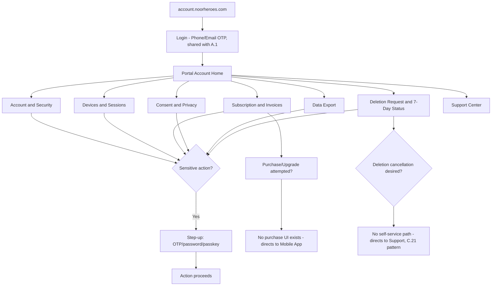
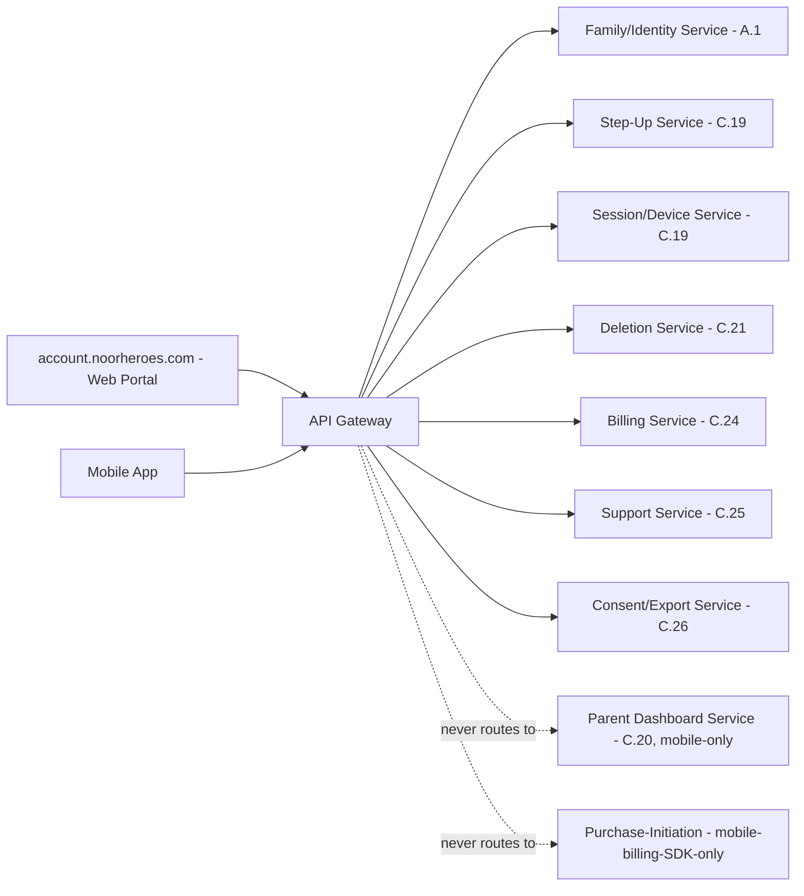

# Feature D.27 — Parent Web Account Portal (account.noorheroes.com)

**App:** NoorHeroes — Islamic Learning App for Children
**Feature Owner:** Product / Platform / Trust & Safety
**Status:** Implementation-ready
**Version:** 1.0
**Depends on:** A.1 (Auth & Onboarding — shared identity/OTP), C.19 (Parent PIN/Biometric Gate — step-up parity), C.21 (Multi-Child Management — deletion-status cross-reference), C.24 (Subscription & Billing — entitlement display), C.26 (Privacy/Consent/Data Rights — shared consent/export contracts)
**Feeds into:** Nothing downstream in the mobile app (this is a terminal, narrow-scope web surface); cross-references the Mobile App for every action explicitly out of its scope

> **Scope note:** This document specifies the **entire Parent Web Account Portal** (`account.noorheroes.com`) — a deliberately narrow, responsive web surface covering exactly eight screens: Login/OTP, Account & Security, Devices & Sessions, Subscription/Invoices, Consent & Privacy, Data Export, Parent Deletion Request & 7-Day Status, and Support Center. Its single most important architectural property is **what it does not do**: it never shows the Parent Progress Dashboard, any child-specific data, or any app-store purchase flow — those remain exclusively in the Mobile App. Every backend contract this portal calls is **shared and reused** from the Mobile App's own already-specified services (A.1's identity/OTP, C.19's step-up, C.21's deletion, C.24's billing, C.26's consent/export) — this document introduces no parallel backend logic, only a second, narrower client surface against the same APIs.

---

## Table of Contents

1. [Product Requirements](#1-product-requirements)
2. [UX/UI Requirements](#2-uxui-requirements)
3. [Backend Requirements](#3-backend-requirements)
4. [Database Design](#4-database-design)
5. [Backend AI Code-Generation Prompt](#5-backend-ai-code-generation-prompt)
6. [Frontend (Web) Requirements](#6-frontend-web-requirements)
7. [Frontend AI Code-Generation Prompt](#7-frontend-ai-code-generation-prompt)
8. [Admin Requirements](#8-admin-requirements)
9. [Admin AI Code-Generation Prompt](#9-admin-ai-code-generation-prompt)
10. [DevOps Requirements](#10-devops-requirements)
11. [Analytics Requirements](#11-analytics-requirements)
12. [Security Requirements](#12-security-requirements)
13. [QA Requirements](#13-qa-requirements)
14. [Marketing Requirements](#14-marketing-requirements)
15. [Release & Rollback Plan](#15-release--rollback-plan)

---

## 1. Product Requirements

### 1.1 Problem Statement

Some parent-account tasks — checking an invoice, reviewing security/devices, requesting a data export, or resolving a billing question — are more naturally done from a desktop browser than a phone, but must never become a backdoor around the platform's child-data and purchase-policy boundaries. NoorHeroes needs a narrow, genuinely useful web account portal that handles exactly these account-level tasks and explicitly, structurally excludes anything touching a child's data, progress, or any app-store purchase initiation (source: Consolidated Blueprint §5.1: "**Parent Web Account Portal** (`account.noorheroes.com`) — a narrow, responsive web surface limited to account, security, devices, billing/invoices, consent, data export, support, and deletion status. It **excludes** the Parent Progress Dashboard and all child-specific data"; §5.4 Web business rules).

### 1.2 Business Goals

- Reduce mobile-only friction for legitimate desktop-convenient account tasks (reviewing an invoice, managing devices, requesting an export) without expanding the platform's child-data attack surface to a second client type.
- Maintain strict store-policy compliance — the web portal must never attempt to initiate a purchase outside the app-store's own provider policy.
- Reinforce, not duplicate, the Mobile App's already-hardened identity, step-up, billing, consent, and deletion backend services — this portal is a thin, scope-limited second client.
- Provide a credible web presence for account/billing support that complements, rather than competes with, the Mobile App's Parent Area.

### 1.3 User Goals

- **Parent:** Log in from a browser to check my invoice, review my account security and devices, manage consent, request a data export, check the status of an account-deletion request, or get support — without needing my phone, but also without expecting to see my child's progress or make a purchase here.

### 1.4 Success Metrics

| Metric | Target |
|---|---|
| Web portal login success rate | ≥ 95% |
| Invoice/billing-task completion rate (web) | ≥ 90% |
| Data export requests initiated via web (vs. mobile) | Tracked, informs relative surface usage |
| Zero out-of-scope content/purchase incidents (child data or app-store purchase reachable from web) | 0 (hard, zero-tolerance) |
| Step-up authentication success rate (web) | ≥ 95% |
| Crash-free / error-free web sessions | ≥ 99.5% |

### 1.5 Stakeholders

Product Manager, Web Platform Engineer, Backend Architect (reusing A.1/C.19/C.21/C.24/C.26's existing services), Security Engineer, Legal/Compliance, Data Analyst, QA Lead, Customer Support Lead.

### 1.6 User Stories

1. As a parent, I want to log in to a web portal using the same phone/email OTP I use on mobile.
2. As a parent, I want to review my account security and manage my PIN/password from a browser.
3. As a parent, I want to see and revoke devices linked to my account.
4. As a parent, I want to view my subscription, invoices, and get guidance to manage purchases on my phone.
5. As a parent, I want to review and manage my consent from the web, same as on mobile.
6. As a parent, I want to request a data export from the web and track its status.
7. As a parent, I want to see my account-deletion status and countdown if I've requested it, and know how to contact Support to cancel.
8. As a parent, I want to reach Support from the web portal.
9. As a parent, I want assurance that I will never see my child's progress, reports, or any purchase flow from this web portal — those stay on my phone.

### 1.7 Functional Requirements

**FR-1** Parent Web Account Portal screens (canonical, complete list, source §5.4): (1) Parent login and OTP; (2) Account and security; (3) Devices and sessions; (4) Subscription, invoices, cancellation, restore-purchase guidance; (5) Consent and privacy; (6) Data export; (7) Parent deletion request and seven-day status; (8) Support center.
**FR-2** **The web portal cannot initiate app-store purchases outside provider policy; it may display the active entitlement and direct the parent to the mobile app appropriately** (source §5.4 Web business rules — a hard, zero-exception rule; cross-ref C.24 FR-7).
**FR-3** **Sensitive actions require recent OTP/password/passkey or equivalent step-up authentication** (source §5.4 — the web-surface equivalent of C.19's mobile step-up gate, applied to billing, consent, export, deletion, and device-revoke actions specifically).
**FR-4** **Child progress, reports, AI history, screen-time controls, and child selectors remain app-only** — these are **structurally absent** from the web portal, not merely hidden behind a missing link (source §5.4 — restated as a hard architectural exclusion, cross-ref C.20's Parent-Session-Only-Gate pattern extended here to a Web-Portal-Cannot-Reach-Child-Data pattern).
**FR-5** **Child disable and permanent-deletion requests are initiated from a verified app Parent Profile, or via Support — never from the web portal directly** (source §5.4 — restated; cross-ref C.21's structural absence of self-service deletion-cancellation, now joined by this portal's structural absence of *any* child-deletion-initiation capability whatsoever, mobile-app-only by design).
**FR-6** Account & Security screen: profile edit, password/PIN reset (the same underlying credential as the mobile app's Parent PIN, reused not duplicated), language preference.
**FR-7** Devices and Sessions screen: lists active sessions/devices (reusing C.19's exact session-list/revocation contract), supports revocation with the same immediate force-logout effect specified there.
**FR-8** Subscription screen: current plan, entitlements, invoice history, cancellation (access continues until period end, consistent with C.24's lifecycle rules), and **restore-purchase guidance** that directs the parent to the mobile app rather than attempting a restore action on the web itself (since restore-purchase is inherently a mobile-OS-billing-API action).
**FR-9** Consent & Privacy screen: the same Consent Log content and withdraw/re-grant actions specified in C.26, rendered as a second client against the identical backend contract.
**FR-10** Data Export screen: request and track status identically to C.26's mobile flow — **the exact same `data_requests` record**, queryable consistently from both surfaces (cross-ref C.26 FR-5).
**FR-11** Parent Deletion Request & 7-Day Status screen: a parent may **initiate** the account-deletion request from the web portal (step-up gated, full warning shown, identical to C.21's mobile flow) and view the countdown status during the grace period; **cancellation remains Support-mediated only**, with zero self-service cancellation capability on the web either, consistent with C.21's platform-wide rule.
**FR-12** Support Center screen: FAQ search and ticket submission/status, reusing C.25's exact backend contract.
**FR-13** The portal must be fully responsive (desktop and mobile-browser-viewport usable), though its primary design target is desktop given its complementary relationship to the Mobile App.

### 1.8 Non-Functional Requirements

- **Structural Scope Exclusion:** Child progress, reports, AI history, screen-time controls, child selectors, and any purchase-initiation flow are absent from this codebase entirely — there is no route, component, or API call anywhere in the web portal's frontend capable of reaching this data/capability, a structural guarantee enforced by the frontend's own architecture, not just route-guarding.
- **Backend Reuse:** Every backend capability this portal exposes reuses an existing, already-hardened service (A.1/C.19/C.21/C.24/C.25/C.26) — zero new backend business logic is introduced by this document.
- **Step-Up Parity:** The web portal's step-up mechanism (OTP/password/passkey re-verification) provides equivalent security assurance to the mobile app's PIN/biometric gate for the same class of sensitive actions.
- **Performance:** Page load p95 < 1.5s on a standard broadband connection; this is a low-complexity, low-interactivity surface by design.

### 1.9 Acceptance Criteria

- Given a parent visits `account.noorheroes.com`, when they log in via phone/email OTP, then they reach the portal's account home, never the Mobile App's Parent Dashboard or any child data.
- Given a parent searches the entire web portal for any path to view a specific child's progress, reports, or AI history, when they look, then no such path exists anywhere in the portal.
- Given a parent attempts to purchase or upgrade a subscription from the web portal, when they try, then no purchase-initiation UI exists — only entitlement display and a clear "manage this on your phone" direction.
- Given a parent requests a data export from the web portal, when they later check status from the Mobile App, then both surfaces show the identical current state.
- Given a parent initiates an account-deletion request from the web portal, when they confirm, then the same 7-day grace period, warning copy, and `deletion_pending` state apply exactly as the Mobile App's equivalent flow would produce.
- Given a parent is in the deletion grace period and logs into the web portal, when they do, then they see the countdown status and a Support-contact path, with no self-service cancellation option anywhere.
- Given a parent attempts any billing, consent, export, deletion, or device-revoke action, when they do, then fresh step-up verification is required first.

### 1.10 Edge Cases

1. A parent logs into the web portal on a device/browser that has never been seen before → this is treated as a new session requiring full OTP verification, not silently trusted based on any mobile-app-side device trust the parent may have established elsewhere.
2. A parent revokes a mobile device from the web portal's Devices screen while actively using that exact device → the mobile session is force-logged-out immediately (reusing C.19's exact revocation behavior), a deliberate, expected consequence, not a bug.
3. A parent attempts to deep-link or directly navigate to a URL pattern resembling a child-data or purchase route → the web portal's routing has no such route defined at all; the result is a standard 404, never an accidental data exposure via a forgotten or partially-implemented route.
4. A parent initiates a deletion request from the web portal, then later opens the Mobile App during the same grace period → the Mobile App's own deletion-status display (C.21) reflects the identical `deletion_pending` state and `delete_after` timestamp, since both surfaces read the same backend record.
5. A parent's session on the web portal expires mid-action → the portal preserves the in-progress form data locally where reasonably possible and prompts a fresh login, rather than silently discarding the parent's work.
6. A parent attempts to use the web portal's Subscription screen to perform a restore-purchase action → no such action exists on the web; the screen explicitly directs them to the mobile app's restore mechanism instead (FR-8).
7. A parent without JavaScript enabled, or using an unusual/outdated browser, accesses the portal → the portal degrades gracefully (a basic, functional experience for core account tasks) rather than presenting a broken or blank page.
8. Two co-guardians, one using the Mobile App and one using the web portal, both adjust the same account's language preference simultaneously → standard last-write-wins semantics apply, consistent with similar low-stakes-preference-conflict handling established elsewhere (cross-ref C.23 Edge Case 7).

### 1.11 Error Handling

| Scenario | System Behavior |
|---|---|
| Unrecognized device/browser login attempt | Full OTP step-up required, no silent trust |
| Direct navigation to a non-existent (child-data/purchase) route | Standard 404, never a partial data exposure |
| Session expires mid-form | In-progress data preserved locally where feasible, fresh login prompted |
| JavaScript disabled / unusual browser | Graceful degradation to a basic functional experience |
| Step-up verification failure | Standard retry/lockout behavior consistent with A.1/C.19's established patterns |

### 1.12 Empty States
- Zero invoices yet (new subscriber) → friendly "Your invoices will appear here" framing, consistent with C.24's mobile equivalent.
- Zero devices listed → friendly "No devices found yet" framing.

### 1.13 Loading States
- Standard web skeleton/loading-state patterns per screen, consistent with the portal's overall low-complexity design.

### 1.14 Offline States
- Standard web offline handling — a clear "you're offline" banner if connectivity drops mid-session, with retry guidance.

### 1.15 Permission States
- No device-level runtime permissions apply to a web portal in the mobile-app sense; standard browser cookie/storage consent follows standard web-compliance practice, separate from this document's scope.

### 1.16 User Flow (Narrative)

Parent visits `account.noorheroes.com` → logs in via phone/email OTP (shared with A.1's identity service) → reaches the portal's account home → navigates to Account & Security, Devices & Sessions, Subscription, Consent & Privacy, Data Export, Deletion Status, or Support Center → any sensitive action requires fresh step-up verification → for anything touching a child specifically, or wanting to make a purchase, the portal has no capability at all and directs the parent to the Mobile App.

### 1.17 Detailed Flow Diagram (Mermaid)



### 1.18 Screen Inventory (Complete — Zero Missing)

| # | Screen | Type | Entry Points | Exit Points |
|---|---|---|---|---|
| 1 | Login / OTP | Primary | Direct navigation to `account.noorheroes.com` | Portal Account Home |
| 2 | Portal Account Home (landing) | Primary | Login success | All sub-screens |
| 3 | Account & Security | Screen | Account Home | Password/PIN Reset, Language Preference |
| 4 | Password/PIN Reset (step-up gated) | Screen | Account & Security | Account & Security (confirmed) |
| 5 | Devices and Sessions | Screen | Account Home, Account & Security | Device Revocation Confirmation |
| 6 | Device Revocation Confirmation (step-up gated) | Modal | Devices and Sessions | Devices list (updated) |
| 7 | Subscription & Invoices | Screen | Account Home | Invoice Detail, Cancellation Confirmation, "Manage on Mobile App" guidance |
| 8 | Invoice Detail | Screen | Subscription & Invoices | Back |
| 9 | Cancellation Confirmation (step-up gated) | Screen | Subscription & Invoices | Subscription & Invoices (status updated) |
| 10 | Restore-Purchase Guidance (directs to Mobile App) | Screen variant | Subscription & Invoices | N/A (external guidance only) |
| 11 | Consent & Privacy | Screen | Account Home | Consent Detail, Withdraw Confirmation |
| 12 | Consent Detail | Screen | Consent & Privacy | Withdraw Confirmation (if optional) |
| 13 | Withdraw Consent Confirmation (step-up gated) | Modal | Consent Detail | Consent & Privacy (updated) |
| 14 | Data Export Request (step-up gated) | Screen | Account Home | Export Status Tracking |
| 15 | Export Status Tracking | Screen | Data Export Request | Download link (when ready) |
| 16 | Parent Deletion Request (step-up gated) | Screen | Account Home | Deletion Warning |
| 17 | Deletion Warning (7-day framing) | Screen | Parent Deletion Request | Deletion Confirmation |
| 18 | Deletion Confirmation | Screen | Deletion Warning | Deletion Status (countdown) |
| 19 | Deletion Status / Countdown (shown on subsequent logins during grace period) | Screen variant | Login during grace period | Support Center (cancellation contact) |
| 20 | Support Center | Screen | Account Home | FAQ Search, Contact Support Form, Ticket History |
| 21 | FAQ Search | Screen | Support Center | FAQ Article Detail |
| 22 | Contact Support Form | Screen | Support Center, FAQ fallback | Ticket Submitted Confirmation |
| 23 | Ticket History / Detail | Screen | Support Center | Back |

### 1.19 Events (Complete Analytics Event List)

`web_portal_login_attempted`, `web_portal_login_succeeded`, `web_portal_login_failed_unrecognized_device`, `web_account_security_viewed`, `web_password_pin_reset_initiated`, `web_devices_viewed`, `web_device_revoked`, `web_subscription_viewed`, `web_invoice_viewed`, `web_cancellation_initiated`, `web_cancellation_completed`, `web_restore_purchase_guidance_shown`, `web_consent_viewed`, `web_consent_withdrawn`, `web_data_export_requested`, `web_data_export_status_viewed`, `web_deletion_request_initiated`, `web_deletion_warning_shown`, `web_deletion_confirmed`, `web_deletion_status_viewed_during_grace`, `web_support_center_viewed`, `web_faq_search_performed`, `web_ticket_submitted`, `web_step_up_required_shown`, `web_step_up_succeeded`, `web_step_up_failed`.

---

## 2. UX/UI Requirements

> The Web Portal follows the platform's **Dual-User Design Rule** — shared color tokens, typography scale, spacing, icons, controls, form behavior, feedback states, accessibility foundation, navigation grammar, and component structure with the Mobile App's Parent Mode visual register, calmer/denser/data-table-appropriate, never an unrelated visual system that would make this feel like a separate product.

### 2.1 Web-Specific Design System Extensions

- **Responsive Layout Grid:** A standard web content-column layout (max-width centered content area, sidebar or top-nav for the 8 screen sections) — desktop-first but fully usable at mobile-browser viewport widths, reusing the same color/typography/spacing tokens as the Mobile App's Parent Mode rather than a separate web-specific design language.
- **Step-Up Modal Pattern:** A consistent, reusable step-up verification modal (OTP/password/passkey) triggered identically before every sensitive action across all 8 screens — visually and behaviorally one shared component, not 5 different implementations.
- **"Manage on Mobile" Guidance Pattern:** A consistent visual treatment (an icon + short explanatory text + no actionable button beyond "Open the NoorHeroes app") used identically wherever the portal needs to redirect a parent to mobile-only capability.

### 2.2 Screen-Level Design Requirements (Key Screens)

#### Screen: Subscription & Invoices

- **Purpose:** Let a parent review billing without being able to purchase from the web.
- **Components:** Current plan/entitlement summary, invoice list with download links, "Cancel Subscription" action (step-up gated), and a "Manage on Mobile App" guidance card replacing where an upgrade/purchase button would otherwise be.
- **States:** Default, Loading, Cancellation-confirming, Cancellation-confirmed.

#### Screen: Deletion Status / Countdown

- **Purpose:** Calmly and clearly communicate a pending deletion's status with no false sense of self-service control over canceling it.
- **Components:** A countdown showing days remaining, the exact warning copy, and a single "Contact Support" action — deliberately no "Cancel" button anywhere on this screen.
- **States:** Default (grace period active).

### 2.3 Tab Structure

The portal has no "tabs" in the mobile-app sense; it's a standard web navigation structure across its 8 sections.

| Click Target | Destination | API Called | Analytics Event | Permission Check | Error Handling |
|---|---|---|---|---|---|
| Login submit | Portal Account Home | Shared A.1 OTP verification endpoint | `web_portal_login_succeeded` | None | Standard OTP error handling |
| "Cancel Subscription" | Cancellation Confirmation | Shared C.24 `POST /v1/parent/subscription/cancel` | `web_cancellation_completed` | Step-up | Standard handling |
| "Withdraw" (consent) | Withdraw Confirmation | Shared C.26 `POST /v1/parent/consents/{id}/withdraw` | `web_consent_withdrawn` | Step-up | Required-consent redirect (shared logic) |
| "Request Export" | Export Status Tracking | Shared C.26 `POST /v1/data-requests/exports` | `web_data_export_requested` | Step-up | Idempotent dedup (shared logic) |
| "Delete Account" | Deletion Warning → Confirmation | Shared C.21 `POST /v1/parent/deletion-request` | `web_deletion_confirmed` | Step-up | Standard handling |
| "Revoke" device | Device Revocation Confirmation | Shared C.19 `DELETE /v1/sessions/{id}` | `web_device_revoked` | Step-up | Standard handling |

### 2.4 Wireframe Description (Composite)

A standard account-settings web-app layout — left sidebar or top navigation listing the 8 sections, a centered content column per section, consistent with widely-recognized SaaS account-management UX conventions.

### 2.5 Screen Image Generation Prompts

**Screen: Portal Account Home / Navigation**
- *Prompt 1 (English):* "Desktop web app account settings page UI mockup, formal and calm visual register consistent with a trustworthy family app's parent mode. Light warm off-white background. A left sidebar with 8 navigation items with simple icons: 'Account & Security', 'Devices', 'Subscription', 'Consent & Privacy', 'Data Export', 'Account Deletion', 'Support'. Main content area shows a welcome card with the parent's name and a few summary stat cards (plan name, device count, last login). Clean, professional, trustworthy web SaaS aesthetic, soft shadows, rounded corners, warm teal and gold accents used sparingly, no realistic human faces, responsive desktop layout."
- *Prompt 2 (Arabic RTL):* "نفس صفحة إعدادات الحساب لتطبيق ويب لسطح المكتب، بطابع بصري رسمي وهادئ يتوافق مع وضع الوالدين الموثوق لتطبيق عائلي، بتخطيط من اليمين إلى اليسار بالكامل. خلفية بيج فاتح دافئ. شريط جانبي بثمانية عناصر تنقل بأيقونات بسيطة: 'الحساب والأمان'، 'الأجهزة'، 'الاشتراك'، 'الموافقة والخصوصية'، 'تصدير البيانات'، 'حذف الحساب'، 'الدعم'. منطقة المحتوى الرئيسية تعرض بطاقة ترحيب باسم الوالد وبضع بطاقات إحصائية ملخصة. طابع ويب مهني وموثوق ونظيف لتطبيق SaaS، ظلال خفيفة، زوايا دائرية، لمسات فيروزية وذهبية دافئة مستخدمة بقلة، بدون وجوه بشرية واقعية، تخطيط متجاوب لسطح المكتب."

**Screen: Deletion Status / Countdown**
- *Prompt 1 (English):* "Desktop web app account-deletion-pending status page UI mockup, calm and serious but not alarmist tone. Light warm off-white background. A centered card showing a large, calm countdown number ('5 days remaining'), below it the exact warning text about scheduled deletion and contacting Support, and a single outlined 'Contact Support' button -- deliberately no cancel button anywhere on the page. Clean, honest, trustworthy web typography, generous spacing, soft shadows, rounded corners, no realistic human faces."
- *Prompt 2 (Arabic RTL):* "نفس صفحة حالة حذف الحساب المعلق لتطبيق ويب لسطح المكتب، بطابع هادئ وجاد لكن غير مثير للقلق، بتخطيط من اليمين إلى اليسار. خلفية بيج فاتح دافئ. بطاقة مركزية تعرض رقم عد تنازلي هادئ وكبير، تحته النص التحذيري الدقيق حول الحذف المجدول والتواصل مع الدعم، وزر واحد محدد الحواف بعنوان 'تواصل مع الدعم' -- بدون أي زر إلغاء في أي مكان على الصفحة عمدًا. خط ويب نظيف وصادق وموثوق، تباعد كبير، ظلال خفيفة، زوايا دائرية، بدون وجوه بشرية واقعية."

---

## 3. Backend Requirements

### 3.1 System Design Overview

This feature introduces **no new backend services**. The Parent Web Account Portal is a second frontend client authenticating against A.1's existing identity/OTP service and calling the exact same API contracts already specified in C.19 (step-up, devices), C.21 (deletion request), C.24 (billing/invoices), C.25 (support), and C.26 (consent/export). The only backend-adjacent work this document specifies is the **CORS/client-origin configuration** permitting the web portal's domain to call these shared APIs, and a **route-capability allowlist** confirming which existing endpoints are intentionally exposed to this client versus which remain mobile-app-exclusive.

### 3.2 Architecture Diagram (Mermaid)



### 3.3 Service Breakdown

| Service | Responsibility (all reused, none new) |
|---|---|
| Family/Identity Service (A.1) | Web portal login/OTP, identical to mobile |
| Step-Up Service (C.19) | Web portal sensitive-action verification |
| Session/Device Service (C.19) | Web portal device list/revocation |
| Deletion Service (C.21) | Web-initiated deletion requests, status display |
| Billing Service (C.24) | Web portal entitlement/invoice display, cancellation |
| Support Service (C.25) | Web portal FAQ/ticket |
| Consent/Export Service (C.26) | Web portal consent/export |

### 3.4 API List

This portal calls the **exact same endpoints** already specified in their respective owning documents — no new endpoint definitions. For clarity, the explicit allowlist of reused endpoints this client is permitted to call:

- `POST /v1/identity/auth/otp/request (canonical; /v1/auth/otp/request alias supported)`, `POST /v1/identity/auth/otp/verify (canonical; /v1/auth/otp/verify alias supported)` (A.1)
- Step-up verification (C.19) — **note:** the web portal's step-up mechanism is OTP/password/passkey re-verification rather than the mobile app's PIN/biometric; the underlying server-side verification principle (always-fresh, never cached) is identical even though the client-side credential type differs.
- `GET /v1/sessions`, `DELETE /v1/sessions/{id}` (C.19)
- `POST /v1/parent/deletion-request`, `GET /v1/parent/deletion-status` (C.21)
- `GET /v1/parent/subscription`, `POST /v1/parent/subscription/cancel` (C.24) — **explicitly excluded:** `POST /api/v1/billing/subscribe` (purchase initiation) is never called by this client, consistent with FR-2.
- `GET /v1/support/faq`, `POST /v1/support/tickets`, `GET /v1/support/tickets` (C.25)
- `GET/PATCH /v1/parent/consents`, `POST /v1/parent/consents/{id}/withdraw`, `POST /v1/data-requests/exports`, `GET /v1/data-requests/{id}` (C.26)

**Explicitly never called by this client (structural exclusion, FR-4/FR-5):** `GET /v1/parent/dashboard` and any of its sub-report endpoints (C.20/C.22), `GET /v1/children/*` (any child-scoped endpoint), `POST /v1/children/{id}/delete` or `/disable` (C.21's child-level actions), `POST /api/v1/billing/subscribe` (C.24's purchase endpoint).

### 3.5 Cross-Cutting API Concerns

- **CORS/origin allowlisting:** The API Gateway permits `account.noorheroes.com` as a valid origin only for the specific allowlisted endpoint set above — a request from this origin to any child-scoped or purchase-initiation endpoint is rejected at the gateway layer, a structural defense-in-depth measure beyond simply "the web app doesn't have a button for it."
- **Zero new business logic:** Every behavior this portal exhibits is defined by its respective owning document — this document's backend contribution is purely the client-origin allowlist configuration.

---

## 4. Database Design

### 4.1 ER Diagram (Mermaid)

This feature introduces **no new tables**. It reads/writes exclusively against tables already specified in A.1, C.19, C.21, C.24, C.25, and C.26.

### 4.2 Tables, Relationships, Constraints

N/A — no new schema.

### 4.3 Audit Fields
All actions taken via this web client are recorded in the same audit trails already specified by each underlying owning feature, with the client-origin/user-agent optionally recorded as contextual metadata on the relevant audit/analytics events.

### 4.4 Soft Delete Rules
N/A — no new tables.

### 4.5 Retention Rules
N/A — inherits retention from the underlying owning features.

---

## 5. Backend AI Code-Generation Prompt

```
You are configuring the API Gateway's CORS/origin allowlist and a
route-capability allowlist middleware for "NoorHeroes" to support the
Parent Web Account Portal (account.noorheroes.com) as a SECOND, NARROWLY-
SCOPED client against the EXISTING backend services already built for
A.1, C.19, C.21, C.24, C.25, and C.26. Do NOT build any new business
logic, tables, or endpoints -- this is purely a client-origin
authorization configuration task.

Hard requirements:
1. Configure CORS to allow the origin https://account.noorheroes.com (and
   appropriate staging equivalents) ONLY for the explicit allowlisted
   endpoint set documented in this spec's API List section. Write a test
   confirming requests to ANY endpoint NOT on this allowlist (e.g.,
   GET /v1/parent/dashboard, GET /v1/children/{id}/*, or
   POST /api/v1/billing/subscribe) are REJECTED at the gateway layer when
   originating from this domain, even if the underlying service itself
   would otherwise process the request for a differently-originating
   (mobile) client with valid credentials.
2. Write a comprehensive route-capability allowlist as actual
   configuration and write a test that enumerates every route in the
   platform's full OpenAPI schema and asserts that each one is EITHER on
   this explicit allowlist OR explicitly rejected for that origin, with
   no route accidentally falling through to an ambiguous default-allow
   state.
3. Confirm (via a test against the actual deployed gateway configuration)
   that POST /api/v1/billing/subscribe specifically is rejected for the
   web portal's origin, since this is the single most business-critical
   exclusion (store-policy compliance) in this entire document.
4. Ensure step-up verification calls made by this client work correctly
   against the EXISTING step-up service without any web-specific
   modification to that service's own logic -- write an integration test
   confirming a step-up flow initiated from a request bearing the web
   portal's origin/client-type metadata behaves identically (in terms of
   freshness/expiry rules) to one initiated from the mobile app.

Deliver: API Gateway / middleware configuration, the route-capability
allowlist data structure, and a pytest/integration-test suite covering
all 4 items, with items 1 and 3 treated as the two highest-priority
guarantees in this entire deliverable.
```

---

## 6. Frontend (Web) Requirements

### 6.1 Technical Requirements
A modern web framework (e.g., React/Next.js or an equivalent SPA/SSR framework consistent with the platform's broader web-tooling choices for the Admin Portal), TypeScript, a shared design-token package consuming the same color/typography/spacing values as the Mobile App's `:core:design-system` per the Dual-User Design Rule.

### 6.2 Screen Mapping
Each of the 23 screens in §1.18 maps to a route/page component; the application's router defines **only** these routes — there is no catch-all or wildcard route capable of resolving to a child-data or purchase-flow page.

### 6.3 Navigation Flow
Standard SPA/MPA navigation via the sidebar/top-nav; step-up verification is implemented as a shared, reusable modal/route-guard component invoked identically before every sensitive action across all screens.

### 6.4 State Management
A shared `SessionContext`/auth-state provider manages the logged-in parent's identity and step-up-freshness state across the app; **no global state container in this codebase ever holds child-scoped data**.

### 6.5 API Mapping
A shared `apiClient` wrapper restricts its own configured base-route set to the explicit allowlist from §3.4 — even at the frontend code level, there is no helper function exposing a child-scoped or purchase-initiation call.

### 6.6 Analytics Mapping
A shared analytics wrapper fires events per §1.19, tagged with a `client_surface: web_portal` dimension.

### 6.7 Offline Support
Standard web offline-detection (a simple connectivity listener) shows a banner and disables action buttons when offline.

### 6.8 Deep Linking
Standard web URLs per screen; no deep-linking interplay with the Mobile App's own scheme.

### 6.9 Push Notifications
N/A — email is the parent-facing channel equivalent here for async-completion alerts.

### 6.10 Testing Strategy
- Unit: the `apiClient` wrapper's restricted base-route configuration.
- UI/E2E tests: a full crawl of the application's defined routes confirming none resolve to child data or a purchase flow; the Deletion Status screen never renders a "Cancel" button under any state.
- Integration: full login → step-up → sensitive-action flow against shared backend services; full export-request-to-status flow confirming consistency with the Mobile App.

---

## 7. Frontend AI Code-Generation Prompt

```
Build the Parent Web Account Portal (account.noorheroes.com) for NoorHeroes as
a TypeScript web application, consuming the SAME backend services
already built for A.1, C.19, C.21, C.24, C.25, and C.26. Do NOT
implement any new backend logic -- this is purely a frontend client
against existing APIs.

Hard requirements:
1. Define the application's router with EXACTLY the 23 routes
   enumerated in this spec's screen inventory -- no wildcard/catch-all
   route exists. Write a test that attempts navigation to a fabricated
   route resembling a child-data path and asserts a standard 404.
2. Implement a shared apiClient module whose exposed methods are
   STRICTLY LIMITED to the explicit allowlist of endpoints. Write a test
   confirming NO function exists for any child-scoped endpoint or the
   purchase-initiation endpoint. The test should fail loudly if such a
   function is ever added, requiring a deliberate, reviewed decision.
3. Implement the Subscription & Invoices screen with NO purchase/upgrade
   button anywhere -- only a "Manage on Mobile App" guidance card. Write
   a UI test scanning this screen for any purchase-initiating button/link.
4. Implement the Deletion Status/Countdown screen to render ONLY a
   "Contact Support" action -- write a UI test asserting no "Cancel"
   button exists anywhere on this screen under any state.
5. Implement a shared StepUpModal component invoked identically before
   every sensitive action -- write a test confirming each of the 5
   relevant actions triggers this exact shared component.
6. Implement graceful degradation for JavaScript-disabled/older browser
   contexts for the core account-view screens.

Use the platform's shared web design-token package per the Dual-User
Design Rule -- this portal must feel like the same product as the
Mobile App's Parent Mode.
```

---

## 8. Admin Requirements

This feature introduces no new admin-authored content or configuration of its own — it is a thin client over already-admin-governed services. The one admin-relevant addition specific to this client:

- **Web Portal Origin/Route Allowlist Monitor (Read-only):** Visibility into the gateway's CORS/route-allowlist configuration for this origin, and any rejected-request attempts from it targeting an out-of-scope route — a security-health signal confirming the structural exclusion is holding in production.

CRUD permissions: Web Portal Origin/Route Allowlist Monitor = Read-only behind `product_admin`/`trust_safety`/`security` role; the allowlist configuration itself is a deployment/infrastructure artifact, not an admin-UI-editable resource.

---

## 9. Admin AI Code-Generation Prompt

```
Build a single read-only admin page (React + TypeScript, existing
NoorHeroes Admin Portal shell) for monitoring the Parent Web Account
Portal's gateway-level access scope.

1. Web Portal Origin/Route Allowlist Monitor -- a read-only view showing
   the CURRENT configured allowlist of endpoints reachable from the
   account.noorheroes.com origin (sourced directly from the live gateway
   configuration, not a separately-maintained admin-entered copy), plus
   a log of any rejected requests from this origin that targeted an
   out-of-allowlist route. This page has NO edit capability; changing
   the actual allowlist is an infrastructure/engineering change. 
   Restricted to product_admin/trust_safety/security roles.

Enforce RBAC via the existing Admin Portal role context. No mutating
actions exist on this page.
```

---

## 10. DevOps Requirements

- **Infrastructure:** The web portal is a standard static/SSR web frontend deployment (CDN-served), with no dedicated backend infrastructure of its own.
- **CI/CD:** The gateway-level allowlist-rejection test and the frontend-side route/apiClient-scope tests are mandatory CI gates.
- **Monitoring/Logging/Alerting:** Alert (P0) on any production-observed successful request from the `account.noorheroes.com` origin to an out-of-allowlist route. Alert on web portal login failure-rate spikes. Alert on step-up verification failure-rate spikes from this client.
- **Disaster Recovery:** N/A beyond what the underlying called services already specify.
- **Rollback Strategy:** Any deploy touching the gateway's CORS/allowlist configuration requires a staging verification confirming the full allowlist-rejection test suite passes before promotion.
- **Backup Strategy:** N/A — stateless frontend.
- **Environment Setup:** Staging provisions a staging-equivalent origin with its own correspondingly-scoped allowlist configuration.

---

## 11. Analytics Requirements

### 11.1 Event Taxonomy
Full list in §1.19, tagged with `client_surface: web_portal`.

### 11.2 Funnel Analysis
`web_portal_login_succeeded` → any sensitive-action funnel, filterable by this surface tag.

### 11.3 Dashboard Metrics
Web portal login success rate, relative task-completion-rate comparison between web and mobile, step-up success/failure rate on this surface.

### 11.4 Cohort & Retention
Cohort by web-portal-usage; informs whether this complementary surface measurably improves account-management satisfaction/retention.

### 11.5 Learning Metrics
None — by design, this surface has zero connection to any learning metric.

---

## 12. Security Requirements

### 12.1 Threat Analysis
- **Child-data or purchase-capability leakage onto a second, web-based client surface:** mitigated by the gateway-level CORS/route allowlist PLUS the frontend's own independently-restricted `apiClient` scope — defense in depth at two separate layers.
- **Step-up bypass on a less-familiar client surface:** mitigated by reusing the exact same step-up service and freshness rules as the Mobile App.
- **Self-service deletion-cancellation bypass via the web surface specifically:** mitigated by structural absence of any cancellation endpoint, identical to the Mobile App's guarantee.

### 12.2 OWASP Checklist (Applied)
Broken Access Control: the two-layer (gateway + frontend) exclusion is a defense-in-depth implementation. Security Misconfiguration: an explicit, tested allowlist (rather than implicit default-allow) is the correct pattern.

### 12.3 API Security
The CORS/route allowlist enforced at the gateway is this feature's most important API-security property.

### 12.4 Mobile Security
N/A — this is a web surface.

### 12.5 Admin Security
The Allowlist Monitor is read-only; the actual allowlist lives in infrastructure configuration, never admin-runtime-editable.

### 12.6 Data Encryption & PII Protection
Standard transport encryption (TLS); same data-handling rigor as underlying owning features.

### 12.7 Child Safety Requirements
This feature's defining child-safety contribution is its **absence of any child-data capability** — the strongest possible guarantee a feature in this position could offer.

### 12.8 Compliance Requirements
Consistent with platform baseline; narrow scope reduces overall compliance-risk profile.

### 12.9 Security Checklist (Pre-Launch)
- [ ] Gateway-level CORS/route allowlist verified to reject every out-of-scope route, including purchase-initiation
- [ ] Frontend `apiClient` scope verified to contain no child-scoped or purchase-initiation function
- [ ] Frontend route table verified to contain no wildcard/catch-all
- [ ] Step-up verification parity with Mobile App verified
- [ ] Deletion Status screen verified to contain no self-service cancellation control

---

## 13. QA Requirements

### 13.1 Test Plan Summary
Coverage spans: gateway-level structural exclusion, frontend-level structural exclusion, step-up parity, and all 8 edge cases from §1.10.

### 13.2 Test Cases — Happy Path
1. Parent logs in via OTP, reviews invoice history, downloads an invoice.
2. Parent withdraws a marketing consent from the web; confirms via Mobile App that the change is reflected.
3. Parent initiates an account-deletion request from the web; confirms the Mobile App shows the identical status.

### 13.3 Edge Cases
All 8 items from §1.10.

### 13.4 Negative Cases
- Direct request from web origin to `GET /v1/parent/dashboard` or `GET /v1/children/*` → rejected at gateway.
- Direct request from web origin to `POST /api/v1/billing/subscribe` → rejected at gateway.
- Navigate to a fabricated child-data-resembling URL → standard 404.
- Search the frontend's `apiClient` module for any child-scoped or purchase function → none exists.

### 13.5 Regression Cases
Full suite re-run on every release touching this frontend codebase or the gateway's CORS/allowlist configuration.

### 13.6 Automation Cases
End-to-end login-to-sensitive-action flows; gateway-allowlist-rejection automated test (CI-blocking); frontend route/apiClient-scope automated test (CI-blocking); cross-surface consistency test.

---

## 14. Marketing Requirements

- **Launch Plan:** Position the web portal as a genuine convenience complement to the Mobile App, not a replacement.
- **Push Notifications:** N/A; email is the async-completion channel equivalent.
- **Release Notes:** New web-portal screens/capabilities get standard release-note entries.
- **App/Play Store Description:** Indirectly supportive of the broader trust narrative.
- **ASO Keywords:** N/A (web surface).

---

## 15. Release & Rollback Plan

### 15.1 Release Plan
Phased rollout 25% → 75% → 100% over 2–3 days — the gateway-level and frontend-level structural-exclusion test suites must pass at every stage.

### 15.2 Rollback Plan
Rollback triggers (all P0): any confirmed child-scoped data point reaching the web portal, any confirmed successful purchase-initiation request from this origin, any confirmed self-service deletion-cancellation capability appearing on this surface. Mechanism: standard frontend rollback plus an immediate gateway-config rollback if the breach originated there.

### 15.3 Success Metrics for Go/No-Go
Matches §1.4 targets. Go/no-go requires sign-off from Product, Security, and Legal/Compliance jointly — the structural exclusion guarantees require confirmation that both test suites are green before this surface is exposed to real parent traffic.
