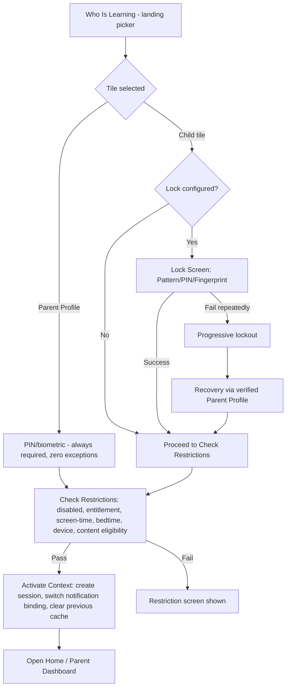
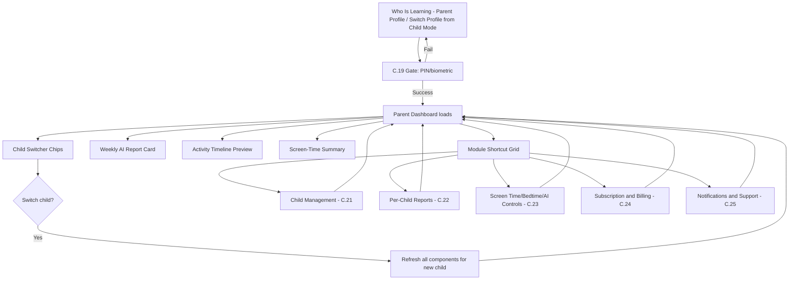
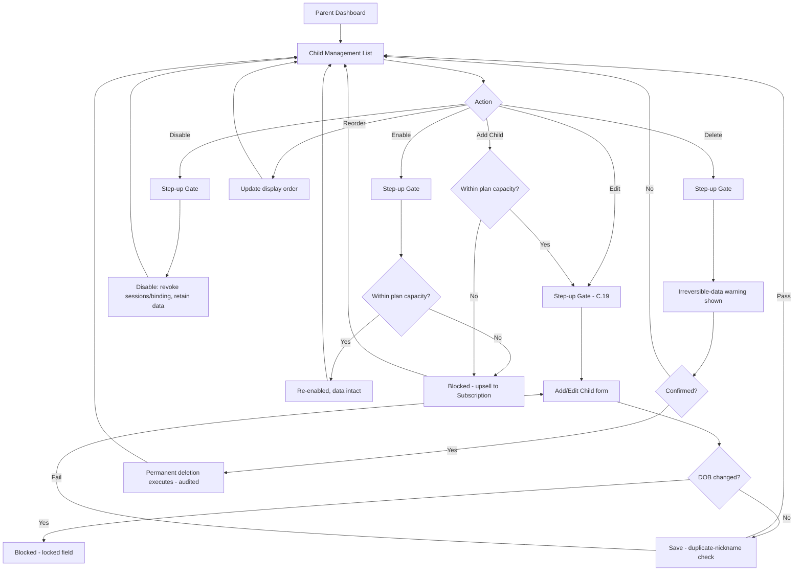
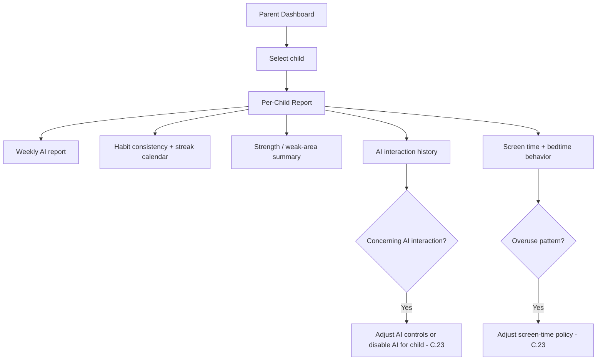
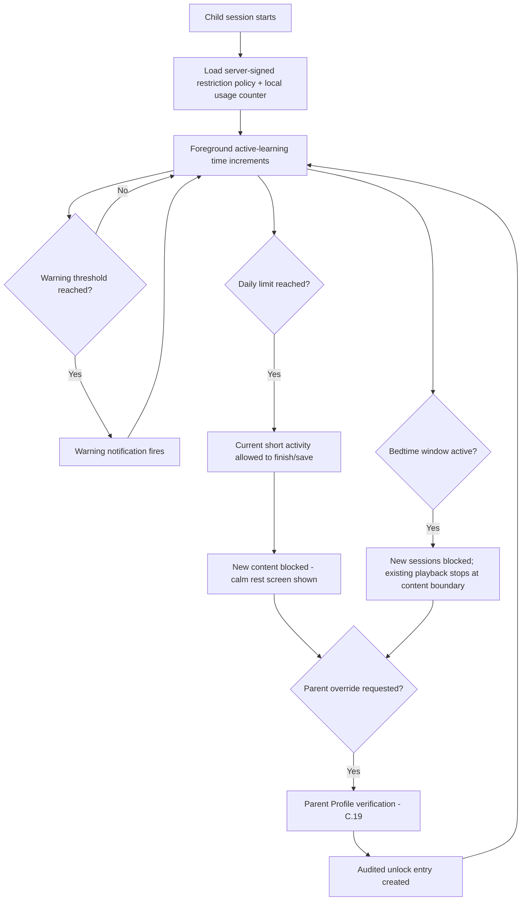
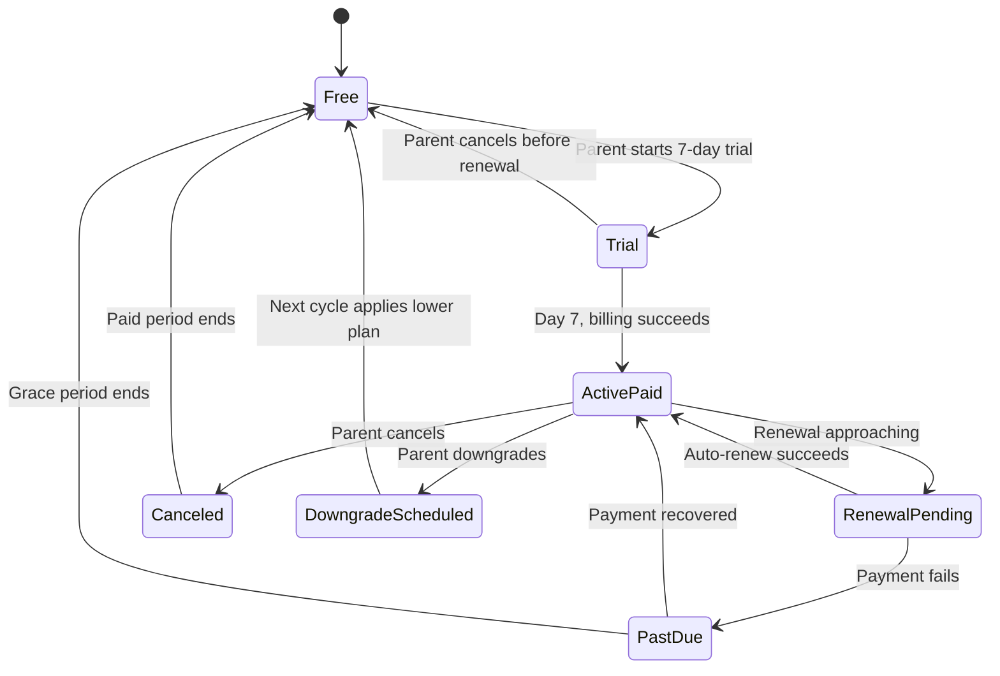
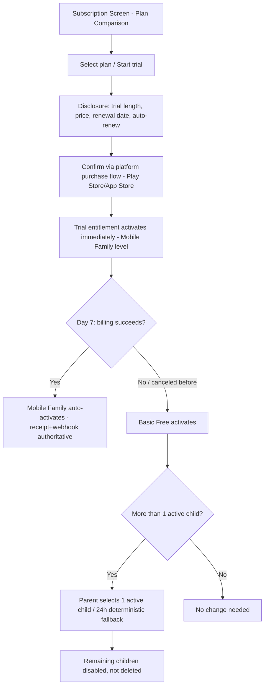
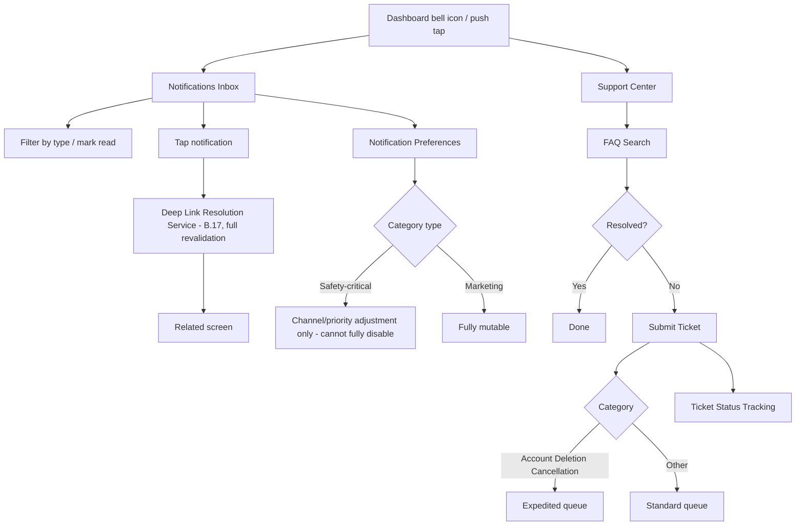
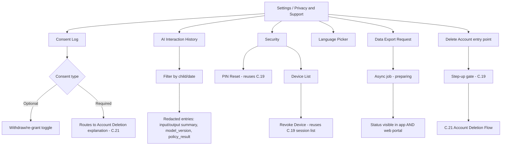

# Parent mobile research — C19–C26

Documentation-only research. PRD mobile sections are transcribed below to preserve exact requirements. Section 1.18 inventories contain components, overlays and variants as well as independent screens; do not turn each row into a new screen. Figma/site inspection is handled separately. Image paths are candidates until collectively inspected; initially three images, then four further images, were individually visually inspected in this research pass. All source folders remain unchanged.

## C19 — PRD_Documents/Parent Area In-App (19-26)/Feature_C19_Parent_PIN_Biometric_Gate.md

Blueprints read for research extraction: Development_Blueprints/C19_Parent_PIN_Biometric_Gate/00-screen-to-code-visual-blueprint.md; Development_Blueprints/C19_Parent_PIN_Biometric_Gate/KMP/01-who-is-learning-profile-picker.md; Development_Blueprints/C19_Parent_PIN_Biometric_Gate/KMP/02-child-lock-verification-screen.md; Development_Blueprints/C19_Parent_PIN_Biometric_Gate/KMP/03-parent-profile-gate-grace-window-management.md; Development_Blueprints/C19_Parent_PIN_Biometric_Gate/KMP/04-child-lock-recovery-flow.md; Development_Blueprints/C19_Parent_PIN_Biometric_Gate/KMP/05-session-activation-cross-profile-state-clearing.md; Development_Blueprints/C19_Parent_PIN_Biometric_Gate/KMP/06-offline-lock-verification-secure-local-cache.md; Development_Blueprints/C19_Parent_PIN_Biometric_Gate/KMP/07-restriction-screen-time-bedtime-override-response-screens.md

Coverage: every FR below retained verbatim; all §1 states and §2 UX behavior retained, alongside Android §6 and QA §13. Blueprint image numbering is not journey numbering. PRD image-generation examples are recommendations/examples, not automatically approved source copy.

## 1. Product Requirements

### 1.1 Problem Statement

Families sharing one device across multiple children, and parents wanting confident control over both their own settings and each child's session, need a profile-selection and access-control system where every child can have an independently-configured lock (or none), every entry into Parent Mode is gated with zero exceptions, lock recovery always routes through verified parent authentication rather than a generic "forgot lock" bypass, and the same gate mechanism governs both routine profile switching and high-stakes override actions like screen-time extensions or child deletion (source: Consolidated Blueprint §6.2: "As a parent with three children sharing one tablet, I want each child to have their own lock and their own isolated session, so that siblings cannot see each other's progress or accidentally access parent controls"; NoorHeroes Blueprint "Lock Rules": "Every child can have a different lock type... Child lock recovery requires verified Parent Profile authentication").

### 1.2 Business Goals

- Provide one canonical, deeply-trusted access-control mechanism reused by every feature requiring a gate (routine profile switch, screen-time override, child deletion, AI/microphone permission changes, PIN reset) rather than fragmented, inconsistent per-feature gating logic.
- Maintain zero-exception re-gating on Parent Mode entry, with a deliberately short, configurable grace window that balances security against repeated-PIN-entry friction for legitimate parent sessions.
- Support flexible per-child lock configuration (none/pattern/PIN/fingerprint) so families can match security friction to each child's age/trust level.
- Ensure lock recovery never becomes a security hole — there is no generic, parent-bypassing "forgot lock" path anywhere in the system.

### 1.3 User Goals

- **Parent:** Set up a PIN (and optionally biometric) once, configure each child's own lock independently, and trust that re-entering Parent Mode always requires verification, while not being constantly re-prompted during a single active parenting session.
- **Child:** Use my own lock (or none, if my parent set it that way) to get into my profile, and know that if I forget it, a grown-up can help me back in safely.

### 1.4 Success Metrics

| Metric | Target |
|---|---|
| Parent gate verification success rate (correct PIN/biometric) | ≥ 95% |
| Cross-profile data leakage incidents | 0 (hard, zero-tolerance) |
| Lock-recovery-via-Parent-Profile completion rate | ≥ 90% |
| Grace-window-related support complaints | Tracked, informs calibration |
| Gate verification latency (local, no network dependency) | p95 < 200ms |
| Crash-free gate/picker sessions | ≥ 99.7% |

### 1.5 Stakeholders

Product Manager, Security Engineer, UX Designer, Backend Architect (Identity/Session Service), Android Architect, Data Analyst, QA Lead, Customer Support Lead, every feature owner requiring a gate (C.20/C.21/C.23).

### 1.6 User Stories

1. As a parent, I want to set a PIN once that gates my Parent Mode, purchases, settings, and any irreversible action.
2. As a parent, I want each of my children to have their own independent lock — or no lock at all, if I trust that child.
3. As a child, I want to enter my pattern/PIN or use my fingerprint to get into my own profile.
4. As a child who forgot my lock, I want a clear way to ask a grown-up to help me back in, without it being a generic bypass.
5. As a parent, I want re-entering Parent Mode to always require my PIN/biometric, except during a brief grace window if I just verified moments ago.
6. As a parent, I want the same PIN gate to apply when I'm extending screen time, deleting a child profile, or changing AI/microphone settings — not a separate, weaker check.
7. As a parent, I want confidence that switching between my children's profiles never lets one child see another's data, even momentarily.

### 1.7 Functional Requirements

**FR-1** The landing profile picker ("Who Is Learning") shows: active child profile tiles, the Parent Profile tile, and an "Add Child" tile (gated behind Parent Profile verification); **disabled child profiles appear only inside the Parent Profile, never on the landing picker** (source §6.2 item 1).
**FR-2** Selecting the **Parent Profile tile always requires PIN or biometric verification, with no exceptions, regardless of how recently the parent last authenticated for a child selection** (source §6.2 item 2/Business Rules).
**FR-3** Selecting a **Child tile**: if no lock is configured, proceed directly to policy checks (FR-7); if a lock is configured (Pattern/PIN/Fingerprint), show the matching lock screen (source §6.2 item 3).
**FR-4** **Every child can have a different lock type** (none, pattern, PIN, fingerprint) — lock configuration is fully independent per child (source NoorHeroes Blueprint "Lock Rules").
**FR-5** Lock verification mechanics: **Pattern** compares against a salted, slow hash (raw gesture points never logged); **PIN** compares against a salted, slow hash with retry-count-enforced progressive lockout; **Fingerprint** uses **OS biometric assertion only** — biometric data itself is never stored by NoorHeroes (source §6.2 item 3 sub-bullets — canonical, zero-exception storage rule).
**FR-6** **Lock failed or biometric unavailable** falls back to that child's own PIN/pattern, or recovers via **verified Parent Profile** — lock recovery **never** routes through a generic "forgot lock" flow that bypasses parent verification (source §6.2 item 3/Validation Rules — hard, zero-exception rule).
**FR-7** The four-stage access pipeline (canonical, source NoorHeroes Blueprint stage grid): (1) **Select Profile** — landing picker lists active children + Parent Profile; (2) **Verify If Locked** — pattern/PIN/biometric with retry limit, recovery through parent authentication; (3) **Check Restrictions** — validate disabled status, entitlement, screen-time budget, bedtime, device, content eligibility; (4) **Activate Context** — create child-mode session, switch notification binding, clear previous profile cache, open Home.
**FR-8** On successful selection, the app creates a **short-lived child-mode session** bound to `family_id`, `child_id`, device ID, and an entitlement snapshot — **sibling progress must never be returned to child-mode API calls** (source §6.2 item 4 — the platform-wide "No Lateral Sibling Access" rule's enforcement origin point).
**FR-9** **Switching to a different child clears all previous child-sensitive UI state before activating the new scoped session** (source §6.2 item 5).
**FR-10** **Parent Mode re-gates on every entry (PIN/biometric), with a short, configurable grace window** — re-entry to Parent Mode from already-active Parent Mode (e.g., from background) may skip the prompt within this window; the Child-Mode-to-Parent-Mode transition via "Switch Profile" always re-prompts with zero exception regardless of grace-window timing (source NoorHeroes Blueprint "Parent / Child Access Control" card; cross-ref B.16 FR-3).
**FR-11** **Two devices may select different children simultaneously** — each installation maintains its own independent active-profile binding, with no cross-device interference (source §6.2 Failure Scenarios; cross-ref B.17 FR-9).
**FR-12** Failed PIN/lock attempts trigger **progressively longer lockout**; recovery for a child's lock is **always** via verified Parent Profile (FR-6); recovery for the **Parent PIN itself** routes through the parent's own account-recovery flow (phone/email OTP re-verification, cross-ref A.1 FR-22), never a shortcut.
**FR-13** The same Parent PIN/biometric gate mechanism is reused, not re-implemented, by every feature requiring parent-level authorization: screen-time/bedtime override (C.23), child profile deletion (C.21), AI/microphone permission changes, PIN reset itself, and Achievement-card sharing (A.11 FR-12).
**FR-14** At the screen-time limit, the system **finishes the current short activity, saves progress, then shows a calm locked state**; **bedtime blocks new sessions during the configured window**; **parent override of either requires Parent Profile verification** through this same gate (source NoorHeroes Blueprint "Restriction Engine"/"Bedtime Configuration" cards — the actual policy is owned by C.23).
**FR-15** **Offline lock verification**: a locked child selected while offline verifies against the **locally cached salted hash**, then enforces the **last signed restriction/entitlement policy** — no network round-trip is required for the lock check itself (source §6.2 Error Handling).

### 1.8 Non-Functional Requirements

- **Security:** Salted, slow (Argon2id-class) hashing for PIN/pattern storage; biometric verification delegates entirely to the OS, with zero biometric data ever transmitted to or stored by NoorHeroes servers. This is the platform's single most security-critical feature.
- **Performance:** Local lock verification must not require a network round-trip — p95 < 200ms, fully on-device.
- **Reliability:** The four-stage pipeline must behave identically whether online or offline (offline falls back to cached hash + last-signed policy per FR-15), never silently skipping a stage.
- **Session Isolation:** Sibling-data leakage prevention (FR-8/FR-9) enforced at both client (UI-state-clearing) and server (query-scoping) layers — defense in depth.

### 1.9 Acceptance Criteria

- Given the Who Is Learning picker is shown, then it lists exactly the active (non-disabled) child profiles plus the Parent Profile tile plus an Add Child tile.
- Given a parent taps the Parent Profile tile, then PIN/biometric verification is always required.
- Given a child with no lock configured taps their tile, then they proceed directly to restriction checks with no lock screen.
- Given a child with a PIN lock exceeds the retry limit, then progressively longer lockout applies, and recovery is only available via verified Parent Profile.
- Given a child profile is activated, then no subsequent child-mode API call ever returns sibling data.
- Given a parent is in an active Parent session and returns to it via normal in-Parent-Mode navigation within the grace window, then they are not re-prompted — but given they tap "Switch Profile" from inside Child Mode, the gate always appears regardless of the grace window.
- Given offline connectivity during lock verification, then the check succeeds/fails against the locally cached salted hash with the last-signed restriction policy applied.
- Given a parent extends screen time, deletes a child profile, or resets their PIN, then they pass through this same gate mechanism.

### 1.10 Edge Cases

1. A child correctly enters their lock, but the device loses connectivity exactly at the "Check Restrictions" stage → this stage also falls back to the last-signed policy snapshot offline, rather than blocking activation entirely.
2. Two children share a device; Child A is PIN-locked, Child B has no lock → switching always returns to the picker and re-runs the full pipeline, including UI-state-clearing, for every switch.
3. A parent's enrolled biometric changes at the OS level → the app gracefully falls back to PIN entry rather than permanently locking the parent out; PIN remains the durable fallback at all times.
4. A child's lock-recovery flow is initiated and parent-verified, but the parent backs out before resetting the new lock → the child's original lock configuration remains unchanged and functional.
5. A device sits idle on the Who Is Learning picker for an extended period → no special device-level timeout is required by this feature, but each individual profile selection always re-runs the full verification pipeline.
6. A parent's grace window expires while they are mid-action inside an already-open Parent Mode screen → this only affects the next re-entry check, not the already-active session.
7. A child enters a correct pattern while an active lockout countdown is still running → the lockout is still honored; correct credentials don't bypass an active cooldown.
8. Two guardians share the same family account on different devices → each device's grace window is tracked independently, with no shared/synced clock across devices.
9. A screen-time override is requested from within Child Mode (a child asks a nearby parent) → still requires the full Parent Profile gate, never a lighter in-context-only check.
10. A child's lock type is changed by the parent while that child might have an active session elsewhere (rare multi-device case) → the change takes effect for future verification attempts; an already-active session isn't retroactively affected mid-session.

### 1.11 Error Handling

| Scenario | System Behavior |
|---|---|
| Wrong PIN/pattern entered | Inline error, retry count increments, progressive lockout once threshold exceeded |
| Biometric assertion fails/unavailable | Falls back to PIN/pattern entry, never a dead end |
| Lockout active, correct credential entered | Lockout countdown still honored, not accepted until countdown expires |
| Offline lock verification | Local cached salted-hash comparison; offline restriction check uses last-signed policy |
| Interrupted lock-recovery flow | Original lock configuration preserved unchanged |
| Biometric enrollment change at OS level | Graceful fallback to PIN, never permanent lockout |

### 1.12 Empty States
- A family with zero children yet → the picker shows only the Parent Profile tile and the Add Child tile.

### 1.13 Loading States
- Profile activation (stage 4): a brief loading state while session/binding/cache-clearing complete, before Home renders.

### 1.14 Offline States
- Full offline functionality for lock verification and restriction-checking per FR-15.

### 1.15 Permission States
- **Biometric (OS-level):** if not enrolled or denied, the biometric option simply isn't offered, consistent with the "hide, don't show-disabled" pattern.

### 1.16 User Flow (Narrative)

App launches with a valid session → Who Is Learning picker shows active children + Parent Profile + Add Child → user taps a tile → Parent Profile always requires PIN/biometric; a child tile applies its configured lock (or none) → restriction checks run → on pass, the appropriate session activates, notification binding switches, previous profile cache clears, and Home/Dashboard renders → any later re-entry to Parent Mode, restriction override, or irreversible action re-runs this same gate.

### 1.17 Detailed Flow Diagram (Mermaid)

### 1.18 Screen Inventory (Complete — Zero Missing)

| # | Screen | Type | Entry Points | Exit Points |
|---|---|---|---|---|
| 1 | Who Is Learning (Profile Picker) | Primary | Splash (valid session), logout-from-child-mode, "Switch Profile" (B.16) | Lock Screen, Parent Gate, Child Home, Parent Dashboard |
| 2 | Profile Lock Verification (Pattern/PIN/Fingerprint) | Screen | Who Is Learning, child tile with lock configured | Child Home (success), Recovery, lockout state |
| 3 | Lockout Countdown State | Screen variant | Repeated failed lock attempts | Recovery link, or retry after countdown |
| 4 | "Ask a Grown-Up" Recovery Link/Prompt | Component | Profile Lock Verification | Parent Profile Gate (recovery context) |
| 5 | Parent Profile PIN/Biometric Gate | Screen | Who Is Learning "Parent Profile" tile, "Switch Profile" from Child Mode, any override-requiring action | Parent Dashboard / the specific override action |
| 6 | Parent PIN Lockout Countdown State | Screen variant | Repeated failed Parent PIN attempts | Account-recovery flow (A.1) |
| 7 | Biometric Fallback-to-PIN State | Screen variant | Biometric assertion failure/unavailability | Standard PIN entry |
| 8 | Restriction Screen | Screen | Check Restrictions stage failure | Parent override gate, or blocked with explanation |
| 9 | Calm Locked State (screen-time limit reached) | Screen | Screen-time budget exhausted mid-session | Parent override gate |
| 10 | Bedtime Block Screen | Screen | Attempted session start during bedtime window | Parent override gate |
| 11 | Add Child Tile (gated) | Component | Who Is Learning | Parent Gate → Add Child flow (A.1) |
| 12 | Disabled Child Profile (visible only inside Parent Profile) | Screen variant (cross-ref C.21) | Parent Profile / Child Management | Re-enable action (C.21) |
| 13 | PIN Reset (re-triggered from Settings → Security) | Screen (shared with A.1) | Settings → Security | Confirms new PIN |

### 1.19 Events (Complete Analytics Event List)

`who_is_learning_viewed`, `profile_tile_selected`, `lock_screen_shown`, `lock_verification_succeeded`, `lock_verification_failed`, `lock_lockout_triggered`, `lock_recovery_initiated`, `parent_gate_shown`, `parent_gate_succeeded`, `parent_gate_failed`, `parent_gate_grace_window_skip`, `biometric_fallback_to_pin`, `restriction_check_failed`, `restriction_override_requested`, `restriction_override_granted`, `session_activated`, `previous_profile_cache_cleared`, `offline_lock_verification_used`.

---

## 2. UX/UI Requirements

> Global Design System tokens defined in **Feature A.1 §2.1**.

### 2.1 Gate-Specific Design System Extensions

- **Who Is Learning Tile Grid:** Large, friendly tappable child avatar tiles, a visually distinct Parent Profile tile (lock icon overlay, consistent with B.16's "Switch Profile" treatment), and a dashed-outline "Add Child" tile.
- **Lock Screen Visual Language:** Calm, non-alarming even during lockout — countdown timers use a non-punitive numeric style consistent with A.7's non-shaming framing.
- **Parent Gate Visual Distinction:** A more formal, less playful visual treatment than any child-mode screen.

### 2.2 Screen-Level Design Requirements

#### Screen: Who Is Learning (Profile Picker)
- **Purpose:** The single landing surface for selecting which mode/child to enter.
- **Components:** Child avatar tiles (active/non-disabled only), Parent Profile tile (lock icon), Add Child tile.
- **States:** Default, Loading, Offline (cached list).
- **Accessibility:** Each tile labeled including lock status.
- **Responsive Rules:** Grid reflows for tablet without shrinking tap targets below 44dp.

#### Screen: Profile Lock Verification
- **Purpose:** Verify the selected child's identity via their configured lock type.
- **Components:** Child avatar header, pattern/PIN/biometric input, retry counter (shown only as attempts accumulate), "Ask a grown-up" recovery link.
- **States:** Default, Entering, Incorrect, Lockout-countdown, Biometric-fallback-offered.
- **Accessibility:** Non-gesture alternative for pattern entry.

### 2.3 Tab Structure

This feature precedes all tab navigation. Click mapping:

| Click Target | Destination | API Called | Analytics Event | Permission Check | Error Handling |
|---|---|---|---|---|---|
| Child tile (no lock) | Check Restrictions → Child Home | `GET /v1/children/{id}/restrictions` then session activation | `profile_tile_selected` → `session_activated` | Restriction checks | Restriction screen on failure |
| Child tile (locked) | Lock Screen | `POST /v1/children/{id}/lock/verify` | `lock_screen_shown` → success/failed | Lock match | Lockout / recovery on repeated failure |
| Parent Profile tile | Parent Gate | `POST /v1/auth/pin/verify` | `parent_gate_shown` → success/failed | Always required | Lockout → account recovery |
| "Ask a grown-up" recovery link | Parent Gate (recovery context) | Same as Parent Gate | `lock_recovery_initiated` | Always required | Standard handling |

### 2.4 Wireframe Description (Composite)

Who Is Learning: a centered tile grid (similar spirit to A.10's Games Hub grid, but functioning as profile navigation). Lock screens: a simple, centered, single-focus input pad consistent with the platform's "one clear focus per screen" philosophy.

### 2.5 Screen Image Generation Prompts

**Screen: Who Is Learning (Profile Picker)**
- *Prompt 1 (English):* "Mobile app profile picker screen UI mockup for a family learning app. Warm off-white background with a soft night-sky gradient header. A grid of 2-3 large rounded square tiles, each showing a colorful cartoon child avatar and first name beneath, one tile with a small lock icon overlay in the corner indicating it requires a code. A distinctly-styled tile with a parent silhouette icon and a small padlock badge labeled 'Parent'. A final dashed-outline tile with a plus icon labeled 'Add Child'. Soft shadows under each tile, generous spacing, playful but clean rounded typography for child names, more formal styling on the Parent tile specifically, modern family-app aesthetic, no realistic human faces on child avatars."
- *Prompt 2 (Arabic RTL):* "نفس واجهة شاشة اختيار الملف الشخصي لتطبيق تعليم عائلي، بتخطيط من اليمين إلى اليسار بالكامل. خلفية بيج فاتح دافئ مع رأس بتدرج لوني هادئ يشبه سماء الليل. شبكة من بطاقتين أو ثلاث بطاقات مربعة كبيرة مستديرة الزوايا، تعرض كل منها صورة رمزية كرتونية ملونة لطفل واسمه الأول أسفلها، مع بطاقة واحدة تحمل أيقونة قفل صغيرة متراكبة في الزاوية تشير إلى أنها تتطلب رمزًا. بطاقة مميزة بأيقونة ظل للوالد وشارة قفل صغيرة بعنوان 'الوالد'. بطاقة أخيرة بخط متقطع وأيقونة زائد بعنوان 'إضافة طفل'. ظلال خفيفة تحت كل بطاقة، تباعد كبير، خط مرح لكن نظيف ومستدير لأسماء الأطفال، تنسيق أكثر رسمية على بطاقة الوالد تحديدًا، طابع تطبيق عائلي حديث، بدون وجوه بشرية واقعية على الصور الرمزية للأطفال."

**Screen: Profile Lock Verification (PIN)**
- *Prompt 1 (English):* "Mobile app child profile lock screen UI mockup, showing a numeric PIN pad. Warm off-white background. At top, a small circular child avatar with their name. Below, a row of 4 circular PIN-progress dots above a 3x4 numeric keypad with large rounded buttons. Below the keypad, a small, calm text link reading 'Ask a grown-up for help'. No retry-count warning visible yet, soft shadows, rounded corners, warm teal and gold accents, friendly but secure-feeling aesthetic, no realistic human faces."
- *Prompt 2 (Arabic RTL):* "نفس شاشة قفل الملف الشخصي للطفل، تعرض لوحة أرقام لرمز PIN، بتخطيط من اليمين إلى اليسار. خلفية بيج فاتح دافئ. في الأعلى صورة رمزية دائرية صغيرة للطفل مع اسمه. أسفل ذلك صف من 4 نقاط دائرية لتقدم الرمز فوق لوحة أرقام 3×4 بأزرار كبيرة مستديرة. أسفل لوحة الأرقام رابط نصي صغير وهادئ يقول 'اطلب المساعدة من أحد الوالدين'. بدون أي تحذير لعدد المحاولات ظاهر حتى الآن، ظلال خفيفة، زوايا دائرية، لمسات فيروزية وذهبية دافئة، طابع ودود لكن يبعث على الشعور بالأمان، بدون وجوه بشرية واقعية."

---

## 6. Android Requirements

### 6.1 Technical Requirements
Kotlin, Jetpack Compose, MVVM, Clean Architecture, module `:core:auth`, depends on `:core:design-system`, `:core:network`, Android's `BiometricPrompt` API.

### 6.2 Screen Mapping
`WhoIsLearningScreen`, `LockVerificationScreen`, `ParentGateScreen` Composables, within `:core:auth's` public API surface.

### 6.3 Navigation Flow
`WhoIsLearningScreen` is the landing destination after Splash; any feature requiring the Parent Gate calls a shared `ParentGateLauncher.requireParentAuth(triggerContext)` function rather than implementing its own PIN-prompt UI.

### 6.4 State Management
`GraceWindowManager` tracks the client-side-only decision of whether to skip showing the Parent Gate UI; calling the actual verify endpoint is always safe per the backend design. `GraceWindowManager` always returns "must prompt" for `triggerContext == SwitchProfile`.

### 6.5 API Mapping
`LockRepository.verifyChildLock()` → `POST /v1/children/{id}/lock/verify`; `ParentGateRepository.verify()` → `POST /v1/auth/pin/verify`; `SessionRepository.activateChildSession()` → `POST /v1/sessions/child-mode`.

### 6.6 Analytics Mapping
`AuthGateAnalytics` fires events per §1.19.

### 6.7 Offline Support
`LockRepository` falls back to a locally-cached salted hash for offline verification; restriction checks fall back to the last-signed policy snapshot.

### 6.8 Deep Linking
N/A — this is the gate all other deep links pass through.

### 6.9 Push Notifications
N/A directly; session activation triggers the device-binding switch consumed by B.17.

### 6.10 Testing Strategy
- Unit: `GraceWindowManager's` zero-exception rule for `SwitchProfile`; lockout-countdown-honored logic.
- UI tests: Who Is Learning never renders a disabled child's tile; Parent Gate always renders for `switch_profile` regardless of recent verification.
- Integration: full profile-switch → session-activation → previous-cache-cleared flow; offline-lock-verification flow.

---

## 13. QA Requirements

### 13.1 Test Plan Summary
Coverage spans: strict sibling isolation, zero-exception Parent Gate, true-recovery-gate enforcement, lockout integrity, offline verification, and all 10 edge cases from §1.10.

### 13.2 Test Cases — Happy Path
1. Parent configures different lock types for 3 children; each successfully enters their own profile.
2. Parent switches profiles via Switch Profile, always re-prompted.
3. A child forgets their lock, parent verifies via "Ask a grown-up," successfully resets it.

### 13.3 Edge Cases
All 10 items from §1.10.

### 13.4 Negative Cases
- Query a sibling's data using a session activated for a different child → `403`.
- Call lock-recovery with a parent token that hasn't freshly verified → rejected.
- Enter a correct PIN during active lockout → still rejected.
- Attempt Switch Profile within seconds of a fresh Parent Gate success elsewhere → still prompts.

### 13.5 Regression Cases
Full suite re-run on every release touching `:core:auth`, Child Lock Service, or Session Activation Service.

### 13.6 Automation Cases
End-to-end multi-child profile-switching flow; sibling-isolation penetration test (CI-blocking); offline lock-verification test; lockout-cooldown-integrity test.

---

## C20 — PRD_Documents/Parent Area In-App (19-26)/Feature_C20_Parent_Dashboard.md

Blueprints read for research extraction: Development_Blueprints/C20_Parent_Dashboard/00-screen-to-code-visual-blueprint.md; Development_Blueprints/C20_Parent_Dashboard/KMP/01-parent-dashboard-landing-screen.md; Development_Blueprints/C20_Parent_Dashboard/KMP/02-child-switcher-component.md; Development_Blueprints/C20_Parent_Dashboard/KMP/03-weekly-ai-report-card-preview.md; Development_Blueprints/C20_Parent_Dashboard/KMP/04-activity-timeline-preview-component.md; Development_Blueprints/C20_Parent_Dashboard/KMP/05-screen-time-summary-preview-component.md; Development_Blueprints/C20_Parent_Dashboard/KMP/06-module-shortcut-grid-navigation.md; Development_Blueprints/C20_Parent_Dashboard/KMP/07-dashboard-offline-caching-sync.md; Development_Blueprints/C20_Parent_Dashboard/KMP/08-dashboard-deep-link-handling.md

Coverage: every FR below retained verbatim; all §1 states and §2 UX behavior retained, alongside Android §6 and QA §13. Blueprint image numbering is not journey numbering. PRD image-generation examples are recommendations/examples, not automatically approved source copy.

## 1. Product Requirements

### 1.1 Problem Statement

Parents need one calm, jargon-free home base showing how each of their children is progressing and a quick path to every settings module, without wading through technical language or alarming framing, and with an absolute guarantee that this view exists only behind verified Parent Mode in the mobile app — never reachable from a child session, and never available on the web portal at all (source: Consolidated Blueprint §6.7: "As a parent, I want one place to see how each of my children is progressing and to adjust their settings, without wading through technical jargon or alarming language"; "Visibility Rule: The Parent Progress Dashboard exists only in the Mobile App and is hidden in every child profile session... Parent dashboard APIs reject any child-mode token outright").

### 1.2 Business Goals

- Make the Dashboard the trust-reinforcing centerpiece of the platform's "Trust-Led Monetization" strategy — parents subscribe when they feel the app is safer, more authentic, and more useful than generic entertainment.
- Drive weekly parent engagement via the AI Weekly Report card, a high-conversion module parents pay for "clarity and reassurance."
- Provide one consistent, calm entry point to every other Parent Area module, reducing navigation confusion across Child Management, Reports, Subscription, Settings, Notifications, and Support.
- Maintain the platform's no-sibling-ranking guarantee at this specific, highest-visibility parent touchpoint.

### 1.3 User Goals

- **Parent:** See a calm summary of how each child is doing this week, switch between children easily, glance at healthy-usage/screen-time status, and reach any settings module quickly — all without alarming language or technical jargon.

### 1.4 Success Metrics

| Metric | Target |
|---|---|
| Weekly Dashboard view rate (among parents with ≥1 active child) | ≥ 60% |
| Weekly AI Report card view-through rate | ≥ 50% |
| Module-shortcut click-through rate (any module) | ≥ 40% per session |
| Child-switcher usage rate (multi-child families) | ≥ 70% |
| Dashboard load time (cached) | p95 < 600ms |
| Cross-sibling ranking incidents on this screen | 0 (hard, zero-tolerance) |
| Crash-free Dashboard sessions | ≥ 99.6% |

### 1.5 Stakeholders

Product Manager, Parent Trust/UX Lead, Backend Architect (Aggregation Service), Android Architect, Data Analyst, Security Engineer, QA Lead, Customer Support Lead, feature owners of C.21/C.22/C.23/C.24/C.25 (module-shortcut destinations).

### 1.6 User Stories

1. As a parent, I want to see, at a glance, how each of my children did this week.
2. As a parent, I want to quickly switch between my children's summaries without navigating away and back.
3. As a parent, I want a preview of recent activity (stories, habits, lessons, rewards) without opening a full report.
4. As a parent, I want to see healthy-usage/screen-time status without digging into a separate settings page.
5. As a parent, I want one place that links to every other parent module — reports, settings, subscription, support.
6. As a parent, I want to compare overall family trends without ever seeing my children ranked against each other.
7. As a parent, I want confidence this dashboard is only ever reachable after I've verified who I am, and never visible from my child's own session.

### 1.7 Functional Requirements

**FR-1** Dashboard components: child switcher chips, weekly AI report card, activity timeline preview, screen-time summary, module shortcut grid (source: NoorHeroes Blueprint screen catalog "Parent Dashboard — Components").
**FR-2** Dashboard actions: switch child context, open any module (Reports, Settings, Subscription, Support), compare family trends (source: screen catalog "Actions").
**FR-3** Entry points: Who Is Learning (Parent Profile selection), bottom-tab "Profile → Parent Mode" from inside Child Mode — both routing through C.19's gate (source: screen catalog "Entry Points").
**FR-4** Exit points: Child Management, Reports, Subscription, Settings, Notifications, Support (source: screen catalog "Exit Points").
**FR-5** **Never ranks siblings against each other; re-entry always requires the PIN/biometric gate unless within the short grace window** (source: screen catalog "Navigation Rules" — restated as this screen's two defining trust rules, the latter being C.19's grace-window mechanic applied here).
**FR-6** **The Parent Progress Dashboard exists only in the Mobile App and is hidden in every child profile session. It becomes visible only when the Parent Profile is selected and verified; Parent dashboard APIs reject any child-mode token outright** (source §6.7 Visibility Rule — a hard, zero-exception architectural rule enforced at the API layer, not merely client-side route-hiding).
**FR-7** Dashboard contents (canonical, source §6.7 "Dashboard Contents"): child selector; milestones completed; course/lesson/Quran/story/quiz/habit/streak progress; badges and achievements; weekly/monthly report summaries; healthy-usage and screen-time status; AI recommendation reasons and safe (redacted) AI interaction history; notification and bedtime settings; child enable/disable controls; subscription and plan capacity.
**FR-8** Weekly Report types and cadence (canonical, source §6.7 "Detailed Workflow"): Weekly child report (stories completed, Quran progress, duas learned, habit streaks, quiz scores, recommended next step) — weekly; Monthly family report (cross-child progress summary, family streaks, content favorites, learning consistency) — monthly; AI insight report (strengths, weak areas, suggested next stories/duas/Quran practice, healthy-usage notes) — premium, weekly; Safety report (AI usage history, blocked requests, content flags, profile-setting changes) — on demand.
**FR-9** **Dashboard content always labels data freshness; uses trend language and recommendations, never judgmental grades** (source §6.7 Validation Rules).
**FR-10** **Subscription/plan-limit messaging appears only on parent surfaces — never inside child mode** (source §6.7 Validation Rules — restated as this screen's explicit permission to show such messaging, in deliberate contrast to A.2 Home's hard prohibition on it).
**FR-11** **Report generation delayed → dashboard shows the last successfully generated report with an explicit "as of" timestamp rather than a blank or broken state** (source §6.7 Error Handling).
**FR-12** **The web portal explicitly excludes the Parent Progress Dashboard** — attempting to access it from the web portal is blocked by design, not merely unimplemented (source §6.7 Failure Scenario; cross-ref the platform's Parent Web Account Portal scope, which is account/security/billing/consent only).
**FR-13** **AI-generated parent insights must never diagnose developmental, behavioral, or religious conditions; must never compare siblings; must never present uncertain conclusions as settled facts** (source §6.7 Business Rules — a hard rule governing every AI-derived content surfaced anywhere on this Dashboard or its linked reports).
**FR-14** The module shortcut grid routes to: Child Management (C.21), Per-Child Reports (C.22), Screen Time & Bedtime / AI Controls (C.23), Subscription & Billing (C.24), Notifications (Parent) & Support (C.25) — this Dashboard does not duplicate any of those modules' own content, only links to them with a brief preview where specified (FR-1's preview components).
**FR-15** "Compare family trends" (FR-2) is satisfied via **aggregate-only or single-child-at-a-time views** — consistent with the structural no-sibling-comparison pattern already established platform-wide (A.7/A.11) — never a simultaneous side-by-side per-child comparison table or chart on this screen.

### 1.8 Non-Functional Requirements

- **Visibility Enforcement:** FR-6's mobile-app-only, Parent-Profile-only visibility rule is enforced at the API layer (rejecting any child-mode token), not merely via client-side route guarding — a P0 architectural requirement.
- **Performance:** Dashboard load p95 < 600ms from cache; weekly report data may be eventually-consistent (generated asynchronously) but must always show a clearly-labeled last-known-good state rather than blocking the whole screen.
- **Tone:** All copy across every Dashboard component uses calm, trend-oriented, non-judgmental language — enforced as a content-governance standard, not just a style guideline.
- **Re-gating:** Every Dashboard session re-entry honors C.19's grace-window rules exactly, introducing no parallel/weaker gating logic of its own.

### 1.9 Acceptance Criteria

- Given a parent successfully passes the C.19 gate, when the Dashboard loads, then it shows the child switcher, weekly AI report card, activity timeline preview, screen-time summary, and module shortcut grid for the currently-selected child.
- Given a parent switches the child-switcher chip to a different child, when the switch completes, then all Dashboard components update to reflect that child's own data only.
- Given a request is made to any Dashboard API using a child-mode session token, when the server processes it, then the request is rejected outright, regardless of which child or family it belongs to.
- Given a parent has multiple children, when they view any "family trend" comparison on this Dashboard, then it is presented as an aggregate or single-child view, never a side-by-side sibling ranking.
- Given the weekly report generation is delayed, when the parent opens the Dashboard, then the last successfully generated report is shown with an explicit "as of [date]" timestamp, never a blank or broken card.
- Given a parent attempts to reach this Dashboard via the web portal, when they try, then access is blocked by design — the web portal has no route to this surface at all.
- Given any AI-generated insight appears on this Dashboard, when reviewed, then it contains no developmental/behavioral/religious diagnosis, no sibling comparison, and no presentation of uncertain conclusions as settled fact.

### 1.10 Edge Cases

1. A parent has zero children with any activity yet (e.g., immediately post-onboarding) → the Dashboard renders with an explicit "no activity yet" empty state for the relevant components (timeline, weekly report) rather than blank/broken cards, consistent with the platform-wide explicit-empty-state philosophy.
2. A parent's only child profile is disabled (cross-ref C.21) → the Dashboard's child switcher still allows selecting that disabled child for **read-only** viewing purposes (consistent with C.21's "disabled profiles retain data and remain visible" rule), but no live/active-session actions are offered for it from here.
3. A parent has a free-tier plan with only 1 active child slot, but the family previously had more children before a downgrade (cross-ref C.24's "excess profiles become read-only archives, never silently deleted" rule) → the child switcher includes these archived profiles in a clearly-distinguished, read-only-labeled state, not mixed in indistinguishably with active children.
4. Analytics/report data for a specific child is delayed beyond the normal generation window (e.g., a backend processing delay) → the affected card shows the explicit delayed-state messaging (FR-11) rather than other Dashboard components being blocked waiting on it — each component degrades independently.
5. A parent's premium subscription (which gates the AI Insight Report specifically, per FR-8) expires or downgrades while they're viewing the Dashboard → the AI Insight Report component reflects the new entitlement state on next load (showing an upsell/locked state appropriately, since this is a parent surface where such messaging is explicitly permitted per FR-10), without crashing or showing stale premium content past expiry.
6. Two parents (co-guardians) on different devices view the Dashboard for the same family simultaneously → each sees their own independently-rendered Dashboard (per their own device's session/grace-window state per C.19), with no shared "currently viewing" lock or conflict — this is a read-mostly screen, not a collaborative-editing surface requiring such coordination.
7. A parent taps a module shortcut (e.g., Child Management) and then uses the back button to return to the Dashboard → the Dashboard re-renders from cache instantly rather than re-fetching everything from scratch, with a background refresh if the cache is stale, consistent with the platform's general cache-then-refresh pattern.
8. A request reaches a Dashboard API with a parent-session token that has technically expired or been revoked (e.g., the parent logged out on another device) → rejected with a standard re-authentication flow, not confused with the child-mode-token-rejection rule (FR-6), which is a distinct, additional check beyond ordinary session validity.
9. A family's weekly report contains AI-generated content that, due to a model error, drifts toward language resembling a developmental/behavioral observation about a specific child → this must be caught by the content-safety validation pipeline (mirroring the platform's established pattern for AI-generated content elsewhere) before ever reaching the Dashboard, never relying on the parent to simply not notice or not mind.

### 1.11 Error Handling

| Scenario | System Behavior |
|---|---|
| Weekly/monthly report generation delayed | Last successfully generated report shown with explicit "as of [date]" timestamp (FR-11) |
| Child-mode token used on any Dashboard API | Outright rejection, regardless of family/child ownership (FR-6) |
| Web portal access attempt | Blocked by design — no route exists (FR-12) |
| Individual component data fetch failure (e.g., activity timeline) | That specific component shows a graceful "may be unavailable right now" state; other components unaffected |
| AI-generated content failing content-safety validation | Suppressed/excluded from display rather than shown unfiltered (Edge Case 9) |

### 1.12 Empty States
- Zero activity yet for the selected child → explicit "Once [Child] starts learning, you'll see their progress here" framing across the relevant components, never a blank/broken-looking chart.

### 1.13 Loading States
- Dashboard: skeleton shimmer for each component independently (child switcher chips load fast/first; weekly report and timeline may resolve slightly later without blocking the rest of the screen).

### 1.14 Offline States
- Dashboard renders from last-cached data when offline, with a clear "may be outdated" indicator; module shortcuts requiring connectivity show this clearly on tap rather than navigating into a broken destination screen.

### 1.15 Permission States
- No new runtime permissions; this screen is purely a data-aggregation/navigation surface.

### 1.16 User Flow (Narrative)

Parent selects Parent Profile from Who Is Learning (or taps "Profile → Parent Mode" from inside Child Mode) → passes C.19's gate → Dashboard loads with the currently-default (or last-viewed) child selected → parent reviews the weekly AI report card, activity timeline preview, and screen-time summary → optionally switches to a different child via the switcher chips, refreshing all components for that child → taps a module shortcut to drill into Child Management, Reports, Settings, Subscription, or Support → returns to the Dashboard via back navigation, which re-renders instantly from cache.

### 1.17 Detailed Flow Diagram (Mermaid)

### 1.18 Screen Inventory (Complete — Zero Missing)

| # | Screen / Component | Type | Entry Points | Exit Points |
|---|---|---|---|---|
| 1 | Parent Dashboard (landing) | Primary | C.19 gate success (Parent Profile or Switch Profile) | Child Management, Per-Child Reports, Screen Time/AI Controls, Subscription, Notifications/Support |
| 2 | Child Switcher Chips | Component | Parent Dashboard | Refreshes Dashboard for selected child |
| 3 | Weekly AI Report Card (preview) | Component | Parent Dashboard | Full Per-Child Report (C.22) |
| 4 | Activity Timeline Preview | Component | Parent Dashboard | Full Activity Timeline (within C.22) |
| 5 | Screen-Time Summary (preview) | Component | Parent Dashboard | Full Screen Time & Bedtime Settings (C.23) |
| 6 | Module Shortcut Grid | Component | Parent Dashboard | Each respective module (C.21-C.25) |
| 7 | Report-Delayed State (component variant) | Component variant | Weekly/Monthly report generation delay | N/A (shows last-known report) |
| 8 | Archived/Disabled Child Read-Only Selector State | Component variant | Child Switcher, archived/disabled child selected | Read-only view of that child's historical data |
| 9 | Empty State — Zero Activity Yet | Screen variant | New family/child, no activity | N/A |
| 10 | Offline Dashboard State | Screen variant | No connectivity | Cached data shown, module shortcuts requiring connectivity indicate this on tap |
| 11 | AI Insight Report Locked/Upsell State (premium-gated component) | Component variant | Non-premium plan viewing the AI Insight Report card | Subscription & Billing (C.24) |

### 1.19 Events (Complete Analytics Event List)

`parent_dashboard_viewed`, `dashboard_child_switched`, `weekly_report_card_viewed`, `weekly_report_card_tapped`, `activity_timeline_preview_viewed`, `activity_timeline_item_tapped`, `screen_time_summary_viewed`, `module_shortcut_tapped` (with `module: child_management|reports|settings|subscription|support`), `dashboard_report_delayed_state_shown`, `dashboard_offline_state_shown`, `ai_insight_locked_state_shown`, `dashboard_child_mode_token_rejected` (internal/security signal).

---

## 2. UX/UI Requirements

> Global Design System tokens defined in **Feature A.1 §2.1**; Parent-Mode formal visual register established in **Feature C.19 §2.1**; no-sibling-comparison structural design principle established in **Features A.7/A.11 §2.1**.

### 2.1 Dashboard-Specific Design System Extensions

- **Calm, Trend-Oriented Visual Language:** Charts and summaries use gentle upward/downward trend-line styling rather than stark pass/fail or letter-grade visuals — consistent with FR-9's "trend language and recommendations, never judgmental grades" requirement, expressed visually as well as textually.
- **Module Shortcut Grid:** A clean icon-plus-label grid (consistent with the platform's general grid pattern, e.g., A.10's Games Hub) but in the more formal Parent Mode visual register established in C.19.
- **Data-Freshness Labeling:** Every data-driven component carries a small, consistently-placed "as of [date/time]" label, never silently presenting stale data as current.

### 2.2 Screen-Level Design Requirements (Key Screens)

#### Screen: Parent Dashboard (Landing)

- **Purpose:** A calm, scannable home base for everything Parent Mode.
- **Components:** Child switcher chip row (avatar + name per child, including archived/disabled in a visually distinguished style), Weekly AI Report card (headline insight + "View full report" link), Activity Timeline preview (last 3-5 items, chronological), Screen-Time Summary (healthy-usage score/status), Module Shortcut Grid (5 icons: Child Management, Reports, Settings, Subscription, Support).
- **States:** Default, Loading (per-component skeleton), Report-delayed (per component), Empty (zero activity), Offline (cached), AI-Insight-locked (premium upsell, parent-surface-appropriate).
- **Accessibility:** Each component independently labeled and screen-reader-navigable; trend charts have a text-equivalent summary, not relying on visual-only interpretation.
- **Responsive Rules:** Single-column stacked on mobile; tablet may show a 2-column layout (e.g., Weekly Report + Timeline side-by-side, Screen-Time + Module Grid below).

### 2.3 Tab Structure

The Parent Dashboard is the landing destination of Parent Mode, not itself a tab within a further sub-navigation (Parent Mode's own internal navigation to C.21-C.25 is via the module shortcut grid plus standard back navigation). Click mapping:

| Click Target | Destination | API Called | Analytics Event | Permission Check | Error Handling |
|---|---|---|---|---|---|
| Child switcher chip | Refreshes Dashboard for that child | `GET /v1/parent/dashboard?child_id=` | `dashboard_child_switched` | Family-ownership check | Cached fallback |
| Weekly Report card | Full Per-Child Report (C.22) | N/A (navigation) | `weekly_report_card_tapped` | Standard C.22 checks | Standard C.22 handling |
| Activity Timeline item | Relevant detail (within C.22) | N/A (navigation) | `activity_timeline_item_tapped` | Standard checks | Standard handling |
| Screen-Time Summary | Full Screen Time & Bedtime Settings (C.23) | N/A (navigation) | `module_shortcut_tapped` (screen_time) | Standard C.23 checks | Standard handling |
| Module Shortcut Grid icon | Respective module | N/A (navigation) | `module_shortcut_tapped` | Standard per-module checks | Standard per-module handling |

### 2.4 Wireframe Description (Composite)

A single, vertically-scrolling, card-based dashboard — consistent with the platform's general "card dashboard" pattern already established in A.2 (Home) and A.11 (Rewards Wallet), but rendered in the more formal Parent Mode visual register, with the child switcher pinned near the top as the primary context-setting control for everything below it.

### 2.5 Screen Image Generation Prompts

**Screen: Parent Dashboard**
- *Prompt 1 (English):* "Mobile app parent dashboard screen UI mockup for a family learning app, in a slightly more formal/professional visual register than a typical playful kids app screen. Warm off-white background. Near the top, a horizontal row of small rounded child-avatar chips with names, one highlighted as selected. Below, a card labeled 'Weekly Report' with a small trend-line graphic and a short calm summary sentence, plus a 'View full report' link. Below that, a card labeled 'This Week' showing 3-4 small chronological activity rows with simple icons (story watched, habit checked, badge earned). Below that, a card labeled 'Screen Time' with a simple horizontal usage bar and a calm status label like 'Healthy balance this week'. At the bottom, a grid of 5 rounded icon buttons labeled 'Children', 'Reports', 'Settings', 'Subscription', 'Support'. Clean, trustworthy, calm aesthetic, soft shadows, rounded corners, warm teal and gold accents used sparingly, no realistic human faces."
- *Prompt 2 (Arabic RTL):* "نفس شاشة لوحة تحكم الوالدين لتطبيق تعليم عائلي، بطابع بصري أكثر رسمية ومهنية قليلاً من شاشة تطبيق أطفال نموذجية، بتخطيط من اليمين إلى اليسار بالكامل. خلفية بيج فاتح دافئ. قرب الأعلى صف أفقي من رقاقات صور رمزية صغيرة مستديرة للأطفال مع أسمائهم، واحدة مميزة كمحددة. أسفل ذلك بطاقة بعنوان 'التقرير الأسبوعي' مع رسمة خط اتجاه صغيرة وجملة ملخص هادئة قصيرة، بالإضافة إلى رابط 'عرض التقرير الكامل'. أسفل ذلك بطاقة بعنوان 'هذا الأسبوع' تعرض 3-4 صفوف نشاط زمنية صغيرة بأيقونات بسيطة (قصة تمت مشاهدتها، عادة تم تسجيلها، وسام تم اكتسابه). أسفل ذلك بطاقة بعنوان 'وقت الشاشة' بشريط استخدام أفقي بسيط وتسمية حالة هادئة مثل 'توازن صحي هذا الأسبوع'. في الأسفل شبكة من 5 أزرار أيقونات مستديرة بعناوين 'الأطفال'، 'التقارير'، 'الإعدادات'، 'الاشتراك'، 'الدعم'. طابع نظيف وموثوق وهادئ، ظلال خفيفة، زوايا دائرية، لمسات فيروزية وذهبية دافئة مستخدمة بقلة، بدون وجوه بشرية واقعية."

---

## 6. Android Requirements

### 6.1 Technical Requirements
Kotlin, Jetpack Compose, MVVM, Clean Architecture, module `:feature:parent-dashboard`, depends on `:core:auth` (C.19's gate), `:core:design-system`, `:core:network`, `:core:offline-cache`.

### 6.2 Screen Mapping
`ParentDashboardScreen` Composable; `ParentDashboardViewModel` exposes `StateFlow<DashboardUiState>` with each component (child switcher, weekly report, timeline, screen-time summary) modeled as an independently-loading/failing slice, consistent with the platform's general per-section independence pattern (A.2 §6.4).

### 6.3 Navigation Flow
Reachable only via `:core:auth's` Parent Gate success path (cross-ref C.19 §6.3); module shortcuts navigate into `:feature:child-management` (C.21), `:feature:reports` (C.22), `:feature:parental-controls` (C.23), `:feature:subscription` (C.24), `:feature:support` (C.25).

### 6.4 State Management
`ParentDashboardViewModel` derives the active `family_id`/parent session entirely from `:core:auth's` session provider (never accepting it as an external parameter, mirroring B.16's established "derive internally" pattern); switching the child-switcher chip re-fetches all components scoped to the newly-selected `child_id`.

### 6.5 API Mapping
`DashboardRepository.getDashboard(childId)` → `GET /v1/parent/dashboard?child_id=`; `DashboardRepository.getReport(type, childId)` → `GET /v1/parent/dashboard/reports/{type}?child_id=`.

### 6.6 Analytics Mapping
`ParentDashboardAnalytics` fires events per §1.19.

### 6.7 Offline Support
Dashboard renders from last-cached data (Room) when offline, with a clear staleness indicator; module shortcuts that require connectivity show this clearly on tap rather than navigating into a broken destination screen.

### 6.8 Deep Linking
`noorheroes://parent/dashboard` — reachable only through the standard Parent Gate flow even if accessed via a deep link (consistent with B.17's universal deep-link-revalidation principle: a deep link to this screen still passes through C.19's gate, never bypassing it).

### 6.9 Push Notifications
Not a notification source itself; may be the landing target for parent-facing notification types (owned by the Parent Area's own Notifications feature, C.25), always passing through the Parent Gate on open per B.17's universal deep-link revalidation rule.

### 6.10 Testing Strategy
- Unit: per-component independent loading/failure state handling; child-switcher re-fetch logic.
- UI tests: AI Insight Report locked state renders correctly for non-premium fixture accounts; report-delayed state shows the correct "as of" framing rather than a blank card.
- Integration: full Parent Gate success → Dashboard load → child-switch → module-shortcut-navigate → back-to-Dashboard-from-cache flow; confirm this screen's ViewModel/repository never accepts a `child_id` that bypasses the active parent session's own family scope (a structural test mirroring B.16's reflection-based pattern).

---

## 13. QA Requirements

### 13.1 Test Plan Summary
Coverage spans: structural child-mode-token rejection (signature test), mandatory content-safety write-time gate (signature test), graceful per-component degradation, report-delay framing, and all 9 edge cases from §1.10.

### 13.2 Test Cases — Happy Path
1. Parent passes the gate, views the Dashboard for Child A, sees all components populated correctly, switches to Child B, and all components refresh for Child B.
2. A delayed weekly report shows the previous week's report with a clear "as of" timestamp.
3. A non-premium parent sees the AI Insight Report card in its locked/upsell state, taps it, and reaches Subscription & Billing.

### 13.3 Edge Cases
All 9 items from §1.10.

### 13.4 Negative Cases
- Attempt any Dashboard API call with a child-mode session token → rejected with `403 CHILD_MODE_TOKEN_REJECTED`, including against a newly-added test-only route.
- Request a `child_id` not belonging to the authenticated parent's family → rejected.
- Simulate a report failing content-safety validation → it is never returned by the read API, with the previous passing report served instead.
- Attempt to access this Dashboard via a simulated web-portal request path → no route exists.

### 13.5 Regression Cases
Full Parent Dashboard suite re-run on every release touching the Dashboard Aggregation Service, the Parent-Session-Only Gate middleware, or the AI Report Generation Service.

### 13.6 Automation Cases
End-to-end: full gate-success → Dashboard-load → child-switch → module-navigation flow; structural child-mode-token-rejection automated test (CI-blocking, run against every route including newly-added ones); content-safety write-time-gate automated test; report-delay-graceful-degradation automated test.

---

## C21 — PRD_Documents/Parent Area In-App (19-26)/Feature_C21_Multi_Child_Management.md

Blueprints read for research extraction: Development_Blueprints/C21_Multi_Child_Management/00-screen-to-code-visual-blueprint.md; Development_Blueprints/C21_Multi_Child_Management/KMP/01-child-management-list-screen.md; Development_Blueprints/C21_Multi_Child_Management/KMP/02-per-child-action-menu-disabled-card-state.md; Development_Blueprints/C21_Multi_Child_Management/KMP/03-add-edit-child-form-dob-lock-integration.md; Development_Blueprints/C21_Multi_Child_Management/KMP/04-disable-reenable-confirmation-flows.md; Development_Blueprints/C21_Multi_Child_Management/KMP/05-permanent-deletion-warning-confirmation-flow.md; Development_Blueprints/C21_Multi_Child_Management/KMP/06-reorder-mode-interaction.md; Development_Blueprints/C21_Multi_Child_Management/KMP/07-plan-capacity-blocked-state-subscription-upsell.md; Development_Blueprints/C21_Multi_Child_Management/KMP/08-trial-cancellation-forced-selection-screen.md; Development_Blueprints/C21_Multi_Child_Management/KMP/09-offline-child-management-caching-sync.md

Coverage: every FR below retained verbatim; all §1 states and §2 UX behavior retained, alongside Android §6 and QA §13. Blueprint image numbering is not journey numbering. PRD image-generation examples are recommendations/examples, not automatically approved source copy.

## 1. Product Requirements

### 1.1 Problem Statement

Parents managing multiple children on one family account need a clear, safe way to view, edit, disable, re-enable, reorder, and — when truly necessary — permanently delete each child's profile, with disabling always reversible and data-preserving, deletion always a genuinely irreversible, self-service, step-up-authenticated action with an explicit warning, and plan-capacity limits enforced fairly without ever silently destroying a downgraded family's data (source: NoorHeroes Blueprint screen catalog "Child Management — Actions: Edit profile, disable/enable, delete (PIN + irreversible-data warning), reorder... Navigation Rules: Delete is a two-step confirm; disabled profiles retain data and remain visible here as read-only"; Consolidated Blueprint §6.14: "Self-service permanent delete button in Family settings... Warning shown: 'Deleted data cannot be recovered'... No Support ticket required").

### 1.2 Business Goals

- Give parents full, trustworthy self-service control over their family's child profiles without requiring Support intervention for routine lifecycle actions, reducing support load while increasing parent confidence.
- Enforce plan-capacity limits fairly — never silently deleting data on a downgrade, always converting excess profiles to read-only archives.
- Maintain absolute clarity between **disable** (reversible, data-retained) and **delete** (irreversible, step-up-authenticated, legally-retained-then-purged) as two genuinely distinct actions.
- Ensure every mutating action on this screen passes through C.19's step-up Parent Gate, with zero shortcuts.

### 1.3 User Goals

- **Parent:** See all my children in one list, edit any child's profile details, temporarily disable a child's access without losing their progress, re-enable them later, reorder the list, and — if I really need to — permanently delete a child's profile with a clear warning and my PIN.

### 1.4 Success Metrics

| Metric | Target |
|---|---|
| Child Management view rate (multi-child families, monthly) | ≥ 50% |
| Disable→re-enable completion rate | ≥ 80% within 90 days |
| Permanent deletion completion rate | Tracked, not optimized |
| Accidental-deletion support contacts | Trending toward zero |
| Plan-capacity-downgrade data-loss incidents | 0 (hard, zero-tolerance) |
| Crash-free Child Management sessions | ≥ 99.6% |

### 1.5 Stakeholders

Product Manager, Parent Trust/UX Lead, Backend Architect (Family/Identity Service), Android Architect, Security Engineer, Legal/Compliance, Data Analyst, QA Lead, Customer Support Lead.

### 1.6 User Stories

1. As a parent, I want to see a list of all my children with their avatar, age, and current status.
2. As a parent, I want to edit any child's profile details.
3. As a parent, I want to temporarily disable a child's access without losing their progress, and re-enable them later.
4. As a parent, I want to reorder my children's list.
5. As a parent, I want to permanently delete a child's profile when truly necessary, with a clear warning and my PIN required.
6. As a parent, I want to add a new child, subject to my current plan's capacity.
7. As a parent who downgraded my plan, I want my children's data preserved as read-only archives, never silently deleted.
8. As a parent, I want every one of these actions to require my PIN.

### 1.7 Functional Requirements

**FR-1** Child Management UI sections: child list cards (avatar, age, status), a per-child action menu, and a "+ Add Child" entry point.
**FR-2** Actions: edit profile, disable/enable, delete (PIN + irreversible-data warning), reorder.
**FR-3** **Delete is a two-step confirm; disabled profiles retain data and remain visible here as read-only.**
**FR-4** **Disable (reversible):** the child cannot enter child mode while disabled; active sessions and notification bindings are revoked immediately; all progress/history/rewards are retained; the parent can re-enable at any time, subject to current plan capacity.
**FR-5** **Permanent Deletion (irreversible, self-service):** (1) parent navigates to Child Settings → Delete Child; (2) parent confirms identity via step-up authentication; (3) the app displays the warning *"Deleted data cannot be recovered. This action is permanent."*; (4) on confirmation, deletion executes immediately, subject to legal-retention rules — no Support ticket required; (5) an audited deletion record is created automatically (`child_deletion_cases` → `audit_logs`).
**FR-6** Add/Edit Child reuses the same form fields established in A.1 (nickname, DOB picker, avatar grid, language/level selectors, interest chips, daily-goal slider, AI permission toggle).
**FR-7** **DOB is immutable after first save except via Support** — a hard rule distinguishing DOB from every other editable field, given its role driving age-band content eligibility platform-wide.
**FR-8** **Visible child count is gated by subscription tier** — adding a child beyond plan capacity is blocked inline with a clear upsell path to Subscription & Billing (C.24).
**FR-9** **Duplicate nicknames within a family are rejected inline** at save time, with differentiation guidance offered as the resolution path.
**FR-10** **Trial-cancellation downgrade:** the parent selects the one child who remains active; all others are disabled (not deleted), retaining data, until plan capacity returns.
**FR-11** Every mutating action requires **step-up authentication** via C.19's Parent Gate — mutating endpoints are never reachable with only a standard parent session token.
**FR-12** Re-enabling a disabled child is itself **subject to current plan capacity** — blocked with a clear upsell path if at the limit, never a silent failure.
**FR-13** Revoking a device (C.23) force-logs-out that session immediately.

### 1.8 Non-Functional Requirements

- **Irreversibility Integrity:** Permanent deletion must be genuinely irreversible after its legal-retention window.
- **Data Preservation on Disable/Downgrade:** Never delete or corrupt underlying data — a hard, zero-tolerance guarantee.
- **Step-Up Auth Coverage:** Every mutating endpoint requires step-up authentication, server-enforced.
- **Performance:** List load p95 < 500ms; Add/Edit Child save p95 < 800ms.

### 1.9 Acceptance Criteria

- Given a parent opens Child Management, then it lists every child (active and disabled), with disabled children clearly marked and read-only.
- Given a parent disables a child, then active sessions/notification bindings are revoked immediately while data remains fully intact.
- Given a parent re-enables a child within plan capacity, then the child becomes immediately able to enter child mode with all prior data intact; at capacity, re-enable is blocked with a clear upsell path.
- Given a parent initiates permanent deletion, then they must pass step-up authentication and see the explicit warning before deletion can proceed.
- Given a parent successfully deletes a child, then no Support ticket was required, an audited deletion record was automatically created, and the deletion is irreversible subject only to the legal-retention window.
- Given a parent attempts to add a child beyond plan capacity, then the action is blocked inline with a path to Subscription & Billing.
- Given a duplicate nickname is attempted, then the save is rejected inline with differentiation guidance.
- Given a plan downgrade occurs, then the parent selects which one child remains active, and all others are disabled (never deleted).

### 1.10 Edge Cases

1. A parent attempts to edit a child's DOB after the first save → the field is read-only/locked, with an explanation that changes require Support.
2. A parent disables their only active child while another device still has that child's session active → that device's session is invalidated on its very next API call.
3. A parent initiates permanent deletion, passes step-up, sees the warning, but backs out before final confirmation → no deletion occurs; the profile is entirely unaffected.
4. A parent reorders children while one is mid-deletion-confirmation for a different child → these are independent actions, neither blocks the other.
5. A family's plan capacity decreases while more children are active than the new limit allows, before the parent completes the forced-selection step → a defined safe default applies (most-recently-active child remains enabled) rather than an undefined/inconsistent state.
6. A parent deletes a child profile with an unusual per-child entitlement tied to it → deletion proceeds per the standard flow; entitlement cascade is handled by C.24's own logic.
7. Step-up authentication expires mid-form → re-attempting to save triggers a fresh step-up prompt rather than silently failing or silently saving.
8. Two co-guardians edit the same child's profile from different devices nearly simultaneously → last-write-wins at the database layer; each UI reflects a fresh fetch before allowing a save.
9. A parent deletes the only remaining active child → allowed, with a gentle informational note (not a hard block) that the family will have zero active children.
10. A re-enabled child's notification binding is re-established the next time their profile is selected via Who Is Learning (C.19/B.17), not separately orchestrated here.

### 1.11 Error Handling

| Scenario | System Behavior |
|---|---|
| Attempt to edit DOB | Field locked/read-only with a brief explanation |
| Add Child beyond plan capacity | Inline block with upsell path |
| Duplicate nickname on save | Inline rejection with differentiation guidance |
| Re-enable beyond plan capacity | Inline block with upsell path |
| Step-up auth expires mid-form | Fresh step-up prompt on save attempt |
| Deletion flow abandoned before final confirm | No action taken; profile unaffected |

### 1.12 Empty States
- Zero children (after deleting all) → list shows only "+ Add Child" with a friendly prompt.

### 1.13 Loading States
- List: skeleton card-list shimmer. Save: button spinner, rest of form remains visible.

### 1.14 Offline States
- List renders read-only from cache; all mutating actions require connectivity, shown clearly.

### 1.15 Permission States
- No new runtime permissions; step-up handled entirely by C.19.

### 1.16 User Flow (Narrative)

Parent reaches Child Management from the Parent Dashboard → sees the full child list (active + disabled, read-only for the latter) → taps a per-child action (edit/disable/enable/delete, each step-up gated) → or taps "+ Add Child" (subject to plan capacity) → may reorder the list → exits to a Per-Child Report (C.22) or back to the Dashboard.

### 1.17 Detailed Flow Diagram (Mermaid)

### 1.18 Screen Inventory (Complete — Zero Missing)

| # | Screen / Component | Type | Entry Points | Exit Points |
|---|---|---|---|---|
| 1 | Child Management (List) | Primary | Parent Dashboard module shortcut | Add/Edit Child, Per-Child Report, Child Locks & Sessions (C.23) |
| 2 | Child List Card | Component | Child Management List | Per-child action menu |
| 3 | Per-Child Action Menu | Component/Modal | Child List Card | Edit, Disable/Enable, Delete, view Report |
| 4 | Add/Edit Child Form | Screen (shared with A.1) | "+ Add Child", per-child "Edit" | Child Management List |
| 5 | DOB Locked-Field Explanation | Component | Add/Edit Child, DOB field tap (post-first-save) | Dismiss |
| 6 | Plan-Capacity-Blocked State (Add Child) | Screen variant | Add Child attempt beyond capacity | Subscription & Billing (C.24) |
| 7 | Duplicate-Nickname Inline Rejection | Component | Add/Edit Child save attempt | Resolves via differentiation guidance |
| 8 | Disable Confirmation (step-up gated) | Screen/Modal | "Disable" action | Child Management List (now disabled) |
| 9 | Re-Enable Confirmation (step-up gated) | Screen/Modal | "Enable" action | Child Management List, or capacity-blocked state |
| 10 | Permanent Deletion — Step 1: Step-Up Gate | Screen (shared with C.19) | "Delete" action | Step 2 |
| 11 | Permanent Deletion — Step 2: Irreversible-Data Warning | Screen | Step-Up Gate success | Confirm / Cancel |
| 12 | Deletion Success Confirmation | Screen variant | Confirmed deletion | Child Management List (child removed) |
| 13 | Reorder Mode | Component/Screen variant | "Reorder" action | Saves new order |
| 14 | Disabled Child Read-Only Card State | Component variant | Child Management List | Re-Enable, view historical Report only |
| 15 | Zero-Children Empty State | Screen variant | No children | Add Child |
| 16 | Offline Child Management State | Screen variant | No connectivity | Read-only browsing |
| 17 | Trial-Cancellation Forced-Selection Screen | Screen | Plan downgrade event | Child Management List (others now disabled) |

### 1.19 Events (Complete Analytics Event List)

`child_management_viewed`, `child_edit_started`, `child_dob_edit_attempted_blocked`, `child_edit_saved`, `child_duplicate_nickname_rejected`, `child_disable_initiated`, `child_disable_completed`, `child_enable_initiated`, `child_enable_completed`, `child_enable_blocked_plan_capacity`, `child_delete_initiated`, `child_delete_warning_shown`, `child_delete_confirmed`, `child_delete_canceled`, `child_delete_completed`, `child_add_initiated`, `child_add_blocked_plan_capacity`, `child_add_completed`, `child_reorder_completed`, `trial_cancellation_forced_selection_shown`, `trial_cancellation_forced_selection_completed`.

---

## 2. UX/UI Requirements

> Global Design System tokens defined in **Feature A.1 §2.1**; Parent-Mode formal visual register established in **Feature C.19 §2.1**.

### 2.1 Child-Management-Specific Design System Extensions

- **Disabled-Profile Visual Treatment:** A clearly desaturated/greyed card style with a "Disabled" status pill — never implying the data is gone.
- **Deletion Warning Visual Treatment:** The single most serious-toned screen in the Parent Area — sober, non-decorative, using the platform's `Error` token for the irreversibility statement, while avoiding any manipulative dark-pattern friction (Cancel equally easy to find/tap as Confirm).
- **Reorder Mode:** Simple drag-handles or up/down arrow controls per row.

### 2.2 Screen-Level Design Requirements

#### Screen: Child Management (List)
- **Purpose:** A clear, trustworthy overview and control surface for every child profile.
- **Components:** Child list cards (avatar, name, age, status pill), per-card action affordance, "+ Add Child", "Reorder" entry.
- **States:** Default, Loading, Empty, Offline, Plan-capacity-at-limit.
- **Accessibility:** Status announced clearly, not relying on color alone.
- **Responsive Rules:** Single-column mobile; denser 2-column on tablet.

#### Screen: Permanent Deletion — Irreversible-Data Warning
- **Purpose:** Ensure deliberate, informed confirmation of an irreversible action.
- **Components:** Child's name/avatar restated, exact warning text, two equally-sized buttons (Cancel / Permanently Delete).
- **States:** Default, Confirming, Success.
- **Accessibility:** Warning text is the focal, screen-reader-announced content; no artificial delay/countdown before Confirm is tappable.

### 2.3 Tab Structure

| Click Target | Destination | API Called | Analytics Event | Permission Check | Error Handling |
|---|---|---|---|---|---|
| "Edit" | Step-up Gate → Add/Edit form | `PATCH /v1/family/children/{id}` | `child_edit_started` → `_saved` | Step-up auth | Inline validation |
| "Disable" | Step-up Gate → confirmation | `POST /v1/children/{id}/disable` | `child_disable_initiated` → `_completed` | Step-up auth | Standard handling |
| "Enable" | Step-up Gate → confirmation | `POST /v1/children/{id}/enable` | `child_enable_initiated` → `_completed`/`_blocked` | Step-up + capacity check | Upsell on block |
| "Delete" | Step-up Gate → Warning | `POST /v1/children/{id}/delete` | full delete funnel | Step-up auth | Two-step confirm |
| "+ Add Child" | Step-up Gate → Add form | `POST /v1/family/children` | `child_add_initiated` → `_completed`/`_blocked` | Step-up + capacity check | Upsell on block |
| "Reorder" | Reorder Mode | `PATCH` order batch | `child_reorder_completed` | Step-up auth | Standard handling |

### 2.4 Wireframe Description

Child Management List: a simple vertical card list. The Deletion Warning screen deliberately breaks from the rest of the app's playful register into a sober, single-focus confirmation screen.

### 2.5 Screen Image Generation Prompts

**Screen: Child Management (List)**
- *Prompt 1 (English):* "Mobile app child management list screen UI mockup for a family learning app, formal parent-mode visual register. Warm off-white background. A vertical list of rounded rectangular cards, each showing a small circular child avatar, name, age, and a status pill reading 'Active' (soft teal) or 'Disabled' (muted grey). Each card has a small three-dot overflow menu. At the bottom, a dashed-outline 'Add Child' card with a plus icon, and a 'Reorder' text link near the top. Clean, trustworthy, calm aesthetic, soft shadows, rounded corners, no realistic human faces on avatars."
- *Prompt 2 (Arabic RTL):* "نفس شاشة قائمة إدارة الأطفال لتطبيق تعليم عائلي، بطابع رسمي لوضع الوالدين، بتخطيط من اليمين إلى اليسار. خلفية بيج فاتح دافئ. قائمة عمودية من بطاقات مستطيلة مستديرة الزوايا، تعرض كل منها صورة رمزية دائرية صغيرة، الاسم، العمر، وشريحة حالة تقول 'نشط' (فيروزي ناعم) أو 'معطل' (رمادي خافت). كل بطاقة بها أيقونة قائمة من ثلاث نقاط. في الأسفل بطاقة بخط متقطع بعنوان 'إضافة طفل'، ورابط 'إعادة الترتيب' قرب الأعلى. طابع نظيف وموثوق وهادئ، ظلال خفيفة، زوايا دائرية، بدون وجوه بشرية واقعية."

**Screen: Permanent Deletion — Irreversible-Data Warning**
- *Prompt 1 (English):* "Mobile app serious warning confirmation screen UI mockup, deliberately sober and minimal compared to a typical playful kids-app screen. Plain white/light grey background, no decorative illustration. Centered child name and small avatar at top. Below, in bold dark-red text: 'Deleted data cannot be recovered. This action is permanent.' Below that, two equally-sized rounded buttons: neutral grey-outlined 'Cancel' and solid dark-red 'Permanently Delete', equally easy to read and tap. Minimal, serious, high-clarity layout, generous white space."
- *Prompt 2 (Arabic RTL):* "نفس شاشة تأكيد التحذير الجاد، بتخطيط من اليمين إلى اليسار، بسيطة ورسمية بشكل متعمد. خلفية بيضاء/رمادية فاتحة جدًا، بدون رسوم زخرفية. اسم الطفل وصورة رمزية صغيرة في الأعلى. أسفل ذلك، بخط عريض أحمر داكن: 'لا يمكن استرجاع البيانات المحذوفة. هذا الإجراء نهائي.' أسفل ذلك، زرّان متساويان: 'إلغاء' محدد الحواف رمادي، و'حذف نهائي' معبأ أحمر داكن، كلاهما سهل القراءة والنقر بالتساوي. تخطيط بسيط وجاد وواضح، مساحة بيضاء كبيرة."

---

## 6. Android Requirements

### 6.1 Technical Requirements
Kotlin, Jetpack Compose, MVVM, Clean Architecture, module `:feature:child-management`, depends on `:core:auth`, `:core:design-system`, `:core:network`.

### 6.2 Screen Mapping
`ChildManagementListScreen`, `AddEditChildScreen` (shared with A.1, parameterized by entry context), `DeletionWarningScreen`.

### 6.3 Navigation Flow
Reached from `:feature:parent-dashboard`; every mutating action calls `ParentGateLauncher.requireParentAuth(...)` first.

### 6.4 State Management
`ChildManagementViewModel` derives family context internally from `:core:auth`. The DOB field renders read-only whenever the server response includes a non-null `dobLockedAt`.

### 6.5 API Mapping
Repository methods map directly to their respective endpoints; every call passes the step-up token from `ParentGateLauncher`.

### 6.6 Analytics Mapping
`ChildManagementAnalytics` fires events per §1.19.

### 6.7 Offline Support
List renders read-only from cache offline; mutating actions show "connect to make changes."

### 6.8 Deep Linking
`noorheroes://parent/children`, `noorheroes://parent/children/{id}/edit`.

### 6.9 Push Notifications
Not a notification source.

### 6.10 Testing Strategy
- Unit: DOB-locked-field rendering; reorder local-state management.
- UI tests: Deletion Warning's Cancel/Confirm buttons equal size; disabled cards show correct read-only state.
- Integration: full disable→re-enable; full deletion and cancellation; plan-capacity-blocked flows routing to Subscription.

---

## 13. QA Requirements

### 13.1 Test Plan Summary
Coverage spans: DOB immutability, immediate session revocation on disable, plan-capacity enforcement, genuine two-step deletion confirm, and all 10 edge cases from §1.10.

### 13.2 Test Cases — Happy Path
1. Parent edits a child's profile; DOB field correctly locked.
2. Parent disables a child mid-session elsewhere; that session is rejected; parent later re-enables with all data intact.
3. Parent completes deletion with audit case automatically created, no Support ticket.

### 13.3 Edge Cases
All 10 items from §1.10.

### 13.4 Negative Cases
- PATCH a child's DOB post-lock → `422 DOB_IMMUTABLE`.
- Add/enable beyond plan capacity → `403 PLAN_CAPACITY_EXCEEDED`.
- Delete without `acknowledged_warning: true` → rejected even with valid step-up.
- Concurrent duplicate-nickname creation → exactly one succeeds.

### 13.5 Regression Cases
Full suite re-run on every release touching the Family/Identity Service's management endpoints, C.19's middleware, or C.24's entitlement checks.

### 13.6 Automation Cases
End-to-end disable→re-enable; deletion and cancellation flows; DOB-immutability test (CI-blocking); plan-capacity-block-and-upsell-routing test.

---

## C22 — PRD_Documents/Parent Area In-App (19-26)/Feature_C22_Per_Child_Reports.md

Blueprints read for research extraction: Development_Blueprints/C22_Per_Child_Reports/00-screen-to-code-visual-blueprint.md; Development_Blueprints/C22_Per_Child_Reports/KMP/01-per-child-report-screen-and-state-architecture.md; Development_Blueprints/C22_Per_Child_Reports/KMP/02-skill-mastery-grid-and-skill-detail-drilldown.md; Development_Blueprints/C22_Per_Child_Reports/KMP/03-ai-interaction-history-screen.md; Development_Blueprints/C22_Per_Child_Reports/KMP/04-safety-report-screen.md; Development_Blueprints/C22_Per_Child_Reports/KMP/05-monthly-family-report-screen.md; Development_Blueprints/C22_Per_Child_Reports/KMP/06-ai-insight-report-screen-premium.md; Development_Blueprints/C22_Per_Child_Reports/KMP/07-report-pdf-export-flow.md; Development_Blueprints/C22_Per_Child_Reports/KMP/08-share-report-flow-parent-gated.md; Development_Blueprints/C22_Per_Child_Reports/KMP/09-report-offline-caching-and-deep-link-handling.md

Coverage: every FR below retained verbatim; all §1 states and §2 UX behavior retained, alongside Android §6 and QA §13. Blueprint image numbering is not journey numbering. PRD image-generation examples are recommendations/examples, not automatically approved source copy.

## 1. Product Requirements

### 1.1 Problem Statement

Parents need a deep, trustworthy progress view for each child — learning, habits, stories, Quran, strengths/weak areas, and a redacted AI interaction history — that always labels data freshness explicitly, never shows raw AI chat transcripts, never reduces a child's identity to anything beyond a nickname/initial when shared, and that turns a concerning AI interaction directly into an actionable control adjustment rather than just an alarming, unresolvable observation (source: NoorHeroes Blueprint screen catalog "Per-Child Reports — Purpose: Deep progress view for one child: learning, habits, stories, Quran, strengths/weak areas, AI history"; Parent Area screen table: "Reports... never include raw AI chat transcripts, only flags"; "Parent Monitoring Flow" diagram: "Concerning AI interaction? → Yes → Adjust AI controls or disable AI for child").

### 1.2 Business Goals

- Deliver the platform's highest-conversion trust module — the AI Weekly Report — as a genuinely useful, calm, jargon-free product parents pay for.
- Give parents a closed loop from observation (a report) to action (adjusting AI/screen-time controls), reinforcing the platform's "Trust-Led Monetization" strategy.
- Maintain absolute discipline around AI interaction history: redacted by design, never raw transcripts, supporting parent oversight without ever becoming a backdoor surveillance/chat-log feature.
- Support organic, zero-CAC growth via parent-gated WhatsApp achievement/progress sharing (a P0 growth channel) without ever leaking PII.

### 1.3 User Goals

- **Parent:** See exactly how my child is doing — what they've learned, their habit consistency, their strengths and weak areas, and what AI interactions occurred — drill into specifics, export or share a report, and know immediately what to do if something concerns me.

### 1.4 Success Metrics

| Metric | Target |
|---|---|
| Per-Child Report full-view rate (from Dashboard preview) | ≥ 45% |
| AI Interaction History review rate (among parents with AI enabled for a child) | ≥ 20% monthly |
| PDF export usage rate | ≥ 10% |
| WhatsApp share usage rate (organic growth signal) | ≥ 8% |
| Concerning-AI-interaction → control-adjustment conversion rate | ≥ 50% |
| Delayed-analytics/no-activity correct-state-shown rate | 100% (never a blank/broken chart) |
| Crash-free Report sessions | ≥ 99.6% |

### 1.5 Stakeholders

Product Manager, Parent Trust/UX Lead, Data & AI Lead (report generation, AI safety redaction), Backend Architect, Android Architect, Legal/Compliance (AI interaction retention/redaction rules), Data Analyst, Security Engineer, QA Lead, Customer Support Lead, feature owners of C.20 (shared Content Safety Validator), C.23 (AI Controls action destination), C.24 (AI Insight Report premium gating).

### 1.6 User Stories

1. As a parent, I want a deep progress view for one child covering learning, habits, stories, Quran, and strengths/weak areas.
2. As a parent, I want to see a weekly trend chart and a habit consistency calendar.
3. As a parent, I want to see which skills my child has mastered and which need work, and drill into any one of them.
4. As a parent, I want to review my child's AI interaction history — what they asked, what was blocked, without seeing raw chat transcripts that feel like surveillance.
5. As a parent, when I see a concerning AI interaction, I want a direct path to adjust AI controls or disable AI for that child.
6. As a parent, I want to filter this report by date range, export it as a PDF, or share an achievement via WhatsApp without exposing my child's identity.
7. As a parent, when analytics are delayed or my child has no activity yet, I want to be told that clearly, not shown a broken-looking empty chart.
8. As a parent, I want my Safety Report on demand — AI usage history, blocked requests, content flags, and profile-setting changes — for full transparency.

### 1.7 Functional Requirements

**FR-1** Per-Child Report components: weekly trend chart, habit calendar, skill mastery grid, AI interaction log link, share-report button (source: screen catalog "Components").
**FR-2** Per-Child Report actions: filter by date range, drill into a skill, export PDF, share via WhatsApp (parent-gated) (source: screen catalog "Actions").
**FR-3** Entry points: Parent Dashboard, Child Management; exit points: AI Interaction History, Screen Time & Bedtime Settings (source: screen catalog "Entry/Exit Points").
**FR-4** **Delayed-analytics and no-activity states are shown explicitly rather than as an empty chart** (source: screen catalog "Navigation Rules").
**FR-5** **Reports never include raw AI chat transcripts, only flags** (source: Parent Area screen table — a hard, zero-exception rule governing the AI Interaction History and Safety Report specifically).
**FR-6** Four report types and their cadence (canonical, source §6.7 "Detailed Workflow"): **Weekly child report** (stories completed, Quran progress, duas learned, habit streaks, quiz scores, recommended next step) — weekly; **Monthly family report** (cross-child progress summary, family streaks, content favorites, learning consistency) — monthly; **AI insight report** (strengths, weak areas, suggested next stories/duas/Quran practice, healthy-usage notes) — premium, weekly; **Safety report** (AI usage history, blocked requests, content flags, profile-setting changes) — on demand.
**FR-7** **Dashboard/report content always labels data freshness; uses trend language and recommendations, never judgmental grades** (source §6.7 Validation Rules — restated here as this screen's own content-tone contract, shared with C.20).
**FR-8** **AI-generated parent insights must never diagnose developmental, behavioral, or religious conditions; must never compare siblings; must never present uncertain conclusions as settled facts** (source §6.7 Business Rules — enforced via the same Content Safety Validator write-time gate established in C.20 §3/§5, reused here, not reimplemented).
**FR-9** Parent Monitoring Flow (canonical, source "Parent Monitoring Flow" diagram): Parent Dashboard → Select child → Per-Child Report → parent sees: Weekly AI report, Habit consistency + streak calendar, Strength/weak-area summary, AI interaction history, Screen time + bedtime behavior → if a concerning AI interaction is found, parent adjusts AI controls or disables AI for that child (routes to C.23); if an overuse pattern is found, parent adjusts the screen-time policy (routes to C.23).
**FR-10** **Achievement sharing is parent-gated and PII-free**: the share flow generates a card showing nickname/initial, badge, and no PII — generated only after Parent PIN verification (source: "Reward/Achievement Flow" diagram, cross-ref A.11 FR-12 — restated and applied here as the canonical share-card contract for any report-originated sharing, not just badge-specific sharing).
**FR-11** **Export PDF** produces a parent-facing document containing the same content-governed (no raw transcript, no diagnosis, no sibling comparison) report data as the in-app view — the PDF is not a separate, less-governed data export path.
**FR-12** **Skill mastery grid drill-down** routes into the underlying skill's detail (consistent with A.9's shared Mastery Engine's skill-state model — Locked/Ready/Learning/Practicing/Mastered/Needs Refresh — presented here in parent-friendly, non-raw-score language, consistent with A.9 FR-3's no-raw-score child-facing rule extended here as a parent-facing-but-still-non-raw-score convention, since A.9's broader "no confusing raw model score" principle applies to parent reports too per FR-7's "never judgmental grades" framing).
**FR-13** AI Interaction History entries are derived exclusively from **safety-event and flag records**, never from raw prompt/response logs — this is an architectural data-sourcing constraint, not merely a display-layer redaction (consistent with A.5's zero-retention principle extended here to the broader AI-interaction-logging surface: if the raw data was never retained in re-displayable form in the first place, FR-5's "never raw transcripts" rule is enforced structurally, not just by a UI choice not to render a field that does exist).
**FR-14** Date-range filtering applies consistently across every component on the screen (trend chart, habit calendar, skill grid, AI interaction log) — a single date-range control governs the whole report view, not per-component independent filters.

### 1.8 Non-Functional Requirements

- **Content Safety:** The same mandatory write-time Content Safety Validator gate established in C.20 governs every report type generated here — no parallel, less-governed generation path.
- **Data Sourcing Integrity:** AI Interaction History's underlying data store must structurally never contain raw, re-displayable prompt/response transcripts — enforced at the data-architecture level (FR-13), not the display layer.
- **Performance:** Report load (cached) p95 < 700ms; PDF export generation p95 < 3s.
- **Tone:** Calm, trend-oriented, never judgmental — consistent with C.20's established content-governance standard.

### 1.9 Acceptance Criteria

- Given a parent opens the full Per-Child Report, when it renders, then it shows the weekly trend chart, habit calendar, skill mastery grid, AI interaction log link, and share-report button for the selected child.
- Given a parent filters by a specific date range, when applied, then every component on the screen reflects that same range consistently.
- Given a parent drills into a specific skill, when the detail opens, then it shows parent-friendly state language (e.g., "Practicing," "Mastered") rather than a raw numeric mastery score.
- Given a parent opens the AI Interaction History, when reviewed, then it shows only flags/safety-event summaries — never a raw chat transcript of what the child typed or what the AI responded.
- Given a parent finds a concerning AI interaction, when they act on it, then they are routed directly to AI Controls (C.23) with a clear path to adjust or disable AI for that specific child.
- Given a parent exports a report as PDF or shares via WhatsApp, when the action completes, then the content is identical in governance (no raw transcripts, no diagnosis, no sibling comparison, no PII beyond nickname/initial for shares) to the in-app view.
- Given report generation is delayed or a child has zero activity in the selected range, when the report renders, then it shows the explicit delayed/no-activity state, never a blank or broken chart.

### 1.10 Edge Cases

1. A parent selects a date range that spans a period before the child's account even existed → the report correctly shows "no activity" only for the portion of the range after account creation, never an error for the impossible pre-existence portion, and clearly communicates the child's actual account-start boundary if relevant to the parent's understanding.
2. A parent shares an achievement via WhatsApp, but the underlying badge is later revoked due to a data-quality correction (cross-ref A.11 Edge Case 3's "badges are sticky once earned" rule) → the already-shared card remains valid/unaffected (it was generated and sent at a point in time, a static artifact, not a live-updating reference); future report views simply reflect current state without retroactively invalidating a prior share.
3. A parent requests a Safety Report "on demand" for a child with zero blocked requests or content flags ever recorded → the report generates successfully showing a clean/reassuring "no safety events recorded" state, never an error or an empty-looking broken section.
4. AI Insight Report access is requested for a child whose family's premium entitlement expires mid-generation (a race between the async report job and a billing-state change) → the report generation job re-checks entitlement at completion time, not just at request time, and the delivered report respects the entitlement state actually in effect when it's served to the parent.
5. A parent drills into a skill mastery grid item for a skill belonging to a domain the child hasn't engaged with at all yet → shows a clear "not started" state for that skill rather than an empty/confusing detail view, consistent with A.9's `Locked`/`Ready` state language.
6. Two co-guardians view the same child's report on different devices simultaneously and one exports a PDF while the other adjusts the date filter → these are independent, read-mostly view actions with no shared-state conflict requiring coordination (distinct from C.21's mutating-action concurrency concerns).
7. A parent's PDF export or WhatsApp share is requested for a report that itself failed content-safety validation (the underlying weekly/AI-insight report row has `content_safety_passed = false`) → the export/share action operates only against the last *passing* report, exactly mirroring C.20's read-API fallback behavior, never exporting/sharing content that was never eligible to be shown in-app in the first place.
8. A child's AI permission is disabled by the parent partway through a reporting period → the AI Interaction History for that period correctly shows activity only up to the point AI was disabled, with no further entries after that point, and the report doesn't imply ongoing AI activity that didn't actually occur.
9. A parent requests an export/share action while offline → blocked with a clear "needs internet" message, since both actions require a fresh, server-validated report payload, never operating on a potentially-stale local cache for an action with external-sharing consequences.

### 1.11 Error Handling

| Scenario | System Behavior |
|---|---|
| Report generation delayed | Last successfully generated report shown with explicit "as of" framing (consistent with C.20's established pattern) |
| Zero activity in the selected range/report type | Explicit "no activity yet" / "no safety events recorded" state, never a blank/broken chart |
| AI Insight Report entitlement lapses mid-generation | Delivered report respects entitlement state at serve time, not request time (Edge Case 4) |
| Export/share requested against a content-safety-failed report | Operates against the last passing report instead, mirroring C.20's fallback |
| Export/share requested offline | Blocked with a clear "needs internet" message |

### 1.12 Empty States
- Zero activity in the selected date range → "Once [Child] starts learning, you'll see their progress here" framing, consistent with the platform's general empty-state philosophy.
- Zero AI interactions/safety events ever → a clean, reassuring "no safety events recorded" state, not an alarming or confusing absence.

### 1.13 Loading States
- Per-Child Report: skeleton shimmer per component, independently resolving (consistent with C.20's per-component independence pattern).
- PDF export: a clear "Generating your report..." progress indicator given the few-second generation time.

### 1.14 Offline States
- The in-app report view renders from cache when offline (read-only, consistent with C.20); export/share actions are blocked offline per Edge Case 9.

### 1.15 Permission States
- No new runtime permissions; WhatsApp sharing uses the standard OS share sheet, which itself may surface its own permission/app-selection UI outside this app's control.

### 1.16 User Flow (Narrative)

Parent drills into a child from the NoorHeroes Dashboard's weekly report preview or via Child Management → full Per-Child Report opens with the weekly trend chart, habit calendar, skill mastery grid, AI interaction log link, and share button → parent filters by date range, which updates every component consistently → parent drills into a specific skill or opens the AI Interaction History → if a concerning AI interaction is found, parent taps through to AI Controls (C.23) to adjust or disable AI for that child → parent may export the report as PDF or share an achievement via WhatsApp, both passing through governance/gating as needed.

### 1.17 Detailed Flow Diagram (Mermaid)

**Parent Monitoring Flow (canonical, source diagram):**

### 1.18 Screen Inventory (Complete — Zero Missing)

| # | Screen | Type | Entry Points | Exit Points |
|---|---|---|---|---|
| 1 | Per-Child Report (full view) | Primary | Parent Dashboard, Child Management | AI Interaction History, Screen Time & Bedtime Settings (C.23), Skill Detail |
| 2 | Date Range Filter (component) | Component | Per-Child Report | Filtered report view |
| 3 | Weekly Trend Chart | Component | Per-Child Report | N/A (display) |
| 4 | Habit Calendar | Component | Per-Child Report | Habit detail (cross-ref A.7) |
| 5 | Skill Mastery Grid | Component | Per-Child Report | Skill Detail Drill-down |
| 6 | Skill Detail Drill-down | Screen | Skill Mastery Grid | Back to Per-Child Report |
| 7 | AI Interaction Log Link (component) | Component | Per-Child Report | AI Interaction History |
| 8 | AI Interaction History (full screen) | Screen | Per-Child Report "AI interaction log" link | Concerning-interaction → AI Controls (C.23) |
| 9 | AI Controls Action Prompt (component, within AI Interaction History) | Component | A flagged/concerning entry | AI Controls (C.23) |
| 10 | Safety Report (on-demand, full screen) | Screen | Per-Child Report / Parent Dashboard | Back to Per-Child Report |
| 11 | Monthly Family Report (cross-child, aggregate-only) | Screen | Parent Dashboard / Per-Child Report cross-link | Back |
| 12 | AI Insight Report (premium) | Screen | Per-Child Report | Locked/Upsell state if non-premium (C.24) |
| 13 | Share Report — Parent Gate | Modal | "Share via WhatsApp" action | OS Share Sheet (success) / cancel |
| 14 | Achievement Share Card Preview (PII-free) | Screen | Parent Gate success | OS Share Sheet |
| 15 | PDF Export — Generating State | Screen variant | "Export PDF" action | PDF ready (OS share/save sheet) |
| 16 | Delayed-Analytics State (component variant) | Component variant | Report generation delayed | N/A |
| 17 | No-Activity Empty State (component variant) | Component variant | Zero activity in range | N/A |
| 18 | Clean/No-Safety-Events State (Safety Report variant) | Screen variant | Safety Report, zero events | N/A |
| 19 | Offline Export/Share Blocked State | Screen variant | Export/Share attempted offline | N/A |

### 1.19 Events (Complete Analytics Event List)

`per_child_report_viewed`, `report_date_range_filtered`, `skill_mastery_grid_viewed`, `skill_detail_drilldown_viewed`, `ai_interaction_history_viewed`, `ai_interaction_concerning_flag_acted_on`, `safety_report_requested`, `monthly_family_report_viewed`, `ai_insight_report_viewed`, `ai_insight_locked_state_shown`, `report_pdf_export_initiated`, `report_pdf_export_completed`, `report_share_gate_opened`, `report_share_completed`, `report_delayed_state_shown`, `report_no_activity_state_shown`, `report_export_share_blocked_offline`.

---

## 2. UX/UI Requirements

> Global Design System tokens defined in **Feature A.1 §2.1**; Parent-Mode formal visual register and calm trend-oriented visual language established in **Feature C.20 §2.1**; PII-free achievement-card pattern established in **Feature A.11 §2.1/§3.4**.

### 2.1 Report-Specific Design System Extensions

- **Skill Mastery Grid Visual Language:** Reuses A.9's six-state visual tokens (Locked/Ready/Learning/Practicing/Mastered/Needs Refresh), recontextualized for a parent audience — same color/iconography system as the child-facing Skill Tree (A.5) for consistency, but labeled with brief parent-oriented descriptions rather than child-facing micro-copy.
- **AI Interaction History Visual Language:** A calm, list-based log of flag/event summaries (e.g., "Topic redirected to approved content," "Topic blocked: [category]") — never styled to resemble a chat-transcript UI, deliberately avoiding any visual implication that raw conversational content exists to scroll through.
- **Habit Calendar:** A simple month-grid calendar with day-cells colored by check-in status, consistent with the platform's general non-alarming, non-shaming visual treatment of habit data established in A.7.

### 2.2 Screen-Level Design Requirements (Key Screens)

#### Screen: Per-Child Report (Full View)

- **Purpose:** A comprehensive, calm, trustworthy deep-dive into one child's learning and safety picture.
- **Components:** Date-range filter control (top), Weekly Trend Chart, Habit Calendar, Skill Mastery Grid, AI Interaction Log entry card, Export PDF and Share buttons.
- **States:** Default, Loading (per-component skeleton), Delayed-analytics (per affected component), No-activity (per affected component), Offline (cached, export/share disabled).
- **Accessibility:** Charts have text-equivalent summaries; skill grid items individually labeled with their parent-friendly state.
- **Responsive Rules:** Single-column stacked on mobile; tablet may show Trend Chart + Habit Calendar side-by-side, Skill Grid below.

#### Screen: AI Interaction History

- **Purpose:** Transparent, non-surveillance-feeling oversight of AI interactions.
- **Components:** Chronological list of flag/event entries (date, category, brief description, resolution status), a clear "Adjust AI Controls" action for any concerning entry.
- **States:** Default, Empty ("No AI interactions recorded" — a neutral, not alarming, framing if AI is disabled or genuinely unused), Loading.
- **Accessibility:** Each entry's category/description fully screen-reader-readable.

### 2.3 Tab Structure

Per-Child Report is reached from the Parent Dashboard or Child Management, not a standalone tab.

| Click Target | Destination | API Called | Analytics Event | Permission Check | Error Handling |
|---|---|---|---|---|---|
| Dashboard weekly-report-card / Child Management report link | Per-Child Report | `GET /v1/parent/reports/{child_id}` | `per_child_report_viewed` | Family-ownership + parent-session-only gate (C.20 pattern) | Cached/delayed fallback |
| Date range filter | Filtered report view | `GET /v1/parent/reports/{child_id}?from=&to=` | `report_date_range_filtered` | Same as above | Same as above |
| Skill Mastery Grid item | Skill Detail | `GET /v1/parent/reports/{child_id}/skills/{skill_id}` | `skill_detail_drilldown_viewed` | Same as above | "Not started" state if applicable |
| AI Interaction Log link | AI Interaction History | `GET /v1/parent/reports/{child_id}/ai-history` | `ai_interaction_history_viewed` | Same as above | Empty/clean state |
| Concerning flag "Adjust AI Controls" | AI Controls (C.23) | N/A (navigation) | `ai_interaction_concerning_flag_acted_on` | Standard C.23 checks | Standard C.23 handling |
| Export PDF | PDF Generating → Share/Save sheet | `POST /v1/parent/reports/{child_id}/export` | `report_pdf_export_completed` | Online required | Offline-blocked message |
| Share via WhatsApp | Parent Gate → Card Preview → OS Share Sheet | `POST /v1/parent/reports/{child_id}/share-card` | `report_share_completed` | Parent PIN/biometric (C.19) | Offline-blocked message |

### 2.4 Wireframe Description (Composite)

A single, vertically-scrolling, card-based deep-dive screen, visually and structurally consistent with C.20's Dashboard pattern but denser/more detailed, reflecting its role as the "drill in further" destination rather than the at-a-glance landing surface.

### 2.5 Screen Image Generation Prompts

**Screen: Per-Child Report**
- *Prompt 1 (English):* "Mobile app per-child deep progress report screen UI mockup for a family learning app, formal parent-mode visual register. Warm off-white background. Top shows a date-range filter pill control. Below, a card with a calm line-trend graph labeled 'This Month'. Below that, a small calendar-grid card showing habit check-in dots across a month. Below that, a card labeled 'Skill Progress' showing a grid of small rounded skill tiles each with a subtle progress-ring icon and a short label like 'Practicing' or 'Mastered'. Below that, a card labeled 'AI Activity' with a small shield icon and a short reassuring summary line. At the bottom, two buttons: 'Export PDF' and 'Share'. Clean, trustworthy, calm aesthetic, soft shadows, rounded corners, warm teal and gold accents used sparingly, no realistic human faces."
- *Prompt 2 (Arabic RTL):* "نفس شاشة تقرير التقدم العميق للطفل لتطبيق تعليم عائلي، بطابع بصري رسمي لوضع الوالدين، بتخطيط من اليمين إلى اليسار بالكامل. خلفية بيج فاتح دافئ. يعرض الأعلى عنصر تحكم بشكل رقاقة لتصفية نطاق التاريخ. أسفل ذلك بطاقة برسم بياني خطي هادئ بعنوان 'هذا الشهر'. أسفل ذلك بطاقة صغيرة بشبكة تقويم تعرض نقاط تسجيل العادات عبر الشهر. أسفل ذلك بطاقة بعنوان 'تقدم المهارات' تعرض شبكة من بلاطات مهارات صغيرة مستديرة، كل منها بأيقونة حلقة تقدم خفيفة وتسمية قصيرة مثل 'قيد التدريب' أو 'مكتسبة'. أسفل ذلك بطاقة بعنوان 'نشاط الذكاء الاصطناعي' مع أيقونة درع صغيرة وسطر ملخص قصير ومطمئن. في الأسفل زرّان: 'تصدير PDF' و'مشاركة'. طابع نظيف وموثوق وهادئ، ظلال خفيفة، زوايا دائرية، لمسات فيروزية وذهبية دافئة مستخدمة بقلة، بدون وجوه بشرية واقعية."

**Screen: AI Interaction History**
- *Prompt 1 (English):* "Mobile app AI interaction history screen UI mockup, calm and transparent, deliberately NOT styled like a chat app. Warm off-white background. A vertical list of rounded card rows, each showing a small shield or checkmark icon, a date, a short category label like 'Topic redirected' or 'Question approved', and a brief one-line description -- no chat bubbles, no back-and-forth conversational styling anywhere. One row has a small 'Adjust AI Controls' text link beneath it. Calm, reassuring, transparent aesthetic, soft shadows, rounded corners, no realistic human faces."
- *Prompt 2 (Arabic RTL):* "نفس شاشة سجل تفاعلات الذكاء الاصطناعي، بطابع هادئ وشفاف، مصممة عمدًا بحيث لا تشبه تطبيق محادثة، بتخطيط من اليمين إلى اليسار. خلفية بيج فاتح دافئ. قائمة عمودية من صفوف بطاقات مستديرة، كل منها يعرض أيقونة درع أو علامة صح صغيرة، تاريخًا، تسمية فئة قصيرة مثل 'تم إعادة توجيه الموضوع' أو 'تمت الموافقة على السؤال'، ووصفًا قصيرًا من سطر واحد — بدون فقاعات محادثة، بدون أي تنسيق محادثة متبادلة في أي مكان. صف واحد به رابط نصي صغير 'تعديل ضوابط الذكاء الاصطناعي' أسفله. طابع هادئ ومطمئن وشفاف، ظلال خفيفة، زوايا دائرية، بدون وجوه بشرية واقعية."

---

## 6. Android Requirements

### 6.1 Technical Requirements
Kotlin, Jetpack Compose, MVVM, Clean Architecture, module `:feature:reports`, depends on `:core:auth` (C.19/C.20's gates), `:core:design-system`, `:core:network`, `:core:offline-cache`.

### 6.2 Screen Mapping
`PerChildReportScreen`, `SkillDetailScreen`, `AiInteractionHistoryScreen`, `SafetyReportScreen`, `ShareReportFlow` (Parent Gate → Card Preview → OS Share Sheet), `PdfExportFlow`.

### 6.3 Navigation Flow
Reached from C.20's Dashboard or C.21's Child Management; a concerning AI Interaction History entry deep-links into `:feature:parental-controls` (C.23) with the relevant `child_id` pre-selected.

### 6.4 State Management
`PerChildReportViewModel` applies a single date-range selection across all component sub-states, consistent with the backend's server-side-consistent filtering (FR-14) — the client never independently filters one component's already-fetched data to a different range than another's.

### 6.5 API Mapping
`ReportRepository.getReport(childId, from, to)` → `GET /v1/parent/reports/{child_id}`; `getSkillDetail()` → skill endpoint; `getAiHistory()` → AI history endpoint; `exportPdf()` → export endpoint; `ShareReportFlow` calls `ParentGateLauncher.requireParentAuth(AchievementShare)` (C.19) before `getShareCard()`.

### 6.6 Analytics Mapping
`PerChildReportAnalytics` fires events per §1.19.

### 6.7 Offline Support
In-app report view renders from cache (read-only); export/share actions are blocked offline with a clear message, consistent with their server-validated, externally-consequential nature.

### 6.8 Deep Linking
`noorheroes://parent/reports/{child_id}`, `noorheroes://parent/reports/{child_id}/ai-history`.

### 6.9 Push Notifications
Landing target for "Your weekly report is ready" notifications (owned by C.25), always passing through the Parent Gate per B.17's universal deep-link revalidation rule.

### 6.10 Testing Strategy
- Unit: consistent date-range application across all sub-state slices; skill-detail DTO reflection test confirming no raw score field.
- UI tests: AI Interaction History never renders anything resembling a chat-bubble/transcript UI (a structural visual-pattern test); Share Card Preview screen scanned for absence of PII fields.
- Integration: full report-view → skill-drilldown → back flow; full concerning-AI-flag → AI Controls deep-link flow; full PDF-export and WhatsApp-share flows including the Parent Gate step for sharing.

---

## 13. QA Requirements

### 13.1 Test Plan Summary
Coverage spans: structural write-time-redaction (signature test), PII-free sharing (signature test), consistent date-range filtering, content-safety fallback for export/share, and all 9 edge cases from §1.10.

### 13.2 Test Cases — Happy Path
1. Parent views a full Per-Child Report, filters by a custom date range, and every component reflects that range.
2. Parent drills into a skill, sees parent-friendly state language, no raw score.
3. Parent reviews AI Interaction History, finds a concerning flag, taps through to AI Controls, and adjusts AI permissions for that child.
4. Parent exports a PDF and separately shares an achievement via WhatsApp after passing the Parent Gate.

### 13.3 Edge Cases
All 9 items from §1.10.

### 13.4 Negative Cases
- Inspect the `ai_safety_event` schema for any raw-transcript-capable column → none exists.
- Inspect a generated share card's data payload for child_id/DOB/location → none present.
- Attempt export/share while offline → blocked with a clear message, no network call attempted.
- Request export/share against a content-safety-failed report → falls back to the last passing report.

### 13.5 Regression Cases
Full Per-Child Reports suite re-run on every release touching the Report Aggregation Service extension, the AI Safety Event Store, PDF Export Service, or Share Card Service.

### 13.6 Automation Cases
End-to-end: full report-view-to-skill-drilldown flow; AI-Interaction-History-to-AI-Controls deep-link flow; PDF export and WhatsApp share flows including the Parent Gate; structural schema-introspection automated tests (CI-blocking).

---

## C23 — PRD_Documents/Parent Area In-App (19-26)/Feature_C23_Parental_Controls.md

Blueprints read for research extraction: Development_Blueprints/C23_Parental_Controls/00-screen-to-code-visual-blueprint.md; Development_Blueprints/C23_Parental_Controls/KMP/01-controls-landing-navigation.md; Development_Blueprints/C23_Parental_Controls/KMP/02-screen-time-settings-usage-display.md; Development_Blueprints/C23_Parental_Controls/KMP/03-quiet-hours-bedtime-settings.md; Development_Blueprints/C23_Parental_Controls/KMP/04-ai-permissions-settings.md; Development_Blueprints/C23_Parental_Controls/KMP/05-content-age-level-settings.md; Development_Blueprints/C23_Parental_Controls/KMP/06-child-locks-sessions-management.md; Development_Blueprints/C23_Parental_Controls/KMP/07-usage-heartbeat-manager-offline-failclosed-engine.md; Development_Blueprints/C23_Parental_Controls/KMP/08-restriction-enforcement-ui-calm-rest-bedtime-block.md

Coverage: every FR below retained verbatim; all §1 states and §2 UX behavior retained, alongside Android §6 and QA §13. Blueprint image numbering is not journey numbering. PRD image-generation examples are recommendations/examples, not automatically approved source copy.

## 1. Product Requirements

### 1.1 Problem Statement

Parents need genuinely trustworthy, server-authoritative control over how long, when, and how their children use the app — daily screen-time limits, bedtime/quiet-hours windows, AI and voice-interaction permissions, and content age-level overrides — with the system finishing a child's current short activity gracefully at the limit rather than yanking it away mid-task, never allowing device-clock manipulation to reset usage counters, and never letting any per-child lock configuration leak data between siblings (source: Consolidated Blueprint §6.13 "Restriction Engine" Detailed Workflow: "At the limit: the current short activity/question is allowed to finish or save, then new content is blocked and a calm rest screen is shown... Bedtime: new sessions are blocked during the bedtime window; existing playback stops at an appropriate boundary... Device clock manipulation does not reset usage counters").

### 1.2 Business Goals

- Make Screen-Time Intelligence a genuine, defensible differentiator from generic entertainment apps — "Healthy usage score, bedtime behavior, overuse alerts, session caps, and quiet hours" as a named premium-value module.
- Maintain server-side authority over every restriction so that local-device tampering (clock changes, app reinstalls) can never extend usage beyond what a parent actually configured.
- Give parents fine-grained AI/voice control per child (disable AI entirely, restrict voice interaction, "curated only" mode) consistent with the platform's Child-Safe AI Layer commitments.
- Support a calm, never-punitive restriction UX that protects the platform's broader anti-shaming ethical commitments even at the moment a limit is enforced.

### 1.3 User Goals

- **Parent:** Set a daily time limit, a bedtime window, and decide whether AI/voice features are enabled per child, trusting that these settings are actually enforced — even if my child tries to manipulate the device clock or use a different device.
- **Child:** When my time is up, finish what I'm doing and see a calm, kind message — never an abrupt cutoff or a scary warning.

### 1.4 Success Metrics

| Metric | Target |
|---|---|
| Screen-time policy configuration completion rate (parents who set at least one limit) | ≥ 60% |
| Restriction-event-to-calm-rest-screen latency (graceful finish, not abrupt cutoff) | 100% compliance (hard guarantee) |
| Device-clock-manipulation bypass attempts blocked | 100% (hard guarantee) |
| Parent override usage rate (screen-time/bedtime) | Tracked, informs calibration of default limits |
| AI Permissions configuration rate | Tracked |
| Child Locks & Sessions device-revocation usage rate | Tracked |
| Crash-free Controls sessions | ≥ 99.6% |

### 1.5 Stakeholders

Product Manager, Child Wellbeing Advisor, Backend Architect (Restriction Engine), Android Architect, Security Engineer, Data Analyst, QA Lead, feature owners of A.4/A.5/A.7/B.17 (policy consumers), C.19 (gate reuse), C.21 (Child Locks cross-reference).

### 1.6 User Stories

1. As a parent, I want to set a daily screen-time limit for each child.
2. As a parent, I want to configure a bedtime window during which new sessions can't start.
3. As a parent, I want to control whether AI features and voice/microphone interaction are enabled for each child, including a "curated only" mode.
4. As a parent, I want to override a child's age-based content level if I think it should be different.
5. As a parent, I want to see and revoke any device my child is currently using.
6. As a child, when my time runs out, I want to finish my current activity and see a kind message, not have the app suddenly stop.
7. As a parent, I want confidence that changing my device's clock, or my child's, can't extend their allowed time.
8. As a parent, I want to grant a little extra time occasionally, with that override clearly tracked.

### 1.7 Functional Requirements

**FR-1** Controls area sections (canonical, source NoorHeroes Blueprint Master Navigation Map): Screen Time, Quiet Hours / Bedtime, AI Permissions, Content Age Level — all reached under Parent Area → Controls.
**FR-2** Restriction Engine Detailed Workflow (canonical, source §6.13, items 1–6): (1) child session starts; app loads the server-signed restriction policy plus the local usage counter; (2) foreground active-learning time increments; background/paused time does not; (3) a warning notification fires at the configured threshold (e.g., 10 minutes remaining); (4) at the limit, the current short activity/question is allowed to finish or save, then new content is blocked and a calm rest screen is shown (e.g., "Mashallah! Great learning today. Time to rest."); (5) bedtime: new sessions are blocked during the bedtime window; existing playback stops at an appropriate boundary (never mid-word in an active Quran lesson); (6) parent override requires Parent Profile verification and creates an audited unlock entry.
**FR-3** **Server is authoritative; local cache is honored only within a signed grace period. Device clock manipulation does not reset usage counters. Multi-device usage is reconciled server-side, not tracked independently per device** (source §6.13 Validation Rules — three hard, zero-exception rules).
**FR-4** **Offline mode enforces the last signed restriction policy rather than allowing unlimited use when disconnected** (source §6.13 Error Handling).
**FR-5** Existing playback stops at an appropriate boundary at bedtime — **never mid-word in an active Quran lesson** (source §6.13 item 5 — a specific, hard content-respect rule distinct from the general "finish the short activity" rule at the screen-time limit, since bedtime cutoffs apply even mid-activity in a way screen-time limits don't, but must still respect natural content boundaries).
**FR-6** AI Permissions per child: disable AI entirely, restrict voice interaction specifically, set language limits, and choose "curated only" mode (source NoorHeroes Blueprint "Parent AI Controls" card: "Parents can disable AI per child, restrict voice interaction, review history, set language limits, and choose 'curated only' mode").
**FR-7** **AI should increase trust, not risk** — every AI Permissions control exists to give parents a strictly more restrictive posture than the platform default, never to unlock capability beyond what the platform's own AI-safety pipeline allows regardless of parent preference (source: AI Rule card — restated as a ceiling principle: parent controls can only narrow AI capability, never expand it past platform-wide safety bounds).
**FR-8** Content Age Level allows a parent to override the system-derived age-band content eligibility for a specific child (e.g., a precocious reader, or conversely a parent wanting more conservative content than the raw DOB-derived band would suggest) — this override interacts with, but never bypasses, the platform's hard age-band-exclusion guarantees elsewhere (cross-ref B.13 Search's hard age-band filter, A.5's domain content eligibility) — it adjusts the *eligible band itself*, which downstream systems then respect exactly as they would the DOB-derived default.
**FR-9** Child Locks & Sessions: configure per-child app lock (PIN/pattern/biometric toggle) and view/revoke the active device list (source: NoorHeroes Blueprint Parent Area screen table, "Child Locks & Sessions — Configure per-child app lock; PIN/pattern/biometric toggle, active device list; Set lock, Revoke device... Revoking a device force-logs-out that session").
**FR-10** **A locked profile opens its own verification screen. Each child can independently use no lock, pattern, PIN, or device biometric. Only salted hashes/OS biometric assertions are stored; raw patterns and PINs are never logged** (source NoorHeroes Blueprint — the configuration-side restatement of C.19's verification-side guarantee; this document owns the *setting* of these values, C.19 owns their *verification*).
**FR-11** Parent override (screen-time extension or bedtime bypass) **requires Parent Profile verification and creates an audited unlock entry** (source §6.13 item 6) — every override is fully traceable, never an invisible or untracked grant.
**FR-12** Every mutating action under Controls requires step-up authentication via C.19's gate — consistent with C.21's identical requirement, this area introduces no separate or weaker authorization mechanism.
**FR-13** Healthy-usage scoring (a derived, parent-facing metric summarizing bedtime behavior, overuse alerts, and session-cap adherence) is computed from the same server-authoritative usage data this engine maintains — it is a read/insight layer on top of Screen Time data, not a separate tracking system (cross-ref C.20/C.22's "healthy-usage and screen-time status" report content, which reads from this engine's data).

### 1.8 Non-Functional Requirements

- **Server Authority:** Every restriction decision is server-computed and server-signed; the client enforces a locally-cached policy only within a bounded grace period when offline, never as an independently-authoritative source.
- **Tamper Resistance:** Device-clock manipulation, app reinstalls, or multi-device usage must never extend a child's actual allowed time beyond what the server's authoritative daily counter reflects.
- **Graceful Enforcement:** Limit-reached and bedtime-reached transitions must never abruptly terminate an in-progress short activity or cut off content mid-word/mid-sentence — this is treated as a hard UX requirement, not a nice-to-have.
- **Auditability:** Every parent override is logged with who granted it, when, and how much additional time/access was given.

### 1.9 Acceptance Criteria

- Given a child's screen-time policy has a daily limit, when the limit is reached mid-activity, then the current short activity/question is allowed to finish or save before any block applies, followed by a calm rest screen.
- Given a child's device clock is manually changed forward or backward, when the app evaluates usage, then the server-authoritative counter is unaffected by this manipulation.
- Given a child uses two different devices on the same day, when usage is evaluated, then total time is reconciled server-side as a single combined daily total, not tracked independently per device.
- Given the bedtime window begins while a child is mid-lesson in an active Quran recitation, when the cutoff applies, then playback stops at an appropriate content boundary, never mid-word.
- Given a parent grants a screen-time override, when granted, then it requires fresh Parent Profile verification and creates an audited `parent_overrides` entry recording who granted it and how much time.
- Given a parent disables AI entirely for a child, when that child uses any AI-touching feature (e.g., A.5's pronunciation coaching), then it falls back to its listen-only/non-AI path, consistent with that feature's own server-side enforcement of this exact setting.
- Given a parent sets a Content Age Level override, when content eligibility is evaluated anywhere in the app, then it respects the overridden band exactly as it would the DOB-derived default, never bypassing any other hard content-safety rule.
- Given a parent revokes a device from Child Locks & Sessions, when revoked, then that device's active session is force-logged-out.

### 1.10 Edge Cases

1. A child is mid-quiz when the daily screen-time limit is reached → the current question is allowed to complete and the score saved, then the rest screen appears — consistent with the platform's general "never lose in-progress reward-eligible progress due to a restriction" principle.
2. A child's bedtime window begins while they are mid-episode of a Story (not specifically a Quran lesson, but a similar "don't cut off mid-content" concern applies) → playback pauses at the nearest natural content boundary (e.g., end of the current scene/segment) rather than literally mid-sentence, generalizing FR-5's Quran-specific example to all content types with a similar respect-for-content-boundaries principle.
3. A parent grants a screen-time override while the child's session is already in the "calm rest screen" blocked state → the override should unblock that same session immediately (the child doesn't need to fully exit and re-enter), consistent with a smooth, non-punitive parent-assist experience.
4. A child is offline when their locally-cached signed policy's grace period expires (e.g., several days of being offline well past the policy's signed validity window) → the app fails closed, applying the most conservative reasonable restriction (e.g., treating it as if the daily limit were already reached) rather than failing open to unlimited use, consistent with FR-4's "never unlimited when disconnected" rule.
5. A parent changes a child's screen-time limit mid-session (e.g., lowering it from another device while the child is actively using the app) → consistent with the platform's general "changes apply at next session" pattern (already established for screen-time/bedtime elsewhere), the active session is not abruptly interrupted by this specific kind of change, though a bedtime-window change taking effect mid-session is a distinct, generally hard-enforced cutoff per FR-2 item 5 regardless of when it was configured (bedtime windows are evaluated against current time continuously, not "locked in" at session start the way a daily-limit value might be).
6. A parent disables AI for a child while that child is mid-recitation-attempt in A.5's pronunciation flow → consistent with A.5's own established edge case (§1.10 Edge Case 2), the in-progress UI gracefully exits to listen-only mode on the next app-state check, never leaving a dangling broken control.
7. Two co-guardians on different devices simultaneously adjust the same child's screen-time limit to different values → standard last-write-wins semantics apply (consistent with the platform's general low-stakes-preference-conflict handling, distinct from the optimistic-concurrency protection applied to higher-stakes actions like child deletion in C.21) — this is a low-risk-enough setting that a simple last-write-wins is acceptable, though the resulting value is always clearly visible to both parents on next view.
8. A Content Age Level override would place a child's eligible band *below* their actual DOB-derived band (a parent choosing more conservative content) → this is fully supported and respected identically to an above-DOB-band override; the system has no asymmetric restriction on which direction a parent can adjust.
9. A device is revoked from Child Locks & Sessions while that device is mid-API-call (e.g., submitting a habit check-in at the exact moment of revocation) → the in-flight request is allowed to complete if it was already authenticated before the revocation took effect (avoiding data loss for an action the child had already legitimately initiated), but any subsequent request from that device fails authentication immediately after.
10. A parent attempts to set a daily screen-time limit of 0 minutes (effectively fully blocking a child) → this is accepted as a valid, if unusual, configuration (a parent's prerogative), resulting in the child immediately seeing the calm rest screen on any session attempt, with no special-casing or warning beyond standard confirmation of the setting being saved.

### 1.11 Error Handling

| Scenario | System Behavior |
|---|---|
| Device clock manipulated | Server-authoritative counter unaffected; usage evaluated against signed server time |
| Offline beyond signed grace period | Fails closed to the most conservative restriction state (Edge Case 4) |
| Bedtime cutoff mid-content | Stops at the nearest natural content boundary, never mid-word/mid-sentence (FR-5/Edge Case 2) |
| Parent override requested while child is blocked | Unblocks the existing session immediately, no re-entry required (Edge Case 3) |
| AI disabled mid-recitation-attempt | In-progress UI gracefully exits to listen-only on next app-state check (Edge Case 6) |
| Device revoked mid-in-flight-request | Already-authenticated in-flight request completes; subsequent requests fail immediately |

### 1.12 Empty States
- A child with no screen-time policy configured yet → defaults to no daily limit (unrestricted) with a clear "no limit set" indicator on the Controls screen, never an ambiguous blank field.

### 1.13 Loading States
- Controls screens: skeleton form shimmer while current settings load.

### 1.14 Offline States
- Controls screens themselves require connectivity to save changes (server-authoritative); viewing current settings may render from cache with a staleness indicator.

### 1.15 Permission States
- No new runtime permissions; microphone-related AI Permissions settings here govern *server-side* feature availability, distinct from the OS-level microphone permission itself (both must be true for recording features to appear, per A.5's established pattern).

### 1.16 User Flow (Narrative)

Parent navigates Parent Area → Controls → selects Screen Time, Quiet Hours/Bedtime, AI Permissions, or Content Age Level for a specific child → makes changes, each requiring step-up authentication → saves → the Restriction Engine immediately reflects the new policy for future sessions (with bedtime windows evaluated continuously regardless of when configured) → separately, the parent may visit Child Locks & Sessions to configure that child's app-lock type or revoke an unfamiliar/old device from the active list.

### 1.17 Detailed Flow Diagram (Mermaid)

**Restriction Engine Flow (canonical, source §6.13):**

### 1.18 Screen Inventory (Complete — Zero Missing)

| # | Screen | Type | Entry Points | Exit Points |
|---|---|---|---|---|
| 1 | Controls Landing (Screen Time / Quiet Hours / AI Permissions / Content Age Level entry list) | Primary | Parent Dashboard module shortcut grid | Each sub-control screen |
| 2 | Screen Time Settings (per child) | Screen | Controls Landing | Saves, returns to Controls Landing |
| 3 | Quiet Hours / Bedtime Settings (per child) | Screen | Controls Landing | Saves, returns to Controls Landing |
| 4 | AI Permissions Settings (per child) | Screen | Controls Landing | Saves, returns to Controls Landing |
| 5 | Content Age Level Settings (per child) | Screen | Controls Landing | Saves, returns to Controls Landing |
| 6 | Child Locks & Sessions (per child) | Screen | Child Management List, Controls Landing | Set Lock sub-screen, Device Revocation |
| 7 | Set Lock Type (Pattern/PIN/Biometric/None) | Screen | Child Locks & Sessions | Child Locks & Sessions (saved) |
| 8 | Active Device List | Component (within Child Locks & Sessions) | Child Locks & Sessions | Device Revocation Confirmation |
| 9 | Device Revocation Confirmation | Modal | Active Device List "Revoke" | Active Device List (device removed) |
| 10 | Warning Notification State (in-app, near screen-time limit) | Component | Active child session approaching limit | Continues session |
| 11 | Calm Rest Screen (limit reached) | Screen | Daily limit reached | Parent Override Gate |
| 12 | Bedtime Block Screen (new session attempt during bedtime) | Screen | Session-start attempt during bedtime window | Parent Override Gate |
| 13 | Mid-Content Bedtime Cutoff (graceful pause at content boundary) | Screen variant | Bedtime window begins mid-session | Parent Override Gate, or session ends |
| 14 | Parent Override Gate | Screen (shared with C.19) | Calm Rest Screen, Bedtime Block Screen | Override granted (audited) → session resumes |
| 15 | Override Audit Confirmation (brief, shown to parent) | Component | Override granted | Returns to whichever screen initiated the override flow |
| 16 | AI Permissions — "Curated Only" Mode Explainer | Component (within AI Permissions Settings) | AI Permissions Settings | N/A |
| 17 | Content Age Level — Override Confirmation | Modal | Content Age Level Settings, save action | Content Age Level Settings (saved) |

### 1.19 Events (Complete Analytics Event List)

`controls_landing_viewed`, `screen_time_policy_configured`, `bedtime_policy_configured`, `ai_permissions_configured` (with `setting: ai_disabled|voice_restricted|curated_only|language_limit`), `content_age_level_overridden`, `child_lock_type_set`, `device_revoked`, `restriction_warning_notification_fired`, `restriction_limit_reached`, `restriction_calm_rest_screen_shown`, `restriction_bedtime_block_shown`, `restriction_bedtime_midcontent_cutoff_shown`, `restriction_override_requested`, `restriction_override_granted` (with `minutes_granted`, `granted_by`), `restriction_offline_grace_expired_failclosed`, `healthy_usage_score_viewed`.

---

## 2. UX/UI Requirements

> Global Design System tokens defined in **Feature A.1 §2.1**; Parent-Mode formal visual register established in **Feature C.19 §2.1**; anti-shaming, non-punitive tone established platform-wide in **Feature A.7 §2.1**.

### 2.1 Controls-Specific Design System Extensions

- **Calm Rest Screen Visual Language:** Warm, celebratory-but-calm imagery (consistent with A.7's anti-shaming visual philosophy) — e.g., a softly glowing moon/star scene with the "Mashallah! Great learning today. Time to rest." message — never a stark "time's up" countdown-zero or lockout-style red treatment.
- **Settings Form Visual Language:** Clean, simple toggle/slider/time-picker controls in the Parent-Mode formal register, with each setting's real-world effect described in plain language directly beneath the control (e.g., under a bedtime time-picker: "New sessions won't start during this window").
- **Device List Visual Language:** A simple list of device entries (name, last-active timestamp, a "Revoke" action) — consistent with general settings-list patterns, no special visual treatment needed beyond clarity.

### 2.2 Screen-Level Design Requirements (Key Screens)

#### Screen: Calm Rest Screen

- **Purpose:** Communicate the daily limit has been reached without any shaming or alarm.
- **Components:** Warm illustration, "Mashallah! Great learning today. Time to rest." message (or equivalent localized phrasing), a subtle "Ask a grown-up for more time" link routing to the Parent Override Gate.
- **States:** Default, Override-requested (brief loading), Override-granted (session resumes).

#### Screen: Screen Time Settings

- **Purpose:** Let a parent configure a clear, understandable daily limit.
- **Components:** Daily limit time-picker/slider, warning-threshold configuration (e.g., "warn at X minutes remaining"), a clear current-usage-today indicator for context.
- **States:** Default, Saving, Saved-confirmation, No-limit-set (explicit empty state).

### 2.3 Tab Structure

Controls is reached from the Parent Dashboard's module shortcut grid. Click mapping:

| Click Target | Destination | API Called | Analytics Event | Permission Check | Error Handling |
|---|---|---|---|---|---|
| Screen Time entry | Screen Time Settings | `GET/PATCH /v1/children/{id}/screen-time-policy` | `screen_time_policy_configured` | Step-up (C.19) | Standard handling |
| Quiet Hours/Bedtime entry | Bedtime Settings | `GET/PATCH /v1/children/{id}/restrictions` (bedtime fields) | `bedtime_policy_configured` | Step-up | Standard handling |
| AI Permissions entry | AI Permissions Settings | `PATCH /v1/family/children/{id}/settings` (AI fields) | `ai_permissions_configured` | Step-up | Standard handling |
| Content Age Level entry | Content Age Level Settings | `PATCH /v1/family/children/{id}/settings` (age-level field) | `content_age_level_overridden` | Step-up | Standard handling |
| Child Locks & Sessions entry | Child Locks & Sessions | `GET/PATCH /v1/children/{id}/lock`, `GET /v1/sessions` | `child_lock_type_set` | Step-up | Standard handling |
| "Revoke" on a device | Revocation Confirmation → applied | `DELETE /v1/sessions/{id}` | `device_revoked` | Step-up | Standard handling |

### 2.4 Wireframe Description (Composite)

A simple settings-list landing screen leading into focused, single-purpose sub-screens — consistent with the platform's general "one clear focus per screen" philosophy, appropriate given each control here is a distinct, independently-meaningful decision a parent makes.

### 2.5 Screen Image Generation Prompts

**Screen: Calm Rest Screen**
- *Prompt 1 (English):* "Mobile app screen-time-limit-reached screen UI mockup for a children's app, warm and celebratory but calm, NOT alarmist. Soft night-sky gradient background with gentle stars and a glowing crescent moon. Centered friendly text reading 'Mashallah! Great learning today. Time to rest.' in warm gold lettering. Below, a small soft illustration of a cozy reading nook or a sleepy lantern character. A small, subtle text link near the bottom reading 'Ask a grown-up for more time'. No countdown timer, no red coloring, no lock icon, calm and warm mood throughout, rounded soft shapes, no realistic human faces."
- *Prompt 2 (Arabic RTL):* "نفس شاشة الوصول إلى حد وقت الشاشة لتطبيق أطفال، بطابع دافئ واحتفالي لكن هادئ وغير مثير للقلق، بتخطيط من اليمين إلى اليسار. خلفية متدرجة هادئة تشبه سماء الليل مع نجوم لطيفة وهلال متوهج. نص ودود في المنتصف يقول 'ما شاء الله! تعلم رائع اليوم. حان وقت الراحة.' بخط ذهبي دافئ. أسفل ذلك رسمة صغيرة وناعمة لزاوية قراءة مريحة أو شخصية فانوس نعسانة. رابط نصي صغير وخفي قرب الأسفل يقول 'اطلب وقتًا إضافيًا من أحد الوالدين'. بدون عداد تنازلي، بدون لون أحمر، بدون أيقونة قفل، طابع هادئ ودافئ في كل مكان، أشكال ناعمة مستديرة، بدون وجوه بشرية واقعية."

**Screen: Screen Time Settings**
- *Prompt 1 (English):* "Mobile app screen-time settings screen UI mockup, formal parent-mode visual register. Warm off-white background. A card showing a large rounded time-picker/slider control for 'Daily Limit' currently showing '45 minutes', with a small subtext below reading 'Today: 20 of 45 minutes used'. Below that, a smaller row for 'Warn me at' with a dropdown showing '10 minutes remaining'. Clean, simple, clear typography, soft shadows, rounded corners, warm teal and gold accents used sparingly, no realistic human faces."
- *Prompt 2 (Arabic RTL):* "نفس شاشة إعدادات وقت الشاشة، بطابع بصري رسمي لوضع الوالدين، بتخطيط من اليمين إلى اليسار. خلفية بيج فاتح دافئ. بطاقة تعرض عنصر تحكم منزلق/منتقي وقت كبير ومستدير لـ 'الحد اليومي' يعرض حاليًا '45 دقيقة'، مع نص فرعي صغير أسفله يقول 'اليوم: تم استخدام 20 من 45 دقيقة'. أسفل ذلك صف أصغر لـ 'تحذيري عند' بقائمة منسدلة تعرض 'باقي 10 دقائق'. خط نظيف وبسيط وواضح، ظلال خفيفة، زوايا دائرية، لمسات فيروزية وذهبية دافئة مستخدمة بقلة، بدون وجوه بشرية واقعية."

---

## 6. Android Requirements

### 6.1 Technical Requirements
Kotlin, Jetpack Compose, MVVM, Clean Architecture, module `:feature:parental-controls`, depends on `:core:auth` (C.19's step-up gate, session list), `:core:design-system`, `:core:network`.

### 6.2 Screen Mapping
`ControlsLandingScreen`, `ScreenTimeSettingsScreen`, `BedtimeSettingsScreen`, `AiPermissionsSettingsScreen`, `ContentAgeLevelSettingsScreen`, `ChildLocksAndSessionsScreen` Composables.

### 6.3 Navigation Flow
Reached from C.20's module shortcut grid; every save action routes through `:core:auth`'s `ParentGateLauncher.requireParentAuth(Settings)` (or a more specific trigger context per setting type) before the PATCH call fires.

### 6.4 State Management
A shared `UsageHeartbeatManager` (in `:core:network` or a dedicated `:core:restriction-engine` module, consumed by the Child Mode app shell, not this Parent-facing module directly) sends periodic heartbeats and surfaces `limit_reached`/`bedtime_active` state to the active child session's UI shell, which renders the Calm Rest Screen or Bedtime Block Screen accordingly — this Parent-facing `:feature:parental-controls` module owns only the configuration screens, not the child-side enforcement UI itself (which lives in the Child Mode app shell, consuming this engine's APIs).

### 6.5 API Mapping
`ControlsRepository.getRestrictions()/updateRestrictions()/updateAiPermissions()/updateContentAgeLevel()` map to their respective endpoints; `ChildLockConfigRepository.setLock()` maps to `PATCH /v1/children/{id}/lock`.

### 6.6 Analytics Mapping
`ControlsAnalytics` fires events per §1.19.

### 6.7 Offline Support
Controls configuration screens require connectivity to save (server-authoritative); the child-side enforcement consumer (`UsageHeartbeatManager`) implements the offline-grace-period fail-closed behavior per §5 item 7's signed-token design.

### 6.8 Deep Linking
`noorheroes://parent/controls/screen-time`, `.../bedtime`, `.../ai-permissions`, `.../content-age-level`, `.../child-locks`.

### 6.9 Push Notifications
N/A directly as a source; this feature's bedtime/quiet-hours configuration is consumed by B.17's Notification Service.

### 6.10 Testing Strategy
- Unit: `UsageHeartbeatManager's` server-time-trust logic (a test confirming the client never derives `minutes_used_today` from local clock arithmetic, only from the server's response).
- UI tests: Calm Rest Screen and Bedtime Block Screen render the correct non-alarming copy and never a countdown/red-styled treatment; AI Permissions settings never expose a toggle that could expand capability beyond default (a UI-level mirror of the backend's ceiling-only design).
- Integration: full screen-time-limit-reached → graceful-finish → calm-rest-screen → parent-override → session-resumes flow; full midnight-crossing bedtime-window evaluation test.

---

## 13. QA Requirements

### 13.1 Test Plan Summary
Coverage spans: server-time-only accounting (signature test), cross-device reconciliation, graceful limit/bedtime enforcement, AI-permission ceiling, override auditing, and all 10 edge cases from §1.10.

### 13.2 Test Cases — Happy Path
1. Parent sets a 45-minute daily limit; child uses 45 minutes, finishes their current quiz question, and sees the Calm Rest Screen.
2. Parent configures a 20:00-07:00 bedtime window; a session attempt at 22:00 is blocked with the Bedtime Block Screen; an attempt at 14:00 succeeds normally.
3. Parent disables AI for a child; that child's Surah Learning screen shows no record button, only listen-only mode.

### 13.3 Edge Cases
All 10 items from §1.10.

### 13.4 Negative Cases
- Manipulate a test device's clock forward by several hours mid-session → server-reported usage is unaffected.
- Send heartbeats from two simulated devices for the same child on the same day → combined into one correct daily total.
- Attempt to construct an AI-permissions PATCH request granting capability beyond the age-band default → rejected/clamped server-side.
- Attempt to grant a restriction override without a fresh Parent Gate pass → rejected.
- Attempt a direct database UPDATE on a `parent_overrides` row → rejected at the permission layer.

### 13.5 Regression Cases
Full Parental Controls suite re-run on every release touching the Restriction Engine, Child Lock Configuration Service, or any policy-consuming feature (A.4/A.5/A.7/B.17).

### 13.6 Automation Cases
End-to-end: full limit-reached-to-graceful-finish-to-rest-screen-to-override flow; midnight-crossing bedtime automated test; cross-device-reconciliation automated test (CI-blocking); AI-permission-ceiling automated test (CI-blocking).

---

## C24 — PRD_Documents/Parent Area In-App (19-26)/Feature_C24_Subscription_Billing.md

Blueprints read for research extraction: Development_Blueprints/C24_Subscription_Billing/00-screen-to-code-visual-blueprint.md; Development_Blueprints/C24_Subscription_Billing/KMP/01-subscription-landing-screen-entry-points.md; Development_Blueprints/C24_Subscription_Billing/KMP/02-plan-comparison-screen.md; Development_Blueprints/C24_Subscription_Billing/KMP/03-trial-upgrade-disclosure-flow.md; Development_Blueprints/C24_Subscription_Billing/KMP/04-play-billing-handoff-server-validated-activation.md; Development_Blueprints/C24_Subscription_Billing/KMP/05-invoice-history-detail-screens.md; Development_Blueprints/C24_Subscription_Billing/KMP/06-cancellation-retry-restore-purchase-flows.md; Development_Blueprints/C24_Subscription_Billing/KMP/07-shared-entitlement-repository-cross-feature-contract.md; Development_Blueprints/C24_Subscription_Billing/KMP/08-child-mode-billing-invisibility-safeguard.md; Development_Blueprints/C24_Subscription_Billing/KMP/09-downgrade-child-selector-trigger-c21-delegation.md; Development_Blueprints/C24_Subscription_Billing/KMP/10-renewal-payment-failure-notification-deeplink-handling.md; Development_Blueprints/C24_Subscription_Billing/KMP/11-free-plan-second-child-upgrade-prompt.md; Development_Blueprints/C24_Subscription_Billing/KMP/12-premium-content-lock-icon-upsell-tapthrough.md; Development_Blueprints/C24_Subscription_Billing/KMP/13-renewal-reminder-banner-component.md

Coverage: every FR below retained verbatim; all §1 states and §2 UX behavior retained, alongside Android §6 and QA §13. Blueprint image numbering is not journey numbering. PRD image-generation examples are recommendations/examples, not automatically approved source copy.

## 1. Product Requirements

### 1.1 Problem Statement

Parents need a clear, fair, surprise-free subscription experience — a genuine 7-day trial with explicit pricing/renewal disclosure before any purchase confirmation, scaling per number of children, with billing decided authoritatively by the store's own receipt and signed webhook rather than client-reported state, and with downgrades that disable rather than delete data, while core Islamic content (duas, basic stories, Quran basics, habit tracking) always remains free per the platform's risk register (source: Consolidated Blueprint §6.9: "As a parent, I want a clear, fair trial that doesn't surprise-charge me, and a plan that scales with my number of children"; "Objective: Convert engaged free families into paying subscribers while keeping core Islamic content... free").

### 1.2 Business Goals

- Convert engaged free families into paying subscribers with a trial-to-paid conversion rate ≥ 25% (Phase 3 exit criterion) and annual-plan share ≥ 40% of paid.
- Maintain billing correctness as a platform-foundational guarantee — store receipt + signed webhook is the source of truth, never client-reported entitlement state, with a reconciliation job covering webhook-delivery gaps.
- Never paywall content the community expects to be free — core duas, stories, Quran basics, and habit tracking remain free per the risk register, a hard product/trust commitment as much as a business one.
- Ensure downgrades and cancellations never destroy data — disabling, never deleting, excess child profiles.

### 1.3 User Goals

- **Parent:** Understand exactly what I'm signing up for and when I'll be charged before confirming, trust that my billing is handled correctly even if something glitches, scale my plan to my number of children, and never lose any child's data just because I downgraded.

### 1.4 Success Metrics

| Metric | Target |
|---|---|
| Trial-to-paid conversion rate | ≥ 25% (Phase 3 exit criterion) |
| Annual plan share of paid subscriptions | ≥ 40% (Phase 3 exit criterion) |
| Entitlement-drift incidents (client-vs-store-truth mismatch beyond grace window) | 0 (hard, zero-tolerance) |
| Billing-related support contact rate | ≤ 3% of active subscriptions |
| Webhook reconciliation job success rate | 100% |
| Restore-purchase success rate | ≥ 98% |
| Crash-free Subscription screens | ≥ 99.6% |

### 1.5 Stakeholders

Product Manager, Growth/Monetization Lead, Backend Architect (Billing Service), Android Architect, Legal/Compliance (store-policy adherence), Data Analyst, Security Engineer, QA Lead, Customer Support Lead, feature owners of C.21 (plan-capacity interplay) and every premium-gated feature.

### 1.6 User Stories

1. As a parent, I want to see a clear comparison of plans before choosing one.
2. As a parent, I want to start a 7-day trial and know exactly what I'll be charged and when, before confirming.
3. As a parent, I want my trial to auto-convert to a paid plan only if I don't cancel, with no surprises.
4. As a parent, I want to cancel anytime and keep my paid access until the period ends.
5. As a parent, I want to upgrade immediately and keep all my children's profiles intact.
6. As a parent, if I downgrade or my trial ends, I want to choose which child stays active rather than losing anyone's data.
7. As a parent, I want to see my invoice history and manage billing through the platform's own purchase flow, never a custom payment form.
8. As a parent, I want my child to never see any billing or subscription messaging, ever.
9. As a parent, if a payment fails, I want a clear reminder and a grace period, not an abrupt loss of access.

### 1.7 Functional Requirements

**FR-1** Plan Comparison (canonical, source §6.9 "Plan Comparison" table): Free Family Starter ($0, 1 active child, basic stories/duas/habits/basic reports, premium content locked, no AI weekly reports, limited offline); Mobile Family ($3/mo or $30/yr, 16.7% savings, 4 children, expanded content, 10 offline downloads, monthly family report, limited AI insights); Premium Family ($5.99/mo or $59/yr, 17.9% savings, 8 children, full story/Quran library, premium animated stories, full offline mode, weekly AI parent reports, advanced dashboard, extra child slots addable later).
**FR-2** Subscription Lifecycle state machine (canonical, source §6.9): `Free → Trial (7-day) → ActivePaid → RenewalPending → ActivePaid (auto-renew success) | PastDue (payment fails) → ActivePaid (recovered) | Free (grace ends); ActivePaid → Canceled → Free (paid period ends); ActivePaid → DowngradeScheduled → Free (next cycle)`.
**FR-3** **Trial Rules** (canonical, source §6.9/§"Yearly Subscription Logic"): (1) parent sees trial length, post-trial price, renewal date, and auto-renew disclosure before confirming; (2) parent confirms through the platform purchase flow (Google Play / App Store) — **never a custom payment form**; (3) trial entitlements (Mobile Family level) activate immediately; (4) on day 7, Mobile Family auto-activates if billing succeeds; **store receipt + signed webhook are the billing source of truth, not client-reported state**.
**FR-4** **Cancellation/Downgrade Rules** (canonical, source §6.9 table): Cancel subscription → paid access remains until the period ends, then reverts to Free limits; Trial cancellation with multiple children → parent selects 1 child to remain active on Free, others become **disabled, not deleted** (progress retained, restored when plan capacity returns), deterministic fallback (most-recently-active child) applies if no selection within 24 hours; Payment failure → parent receives email/push reminder, **child mode never shows billing messaging**; Renewal reminder → annual plans notify 7 days and 24 hours before renewal; Free plan second-child attempt → upgrade prompt shown in **parent mode only**, existing child's data unaffected.
**FR-5** **Entitlement checks apply at:** catalog/home feed, search, content detail, playback start, download manifest, AI features, and child-profile activation/creation (source §6.9 Validation Rules — the canonical, complete list of entitlement checkpoints every consuming feature must implement).
**FR-6** **Store webhook delayed → use last verified entitlement plus a grace window, then reconcile via a dedicated reconciliation job (not silent trust of the webhook alone, since webhook delivery is not guaranteed-once)** (source §6.9 Error Handling).
**FR-7** **The web portal cannot initiate app-store purchases outside provider policy; it may display the active entitlement and direct the parent to the mobile app appropriately. Store-purchase actions route through platform billing APIs only** (source §5 Web business rules / NoorHeroes Blueprint Parent Area screen table — restated as the hard rule governing the web portal's strictly limited billing surface).
**FR-8** **Purchases, AI controls, external links, deletion/export, and profile edits require parent PIN. Child mode never exposes billing or account-management controls** (source NoorHeroes Blueprint — restated as the hard rule this feature's child-mode-invisibility guarantee enforces, consistent with A.2's platform-wide no-billing-content-to-child rule).
**FR-9** **Yearly Billing Flow** (canonical, source §"Billing Flow" card): Trial converts automatically to Mobile Family unless the parent cancels before the trial ends; Auto-renew renews unless the parent cancels before the renewal date; Cancel means access continues until the paid period ends, then returns to Free limits; Upgrade unlocks immediately and keeps all child profiles intact; Trial cancellation/downgrade activates Basic Free with only one child remaining active and additional profiles disabled without data deletion.
**FR-10** **Downgrade never deletes child data; excess profiles become read-only archives, never silently deleted** (source NoorHeroes Blueprint Subscription & Billing screen, "Navigation Rules" — restated; cross-ref C.21's archived-profile read-only display pattern).
**FR-11** Subscription screen components (canonical, source screen catalog): plan card, entitlement list, invoice history, "Manage on Play Store" deep link, cancel flow. Actions: start trial, upgrade, downgrade, cancel renewal, view invoice, retry failed payment. Entry points: Parent Dashboard, paywall upsell, Settings. Exit points: Google Play billing sheet (external), Parent Dashboard.
**FR-12** Billing endpoints (canonical, source API table): `GET /api/v1/billing/plans` (public, cached); `POST /api/v1/billing/subscribe` (Bearer JWT, validates receipt server-side before activation); `POST /api/v1/billing/webhooks/play` (webhook signature, idempotent on `provider_event_id`, feeds reconciliation); `POST /api/v1/billing/reconcile` (internal/Celery, scheduled job reconciling entitlement state vs. provider truth, not user-facing).
**FR-13** Paywall upsell UI is shown **only in the parent area** when a profile limit is reached or premium content is browsed in a parent-approved discovery context — never inside child mode (cross-ref A.2's hard rule, C.20's explicit permission for parent-surface billing messaging).
**FR-14** Premium content items remain **visible with a lock icon** in parent-approved discovery contexts — never hidden entirely. **Locking never deletes progress. Free plan always supports basic Islamic education** (source NoorHeroes Blueprint — restated, cross-ref A.3/A.10's established "locked, not hidden" content pattern).

### 1.8 Non-Functional Requirements

- **Billing Source-of-Truth Integrity:** Store receipt + signed webhook are authoritative; client-reported purchase state is never trusted for activation — this is the platform's highest-priority monetization-integrity guarantee.
- **Reconciliation Reliability:** The scheduled reconciliation job must run reliably and catch any entitlement drift within a bounded window, given webhook delivery is not guaranteed-once.
- **Child-Mode Invisibility:** Billing/subscription content is structurally absent from every child-mode-reachable code path — a platform-wide guarantee this feature's API design must not violate.
- **Store-Policy Compliance:** All purchase flows route through Google Play/App Store billing APIs exclusively — no custom payment form exists anywhere in the app.

### 1.9 Acceptance Criteria

- Given a parent starts a 7-day trial, when they confirm, then they have already seen trial length, post-trial price, renewal date, and auto-renew disclosure, and confirmation happens through the platform purchase flow, never a custom form.
- Given a trial reaches day 7 and billing succeeds, when checked, then Mobile Family entitlement activates automatically, driven by the store receipt and signed webhook, not any client-reported state.
- Given a parent cancels a trial with 3 active children, when the trial ends, then Basic Free activates with exactly 1 child remaining active (per the parent's selection, or the deterministic most-recently-active fallback after 24 hours with no selection) and the rest disabled with data fully retained.
- Given a payment fails on renewal, when this occurs, then the parent receives an email/push reminder and enters a grace period — child mode shows no billing messaging at any point in this process.
- Given a webhook is delayed, when the app checks entitlement, then it uses the last verified entitlement plus a grace window, with the reconciliation job catching any eventual discrepancy.
- Given a parent attempts to purchase via the web portal, when they try, then no purchase flow exists there — only entitlement display and a redirect to the mobile app.
- Given a free-tier parent attempts to add a second child, when blocked, then the upgrade prompt appears only in parent mode, with the existing child's data entirely unaffected.
- Given a parent downgrades from Premium Family (8 children) to Free, when the transition completes, then the parent has chosen (or the deterministic fallback has selected) 1 active child, with the remaining 7 disabled, not deleted.

### 1.10 Edge Cases

1. A parent starts a 7-day trial, then immediately cancels within the first hour → the trial entitlement remains active (Mobile Family level) for the remainder of the 7 days, since canceling a trial means "don't auto-convert," not "revoke immediately" — consistent with the platform's general "access continues until the period ends" cancellation philosophy applied even to trials.
2. The Play Store webhook for a successful day-7 trial conversion is delayed by several hours → the app continues to honor the last-verified (trial) entitlement through the signed grace window; if the webhook arrives within that window, entitlement updates correctly; if it doesn't arrive before the grace window expires, the reconciliation job queries the store directly to resolve the actual state rather than leaving it ambiguous indefinitely.
3. A parent on Premium Family (8 children, 6 active) downgrades to Mobile Family (4 children) → the system must select which 2 of the 6 active children become disabled; consistent with the trial-cancellation pattern, the parent is prompted to choose, with the deterministic most-recently-active fallback applying if no selection is made within 24 hours, generalized here from "select 1 of many" to "select N of many to keep" as needed for the specific plan-capacity delta.
4. A parent's payment fails, enters the grace period (`PastDue`), and recovers payment on the very last day of the grace window → the account returns to `ActivePaid` and no children are disabled, since the grace period's entire purpose is to avoid disrupting access while payment issues are resolved.
5. A parent restores a purchase on a new device (e.g., after reinstalling the app or switching devices) → the restore-purchase flow re-validates the existing store receipt server-side and re-establishes the correct entitlement state without requiring a new purchase, consistent with standard app-store restore-purchase expectations.
6. A parent attempts to browse premium content while on the Free plan → the content is shown with a lock icon in the relevant parent-approved discovery context (never hidden entirely), and tapping it routes to the Subscription upsell — this premium content is never silently absent from a catalog/browse view.
7. A family's annual plan is approaching its renewal date, and the 7-day reminder notification would fire during the child's configured bedtime window → since this is a parent-facing notification type, not a child-facing one, it is unaffected by the child's own bedtime/quiet-hours configuration (cross-ref C.23's scope being specifically per-child; parent notification timing is governed by the Parent Area's own notification preferences, C.25).
8. A parent's family has children added via different historical plan tiers (e.g., 4 children added while on Premium Family, then downgraded) → the system's enforcement of "how many children may be *active* at once" is always evaluated against the *current* plan, regardless of historical tier at the time each child was originally added — there is no grandfathering of past capacity.
9. Two webhook events for the same underlying billing event arrive (e.g., a retried delivery from the store) → idempotent processing on `provider_event_id` ensures the second delivery is a safe no-op, never double-processing a renewal or cancellation event.
10. A parent attempts to upgrade mid-trial (before day 7) directly to Premium Family rather than waiting for the standard Mobile Family auto-conversion → this is supported as a direct upgrade path; the trial's scheduled day-7 conversion logic is superseded by the explicit upgrade, which takes effect immediately per FR-9's "Upgrade unlocks immediately" rule.

### 1.11 Error Handling

| Scenario | System Behavior |
|---|---|
| Store webhook delayed | Last verified entitlement honored within a signed grace window; reconciliation job resolves any lingering ambiguity (FR-6) |
| Duplicate webhook delivery | Idempotent on `provider_event_id`, safe no-op on replay (Edge Case 9) |
| Payment failure on renewal | Email/push reminder, grace period (`PastDue`), no child-mode billing messaging at any point |
| Restore-purchase request | Server-side receipt re-validation, entitlement re-established without a new purchase |
| Plan-capacity-reducing downgrade with more active children than the new plan allows | Parent prompted to select which children remain active; deterministic 24-hour fallback if no selection |

### 1.12 Empty States
- Zero invoice history yet (new subscriber, first billing cycle not yet processed) → friendly "Your first invoice will appear here after your trial converts" framing.

### 1.13 Loading States
- Plan Comparison/Subscription screen: skeleton plan-card shimmer while entitlement/plan data loads.

### 1.14 Offline States
- Subscription screen renders last-cached entitlement/plan state when offline; purchase/upgrade/cancel actions require connectivity and clearly indicate this if attempted offline, given their store-billing-API dependency.

### 1.15 Permission States
- No new runtime permissions; all purchase actions route through the OS-level Play Store/App Store billing sheet, which has its own standard permission/account context outside this app's control.

### 1.16 User Flow (Narrative)

Parent reaches Subscription from the Parent Dashboard, a paywall upsell, or Settings → views the Plan Comparison → starts a trial or upgrades directly, confirming through the platform purchase flow with full disclosure shown beforehand → entitlement activates based on store receipt/webhook → parent may later view invoice history, manage billing via "Manage on Play Store," cancel (access continues until period end), or downgrade (triggering the child-selection flow if capacity is reduced) → if a payment fails, the parent receives reminders and a grace period before any access reduction, and the child never sees any of this.

### 1.17 Detailed Flow Diagram (Mermaid)

**Subscription Lifecycle State Machine (canonical, source §6.9):**

**Trial/Purchase Flow:**

### 1.18 Screen Inventory (Complete — Zero Missing)

| # | Screen | Type | Entry Points | Exit Points |
|---|---|---|---|---|
| 1 | Subscription & Billing (landing) | Primary | Parent Dashboard module shortcut, paywall upsell, Settings | Plan Comparison, Invoice History, Cancel Flow, Google Play billing sheet (external) |
| 2 | Plan Comparison | Screen | Subscription landing | Trial Disclosure / Direct Upgrade Disclosure |
| 3 | Trial Disclosure Screen (length, price, renewal date, auto-renew) | Screen | Plan Comparison "Start Trial" | Platform Purchase Flow (external) |
| 4 | Direct Upgrade Disclosure Screen | Screen | Plan Comparison "Upgrade" | Platform Purchase Flow (external) |
| 5 | Platform Purchase Flow (Google Play / App Store billing sheet) | System (external) | Trial/Upgrade Disclosure confirm | Returns to Subscription landing |
| 6 | Entitlement List (component, current plan's included features) | Component | Subscription landing | N/A |
| 7 | Invoice History | Screen | Subscription landing | Invoice Detail |
| 8 | Invoice Detail | Screen | Invoice History | Back |
| 9 | "Manage on Play Store" Deep Link | Component | Subscription landing | External Play Store subscription management |
| 10 | Cancel Flow — Confirmation | Screen | Subscription landing "Cancel" | Subscription landing (status updated to Canceled, access continues) |
| 11 | Retry Failed Payment | Screen | PastDue state notification/banner | Platform Purchase Flow (external) |
| 12 | Trial-Cancellation/Downgrade Child Selector (shared trigger, owned by C.21) | Screen (cross-ref C.21) | Trial cancellation / downgrade transition | Child Management List (C.21) |
| 13 | Deterministic-Fallback Notice (24h, cross-ref C.21) | Screen variant | No explicit selection within 24h | Child Management List |
| 14 | Free-Plan Second-Child Upgrade Prompt (parent-mode only) | Modal | Add Child attempt beyond Free-plan capacity | Subscription landing |
| 15 | Premium Content Lock Icon + Upsell Tap-Through (parent-approved discovery context) | Component | Parent-mode content browsing | Subscription landing |
| 16 | Renewal Reminder Banner (7-day / 24-hour, parent-facing) | Component | Parent Dashboard / Notifications | Subscription landing |
| 17 | Web Portal — Entitlement Display Only (cross-ref Parent Web Account Portal) | Screen (web) | Web Portal navigation | Redirect to Mobile App |
| 18 | Restore Purchase Action | Component | Subscription landing | Re-established entitlement, or "nothing to restore" state |

### 1.19 Events (Complete Analytics Event List)

`subscription_screen_viewed`, `plan_comparison_viewed`, `trial_started`, `trial_disclosure_viewed`, `trial_auto_converted`, `trial_canceled`, `upgrade_initiated`, `upgrade_completed`, `downgrade_initiated`, `downgrade_completed`, `cancellation_initiated`, `cancellation_completed`, `payment_failed`, `payment_recovered`, `grace_period_entered`, `grace_period_expired`, `webhook_received` (internal), `webhook_processing_idempotent_skip` (internal), `reconciliation_job_drift_corrected` (internal/integrity signal), `invoice_viewed`, `manage_on_play_store_tapped`, `restore_purchase_initiated`, `restore_purchase_completed`, `renewal_reminder_shown`, `premium_lock_icon_tapped`, `free_plan_second_child_upsell_shown`, `entitlement_check_performed` (internal, high-volume, sampled).

---

## 2. UX/UI Requirements

> Global Design System tokens defined in **Feature A.1 §2.1**; Parent-Mode formal visual register established in **Feature C.19 §2.1**; the platform-wide rule that billing/upsell content is explicitly permitted here (a parent-only surface) per **Feature C.20's** documented exception.

### 2.1 Subscription-Specific Design System Extensions

- **Plan Card Visual Language:** Three clearly-differentiated plan cards (Free/Mobile Family/Premium Family) with the current plan visually highlighted, pricing shown both monthly and annual (with the savings percentage called out), and included-features lists using simple checkmark rows.
- **Disclosure Screen Visual Language:** Calm, clear, unhurried typography for trial/upgrade disclosures — every material term (price, date, auto-renew) visually prominent, never buried in fine print, consistent with the platform's "no surprise-charging" trust commitment.
- **Lock Icon Treatment:** Consistent with A.3/A.10's existing "locked, not hidden" premium-content visual pattern — a small, friendly lock badge on an otherwise fully-visible content card, tapping through to the upsell rather than a dead end.

### 2.2 Screen-Level Design Requirements (Key Screens)

#### Screen: Plan Comparison

- **Purpose:** Let a parent clearly compare and choose a plan.
- **Components:** Three plan cards (Free/Mobile Family/Premium Family) with monthly/annual toggle, feature checklists, child-capacity callout, current-plan indicator.
- **States:** Default, Loading (skeleton), Annual-toggle-active (recalculates displayed pricing/savings).
- **Accessibility:** Pricing and savings percentages fully screen-reader-readable, not relying on visual-only badge styling.
- **Responsive Rules:** Stacked cards on mobile; side-by-side 3-column on tablet.

#### Screen: Trial Disclosure

- **Purpose:** Ensure complete, unambiguous understanding before the platform purchase flow opens.
- **Components:** Trial length, post-trial price, renewal date, auto-renew disclosure statement, "Continue to Purchase" action (which hands off to the OS billing sheet).
- **States:** Default, Proceeding-to-purchase (brief transition state before the external sheet opens).

### 2.3 Tab Structure

Reached from the Parent Dashboard, a paywall upsell, or Settings — not a standalone tab. Click mapping:

| Click Target | Destination | API Called | Analytics Event | Permission Check | Error Handling |
|---|---|---|---|---|---|
| "Start Trial" (Plan Comparison) | Trial Disclosure | None until confirm | `trial_disclosure_viewed` | None | N/A |
| "Continue to Purchase" (Disclosure) | Platform Purchase Flow (external) | `POST /api/v1/billing/subscribe` (on return with receipt) | `trial_started` | None | Receipt validation failure handling |
| "Manage on Play Store" | External Play Store | N/A | `manage_on_play_store_tapped` | None | N/A |
| "Cancel" (Subscription landing) | Cancel Confirmation | Platform cancel flow (external) + local status sync | `cancellation_initiated` → `_completed` | Step-up not required (a reversible-until-period-end action) | Standard handling |
| Premium content lock icon | Subscription landing (upsell context) | N/A | `premium_lock_icon_tapped` | None | N/A |

### 2.4 Wireframe Description (Composite)

A standard commerce-pattern screen sequence — Plan Comparison → Disclosure → external billing sheet handoff — consistent with platform-store-billing UX conventions parents already recognize from other subscription apps, deliberately not reinventing this familiar pattern.

### 2.5 Screen Image Generation Prompts

**Screen: Plan Comparison**
- *Prompt 1 (English):* "Mobile app subscription plan comparison screen UI mockup, formal parent-mode visual register. Warm off-white background. A small toggle switch at top for 'Monthly / Yearly'. Below, three vertically-stacked rounded plan cards: 'Free Family Starter' ($0, simple feature checklist), 'Mobile Family' ($3/mo, highlighted with a subtle gold border indicating popularity, feature checklist, '4 children' badge), and 'Premium Family' ($5.99/mo, feature checklist, '8 children' badge). Each card has a rounded button at the bottom ('Start Free', 'Start Trial', 'Upgrade'). Clean, trustworthy, clear pricing typography, soft shadows, rounded corners, warm teal and gold accents, no realistic human faces."
- *Prompt 2 (Arabic RTL):* "نفس شاشة مقارنة خطط الاشتراك، بطابع بصري رسمي لوضع الوالدين، بتخطيط من اليمين إلى اليسار بالكامل. خلفية بيج فاتح دافئ. مفتاح تبديل بسيط في الأعلى لـ 'شهري / سنوي'. أسفل ذلك ثلاث بطاقات خطط مستديرة مرصوصة عموديًا: 'الباقة المجانية للعائلة' (0$، قائمة تحقق ميزات بسيطة)، 'باقة الموبايل العائلية' (3$/شهريًا، مميزة بحد ذهبي خفيف يشير إلى الشعبية، قائمة تحقق ميزات، شارة '4 أطفال')، و'الباقة المميزة للعائلة' (5.99$/شهريًا، قائمة تحقق ميزات، شارة '8 أطفال'). كل بطاقة بزر مستدير في الأسفل ('ابدأ مجانًا'، 'ابدأ التجربة'، 'ترقية'). خط تسعير نظيف وموثوق وواضح، ظلال خفيفة، زوايا دائرية، لمسات فيروزية وذهبية دافئة مستخدمة بقلة، بدون وجوه بشرية واقعية."

**Screen: Trial Disclosure**
- *Prompt 1 (English):* "Mobile app trial disclosure confirmation screen UI mockup, calm and transparent tone. Warm off-white background. A centered card showing four clear rows of information: 'Trial length: 7 days', 'Price after trial: $3.00/month', 'First renewal date: [date]', 'Auto-renews unless canceled'. Below, a single prominent rounded button reading 'Continue to Purchase'. A small muted 'Cancel' text link beneath. Clean, honest, no-surprises visual tone, generous spacing, soft shadows, rounded corners, warm teal and gold accents used sparingly, no realistic human faces."
- *Prompt 2 (Arabic RTL):* "نفس شاشة تأكيد الإفصاح عن التجربة، بطابع هادئ وشفاف، بتخطيط من اليمين إلى اليسار. خلفية بيج فاتح دافئ. بطاقة مركزية تعرض أربعة صفوف واضحة من المعلومات: 'مدة التجربة: 7 أيام'، 'السعر بعد التجربة: 3.00$/شهريًا'، 'تاريخ التجديد الأول: [التاريخ]'، 'يتجدد تلقائيًا إلا في حال الإلغاء'. أسفل ذلك زر مستدير بارز واحد يقول 'الاستمرار للشراء'. رابط نصي خافت صغير بعنوان 'إلغاء' أسفل ذلك. طابع بصري نظيف وصادق وبدون مفاجآت، تباعد كبير، ظلال خفيفة، زوايا دائرية، لمسات فيروزية وذهبية دافئة مستخدمة بقلة، بدون وجوه بشرية واقعية."

---

## 6. Android Requirements

### 6.1 Technical Requirements
Kotlin, Jetpack Compose, MVVM, Clean Architecture, module `:feature:subscription`, depends on `:core:auth`, `:core:design-system`, `:core:network`, Google Play Billing Library.

### 6.2 Screen Mapping
`SubscriptionLandingScreen`, `PlanComparisonScreen`, `TrialDisclosureScreen`, `InvoiceHistoryScreen` Composables; purchase confirmation hands off to the Play Billing Library's own UI, not a custom Compose screen.

### 6.3 Navigation Flow
Reached from C.20's module shortcut grid, paywall upsells throughout the parent-approved discovery contexts, or Settings; "Continue to Purchase" launches the Play Billing flow via the official SDK, never a custom payment form.

### 6.4 State Management
`SubscriptionViewModel` derives current entitlement state from the server (`GET /v1/parent/subscription`), never independently computing or caching a "purchased" state from the Play Billing SDK's local response alone — the SDK's purchase result is submitted to the backend for server-side validation, and the backend's response is what actually updates the UI's entitlement state.

### 6.5 API Mapping
`SubscriptionRepository.getPlans()/subscribe()/cancel()/getInvoices()` map to their respective endpoints; `EntitlementRepository.check(feature, childId)` is the shared client-side wrapper around `GET /v1/entitlements/check`, consumed by every other feature module (A.2/A.3/A.5/A.10/A.11/B.15) rather than each implementing its own entitlement-check call.

### 6.6 Analytics Mapping
`SubscriptionAnalytics` fires events per §1.19.

### 6.7 Offline Support
Subscription screen renders last-cached entitlement state offline; purchase/cancel actions require connectivity.

### 6.8 Deep Linking
`noorheroes://parent/subscription`.

### 6.9 Push Notifications
Renewal-reminder and payment-failure notifications (owned by C.25) deep-link here.

### 6.10 Testing Strategy
- Unit: `EntitlementRepository's` shared-contract usage (a structural test confirming feature modules consume this shared repository rather than independently calling the entitlement endpoint with divergent logic).
- UI tests: Free-plan second-child upsell never appears in any child-mode-reachable screen (a blocklist scan mirroring A.2's billing-content-absence test pattern, applied here at the source).
- Integration: full trial-start → disclosure → Play Billing handoff → server-validated-activation flow; full downgrade → child-selector → disable flow (delegating to C.21).

---

## 13. QA Requirements

### 13.1 Test Plan Summary
Coverage spans: receipt-validated activation (signature test), idempotent webhook processing (signature test), state-machine correctness, plan-capacity-driven disabling delegation to C.21, and all 10 edge cases from §1.10.

### 13.2 Test Cases — Happy Path
1. Parent starts a 7-day trial, sees full disclosure, confirms via Play Billing, and the trial entitlement activates immediately.
2. Day 7 arrives, billing succeeds via store receipt/webhook, and Mobile Family activates automatically.
3. Parent downgrades from Premium Family to Free with multiple active children, selects 1 to remain active, and the rest are disabled with data intact.

### 13.3 Edge Cases
All 10 items from §1.10.

### 13.4 Negative Cases
- Submit a subscribe request with a fabricated/unverifiable receipt → rejected, no entitlement granted.
- Replay the same webhook payload twice → state transitions exactly once.
- Attempt any billing endpoint with a child-mode session token → rejected.
- Attempt to find a purchase-initiation path on the web portal → none exists.

### 13.5 Regression Cases
Full Subscription & Billing suite re-run on every release touching the Billing Service, Webhook Receiver, Reconciliation Job, or Entitlement Check Service.

### 13.6 Automation Cases
End-to-end: full trial-to-paid-conversion flow against the store sandbox; idempotent-webhook-replay automated test (CI-blocking); state-machine exhaustive-transition automated test; plan-capacity-downgrade-to-C.21-delegation automated test.

---

## C25 — PRD_Documents/Parent Area In-App (19-26)/Feature_C25_Notifications_Parent_Support.md

Blueprints read for research extraction: Development_Blueprints/C25_Notifications_Parent_Support/00-screen-to-code-visual-blueprint.md; Development_Blueprints/C25_Notifications_Parent_Support/KMP/01-notifications-inbox-screen-read-state-sync.md; Development_Blueprints/C25_Notifications_Parent_Support/KMP/02-notification-preferences-safety-critical-channel-selector.md; Development_Blueprints/C25_Notifications_Parent_Support/KMP/03-support-center-faq-search.md; Development_Blueprints/C25_Notifications_Parent_Support/KMP/04-contact-support-form-ticket-history-status-tracking.md

Coverage: every FR below retained verbatim; all §1 states and §2 UX behavior retained, alongside Android §6 and QA §13. Blueprint image numbering is not journey numbering. PRD image-generation examples are recommendations/examples, not automatically approved source copy.

## 1. Product Requirements

### 1.1 Problem Statement

Parents need a clear inbox of system/safety/marketing alerts, granular control over which notification categories they receive and when, and an easy way to reach self-serve (FAQ) or human (ticket) support — with an absolute guarantee that safety-critical alerts (an account-deletion grace-period countdown, a billing failure that could lapse access) can never be silently muted, while marketing notifications remain fully optional (source: NoorHeroes Blueprint Parent Area screen table: "Notifications (Parent) | Inbox of system/safety/marketing alerts | List, read/unread state, filters | Mark read, Open related screen | Dashboard bell icon, push tap | Related deep-linked screen | Safety alerts cannot be muted; marketing ones can").

### 1.2 Business Goals

- Ensure parents never miss a safety-critical alert (deletion grace period, billing failure) that could materially affect their family's access or data, while respecting their right to opt out of purely promotional content.
- Reduce support burden via genuinely useful self-serve FAQ search, reserving human ticket support for issues that actually need it.
- Maintain the shared notification-delivery architecture's integrity (exclusive device-profile binding, server-side quiet-hours enforcement) at the parent-facing half of the system, consistent with B.17's child-facing specification.
- Provide a clear, async-aware ticket-status experience so parents always know where their support request stands.

### 1.3 User Goals

- **Parent:** See all my notifications in one inbox, control which categories I get and when (except the ones that genuinely matter for safety/billing), search for an answer myself first, and submit a ticket with visibility into its status if I need real help.

### 1.4 Success Metrics

| Metric | Target |
|---|---|
| Notification inbox view rate (weekly) | ≥ 40% |
| Safety-critical-category delivery success rate (deletion grace, billing failure) | 100% (hard, zero-tolerance) |
| FAQ self-serve resolution rate (ticket not submitted after a relevant FAQ view) | ≥ 50% |
| Support ticket first-response time | ≤ 24 hours |
| Support ticket resolution satisfaction rate | ≥ 85% |
| Crash-free Notifications/Support sessions | ≥ 99.6% |

### 1.5 Stakeholders

Product Manager, Customer Support Lead, Trust & Safety, Backend Architect (shared Notification Service from B.17), Android Architect, Data Analyst, QA Lead, feature owners of C.21 (deletion-cancellation routing) and C.24 (billing-failure source events).

### 1.6 User Stories

1. As a parent, I want one inbox showing all my system, safety, and marketing notifications.
2. As a parent, I want to mark notifications as read and filter by type.
3. As a parent, I want to control which notification categories I receive and set quiet hours for non-critical ones.
4. As a parent, I want assurance that safety-critical alerts (deletion countdown, billing failure) always reach me, even if I've muted everything else.
5. As a parent, I want to search a FAQ before submitting a support ticket.
6. As a parent, I want to submit a support ticket and see its status without guessing.
7. As a parent, when I have a pending account-deletion request, I want a clear way to contact Support to cancel it from right here.

### 1.7 Functional Requirements

**FR-1** Notifications (Parent) components: inbox list, read/unread state, filters by type (source: screen catalog).
**FR-2** Notifications (Parent) actions: mark read, open the related deep-linked screen (source: screen catalog).
**FR-3** **Safety alerts cannot be muted; marketing ones can** (source: screen catalog "Navigation Rules" — a hard, zero-exception rule on the category-preference model itself, not just a UI convention).
**FR-4** **Safety-critical notifications (deletion grace period, billing failure) cannot be fully disabled, only de-prioritized in delivery channel** (source: NoorHeroes Blueprint — restated as the precise mechanism: a parent may downgrade *how* a safety-critical notification reaches them — e.g., push de-prioritized in favor of email-only — but never opt out of receiving it through *some* channel entirely).
**FR-5** Support Center components: FAQ search, contact-support form, ticket status (source: screen catalog "Privacy & Support — Components: Consent toggles, AI history, export request, support chat"; NoorHeroes Blueprint "Notifications (Parent) & Support — Components: Notification type toggles, quiet hours, FAQ search, contact-support form, ticket status").
**FR-6** Support Center actions: toggle notification categories, set quiet hours, submit support ticket, view ticket history (source: screen catalog "Actions").
**FR-7** **Data-export requests are async; status shown here and in the web portal** (source: screen catalog — restated as the canonical async-job UX pattern this feature's "Privacy & Support" surface must implement for export/deletion-adjacent requests).
**FR-8** **Parent Account Deletion cancellation during the 7-day grace period routes through Support, never self-service** (cross-ref C.21 FR-8 step 7) — the Support Center's contact-form/ticket flow is the actual mechanism through which a parent initiates this specific cancellation request; this document's ticket-submission flow must support a distinctly-tagged "Account Deletion Cancellation" category that routes to the appropriate priority queue.
**FR-9** Support tickets support a defined category taxonomy (e.g., billing, technical issue, content concern, safety concern, account-deletion-cancellation, general) — each category may route to a different internal queue/SLA, with safety-concern and account-deletion-cancellation categories receiving expedited priority.
**FR-10** The FAQ search is content-governed (admin-authored, scholar-reviewed where Islamic-content-adjacent) — never an AI-freeform-generated answer presented as official guidance, consistent with the platform's general content-governance discipline applied here to support content specifically.
**FR-11** A parent's notification-category preferences and quiet-hours configuration here are the **parent-facing counterpart** of B.17's shared Policy Engine — this feature writes to the same `notification_preferences` table B.17's Policy Engine reads from, with `child_id` null for parent-scoped preference rows (cross-ref B.17 §4.1's shared schema).
**FR-12** Every notification in the inbox deep-links to its related screen using the same Deep Link Resolution Service specified in B.17 (full revalidation on open) — this feature does not implement a separate, weaker deep-link path for parent-facing notifications.

### 1.8 Non-Functional Requirements

- **Safety-Critical Delivery Guarantee:** Deletion-grace-period and billing-failure notifications must always reach the parent through at least one enabled channel — this is enforced at the preference-model layer (these categories simply have no "fully off" state representable in the schema), not merely a UI restriction.
- **Self-Serve Effectiveness:** FAQ content must be genuinely useful and kept current — measured via the self-serve resolution rate metric, with admin tooling supporting content-gap identification from search-then-ticket patterns.
- **Ticket Transparency:** Ticket status must always be visible and current to the parent, with no ambiguous "submitted" state that never updates.
- **Shared Architecture Reuse:** This feature's notification-delivery mechanics reuse B.17's exact shared infrastructure (binding, Policy Engine, Deep Link Resolution) — no parallel, divergent implementation for the parent-facing half.

### 1.9 Acceptance Criteria

- Given a parent opens the Notifications inbox, when it renders, then they see all system/safety/marketing notifications with read/unread state and filters.
- Given a parent attempts to disable a safety-critical category (deletion grace period or billing failure), when they look for a "turn off completely" option, then none exists — only channel/delivery-priority adjustment is offered.
- Given a parent mutes all marketing notifications, when a purely promotional notification would otherwise fire, then it is correctly suppressed, while a safety-critical notification in the same period still delivers through at least one channel.
- Given a parent has a pending Account Deletion request, when they open Support, then a clearly-visible path to submit an "Account Deletion Cancellation" ticket is available, routing to an expedited support queue.
- Given a parent searches the FAQ, when results are shown, then all content is admin-authored and content-governed — never an AI-freeform-generated answer.
- Given a parent submits a support ticket, when they later check ticket status, then it accurately reflects the current state (open/in-progress/resolved) without requiring them to guess or re-contact support to find out.
- Given a parent taps a notification in the inbox, when it opens, then it deep-links through the same full-revalidation Deep Link Resolution Service used for child-facing notifications (B.17), never a separate weaker path.

### 1.10 Edge Cases

1. A parent mutes every notification category they can (everything except the un-mutable safety-critical ones) → the inbox still functions normally for viewing any notifications that do arrive (the safety-critical ones, plus any the parent didn't fully mute), never breaking or hiding the inbox itself based on preference state.
2. A parent submits a ticket, then submits a second, related ticket on the same topic before the first is resolved → both tickets exist independently in their ticket history (no automatic merging), though a support agent may manually link/merge them on the admin side if appropriate — the parent always sees an accurate reflection of what they actually submitted.
3. A parent's Account Deletion grace period expires (cascade completes) while they have an open, unresolved "Account Deletion Cancellation" ticket → consistent with C.21's cascade-worker boundary logic, if the ticket/cancellation wasn't actioned by Support before the deadline, the cascade proceeds as scheduled; the ticket should then be updated to reflect this outcome rather than remaining ambiguously "open" forever.
4. A parent searches the FAQ for a topic with no matching content → a clear "no results, here's how to contact Support" fallback is shown, never a dead-end blank search result.
5. A parent's billing-failure notification is configured to de-prioritized delivery (e.g., email-only, push de-prioritized) → it still must actually arrive via that remaining enabled channel; "de-prioritized" never means "sometimes doesn't arrive at all" — it's a channel/ordering preference, not a delivery-reliability reduction.
6. A parent views the Notifications inbox while offline → renders from cache with a staleness indicator; marking-as-read actions taken offline queue and sync on reconnect, consistent with the platform's general offline-action pattern.
7. A parent's ticket category is "safety concern" but the actual content, on review, turns out to be a routine billing question → support agents can recategorize a ticket on the admin side without the parent needing to resubmit; the parent's ticket-status view reflects the corrected category and any resulting SLA change transparently.
8. Two co-guardians on different devices both submit feedback/tickets about the same underlying issue independently → each ticket is tracked separately (consistent with Edge Case 2's no-auto-merge default), with support agents responsible for recognizing and coordinating related tickets manually if warranted.

### 1.11 Error Handling

| Scenario | System Behavior |
|---|---|
| FAQ search returns zero results | Clear "no results, contact Support" fallback (Edge Case 4) |
| Ticket submission fails (network) | Local draft preserved, retried, never silently lost |
| Notifications inbox fetch failure | Cached last-known list shown with a staleness indicator |
| Mark-as-read action fails (network) | Optimistic local update, queued for retry, never blocks further interaction |
| Safety-critical notification delivery channel itself fails (e.g., push token invalid) | Falls back to the next enabled channel (e.g., email) rather than silently failing to deliver at all |

### 1.12 Empty States
- Zero notifications yet (new account) → friendly "Nothing here yet" empty state.
- Zero ticket history yet → friendly "You haven't contacted Support yet — search our FAQ or reach out anytime" framing.

### 1.13 Loading States
- Notifications inbox / Support Center: skeleton list shimmer.

### 1.14 Offline States
- Notifications inbox renders from cache; FAQ search and ticket submission require connectivity, indicated clearly if attempted offline.

### 1.15 Permission States
- No new runtime permissions; relies on the existing OS notification-permission state already governed by the platform's general notification infrastructure (B.17).

### 1.16 User Flow (Narrative)

Parent taps the Dashboard bell icon or a push notification → Notifications inbox opens, showing all categories with read/unread state and filters → parent marks items read or taps through to a related screen via full deep-link revalidation → separately, parent navigates to Support → searches the FAQ first → if unresolved, submits a ticket (optionally tagged with a specific category like "Account Deletion Cancellation") → tracks ticket status over time until resolution → throughout, the parent may visit notification-preference settings to adjust which categories/channels/quiet-hours apply, with safety-critical categories always remaining at least minimally deliverable.

### 1.17 Detailed Flow Diagram (Mermaid)

### 1.18 Screen Inventory (Complete — Zero Missing)

| # | Screen | Type | Entry Points | Exit Points |
|---|---|---|---|---|
| 1 | Notifications (Parent) Inbox | Primary | Parent Dashboard bell icon, push notification tap | Related deep-linked screen, Notification Preferences |
| 2 | Notification Type Filter (component) | Component | Notifications Inbox | Filtered inbox |
| 3 | Notification Detail / Mark-Read Interaction (inline) | Component | Notifications Inbox | Related deep-linked screen |
| 4 | Notification Preferences — Category Toggles | Screen | Notifications Inbox, Settings | Saves, returns |
| 5 | Notification Preferences — Quiet Hours | Screen | Notification Preferences | Saves, returns |
| 6 | Safety-Critical Category — Channel/Priority Adjustment (not a full disable) | Screen variant | Notification Preferences, safety-critical category | Saves, returns |
| 7 | Support Center (landing) | Primary | Parent Dashboard, Settings, Privacy & Support | FAQ Search, Contact Support Form, Ticket History |
| 8 | FAQ Search | Screen | Support Center | FAQ Article Detail, "Contact Support" fallback |
| 9 | FAQ Article Detail | Screen | FAQ Search results | Back, "Was this helpful?" → Contact Support if not |
| 10 | FAQ Zero-Results Fallback | Screen variant | FAQ Search, no matches | Contact Support Form |
| 11 | Contact Support Form | Screen | Support Center, FAQ fallback | Ticket Submitted Confirmation |
| 12 | Ticket Category Selector (within Contact Support Form) | Component | Contact Support Form | N/A |
| 13 | Ticket Submitted Confirmation | Screen | Contact Support Form submit | Ticket History |
| 14 | Ticket History List | Screen | Support Center | Ticket Detail |
| 15 | Ticket Detail / Status View | Screen | Ticket History | Back, add a follow-up message |
| 16 | Account Deletion Cancellation — Expedited Ticket Entry Point | Component | Deletion-Pending Countdown Banner (cross-ref C.21), Support Center | Contact Support Form (pre-tagged category) |
| 17 | Privacy & Support — Data Export Status (async) | Screen | Settings → Privacy & Support | Web Portal (cross-reference for status) |

### 1.19 Events (Complete Analytics Event List)

`notifications_inbox_viewed`, `notification_marked_read`, `notification_filtered_by_type`, `notification_deep_link_opened`, `notification_preferences_viewed`, `notification_category_toggled`, `notification_quiet_hours_set`, `safety_critical_category_disable_attempt_blocked` (internal/UX signal), `support_center_viewed`, `faq_search_performed`, `faq_article_viewed`, `faq_zero_results_shown`, `faq_marked_unhelpful`, `support_ticket_submitted` (with `category`), `support_ticket_status_viewed`, `support_ticket_follow_up_added`, `account_deletion_cancellation_ticket_submitted`, `data_export_status_viewed`.

---

## 2. UX/UI Requirements

> Global Design System tokens defined in **Feature A.1 §2.1**; Parent-Mode formal visual register established in **Feature C.19 §2.1**.

### 2.1 Notifications/Support-Specific Design System Extensions

- **Inbox List Visual Language:** Standard read/unread visual distinction (bold vs. regular weight, a small dot indicator), category-type icon badges (system/safety/marketing), consistent with general inbox UX conventions parents already recognize.
- **Safety-Critical Category Visual Treatment:** In Notification Preferences, safety-critical categories are visually distinguished (e.g., a small "Required" or "Safety" tag) with the toggle replaced by a channel-selector control rather than a simple on/off switch — making the "you can adjust delivery, but not fully disable" distinction visually obvious, not just a disabled-looking toggle that might read as a bug.
- **FAQ/Support Visual Language:** Clean, simple search-and-list pattern consistent with standard help-center conventions; ticket status uses a simple stage-indicator (Submitted → In Progress → Resolved) rather than ambiguous free-text status only.

### 2.2 Screen-Level Design Requirements (Key Screens)

#### Screen: Notification Preferences

- **Purpose:** Let a parent control notification categories and timing, with safety-critical categories clearly distinguished.
- **Components:** Category list (System/Safety/Marketing groupings), per-category toggle (marketing) or channel-selector (safety-critical), quiet-hours time-range picker (applies to non-safety-critical categories).
- **States:** Default, Saving, Saved-confirmation.
- **Accessibility:** The distinction between a true on/off toggle and a channel-selector-only control is conveyed via both visual styling and accessible label text ("Safety alerts: always on, choose delivery method"), never ambiguous to a screen-reader user.

#### Screen: Support Center

- **Purpose:** A calm, effective self-serve-first help hub.
- **Components:** FAQ search bar, popular-topics quick links, "Contact Support" entry, "My Tickets" entry.
- **States:** Default, Search-active, Search-zero-results.

### 2.3 Tab Structure

Reached from the Parent Dashboard's bell icon (Notifications) or module shortcut grid (Support), and from Settings. Click mapping:

| Click Target | Destination | API Called | Analytics Event | Permission Check | Error Handling |
|---|---|---|---|---|---|
| Bell icon | Notifications Inbox | `GET /v1/parent/notifications` | `notifications_inbox_viewed` | None | Cached fallback |
| Notification item | Deep Link Resolution → related screen | `GET /v1/notifications/resolve` (shared with B.17) | `notification_deep_link_opened` | Full revalidation (B.17) | Standard B.17 fallback states |
| Notification Preferences entry | Preferences screen | `GET/PATCH /v1/parent/notification-preferences` | `notification_category_toggled` | None | Standard handling |
| Support Center entry | Support Center | N/A | `support_center_viewed` | None | N/A |
| FAQ search | FAQ results | `GET /v1/support/faq?q=` | `faq_search_performed` | None | Zero-results fallback |
| "Contact Support" / Submit ticket | Ticket Submitted Confirmation | `POST /v1/support/tickets` | `support_ticket_submitted` | None | Retry on failure |
| Ticket History item | Ticket Detail | `GET /v1/support/tickets/{id}` | `support_ticket_status_viewed` | Own-family-scoped | Standard handling |

### 2.4 Wireframe Description (Composite)

Notifications Inbox follows a standard list/inbox pattern; Support Center follows a standard help-center landing pattern (search-first, with clear secondary paths to contact/ticket-history) — both deliberately conventional, since parents benefit from these surfaces matching widely-recognized patterns rather than introducing novel interaction models.

### 2.5 Screen Image Generation Prompts

**Screen: Notifications (Parent) Inbox**
- *Prompt 1 (English):* "Mobile app parent notifications inbox screen UI mockup, formal parent-mode visual register. Warm off-white background. A row of small filter chips at top ('All / System / Safety / Marketing'). Below, a vertical list of rounded notification rows, some in bold text with a small unread dot (unread), some in regular weight (read), each with a small category icon badge (a shield for safety, a bell for system, a tag for marketing) and a timestamp. Clean, organized, trustworthy aesthetic, soft shadows, rounded corners, warm teal and gold accents used sparingly, no realistic human faces."
- *Prompt 2 (Arabic RTL):* "نفس شاشة صندوق إشعارات الوالدين، بطابع بصري رسمي لوضع الوالدين، بتخطيط من اليمين إلى اليسار بالكامل. خلفية بيج فاتح دافئ. صف من رقاقات تصفية صغيرة في الأعلى ('الكل / النظام / السلامة / التسويق'). أسفل ذلك قائمة عمودية من صفوف إشعارات مستديرة، بعضها بخط عريض مع نقطة صغيرة لغير المقروء، وبعضها بخط عادي (مقروء)، كل منها بشارة أيقونة فئة صغيرة (درع للسلامة، جرس للنظام، علامة للتسويق) وطابع زمني. طابع نظيف ومنظم وموثوق، ظلال خفيفة، زوايا دائرية، لمسات فيروزية وذهبية دافئة مستخدمة بقلة، بدون وجوه بشرية واقعية."

**Screen: Notification Preferences (Safety-Critical Category)**
- *Prompt 1 (English):* "Mobile app notification preferences screen UI mockup, formal parent-mode visual register. Warm off-white background. A list of setting rows grouped under headers 'Safety & Account' and 'Marketing'. Under 'Safety & Account', a row labeled 'Billing & Account Alerts' with a small 'Always On' tag and a channel-selector dropdown showing 'Push + Email' instead of a simple toggle switch. Under 'Marketing', a row labeled 'New Content Updates' with a standard toggle switch, currently on. Clean, clear, trustworthy typography distinguishing the two control types visually, soft shadows, rounded corners, warm teal and gold accents, no realistic human faces."
- *Prompt 2 (Arabic RTL):* "نفس شاشة تفضيلات الإشعارات، بطابع بصري رسمي لوضع الوالدين، بتخطيط من اليمين إلى اليسار بالكامل. خلفية بيج فاتح دافئ. قائمة من صفوف الإعدادات مجمعة تحت عناوين 'السلامة والحساب' و'التسويق'. تحت 'السلامة والحساب' صف بعنوان 'تنبيهات الفوترة والحساب' مع شارة صغيرة 'مفعّل دائمًا' وقائمة منسدلة لاختيار القناة تعرض 'إشعار + بريد إلكتروني' بدلاً من مفتاح تبديل بسيط. تحت 'التسويق' صف بعنوان 'تحديثات المحتوى الجديد' مع مفتاح تبديل عادي، مفعّل حاليًا. خط نظيف وواضح وموثوق يميز بين نوعي التحكم بصريًا، ظلال خفيفة، زوايا دائرية، لمسات فيروزية وذهبية دافئة، بدون وجوه بشرية واقعية."

---

## 6. Android Requirements

### 6.1 Technical Requirements
Kotlin, Jetpack Compose, MVVM, Clean Architecture, module `:feature:parent-notifications-support`, depends on `:core:notifications` (B.17's shared module), `:core:auth`, `:core:design-system`, `:core:network`.

### 6.2 Screen Mapping
`NotificationsInboxScreen`, `NotificationPreferencesScreen`, `SupportCenterScreen`, `FaqSearchScreen`, `ContactSupportFormScreen`, `TicketHistoryScreen`, `TicketDetailScreen` Composables.

### 6.3 Navigation Flow
Reached from C.20's Dashboard bell icon and module shortcut grid, and from Settings; notification taps route through `:core:notifications's` existing `DeepLinkResolutionHandler` (B.17 §6.3), never a separate parent-specific deep-link path.

### 6.4 State Management
`NotificationPreferencesViewModel` renders safety-critical categories with a distinct UI component (a channel-selector, never a simple toggle) derived from the server's `safety_critical` flag on each category — the client never hardcodes which categories are safety-critical; it reflects whatever the server's category registry reports, so a future new safety-critical category requires no client app update to be correctly rendered as non-fully-disableable.

### 6.5 API Mapping
`NotificationsRepository.getInbox()/markRead()` and `SupportRepository.searchFaq()/submitTicket()/getTickets()` map to their respective endpoints.

### 6.6 Analytics Mapping
`ParentNotificationsAnalytics`/`SupportAnalytics` fire events per §1.19.

### 6.7 Offline Support
Inbox renders from cache offline; mark-as-read queues and syncs on reconnect; FAQ search and ticket submission require connectivity.

### 6.8 Deep Linking
`noorheroes://parent/notifications`, `noorheroes://parent/support`, `noorheroes://parent/support/tickets/{id}`.

### 6.9 Push Notifications
This feature is itself a landing target for parent-facing pushes (owned by the shared B.17 architecture); it does not define new push trigger types beyond what C.21/C.24 already specify as source events.

### 6.10 Testing Strategy
- Unit: `NotificationPreferencesViewModel's` server-driven (not hardcoded) safety-critical-category rendering logic.
- UI tests: a safety-critical category's preference row never renders a simple binary toggle (only a channel-selector); FAQ zero-results state shows the Contact Support fallback, never a dead end.
- Integration: full notification-tap → deep-link-resolve → correct-destination flow (reusing B.17's existing test infrastructure); full FAQ-search-to-ticket-submission-to-status-tracking flow; full Account-Deletion-Cancellation ticket submission flow confirming it only creates a ticket, never directly altering deletion status client-side either.

---

## 13. QA Requirements

### 13.1 Test Plan Summary
Coverage spans: exclusive-binding integrity (signature test), send-time policy re-evaluation (signature integrity test), deep-link full revalidation, content-safety template governance, and all 11 edge cases from §1.10.

### 13.2 Test Cases — Happy Path
1. Child doesn't meet their daily goal by the threshold hour → daily-reminder notification fires, respecting quiet hours, and tapping it lands correctly on the relevant learning screen.
2. Child's streak is at risk in the evening → streak-risk notification fires, tapping it lands on Habit Builder, and a timely check-in resolves the risk.
3. Parent switches the active device profile from Child A to Child B → Child A's binding deactivates and Child B's activates atomically, with subsequent notifications correctly targeted.

### 13.3 Edge Cases
All 11 items from §1.10.

### 13.4 Negative Cases
- Switch the active binding away from Child A between intent creation and send → notification is not misdelivered to whichever profile is now active.
- Change a child's quiet-hours configuration after an intent is created but before send → the updated configuration is respected, not the stale one.
- Attempt to save a child-facing template containing a blocked billing term → rejected for every role.
- Tap a notification deep link while offline → clear reconnect prompt, no crash.
- Open a notification originally intended for Child A while Child B's session is active → correctly re-routes through Who Is Learning, never resolves into Child A's content under Child B's session.

### 13.5 Regression Cases
Full Notifications suite re-run on every release touching the Notification Intent Service, Policy Engine, Device Profile Binding Service, Template Renderer, or Deep Link Resolution Service.

### 13.6 Automation Cases
End-to-end: full trigger-to-delivery-to-open-to-correct-destination flow per notification class; atomic-binding-switch automated test (CI-blocking); send-time-re-evaluation automated test for both stale-condition and stale-binding scenarios; child-facing-template content-safety automated scan.

---

## C26 — PRD_Documents/Parent Area In-App (19-26)/Feature_C26_Privacy_Consent_Account_Security_Data_Rights.md

Blueprints read for research extraction: Development_Blueprints/C26_Privacy_Consent_Account_Security_Data_Rights/00-screen-to-code-visual-blueprint.md; Development_Blueprints/C26_Privacy_Consent_Account_Security_Data_Rights/KMP/01-settings-privacy-navigation-hub.md; Development_Blueprints/C26_Privacy_Consent_Account_Security_Data_Rights/KMP/02-consent-log-withdrawal-flow.md; Development_Blueprints/C26_Privacy_Consent_Account_Security_Data_Rights/KMP/03-ai-interaction-history-screen.md; Development_Blueprints/C26_Privacy_Consent_Account_Security_Data_Rights/KMP/04-account-security-device-session-management.md; Development_Blueprints/C26_Privacy_Consent_Account_Security_Data_Rights/KMP/05-family-language-picker.md; Development_Blueprints/C26_Privacy_Consent_Account_Security_Data_Rights/KMP/06-data-export-request-status-tracking.md; Development_Blueprints/C26_Privacy_Consent_Account_Security_Data_Rights/KMP/07-settings-exit-actions-logout-deletion-entry.md

Coverage: every FR below retained verbatim; all §1 states and §2 UX behavior retained, alongside Android §6 and QA §13. Blueprint image numbering is not journey numbering. PRD image-generation examples are recommendations/examples, not automatically approved source copy.

## 1. Product Requirements

### 1.1 Problem Statement

Parents need genuine, granular visibility into and control over their family's privacy posture — reviewing or withdrawing any consent they gave at onboarding, seeing a real (if redacted) record of what their child's AI interactions actually involved, exporting their family's data, resetting account security, and managing devices — all gated by step-up authentication for anything sensitive, with the AI interaction record redacted **at write time, not just at read time**, and data-export requests handled as genuinely async with consistent status visibility across both the mobile app and the web portal (source: Consolidated Blueprint §9.5 schema notes: "`ai_interactions`: id, child_id, model_version, input_redacted, output_redacted, policy_result, expires_at | Redacted at write time, not just at read time"; NoorHeroes Blueprint Parent Settings screen: "Components: Security (PIN/biometric reset), devices list, consent log, AI controls per child, language picker, export/delete account... Navigation Rules: Export and deletion require step-up authentication").

### 1.2 Business Goals

- Operationalize the platform's consent-and-privacy commitments concretely, not just as legal boilerplate — every consent captured at onboarding (A.1) must be genuinely reviewable and revocable here.
- Provide real AI-safety transparency at a depth beyond C.22's flags-only Safety Report, while maintaining the platform's zero-tolerance "redacted at write time" guarantee — there is no raw, unredacted version of this data anywhere in the system to accidentally leak.
- Support data-portability/export rights as a genuinely functional, async, cross-surface-visible feature, not a dead-end request button.
- Keep Account Security (PIN reset, device management) consistent and reused from C.19/C.23's existing mechanisms rather than introducing a third parallel implementation.

### 1.3 User Goals

- **Parent:** See and control exactly what I consented to, get real visibility into my child's AI interactions (in a safe, redacted form), export my family's data if I want a copy, reset my PIN or manage devices, and pick my preferred language — all from one trustworthy settings area.

### 1.4 Success Metrics

| Metric | Target |
|---|---|
| Consent Log view rate (among active parents) | ≥ 15% (a trust-reinforcing, not necessarily high-frequency, feature) |
| Consent withdrawal completion rate (once initiated) | ≥ 95% |
| AI Interaction History view rate | Tracked, informs whether this transparency feature is actually used |
| Data Export request completion rate | ≥ 90% within the committed SLA |
| PIN reset completion rate | ≥ 95% |
| Device revocation usage rate | Tracked |
| Crash-free Settings sessions | ≥ 99.6% |

### 1.5 Stakeholders

Product Manager, Trust & Safety, Legal/Compliance, Backend Architect, Android Architect, Data Analyst, Security Engineer, QA Lead, Customer Support Lead, feature owners of C.19 (PIN/device reuse), C.21 (deletion entry point), C.23 (AI Permissions cross-reference).

### 1.6 User Stories

1. As a parent, I want to see every consent I gave during onboarding and withdraw any optional one at any time.
2. As a parent, I want to see a redacted record of my child's AI interactions, including anything that was blocked.
3. As a parent, I want to request an export of my family's data and know when it's ready.
4. As a parent, I want to reset my PIN and manage which devices have access to my account.
5. As a parent, I want to choose my preferred app language from one clear setting.
6. As a parent, I want every sensitive action here (export, deletion-adjacent actions, consent withdrawal) to require my PIN again.

### 1.7 Functional Requirements

**FR-1** Settings/Privacy & Support components (canonical, source NoorHeroes Blueprint Parent Settings screen): Security (PIN/biometric reset), devices list, consent log, AI controls per child (cross-ref/link only, configuration owned by C.23), language picker, export/delete account.
**FR-2** Settings actions: reset PIN, revoke device, review/withdraw consent, request export, request account deletion (cross-ref C.21 for the deletion flow itself — this screen's role is the entry point/link).
**FR-3** **Export and deletion require step-up authentication; deletion shows the 7-day grace period explicitly** (source: screen catalog "Navigation Rules" — restated; the deletion *experience* itself is C.21's, this screen only requires the same step-up before linking into it).
**FR-4** **Logout requires confirmation if any unsynced offline downloads exist** (source: screen catalog "Settings — Navigation Rules") — a data-loss-prevention courtesy check specific to the logout action on this screen.
**FR-5** **Data-export requests are async; status shown here and in the web portal** (source: screen catalog "Privacy & Support — Navigation Rules") — the same `data_requests` record is queryable from both surfaces.
**FR-6** AI Interaction History entries are **redacted at write time, not just at read time** — `ai_interactions.input_redacted`/`output_redacted` are the only fields that ever exist for this data; there is no corresponding unredacted column anywhere in the schema for a later read-time filter to fail and leak (source §9.5 schema notes — a hard, structural guarantee, generalizing C.22's flags-only Safety Report into the fuller, still-safe, history view this screen offers).
**FR-7** Each AI Interaction History entry carries `model_version` and `policy_result` (e.g., allowed/blocked/redirected) alongside the redacted input/output summaries and an `expires_at` retention boundary — giving parents genuine context (what kind of interaction, what the system decided) without ever exposing a raw, re-identifiable transcript.
**FR-8** Consent Log entries are individually reviewable and, for optional consents (personalization, voice/AI, marketing — cross-ref A.1 FR-5's required-vs-optional distinction), individually withdrawable; **required consents (Terms, Privacy Policy, child-data-processing) cannot be withdrawn without triggering the broader account-deletion path**, since withdrawing a required consent is functionally equivalent to revoking the basis for the account's existence (cross-ref A.1's consent model, restated here as this screen's withdrawal-eligibility rule).
**FR-9** Withdrawing the AI/voice consent specifically here has the identical effect as toggling AI off via C.23's AI Permissions screen — this screen and C.23 read/write the **same** underlying settings field, never two independently-tracked values that could drift out of sync.
**FR-10** The language picker sets the app's display language; this is the same setting B.16's child-Profile language toggle exposes per-child — at the parent level, this screen sets the **default/family-level** language preference, distinct from (but consistent in mechanism with) a child's own individual override, if any.
**FR-11** PIN reset and device revocation on this screen reuse C.19's exact `ParentGateLauncher`/session-list mechanisms — this screen introduces no parallel PIN-storage or session-management implementation of its own.
**FR-12** Data export produces a structured, parent-readable export of the family's own data (consent history, child profiles' progress summaries, AI interaction history, billing history) — **never** including another family's data, and excluding raw biometric data (which never existed in exportable form to begin with, per A.1/C.19's zero-biometric-storage guarantee).

### 1.8 Non-Functional Requirements

- **Write-Time Redaction:** AI Interaction History redaction must happen at the moment of ingestion, not as a query-time filter — a structural guarantee, not a defense-in-depth layer alone.
- **Step-Up Consistency:** Every sensitive action on this screen (export request, consent withdrawal, PIN reset, account-deletion entry) requires fresh step-up via the same C.19 mechanism used everywhere else in the app.
- **Cross-Surface Consistency:** Data-export request status must be identical whether viewed from the mobile app or the NoorHeroes Web Account Portal — a single source of truth, never two diverging status views.
- **Settings Single-Source-of-Truth:** AI/voice consent here and C.23's AI Permissions toggle must never represent two independently-stored values.

### 1.9 Acceptance Criteria

- Given a parent opens the Consent Log, when it renders, then every consent captured at onboarding is individually listed with its current status and, for optional consents, a withdraw action.
- Given a parent withdraws the AI/voice consent here, when checked from C.23's AI Permissions screen, then it reflects the identical updated state — they are the same setting.
- Given a parent attempts to withdraw a required consent (Terms/Privacy/child-data-processing), when they try, then they are routed toward the account-deletion path rather than a simple toggle-off, since this isn't independently revocable.
- Given a parent opens AI Interaction History, when it renders, then every entry shows only redacted input/output summaries, model version, and policy result — never a raw, re-identifiable transcript, and this is true even immediately after a fresh interaction (no write-time gap where unredacted data briefly exists).
- Given a parent requests a data export, when they check status later from either the mobile app or the web portal, then both show the identical current state.
- Given a parent attempts to log out with unsynced offline downloads present, when they try, then a confirmation prompt appears first.
- Given a parent initiates PIN reset or device revocation, when completed, then it uses the exact same underlying mechanism as C.19's gate and active-session list, never a separate implementation.

### 1.10 Edge Cases

1. A parent withdraws the marketing consent, then later wants to re-grant it (e.g., decides they do want promotional emails after all) → re-granting an optional consent is supported as a straightforward toggle-back-on action, creating a new consent-ledger entry (consistent with A.1's append-only, versioned consent-recording pattern) rather than attempting to "undelete" the prior withdrawal record.
2. A parent requests a data export, then immediately requests a second one before the first completes → the second request either queues behind the first or is recognized as a duplicate-in-progress request (returning the existing request's status rather than spawning a redundant parallel export job) — implementation may choose either approach, but the parent must never see two simultaneously-conflicting "your export is ready" notifications for what should be one logical export.
3. An AI interaction occurs for a child whose family later requests full account deletion, and the 7-day grace period elapses → the AI Interaction History records for that family are subject to the same cascade-deletion/legal-retention rules as all other family data (cross-ref C.21's cascade worker), not independently retained beyond what's legally required.
4. A parent's AI Interaction History query spans a period with zero AI interactions (e.g., AI was disabled for that child the whole time) → shows an explicit "No AI interactions in this period" state, consistent with C.22's established empty-state pattern for the same conceptual absence.
5. A parent revokes a device that is, at that exact moment, in the middle of an active data-export-status poll from that same device → the in-flight read request may complete (read-only, low-risk), but any subsequent request from that revoked device fails authentication immediately after, consistent with C.23's established device-revocation timing pattern.
6. A parent changes the family-level language preference while a specific child has their own individually-overridden display language (per B.16) → the child's own override is unaffected; this screen's language picker only affects the family/parent-level default and any child without their own override.
7. A data export request is made for a family with a very large amount of historical data (long-tenured, many children) → the export job may take longer; the async status model already accommodates this via its "preparing" state, with no different handling needed beyond what the async design already provides.
8. A parent attempts to view AI Interaction History for a child whose AI has always been disabled (never enabled) → shows a friendly empty state distinct from "no interactions this period" — something like "AI has been off for this child the entire time," reinforcing that the absence is by configuration, not a missing-data issue worth flagging as suspicious.

### 1.11 Error Handling

| Scenario | System Behavior |
|---|---|
| Data export request fails to start (backend issue) | Clear retry option, never a silent failure |
| Duplicate export request while one is in-progress | Recognized and deduplicated, or queued; never two conflicting "ready" states |
| Consent withdrawal attempted on a required consent | Routed to the account-deletion explanation rather than a toggle action |
| PIN reset / device revocation failure | Standard C.19 error handling reused, no separate error path |
| Logout attempted with unsynced downloads | Confirmation prompt required before proceeding (FR-4) |

### 1.12 Empty States
- Zero AI interactions ever (AI always disabled) → distinct "AI has been off the entire time" framing (Edge Case 8).
- Zero AI interactions in a selected period (AI enabled but unused) → "No AI interactions in this period" framing (Edge Case 4).
- Zero data-export history yet → friendly "Request your first export anytime" framing.

### 1.13 Loading States
- Settings/Privacy screens: skeleton list shimmer for Consent Log, AI Interaction History, device list.

### 1.14 Offline States
- Settings screens render last-cached data offline; export requests, consent withdrawal, PIN reset, and device revocation all require connectivity and indicate this clearly if attempted offline.

### 1.15 Permission States
- No new runtime permissions; relies entirely on the existing step-up authentication gate (C.19).

### 1.16 User Flow (Narrative)

Parent navigates to Settings or Privacy & Support from the Parent Dashboard → reviews/withdraws individual consents in the Consent Log → views AI Interaction History for safety transparency, filtered by child/date if desired → requests a data export, tracking its async status → manages account security (PIN reset, device list/revocation) → sets the family-level language → if wanting to delete the account entirely, taps through to C.21's dedicated deletion flow, passing through the same step-up gate first.

### 1.17 Detailed Flow Diagram (Mermaid)

### 1.18 Screen Inventory (Complete — Zero Missing)

| # | Screen | Type | Entry Points | Exit Points |
|---|---|---|---|---|
| 1 | Settings (landing) | Primary | Parent Dashboard | Security, Consent Log, AI Interaction History, Language, Privacy & Support |
| 2 | Privacy & Support (landing, may be a sub-section of Settings) | Primary | Settings, Parent Dashboard | Consent Log, AI Interaction History, Data Export, Account Deletion entry |
| 3 | Security — PIN Reset (shared screen with A.1/C.19) | Screen | Settings → Security | Settings (confirmed) |
| 4 | Security — Device List | Screen | Settings → Security | Device Revocation Confirmation |
| 5 | Device Revocation Confirmation | Modal | Device List | Device List (device removed) |
| 6 | Consent Log | Screen | Privacy & Support | Consent Detail / Withdraw Confirmation |
| 7 | Consent Detail (full text + status) | Screen | Consent Log | Withdraw Confirmation (if optional) |
| 8 | Withdraw Optional Consent — Confirmation | Modal | Consent Detail | Consent Log (updated) |
| 9 | Required-Consent Withdrawal Attempt — Account Deletion Explanation | Screen variant | Consent Detail, required consent | Account Deletion entry (C.21) |
| 10 | AI Interaction History | Screen | Privacy & Support, Per-Child Report (C.22) cross-link | AI Interaction Detail |
| 11 | AI Interaction Detail (redacted) | Screen | AI Interaction History | Back |
| 12 | AI Interaction History — "AI Always Off" Empty State | Screen variant | AI Interaction History, AI never enabled for this child | N/A |
| 13 | AI Interaction History — "No Interactions This Period" Empty State | Screen variant | AI Interaction History, zero in selected range | N/A |
| 14 | Language Picker | Screen | Settings | Settings (applied immediately) |
| 15 | Data Export Request | Screen | Privacy & Support | Export Status Tracking |
| 16 | Export Status Tracking (preparing/ready) | Screen | Data Export Request | Download/view export, or continues polling |
| 17 | Account Deletion Entry Point (links into C.21) | Component | Privacy & Support | Step-up Gate → C.21's deletion flow |
| 18 | Logout Confirmation (unsynced downloads present) | Modal | Settings "Logout" | Logged out, or canceled |

### 1.19 Events (Complete Analytics Event List)

`settings_viewed`, `privacy_support_viewed`, `consent_log_viewed`, `consent_detail_viewed`, `consent_withdrawn` (with `consent_type`), `consent_regranted`, `required_consent_withdrawal_attempt_redirected`, `ai_interaction_history_viewed`, `ai_interaction_detail_viewed`, `ai_history_empty_state_shown` (with `reason: never_enabled|no_interactions_period`), `language_changed`, `data_export_requested`, `data_export_status_viewed`, `data_export_completed`, `pin_reset_initiated` (cross-ref C.19), `device_list_viewed`, `device_revoked` (cross-ref C.19/C.23), `logout_unsynced_downloads_confirmation_shown`, `account_deletion_entry_point_tapped`.

---

## 2. UX/UI Requirements

> Global Design System tokens defined in **Feature A.1 §2.1**; Parent-Mode formal visual register established in **Feature C.19 §2.1**; AI Interaction Log's deliberately non-chat-like visual language established in **Feature C.22 §2.1**.

### 2.1 Settings-Specific Design System Extensions

- **Consent Log Visual Language:** Each consent shown as a clear row with its name, current status (Granted/Withdrawn), the date it was last changed, and a clear required/optional tag — required consents visually distinguished (e.g., a small "Required" label) so a parent never mistakes them for a simple toggle.
- **AI Interaction History Visual Language:** Identical, deliberately plain/non-chat-like list pattern to C.22's AI Safety Log — these two screens should feel like the same family of safety-transparency surfaces, just at different depths (C.22's is flags-only/safety-report-scoped; this screen's is the fuller interaction-level history), never visually implying one is "more like a chat" than the other.
- **Export Status Visual Language:** A simple stage-indicator (Requested → Preparing → Ready) consistent with C.25's ticket-status pattern, reused here for visual consistency across the app's various async-job status displays.

### 2.2 Screen-Level Design Requirements (Key Screens)

#### Screen: Consent Log

- **Purpose:** Give parents real, granular visibility and control over what they've consented to.
- **Components:** Per-consent row (name, status, last-changed date, required/optional tag), tap-through to full consent text.
- **States:** Default, Withdraw-confirming, Withdrawn-confirmation, Required-consent-redirect.
- **Accessibility:** Required/optional distinction conveyed via both visual tag and accessible label text, never color alone.

#### Screen: AI Interaction History

- **Purpose:** Real AI-safety transparency without ever exposing raw, re-identifiable content.
- **Components:** Filterable list (by child, by date range), each entry showing a redacted summary, `model_version`, and `policy_result` (allowed/blocked/redirected) with a calm icon per result type.
- **States:** Default, Filtered, "AI always off" empty state, "no interactions this period" empty state.

### 2.3 Tab Structure

Reached from the Parent Dashboard via Settings/Privacy & Support, not a standalone tab.

| Click Target | Destination | API Called | Analytics Event | Permission Check | Error Handling |
|---|---|---|---|---|---|
| Consent Log entry | Consent Detail | `GET /v1/parent/consents` | `consent_detail_viewed` | None | Standard handling |
| "Withdraw" (optional consent) | Withdraw Confirmation | `POST /v1/parent/consents/{id}/withdraw` | `consent_withdrawn` | Step-up (C.19) | Standard handling |
| AI Interaction History entry | Interaction Detail | `GET /v1/children/{id}/ai-history` | `ai_interaction_detail_viewed` | None | Empty-state fallback |
| "Request Export" | Export Status Tracking | `POST /v1/data-requests/exports` | `data_export_requested` | Step-up (C.19) | Retry on failure |
| "Reset PIN" | PIN Reset (shared with A.1/C.19) | Reuses C.19's flow | `pin_reset_initiated` | Step-up | Standard C.19 handling |
| "Revoke" device | Device Revocation Confirmation | `DELETE /v1/sessions/{id}` (shared with C.19/C.23) | `device_revoked` | Step-up | Standard handling |
| "Delete Account" | Step-up Gate → C.21's flow | N/A (navigation) | `account_deletion_entry_point_tapped` | Step-up | Standard C.21 handling |

### 2.4 Wireframe Description (Composite)

Standard settings-list patterns throughout — consent rows, history-list rows, a simple security sub-section — consistent with the platform's general Parent-Mode formal visual register, deliberately unsurprising given this is a trust/compliance-oriented surface where familiarity and clarity matter more than novelty.

### 2.5 Screen Image Generation Prompts

**Screen: Consent Log**
- *Prompt 1 (English):* "Mobile app consent log settings screen UI mockup, formal parent-mode visual register. Warm off-white background. A vertical list of rounded rows, each showing a consent name (e.g., 'Personalization & AI Recommendations'), a status pill ('Granted' in teal or 'Withdrawn' in muted grey), a small 'Optional' or 'Required' tag, and the date last changed in small muted text. One row visually distinguished with a 'Required' tag and no toggle/withdraw control visible, just a small info icon. Clean, transparent, trustworthy aesthetic, soft shadows, rounded corners, warm teal and gold accents used sparingly, no realistic human faces."
- *Prompt 2 (Arabic RTL):* "نفس شاشة إعدادات سجل الموافقات، بطابع بصري رسمي لوضع الوالدين، بتخطيط من اليمين إلى اليسار بالكامل. خلفية بيج فاتح دافئ. قائمة عمودية من صفوف مستديرة، كل منها يعرض اسم الموافقة (مثل 'التخصيص وتوصيات الذكاء الاصطناعي')، شريحة حالة ('ممنوحة' بالفيروزي أو 'مسحوبة' بالرمادي الخافت)، شارة صغيرة 'اختياري' أو 'مطلوب'، وتاريخ آخر تغيير بخط صغير خافت. صف واحد متميز بصريًا بشارة 'مطلوب' وبدون عنصر تبديل/سحب ظاهر، فقط أيقونة معلومات صغيرة. طابع نظيف وشفاف وموثوق، ظلال خفيفة، زوايا دائرية، لمسات فيروزية وذهبية دافئة مستخدمة بقلة، بدون وجوه بشرية واقعية."

**Screen: AI Interaction History**
- *Prompt 1 (English):* "Mobile app AI interaction history screen UI mockup, calm and plain, deliberately not chat-styled. Warm off-white background. A filter row at top with child-selector and date-range chips. Below, a vertical list of rounded rows, each with a small neutral icon (a checkmark in a circle for 'allowed', a shield for 'blocked', an arrow for 'redirected'), a short redacted summary line (e.g., 'Question about a story character - allowed'), the model version in tiny muted text, and a date. No chat bubbles, no quoted raw text. Clean, minimal, reassuring aesthetic, soft shadows, rounded corners, no realistic human faces."
- *Prompt 2 (Arabic RTL):* "نفس شاشة سجل تفاعلات الذكاء الاصطناعي، بطابع هادئ وبسيط، مصمم عمدًا بحيث لا يشبه واجهة محادثة، بتخطيط من اليمين إلى اليسار. خلفية بيج فاتح دافئ. صف تصفية في الأعلى بمحدد طفل ورقاقات نطاق تاريخ. أسفل ذلك قائمة عمودية من صفوف مستديرة، كل منها بأيقونة محايدة صغيرة (علامة صح في دائرة لـ 'مسموح'، درع لـ 'محظور'، سهم لـ 'تمت إعادة التوجيه')، وسطر ملخص منقّى مختصر (مثل 'سؤال عن شخصية في قصة - مسموح')، وإصدار النموذج بخط صغير خافت، وتاريخ. بدون فقاعات محادثة، بدون نص خام مقتبس. طابع نظيف وبسيط ومطمئن، ظلال خفيفة، زوايا دائرية، بدون وجوه بشرية واقعية."

---

## 6. Android Requirements

### 6.1 Technical Requirements
Kotlin, Jetpack Compose, MVVM, Clean Architecture, module `:feature:parent-settings`, depends on `:core:auth` (C.19's PIN/device/step-up infrastructure), `:core:design-system`, `:core:network`, `:core:offline-cache`.

### 6.2 Screen Mapping
`SettingsScreen`, `ConsentLogScreen`, `AiInteractionHistoryScreen`, `LanguagePickerScreen`, `DataExportRequestScreen`, `DeviceListScreen` Composables; PIN reset reuses A.1/C.19's existing screen rather than a new implementation.

### 6.3 Navigation Flow
Reached from C.20's Dashboard; sensitive actions route through `:core:auth's` `ParentGateLauncher.requireParentAuth(...)` with appropriate trigger contexts (`Settings`, `PinReset`, a new `DataExport` context, etc.); "Delete Account" links into C.21's existing flow rather than reimplementing any part of it here.

### 6.4 State Management
`ConsentLogViewModel's` withdraw action for `voice_ai` consent and `:feature:parental-controls's` (C.23) AI Permissions toggle both read from and write to the **same shared repository method** (`FamilySettingsRepository.updateAiSettings()`) — neither module maintains its own independent cached copy that could drift.

### 6.5 API Mapping
`ConsentRepository.getConsents()/withdraw()`, `AiHistoryRepository.getHistory()`, `DataExportRepository.request()/getStatus()` map to their respective endpoints; device list/PIN reset reuse `:core:auth's` existing repositories.

### 6.6 Analytics Mapping
`ParentSettingsAnalytics` fires events per §1.19.

### 6.7 Offline Support
Settings screens render last-cached data offline; all mutating actions (withdraw, export request, PIN reset, device revocation) require connectivity.

### 6.8 Deep Linking
`noorheroes://parent/settings`, `.../settings/consent`, `.../settings/ai-history`, `.../settings/export`.

### 6.9 Push Notifications
Export-ready notifications (owned by C.25) deep-link into the Export Status Tracking screen.

### 6.10 Testing Strategy
- Unit: shared-field consistency between Consent Log's voice_ai withdrawal and C.23's AI Permissions toggle (an integration test using a shared fixture repository).
- UI tests: a required consent's row never renders a withdraw/toggle control, only an info icon routing to the account-deletion explanation; AI Interaction History never renders chat-bubble-shaped components (mirroring C.22's exact test pattern).
- Integration: full consent-withdrawal flow; full data-export request-to-ready flow with idempotent-duplicate-request handling; logout-with-unsynced-downloads confirmation flow.

---

## 13. QA Requirements

### 13.1 Test Plan Summary
Coverage spans: structural write-time-redaction (signature test), shared consent/settings field consistency (signature test), required-consent-withdrawal rejection, idempotent export requests, and all 8 edge cases from §1.10.

### 13.2 Test Cases — Happy Path
1. Parent reviews the Consent Log, withdraws the marketing consent, and later re-grants it.
2. Parent views AI Interaction History for a child, sees redacted entries with clear policy results, and confirms no raw content is ever shown.
3. Parent requests a data export, tracks its status to completion, and downloads it; the same status is visible from the web portal.

### 13.3 Edge Cases
All 8 items from §1.10.

### 13.4 Negative Cases
- Attempt to withdraw a required consent → rejected, redirected to account-deletion explanation.
- Introspect the `ai_interactions` schema for any unredacted-content column → none found.
- Toggle AI off via the Consent Log, then check C.23's AI Permissions screen → reflects the identical change.
- Submit a duplicate export request while one is already preparing → returns the existing request, no parallel job created.

### 13.5 Regression Cases
Full suite re-run on every release touching the Consent Management Service, AI Interaction History Service, or Data Export Service.

### 13.6 Automation Cases
End-to-end: full consent-review-withdraw-regrant flow; full AI-history-view flow with content-safety UI scan (CI-blocking); full export-request-to-ready flow with idempotency verification (CI-blocking); shared-field consistency automated test between this feature and C.23.

---

## Verified image ledger

### Screens/Mobile App/Subscription/Plan Comparison-01.png

Cream surface, dark serif headings, teal selected billing segment and rounded plan outline, outlined capacity badge, green check and grey crossed-out unavailable feature rows.

Exact visually transcribed source strings (fixture names/dates preserved only as source evidence):

- Choose Your Plan

- Start with a 7-day free trial. Cancel anytime.

- Monthly

- Annual

- Current Plan

- Free Family Starter

- Perfect for trying out

- $0.00 /month

- Up to 2 children

- Basic stories library

- Essential duas & habits

- Limited AI questions (5/day)

- Offline mode

- Premium stories

- Advanced rewards & games

- Unlimited AI guidance

### Screens/Mobile App/Child Management/Delete Child Warning-01.png

Sober off-white surface, small emoji avatar, red warning card, typed-name field, equally placed cancel/delete controls; delete grey disabled until name matching is implied but actual behavior is not observed.

Exact visually transcribed source strings (fixture names/dates preserved only as source evidence):

- Delete Aisha’s Profile?

- Deleted data cannot be recovered. This action is permanent.

- All of Aisha’s learning progress, achievements, and saved content will be permanently deleted. This cannot be undone.

- Type AISHA to confirm:

- Type name here

- Cancel

- Permanently Delete

- ⚠️ This is your only warning. There is no undo.

### Screens/Mobile App/Privacy/Consent Log-01.png

Cream surface, bold sans headings, pale blue information banner, white grouped consent cards, teal Granted badges, blue Required tags and information icons. Date is a source fixture, not current user data.

Exact visually transcribed source strings (fixture names/dates preserved only as source evidence):

- Consent Log

- Required consents cannot be withdrawn while you have an active account. You can withdraw Optional consents at any time.

- REQUIRED CONSENTS

- Terms of Service & Privacy Policy

- Granted

- Required

- Last changed Jun 12, 2025

- Required to use NoorHeroes. Covers data handling, user rights, and platform rules.

- Child Data Processing

- Required processing of your child's learning data to provide the service.

- Age Verification

- You confirmed the child using this profile is under 13.

- OPTIONAL CONSENTS

## Cross-source conflicts and approval decisions

- P-C24-01: Inspected Plan Comparison-01.png Free Family Starter says Up to 2 children; C24 FR-1 says 1 active child. Source image also offers Limited AI questions (5/day), absent from FR-1 plan list. Preserve evidence and resolve before execution.

- P-C21-01: Inspected Delete Child Warning-01.png adds typed AISHA confirmation and only-warning footer. C21 §2.2 specifies equally sized Cancel/Permanently Delete, serious tone, no artificial delay; name typing is absent from PRD. Approval needed on retaining extra friction/copy.

- P-C21-02: C25 FR-8 points to C21 FR-8 step 7 for account deletion cancellation; actual C21 FR-8 governs plan capacity. C26 links full account deletion into C21, but C21 has only child-deletion screens. Full account deletion warning, 7-day countdown, pending access policy and support-cancellation destination need authoritative reconciliation, not invention.

- P-C26-01: C22 AI history is flags/safety events only (FR-5/13); C26 history is write-time-redacted input/output summaries with model_version/policy_result/expires_at (FR-6/7). Treat distinct scoped views or seek approval for merge; do not silently present full history in safety-only report.

- P-C21-03: Blueprint refers to Add:Edit Child-01/02.png; actual filesystem uses Add_Edit Child-01/02.png. Use actual paths.

- P-C26-02: Blueprint boilerplate suggests XP particles/Islamic illustrations/runtime camera-microphone-storage permissions on all mapped screens. PRD privacy/deletion/security surfaces do not require these; specificity and sober parent register take precedence.

- P-C24-02: Android-focused landing label Manage on Play Store must become actual platform-specific store management affordance on iOS; iOS equivalent behavior is supported by FR-3 App Store purchase reference but exact copy requires source verification.

- P-C25-01: QA §13 reuses child-notification binding/reminder cases and says 11 edge cases, while C25 §1.10 lists 8 parent support cases. Retain parent cases and shared B17 dependency; do not invent parent journey screens from stale QA wording.

## Execution coverage and limitations

8 PRD product/UX/Android/QA section sets and all feature KMP/visual blueprint sources extracted. Seven image files visually inspected; all other PNG content/layers/interactions remain unverified in this research pass and must be inspected collectively before Figma execution. Figma nodes, components, constraints, site navigation, animations and exact remaining screen copy are deliberately not asserted. All FRs are recorded in parent.json.functional_requirements; associate them with owning screen plus cross-cutting gates/state rather than treating backend-only constraints as separate screens. Source fixtures never authorize fabricated statistics or religious text. Back behavior beyond listed exits remains a recommendation requiring reconciliation with current flow.

## Additional individually inspected images

Seven images total are now visually inspected. All remaining PNGs remain unverified.

### Screens/Mobile App/Parent Area/Parent Dashboard-01.png
State selector chips may be design demo controls rather than product navigation; confirm against Figma/site. Source example names/report narrative remain fixtures.
- Parent Dashboard
- Default
- Loading
- Offline
- Empty
- SELECT CHILD
- Aisha
- Omar
- Fatima
- Weekly Report
- Today, 9:00 AM
- Positive
- Aisha had a great week with consistent Quran practice
- View Full Report
- This Week
- See all
- Completed: Prophet Yusuf story
- 2 hours ago
- Checked off: Evening dua
- 5 hours ago
- Earned: 7-Day Streak badge
- Yesterday
### Screens/Mobile App/Child Management/Add_Edit Child-01.png
Avatar grid and six profile color swatches; disabled Add Child. Age field visible instead of mandatory DOB; language/level/interests/daily goal/AI permission absent in this image.
- Add Child
- Child's Name
- Enter name
- Age
- Enter age
- Age helps us personalize content appropriately
- Choose Avatar
- Profile Color
### Screens/Mobile App/Child Reports/Per-Child Report-01.png
Blank-looking chart with small teal baseline bars; circular calendar day statuses. Numeric values are source fixtures, not live data. State controls may be authoring/demo-only.
- Progress Report
- Aisha
- Detailed learning report
- Past Month
- Default
- Loading
- Delayed
- No Activity
- Learning Activity
- Mon
- Tue
- Wed
- Thu
- Fri
- Sat
- Sun
- 1,155
- Total XP
- 165
- Daily Avg
- 7/7
- Days Active
- Habit Check-ins
- This Month
### Screens/Mobile App/Support/New Ticket-01.png
Category chips, subject single line, multiline details, disabled Submit Ticket. No safety email address visible; safety and account-deletion-cancellation categories not shown in this image.
- Contact Support
- Our support team typically responds within 24 hours. For urgent safety concerns, please use our safety email directly.
- Category
- Technical issue
- Billing / subscription
- Content concern
- Account / access
- Other
- Subject
- Brief description of your issue
- Details
- Please describe the issue in as much detail as possible. Include any error messages you saw.
- 0 characters
- Submit Ticket

Additional conflicts:
P-C21-04: Add_Edit Child-01.png uses Age / Enter age instead of PRD C21 FR-6 DOB picker; language, level, interests, goal and AI toggle are not visible. Inspect continuation Add_Edit Child-02 before concluding missing; preserve conflict between age and immutable DOB.
P-C25-02: New Ticket-01.png lacks explicit safety-concern and account-deletion-cancellation category chips required by C25 FR-8/9; urgent safety email instruction has no visible address. Requires source continuation inspection and verified contact content.
P-C20-01: Dashboard and Report screenshots contain Default/Loading/Offline/Empty state toggles. Their product status is unverified; classify as probable preview/demo state controls pending actual site/Figma interaction audit.

